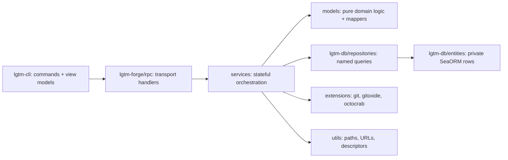

# LGTM Implementation Conventions

## Hard Rules

- Run builds, formatters, linters, and tests through project [Mise tasks](mise.toml) invoked by Premise (`premise run format`, `premise run lint`, `premise run test`, `premise run e2e:smoke`). Keep task scripts tracked and generated outputs ignored.
- During alpha, update branch-introduced contracts directly without compatibility shims or duplicate fields.
- Expose database queries and mutations only through named repository methods in [`libs/lgtm-db`](libs/lgtm-db/src/lib.rs). Keep SeaORM `Entity` and `ActiveModel` types `pub(crate)`; never expose raw connections, query builders, or raw SQL to callers.
- Models validate, map data, and implement pure domain behavior; services own persistence orchestration, transactions, and external I/O.
- Keep CLI review and comment commands as thin RPC clients over `lgtm-forge`. Preserve daemon and health behavior; do not embed review persistence in `lgtm-cli`.
- Establish tracing spans at CLI/RPC boundaries (`#[tracing::instrument]`). Services emit tracing events and never store request spans.
- Preserve pinned Neovim dependencies in the plugin setup, source-switch installer, and E2E harness (including NuiComponents/NUI and optional Kak).
- [Proposed] Preserve the Neovim development and release plugin installation tasks when resetting plugin features.
- Never create, recreate, rename, archive, or delete GitHub repositories in tests. Use `LGTM_E2E_GITHUB_REPOSITORY`, verify private visibility before writes, and clean up only run-owned PRs and refs.

## Organization

```text
├── apps/
│   ├── lgtm-forge/src/
│   │   ├── models/          # Pure domain entities, factories, validators, and proto From mappers
│   │   ├── services/        # Stateful orchestration (ReviewService) with constructor injection
│   │   ├── extensions/      # Stateless SDK/CLI adapters (git.rs, gitoxide.rs, octocrab.rs)
│   │   ├── forge/           # RemoteForge trait and provider wire contracts (forge/models.rs)
│   │   ├── rpc/             # Connect/gRPC transport handlers
│   │   ├── snapshots.rs     # LGTM-managed local Git snapshot store
│   │   ├── error.rs         # Application error enum
│   │   └── utils.rs         # Cross-cutting non-SDK helpers (LGTM_HOME, URLs, agent descriptors)
│   └── lgtm-cli/src/
│       ├── commands/        # One file per command group (local types, Args, run callback, helpers)
│       ├── models/          # CLI view models (From<Proto> + print) and shared args (common.rs)
│       ├── rpc_client.rs    # Connect RPC client factory over generated ReviewServiceClient
│       ├── daemon.rs        # Background daemon lifecycle
│       └── store.rs         # Local runtime state store
├── libs/
│   └── lgtm-db/src/
│       ├── entities/        # Private SeaORM table models and shared column enums (common.rs)
│       ├── repositories/    # Named repository queries and explicit column mutations
│       └── client.rs        # Database pool and Transaction handles
└── e2e/
    ├── common/              # Shared process, cassette, and GitHub PR fixtures
    ├── forge/               # Backend RPC E2E specs
    ├── cli/                 # CLI local-review, pr-review, parity, and daemon specs
    └── nvim/                # Neovim plugin shell and installer specs
```



- [Proposed] Name architecture documentation and E2E suite directories for `lgtm-forge` as `forge` (`docs/architecture/forge/` and `e2e/forge/`) rather than `backend`.
- [Proposed] Preserve existing documentation template headings and structure; use `NA/WIP` for unimplemented sections.

## Style

### Rust Layout & Naming

- Use one inherent `impl` block per type per file: constructors first, `// Public` operations next, `// Private` helpers last, and trait `impl` blocks after the inherent block. Pad section headers with hyphens to column 80.
- Name public repository and service reads `get_*`. Name mutating operations and factories with imperative verbs (`promote`, `publish_session`).
- Call library and generated client methods directly; do not add pass-through wrapper aliases.
- Use `uuid::Uuid` for internal IDs, `repository_url` (with `_url` suffix only for full URLs) for normalized remote addresses, and `git_dir` for canonical local `.git` directories.
- Humans require `email`; agents require `provider` and `model` and have no email. Model review contexts as `Local` or `ForgeBacked` and reject remote operations on `Local` contexts.

```rust
impl CommentAnchor {
    pub fn new(file_path: &str, start_line: Option<u32>, line: u32, commit_sha: &str) -> Result<Self> {
        // constructor before // Public
    }

    // Public ------------------------------------------------------------------

    pub fn validate_line(blob: Option<&str>, file_path: &str, start_line: Option<u32>, line: u32) -> Result<()> {
        // public operations
    }

    // Private -----------------------------------------------------------------

    fn validate_coordinates(file_path: &str, start_line: Option<u32>, line: u32) -> Result<String> {
        // private helpers
    }
}
```

### CLI View Models

- Transform backend RPC responses into CLI view models under `apps/lgtm-cli/src/models/` using `From` conversions and render terminal/JSON output via `print` methods. Name entity structs without a `View` suffix (`Identity`, `CommentAnchor`, `Comment`, `DiffHunk`, `Review`, `Session`) and name command-response wrappers `*CommandOutput` (`AddCommandOutput`, `ShowReviewCommandOutput`). Keep shared CLI argument types and formatting helpers in `apps/lgtm-cli/src/models/common.rs`.

### Documentation

- Use soft wraps for Markdown prose (one source line per paragraph). Keep diagrams as inline Mermaid fences and prefer file trees, tables, and short code snippets over long prose.

## Testing

### Rust BDD Unit & Integration Tests

- Colocate unit tests in `#[cfg(test)] mod tests` after a `// tests ---` separator padded to column 80; place shared unit fixtures in `src/tests/`.
- Put integration suites directly under `tests/<area>.rs` with shared fixtures in `tests/common/mod.rs` (never `tests/integration/` or `tests/support/`).
- Structure all Rust unit and integration tests with nested `mod given_*` and `mod when_*` modules and `fn should_<behavior>()` leaf cases:

```rust
// tests -----------------------------------------------------------------------

#[cfg(test)]
mod tests {
    use super::*;

    // fixtures ----------------------------------------------------------------

    fn sample_agent() -> Identity {
        Identity::new_agent(Uuid::new_v4(), "claude-sonnet-4-5", "anthropic", "claude-sonnet-4-5").unwrap()
    }

    // tests -------------------------------------------------------------------

    mod given_an_agent_identity {
        use super::*;

        mod when_formatting_export_body {
            use super::*;

            #[test]
            fn should_append_agent_disclosure_footer() {
                // Arrange
                let agent = sample_agent();
                // Act
                let body = format_body_with_disclosure("Check invariant", &agent);
                // Assert
                assert!(body.ends_with("> Generated by AI agent `anthropic/claude-sonnet-4-5` via LGTM"));
            }
        }
    }
}
```

### TypeScript Vitest E2E Tests

- Organize Vitest specs under `e2e/` using `describe('Given ... / When ...')` or `describe('When ...')` blocks and space-separated `it('should <behavior>')` titles (do not use `should_snake_case` in TypeScript).
- Separate `// Arrange`, `// Act`, and `// Assert` blocks with comments. Keep feature setup in adjacent `*.fixtures.ts` files and export only helpers used across modules.

```typescript
describe('Given a local working tree / When staging and committing in local snapshot mode', { tags: ['e2e', 'cli', 'local-review'] }, () => {
  const fixture = useTestHarness('cli')

  it('should stage and shadow commit worktree changes without modifying checkout', { tags: ['smoke'] }, async () => {
    // Arrange
    const { runtime } = fixture()
    await initLocalRepo(runtime)

    // Act
    const added = await runtime.json(['add', 'src/lib.rs', '--local'])

    // Assert
    expect(added).toEqual({ staged_paths: ['src/lib.rs'], local: true })
  })
})
```

- During development, run focused tests (`premise run e2e:smoke` or a single spec/test filter); reserve full E2E runs for final validation or shared fixture changes. See [`e2e/README.md`](e2e/README.md) for GitHub cassette replay and recording commands.
