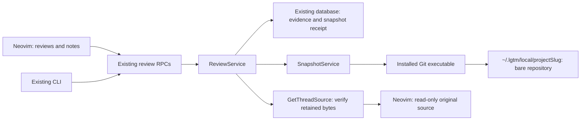

# PoC: backend-owned local snapshots

> Experimental branch only. Do not merge or release this branch.

## Purpose

Show the existing LGTM app and Neovim plugin preserving local review and note source content with the installed Git executable. The backend maintains bare repositories at `~/.lgtm/local/{projectSlug}` (`$LGTM_HOME/local/{projectSlug}` when configured). Success means using ordinary review/note commands, keeping the project's HEAD, refs, staging area and files unchanged, and opening the original content in Neovim after edits or restart. No new library package, alternate application, hosted service or Git server is introduced.

The branch was reset to the user-selected `origin/main` base before this implementation. The original standalone `lgtm-git` experiment was removed. This README replaces the normal application README for the PoC branch; existing user and development guides remain under `docs/`.

## Setup and tasks

Use the repository's Mise tools: Rust 1.94.0, Bun 1.4.2, and Neovim 0.12.5. Git 2.35.1 was used during development. `tempfile` is now a runtime dependency in the backend and the CLI that bundles its sources. Production snapshot storage defaults to `~/.lgtm/local`; automated editor tests isolate `LGTM_HOME` in temporary directories. SQLite needs no service. PostgreSQL validation uses `LGTM_TEST_POSTGRES_URL` when supplied, or starts a disposable local cluster through the installed PostgreSQL tools and Python 3. It uses a private Unix socket, does not touch an existing cluster, and shuts down after the run. Docker was unavailable; local PostgreSQL 17.11 validation succeeded.

| Task | Command | Purpose | Result |
| --- | --- | --- | --- |
| Build existing app | `premise run poc:build` | Bundle backend and compile the existing CLI | Passed |
| Check | `premise run poc:check` | Check backend and test targets | Passed |
| Service contracts | `premise run poc:test` | Snapshots, source validation, moves, notes promotion, and review/RPC contracts | 30 tests passed |
| PostgreSQL | `premise run poc:test:postgres` | Snapshot workflows on SQLite and PostgreSQL | All 3 cases passed against both databases |
| Run real editor journeys | `premise run poc:nvim` | Review and note snapshots through the existing app and plugin | Both new journeys passed; all 28 feature journeys also passed |
| Backend lint | `premise run poc:lint` | Clippy with warnings denied | Passed |
| Plugin contracts | `premise run //apps/lgtm.nvim:test` | Lua syntax and plugin contracts | Passed, including 24 shared placement cases |

List the PoC tasks with `mise tasks ls --all`.

### Try it in Neovim

Build with `premise run poc:build`. Use the development plugin from `apps/lgtm.nvim` and the newly built `target/debug/lgtm` executable. If your existing daemon runs an older binary, stop it with `target/debug/lgtm down` and start this one with `target/debug/lgtm up --foreground --no-open`. Plugin setup and identity configuration remain as documented in `apps/lgtm.nvim/README.md`. The existing `premise run nvim:install-dev-plugin` utility can point your Neovim installation at this checkout if desired.

1. Open a saved project file. Run `:Lgtm review` and choose working, staged, or branch. Creating a new review writes a snapshot under `refs/lgtm/reviews/{reviewId}`.
2. Add a review comment as usual, or use `:Lgtm note` on a saved file, including an ignored plan. The backend snapshots the validated bytes and stores a receipt with the thread. Service logs include the repository directory, retention ref, and commit identity under `Retained local source snapshot`. Existing comments do not receive retroactive snapshots.
3. Edit and save the file. Open the thread with Enter or `:Lgtm threads` / `:Lgtm notes`, select the discussion, and press `o` to open its original source. The buffer is read-only; press `q` to close it. Normal current-location mapping and orphan labels remain in effect.
4. Inspect `~/.lgtm/local/{projectSlug}` with `git -C <directory> show-ref` and `git -C <directory> show <commit>:<path>`. The slug is a readable project name plus a 12-character hash of its canonical common Git directory. Worktrees of one project share storage. Non-Git notes use their canonical parent directory as identity.

The CLI can read the same original through `lgtm comments source THREAD --path /absolute/project --identity ACTOR_ID`, or with `--notes /absolute/file` in place of `--path` for notes. Use the same identity options as existing comment commands. It returns JSON containing the snapshot receipt and original content.

## Code map

- `apps/lgtm-backend/src/extensions/git.rs`: Stateless adapter for the environment's Git executable.
- `apps/lgtm-backend/src/services/snapshot.rs`: Project storage identity, capture, retention, and historical reads on blocking workers.
- `apps/lgtm-backend/src/services/review.rs`: Capture when a local review starts, when an anchored local comment/note is accepted, and when evidence is promoted locally. Retry receipts return before capture.
- `apps/lgtm-backend/src/models/local_snapshot.rs`: Validated storage receipt. `AnchorEvidence` stores it in the existing evidence JSON; no new database table or migration is needed.
- Review Protobuf/RPC and CLI transport: Return snapshot receipts and scoped historical content through `GetThreadSource`.
- `apps/lgtm.nvim/lua/lgtm/snapshots.lua` and the existing thread window: Open historical content with `o` through RPC.
- `mise-tasks/poc-postgres`: Disposable PostgreSQL fixture for the PoC contracts.
- `apps/lgtm-backend/tests/local_snapshots.rs`: Database-backed checkout isolation, retry, ignored-note, restart, garbage collection, and squash preservation contracts.
- Existing `e2e/nvim/notes.spec.ts` and `local-review.spec.ts`: Real Neovim snapshot journeys, kept in their existing feature suites.

## Validation evidence

The required Neovim profile passed all 28 local-review and notes journeys with `premise run //e2e/nvim:test -- notes.spec.ts local-review.spec.ts`. The focused `poc:nvim` task also passed both new snapshot journeys, including the CLI historical-source command and editor reopening after app/editor restart. Backend contracts cover immutable retries, wrong-scope rejection, retained source after deletion and restart, garbage collection, squash history, and rejection of tracked directories replaced by symlinks. All commands ran through project Mise tasks invoked by Premise.

TypeScript type checking, Neovim ESLint, Lua contract/format checks, backend Clippy, and Rust formatting passed. Unrelated E2E suites and the optional Kakoune-style editor profile were not run. No real GitHub operations or private fixture credentials were used.

## Alternatives

A separate `lgtm-git` crate or `lgtm-forge` service is unnecessary here. Existing backend services orchestrate Git directly through a stateless adapter. Authenticated network hosting and replication can be investigated later without changing the snapshot capture boundary.

## Experiments

| Approach | Capture | How to run | Result |
| --- | --- | --- | --- |
| Existing local review | Full working, index, or branch-head tree on new review; retain source commit ancestry | `premise run poc:nvim` | Passed through the existing CLI-hosted backend and real Neovim |
| Existing note/comment | Overlay the exact validated file on its retained source commit, or a root tree outside Git; save immutable thread ref | `premise run poc:nvim` | Passed through the existing CLI-hosted backend and real Neovim |
| Squash retention | Preserve observed developer commits in the same LGTM store before a rewrite | `premise run poc:test` | Passed after squash, reflog expiry and Git garbage collection |

## Learnings and limits

- Git objects and refs belong to the backend-owned store. Temporary indexes and `commit-tree` leave the developer's branch and staging area alone. Saved working bytes and index blobs remain distinct; ignored notes require explicit selection.
- Review snapshots record the selected whole tree. Thread snapshots preserve the annotated file against its committed baseline; they do not claim to capture all other uncommitted files at comment time. Immutable refs retain both snapshots and observed developer commits. Pre-squash history must be observed before it becomes unavailable.
- The original anchor remains immutable. Snapshot availability enables historical reads but does not prove a unique mapping to rewritten current code. Existing orphaning and mapping behavior remains visible.
- No every-keystroke capture, unsaved-buffer capture, SSH/HTTP Git serving, remote snapshot synchronization, or retention expiry is implemented. SHA-256 repositories, submodules, non-UTF-8 paths, Windows behavior and large-repository performance remain outside this PoC.
- A full working capture is not an atomic filesystem snapshot. Comment capture instead stores the exact bytes already validated against the client's source hash and excerpt. Capture uses local Git subprocesses on blocking workers.
- Git writes finish before the corresponding database write commits. A database rollback can leave an unused retained Git ref; it cannot produce a successful comment pointing to an unfinished snapshot. Cleanup and recovery of those unused refs require later design.
- Project slugs use local canonical paths, so cross-machine identity is not solved. Move/reclone reconciliation and resource/size limits need follow-up work.

## Compare with main at branch creation

The immutable base is `07320b0805d1c2beb9db53ae93d688f8ddc368a7`, confirmed against `origin/main` at reset. Use `git diff <base_commit> HEAD` after committing; until then inspect `git diff <base_commit>` and the untracked source files reported by `git status`.

## Disposition

Use the integrated behavior to decide how snapshot-backed sources should affect the anchor model before production integration. Preserve the experiment as the annotated `refs/tags/poc/git-server` tag after committing and pushing the PoC branch; never merge it through the PoC workflow. Test commits and hard resets run only in disposable fixtures. Compare the frozen experiment with `git diff 07320b0805d1c2beb9db53ae93d688f8ddc368a7 refs/tags/poc/git-server`. To resume after freezing, create a working branch with `git switch -c poc/git-server-recovery refs/tags/poc/git-server` and rerun the tasks above.
