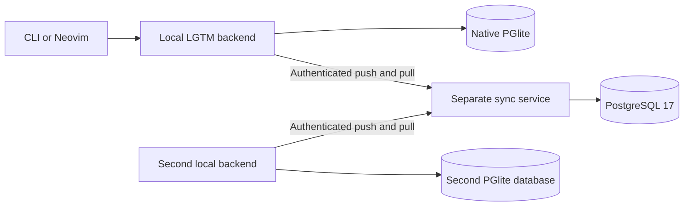

# PoC: PGlite and authenticated review sync

> Experimental branch only. Do not merge into production or publish as a release.

## Purpose

Can LGTM keep all review types in native embedded PostgreSQL and synchronize signed-in devices through a separate cloud service? The success criterion is two independent local backend processes using persistent `pglite-rs` databases, exchanging notes, working/staged/branch/directory reviews and forge-backed PR reviews through authenticated HTTP to a service backed by normal PostgreSQL.

Keep the design direct: sync complete context snapshots, persist uploads before sending them, deduplicate by operation UUID, and reject concurrent changes to the same context. This POC does not implement a generic merge engine, production login, team sharing, or PostgreSQL logical replication.

## Setup and tasks

Use the repository's Mise tool versions: Rust 1.94, Bun 1.4.2 and Node 26.10. Native PGlite is pinned to `pglite-rs` 0.2.7; the crate supplies platform-specific PostgreSQL artifacts during compilation. A local backend opens one engine with one SeaORM connection. The tested platform is macOS arm64; other targets require validation.

Run `premise run poc:install`, then `premise run poc:build`. Start persistent cloud PostgreSQL with `premise run poc:postgres`; start `premise run poc:cloud`, `premise run poc:device-a` and `premise run poc:device-b` in separate terminals. Without Docker, run `premise run poc-cloud-native` instead of the PostgreSQL and cloud tasks; it starts a persistent native PostgreSQL cluster and the same cloud service. Alternatively, `docker compose -f compose.poc.yaml up --build -d` runs both cloud components. The local backends stay on the host.

Device A listens on port 8081, device B on 8082, and the sync service on 8090. Both devices use the development token `poc-alice`. `poc-bob` identifies another isolated account. These are public test credentials, not a real sign-in system. The local services use the same review RPCs as before; point a CLI or editor client at its selected local endpoint. The CLI's bundled daemon remains unchanged; use the standalone backend for this experiment.

| Task | Command | Purpose | Observed result |
| --- | --- | --- | --- |
| Install | `premise run poc:install` | Install existing TypeScript dependencies | Passed |
| Build | `premise run poc:build` | Build local backend and cloud service | Passed on macOS arm64 |
| Test | `premise run poc:test` | SQLite/PostgreSQL persistence contracts and real PGlite process journeys | Passed: 4 contracts on SQLite and PostgreSQL; 8 sync journeys |
| Lint | `premise run poc:lint` | Clippy for affected Rust packages and targets | Passed |
| Format | `premise run poc:format` | Format affected Rust packages | Passed |
| Anonymous | `premise run poc:local` | Persistent offline backend on port 8083 | Passed: HTTP 200 |
| Device A | `premise run poc:device-a` | Signed-in PGlite backend on port 8081 | Passed: HTTP 200 |
| Device B | `premise run poc:device-b` | Second signed-in backend on port 8082 | Passed: HTTP 200 |
| PostgreSQL | `premise run poc:postgres` | Docker PostgreSQL with a named volume on port 55432 | Docker engine unavailable in initial validation |
| Cloud | `premise run poc:cloud` | Host sync service against Docker PostgreSQL | Docker target unavailable; passed with native PostgreSQL override |
| Remote test | `premise run poc-test-remote` | Disposable native PostgreSQL, two PGlite devices, real HTTP | Passed: all 8 journeys |
| Native cloud | `premise run poc-cloud-native` | Persistent native PostgreSQL and the cloud service | Passed: authenticated HTTP 200 |
| CLI compatibility | `premise run poc:cli-check` | Bundle current sources and check CLI with all features | Passed |
| TypeScript | `premise run e2e:typecheck` and `premise run poc:ts-lint` | Typecheck and lint process journeys | Passed |
| Existing smoke | `premise run e2e:backend:run -- notes.spec.ts local-review.spec.ts --tags-filter=smoke` | Existing notes and directory journeys on the PGlite default | Passed: 2 selected cases |

The remote test task uses installed PostgreSQL tools (`initdb`, `pg_ctl`) to create an isolated temporary cluster with only a private Unix socket, then removes that cluster. Alternatively, supply `LGTM_TEST_POSTGRES_URL` pointing at a disposable PostgreSQL database. No user database or system PostgreSQL service is changed. The Docker environment is for persistent interactive replay; do not remove its volume if you want to retain cloud reviews.

## Code map

- `libs/lgtm-db/src/connection.rs`: `pglite://` connection lifecycle, one connection, and an exclusive data-directory lock.
- `libs/lgtm-db/src/sync/snapshot.rs`: actual LGTM rows for one context, relationship validation and device-path removal.
- `libs/lgtm-db/src/sync/repository.rs`: snapshot import/export, durable pending uploads, accepted baselines and pull cursor. SQL stays behind named repository methods.
- `libs/lgtm-sync/src/lib.rs`: one push/pull cycle, with no transaction held across network calls.
- `apps/lgtm-backend/src/main.rs`: local PGlite default and an optional background sync worker.
- `apps/lgtm-sync-service/src/`: separate HTTP service, token-to-account mapping, private PostgreSQL entities and acceptance repository. It does not import the local backend or access local Git/files.
- `libs/lgtm-db/tests/sync_repository.rs`: transactional snapshot and retry contracts.
- `e2e/sync/`: independent notes, local-review and PR-review process journeys. PR reads use existing GitHub recordings; tests do not access live GitHub.
- `compose.poc.yaml`, `Dockerfile.poc`: persistent remote-service simulation.

## Alternatives

- Native `pglite-rs` keeps the engine in the Rust process and preserves SeaORM through a Unix socket. This is the implemented local storage approach.
- Electric's JavaScript/WASM distribution would require an additional host runtime or integration layer. It is not implemented here.
- Native logical replication can be evaluated later as a download transport. The implemented application protocol keeps credentials and account filtering in the cloud service and supplies an upload path for offline writes.

## Experiments

Local changes commit to PGlite without waiting for the cloud. Once both `LGTM_SYNC_URL` and `LGTM_SYNC_TOKEN` are set, the worker authenticates, binds the data directory to that account, scans contexts, persists a changed snapshot, uploads it, and pulls accepted changes every two seconds. If the network fails, local operations continue. Pending requests retain their UUID and payload across restart. Newer local changes remain dirty after an older upload is acknowledged.

The remote service serializes writes per account. Each accepted snapshot receives an increasing version; the client supplies the last version it knows. A stale write returns HTTP 409 and retains the local snapshot and pending upload. The POC deliberately stops that sync cycle on conflict; resolving it requires a later UI/protocol decision. No version is silently discarded.

All context types travel through the same contract. Snapshots contain identities, contexts, sessions, threads, comments and file-review marks. Workspace associations and mutation retry receipts stay local. Absolute notes and Git locations become `/lgtm-unbound/<context UUID>` on another device; original device bindings survive incoming updates. Downloaded reviews are readable without the original checkout. Rebinding downloaded local reviews to a different checkout or notes location is a follow-up.

The HTTP endpoints are `GET /v1/account`, `POST /v1/push` and `GET /v1/pull?cursor=<version>`. Use `Authorization: Bearer <development token>`. A push contains an operation UUID, expected cloud version and complete snapshot. A pull returns the latest changed snapshots through its cursor. The tests in `e2e/sync/` are minimal executable examples of the actual review RPCs and the sync protocol.

Remote snapshots belong exclusively to the authenticated account. One local data directory binds to its first sync account; another token cannot adopt its data. Remove the two sync environment variables to run locally without sync. Signing in in this POC uploads all reviews in that data directory, including drafts and selected-text evidence; there is no per-review selection UI.

## Learnings and limits

- The native engine starts and applies LGTM's existing PostgreSQL migrations through SeaORM; local review-domain code remains shared. Both-direction notes, offline restart, exact retry after a lost response, stale-write conflicts, account isolation, all local comparison kinds and recorded PR metadata passed the process journeys.
- `pglite-rs` permits only one native initialization per process, including after closing an engine. Separate device processes and process restarts are required.
- Whole-context snapshots are simple and preserve deletions, but concurrent edits to different comments in one context still conflict. Large histories are retransmitted; payloads are limited to 8 MiB.
- The cloud service stores snapshots with validated relationship links in PostgreSQL, rather than materializing the full review schema. It is a sync experiment, not a hosted review UI or complete cloud review API.
- Development bearer tokens simulate authenticated users. Real identity providers, TLS termination, team permissions, account migration and identity reconciliation across independently initialized devices remain unimplemented. Existing local identity metadata is still attribution, not authentication.
- The POC preserves forge IDs and posting states, but does not establish cross-device ownership of GitHub writes. Do not use this branch for live multi-device forge posting; the PR journey uses recorded reads only.
- Full-context deletion, engine-major-version upgrades, backup/restore, performance measurements and long-running replication guarantees remain unknown. Existing SQLite databases are not migrated automatically.

## Compare with main at branch creation

The immutable base is `07320b0805d1c2beb9db53ae93d688f8ddc368a7`. After committing, compare with `git diff 07320b0805d1c2beb9db53ae93d688f8ddc368a7 HEAD`; while this experiment is uncommitted, use `git diff 07320b0805d1c2beb9db53ae93d688f8ddc368a7` plus `git status --short` for newly added files.

## Disposition

The experiment passes its functional checks on macOS arm64 using native PostgreSQL 17. Docker image build and Compose startup remain unverified because the Docker engine was unavailable. Use the evidence to decide whether native embedded PostgreSQL and an application-level sync service are worth adopting. Freeze with `poc freeze` after review; do not merge this branch. No commit, push or tag is implied by implementation.
