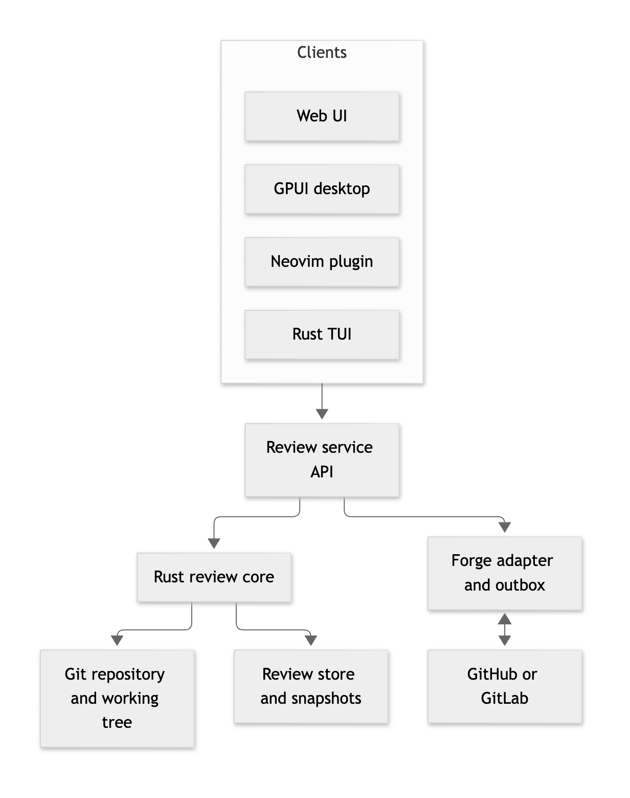
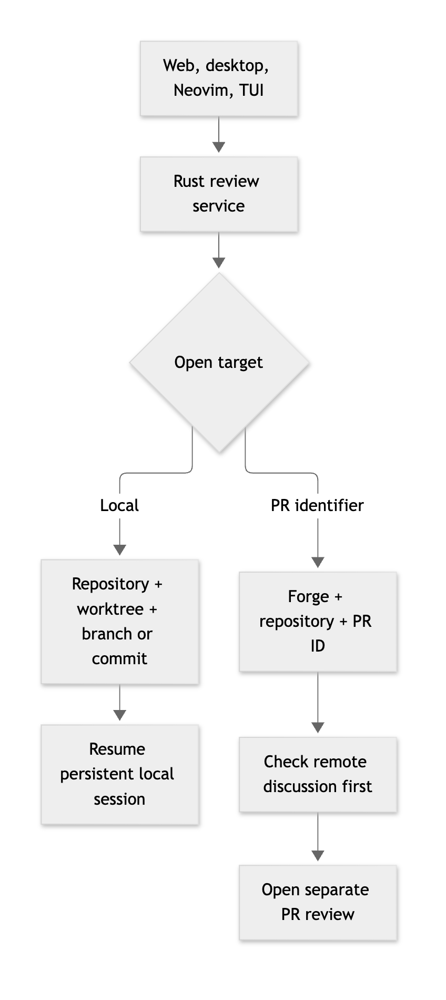
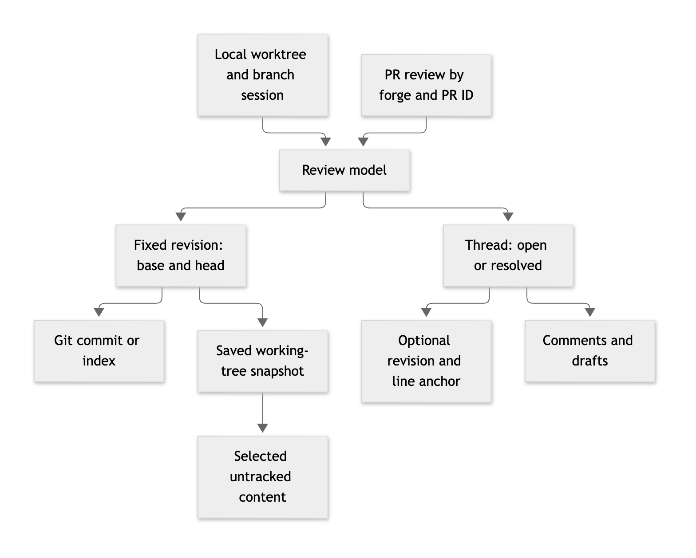
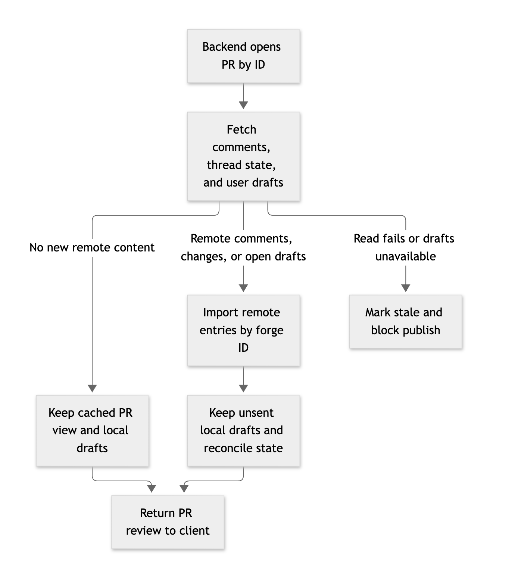

# Initial architecture: one Rust review service

- Status: proposed
- Deciders: [project maintainers]
- Date: 2026-10-07

## Context and Problem Statement

lgtm needs one review model for web, desktop, Neovim, and terminal clients. A review can include committed changes, staged changes, working-tree edits, and untracked files. Git does not store review threads or their resolved state. How can clients share reviews without requiring a forge or exposing private files?

## Decision Drivers

- Work offline and without a forge account.
- Keep Git source separate from review data.
- Never publish drafts or untracked files without a clear user action.
- Use the same review rules in every client.
- Allow a local service and an authenticated remote service.

## Considered Options

- One Rust core and service. This keeps client behavior consistent but adds service maintenance.
- Separate client logic. This avoids a service but causes review rules to drift.
- Forge-only reviews. This supports shared comments but not private local work.

## Decision Outcome

Propose a Rust core for Git inspection, snapshots, diffs, and review rules. A service exposes the core to web, Neovim, desktop, and TUI clients. A Rust desktop or TUI client can also use the same core without a service. [ADR-0002](0002-service-rpc-framework.md) proposes the service protocol.

[Mermaid source](diagrams/service-architecture.mmd)

The service runs on the user's machine or on a remote host. A remote service can read only repositories available to that host. The user must choose which local files to send to a remote service.

### Review data

A local session has a stable key for its repository, worktree, and branch. A detached worktree uses its commit instead of a branch. This session survives restarts without a forge. A pull request (PR) review uses a separate key: forge, repository, and explicit PR identifier. A matching branch never merges the two contexts.

[Mermaid source](diagrams/context-selection.mmd)

Both contexts share a review model. Each revision has a fixed base and head. Either side can use a Git commit, the index, or a saved working-tree snapshot. The snapshot stores selected untracked content by its hash. Opening a review does not stage those files.

A thread belongs to a review and has an open or resolved state. A thread can point to a file and line range in one revision, or to the review as a whole. Comments belong to threads. A comment can remain a local draft.

[Mermaid source](diagrams/review-model.mmd)

Keep an anchor tied to its original revision. If the source changes, show a suggested new location. Mark uncertain matches as outdated or ambiguous. Keep enough snapshot data to read old comments, or warn before removing it.

### Storage and forge sync

Store local sessions, PR review caches, threads, and snapshots in a local database. Git remains the source for committed code. Every frontend asks the backend to open a context. A local session opens from stored state without a forge request. For a PR, the backend first checks remote comments, thread changes, and the signed-in user's open drafts.

[Mermaid source](diagrams/pr-open-sync.mmd)

If nothing changed, return the cached PR view and local drafts. If remote work exists, import it by forge ID before returning the view. Keep unsent local drafts. If the read fails, mark the cache stale and block publication. Do not claim a complete view if the forge cannot expose user drafts. Check for new remote changes again before publication.

A forge adapter publishes only chosen local actions. An outbox keeps actions until they reach the forge. A pull never publishes a draft. Do not add a general sync engine yet. If lgtm later stores shared reviews on its own remote server, decide how clients merge offline edits in another ADR.

### Access

A local service needs a secret or other access control, even on loopback. It must limit browser origins and repository paths. A remote service needs user sign-in and repository access rules. Never serve an arbitrary host file path.

### Positive Consequences

- All clients use one review model.
- Local sessions work before a pull request exists.
- Forge support stays outside the core.

### Negative Consequences

- Snapshots, anchors, and forge conflicts need clear rules.
- A local service needs installation and process management.
- Embedded clients and service clients need the same behavior tests.

## Open Questions

- How long must saved snapshots remain available?
- How do branch renames and worktree moves affect session keys?
- Which forges expose the signed-in user's open drafts?
- What happens when local and forge users change the same thread?
- Do Rust clients launch the service or use the core directly?
- What remote sharing does the first release need?

## Links

- [ADR-0002: service RPC framework](0002-service-rpc-framework.md)
