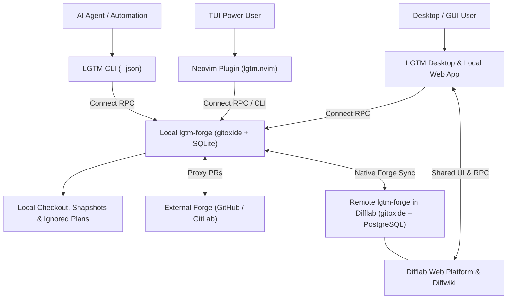

# Use a local desktop/web app and Neovim plugin for reviews

- **Status:** accepted
- **Deciders:** Siddharth Kapoor
- **Date:** 2026-10-31

## Context and Problem Statement

`lgtm` is intended to be a review tool which is meant to address the code review bottleneck which is being caused by agents pumping out code faster than people normally can. In addition to this, the code has some rough edges. For instance, while LLM code can be exhaustively guarded (some may even say over-engineered), it can suffer from readability and organization issues. For now we'll side step concerns of architectural correctness. The point is there's a lot more review to do, and the result is a lot of folks are giving up on review altogether.

`lgtm`'s solution to this is to make local code review easier (with or without PRs) as well as local plan reviews to make it quicker to iterate on and edit plans, which is a staple in a spec driven workflow. Asking for changes via chat can be exhausting, requires a tonne of typing and simply does not scale. Therefore lgtm will offer:

1. local code review
2. local forge synced PR reviews
3. Arbitrary file reviews which can be used for annotating plans, etc.

To be sure, there's a lot of existing tools, but all have specific niches. `tuicr`can handle local or forge synced reviews, but struggles with gitignored entities like plans and mandates working in a tui. `revdiff` is for local review only, `hunk` is for PRs only, `Atlas.nvim` is for PRs only, `review.nvim` is for local reviews only. So everything has an edge in one way or another, and nothing quite works for everyone's workflow on a team, which makes these tools individual centric rather than team centric.

## Decision Drivers

- We want local reviews, PR reviews, gitignored arbitrary file reviews.
- I want lgtm to be usable with difflab for in-platform reviews
- Support tui users
- Support non-tui users
- Support purely agentic local review to keep forge threads clean and focused on human exchanges

## Considered Options

### Desktop app

A local desktop application provides a dedicated window for reviewing local files and pull requests, and serves as the primary desktop client offered alongside `diffwiki` to interact with the `difflab` web platform.

| Pros | Cons |
| --- | --- |
| Dedicated native window without requiring a terminal editor | Requires per-OS desktop packaging and signing |
| Pairs with `diffwiki` as the main desktop entry point into `difflab` | Terminal users must leave their editor unless a Neovim plugin is also offered |
| Reuses the web UI and RPC contract shared with the `difflab` web platform | Adds desktop shell lifecycle alongside the CLI daemon |

### Terminal user interface

A standalone terminal user interface (TUI) runs inside a terminal emulator with custom panes and keybindings.

| Pros | Cons |
| --- | --- |
| Stays in the terminal without opening a browser | Non-TUI users must learn custom terminal keybindings |
| Fast keyboard navigation across files and threads | File trees, diffs, and long threads crowd limited terminal space |
| No browser process required | Rebuilds buffer, LSP, and navigation features Neovim already has |

### Local web app

A local web application uses the user's browser for the visual interface and a local background daemon for review operations.

| Pros | Cons |
| --- | --- |
| Familiar graphical UI for code diffs and markdown plans | Requires CLI daemon lifecycle management (`up` / `down`) |
| Ample layout space for file trees, diffs, and thread panes | Needs loopback access controls for local file reads |
| Directly reusable for in-platform Difflab reviews | Terminal users must switch to a browser without an editor client |

### Neovim plugin

A Neovim plugin integrates review actions, diff buffers, and comment threads directly inside the editor.

| Pros | Cons |
| --- | --- |
| Inspect code, edit files, and reply without leaving the editor | Requires Neovim; does not cover other terminal editors |
| Reuses native buffers, treesitter, LSP, and keymaps | Requires maintaining plugin compatibility and Lua UI surfaces |
| Complements the web app for terminal power users | Must maintain feature parity with the web interface |

## Decision Outcome

Chosen option: Build a local desktop and web app alongside a Neovim plugin and CLI, backed by `lgtm-forge`. `lgtm` will be the main desktop application offered alongside `diffwiki` for interacting with `difflab`, while `lgtm-forge` can also run remotely as the self-hosted or cloud forge engine inside the `difflab` web platform itself. The Neovim plugin serves TUI power users, the desktop and web app serve graphical users locally and in `difflab`, and the CLI serves agentic review workflows.

### Positive Consequences

- Desktop and browser users can review code and plans in a dedicated graphical app without learning a terminal editor.
- `lgtm` acts as the flagship desktop companion alongside `diffwiki`, while `lgtm-forge` and its web UI also run on the server to power `difflab` as a full remote forge.
- Neovim users can review files and reply to comments inside their editor.
- All clients (desktop, web, Neovim, CLI, and the `difflab` platform) share the exact same `lgtm-forge` RPC contract, review sessions, comments, and human/agent identities.
- The CLI gives agents direct access to review actions without operating a visual client.

### Negative Consequences

- The project must maintain the desktop/web UI and the Neovim plugin and keep their review features equivalent.
- Packaging the desktop app alongside the CLI daemon adds OS release artifacts.
- Users of terminal editors other than Neovim must use the desktop/web app or CLI. This choice does not provide a standalone TUI, avoiding a redundant `tuicr` clone.

## References

- [Original ADR 0001 revision (v1, 2026-10-13)](revisions/v1.md)
- [Core concepts PRD](../../prd/0001-core-concepts/README.md)
- [Web review design and snapshots](../../designs/prototypes/lgtm-v0/README.md)
- [Current architecture](../../docs/architecture/index.md)
- [tuicr](https://github.com/agavra/tuicr): Terminal code review with Vim-style controls.
- [Plannotator](https://github.com/backnotprop/plannotator): Visual review of agent plans and code changes.
- [revdiff](https://github.com/umputun/revdiff): Terminal review of diffs, files, and documents with annotations.
- [atlas.nvim](https://github.com/emrearmagan/atlas.nvim): Pull request review and issue management in Neovim.
- [review.nvim](https://github.com/georgeguimaraes/review.nvim): CodeDiff annotations with Markdown export for agent feedback.
- [hunk](https://github.com/smolcars/hunk): Desktop diff viewer and agent orchestration.

## Appendix

### Appendix A: Revision History

- **2026-10-13 ([v1](revisions/v1.md)):** Initial accepted decision choosing a local web app, Neovim plugin, and CLI access for agents.
- **2026-10-31 (v2):** Moved into `adr/0001-initial-architecture/ADR.md`, preserved v1 under `revisions/v1.md`, converted option evaluations to terse pros/cons tables, added diagrams for each option, and updated the decision outcome to include the `lgtm` local desktop app alongside `diffwiki` and the `difflab` web platform.
