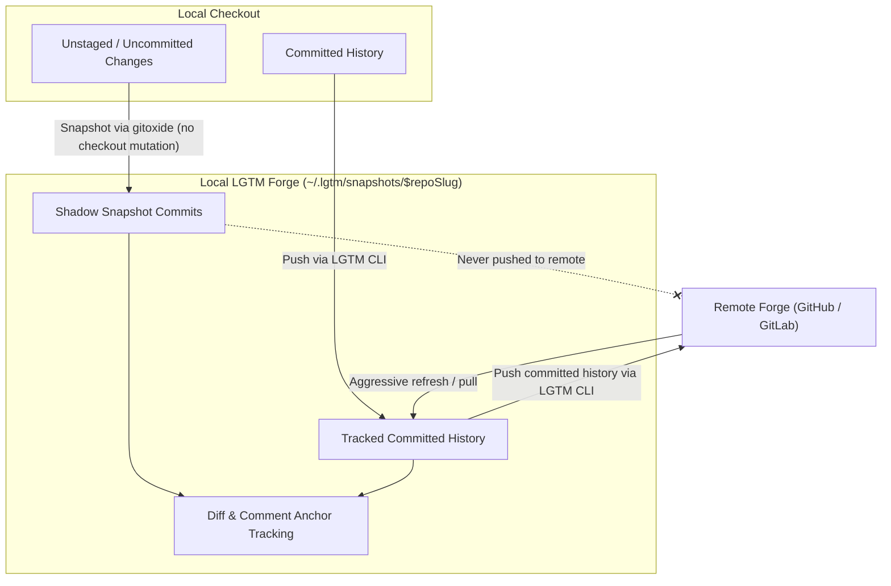
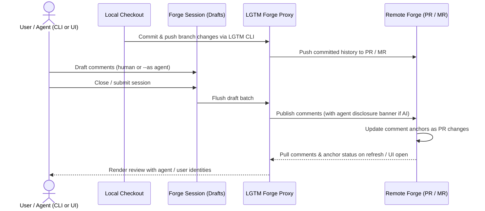
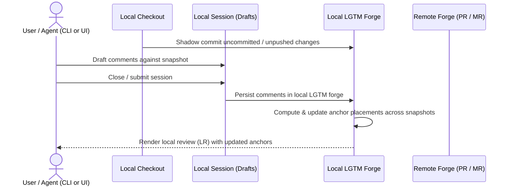

# Core Concepts & CLI Design

- **Status:** accepted
- **Deciders:** Sid
- **Date:** 2026-10-30

## Context and Problem Statement

Initial work on LGTM ran into a spate of issues. Agentic coding issues aside, the complexity did balloon a fair bit from trying to work on the Neovim plugin at the same time as the backend. The latter wasn't fully intended either, but certain additions were needed to be able to support anchor placements, tracking comment's being orphaned etc, which was all being done by manual line tracking and file comparisons, which started to feel like a forge implementation. Consequently we're pivoting to implementing a mini forge which will sit as a proxy between remote and git/vcs CLIs, imposing agent identities on remote forges which do not support them while also supporting local-only reviews with a local forge extrinsic to the local checkout.

We also found there was a lot of unnecessary complexity in the original design which made distinctions in the following flows: PRs, branch review (local commits vs remote), worktree reviews (local files vs remote) and staged review (next changeset for comitting). This blew up the test surface, introduce a lot of branching, made the code hard to reason about and made manual testing harder. Consequently we're simplifying to local vs forge based reviews, with the distinction between those being where comments are persisted and the possibility of including local LGTM forge based commits (which will never be made to local checkout or remote forges).

Finally, the need to create a whole neovim plugin for review creates a barrier to immediately testing the code, and also makes the plugin development harder since you're not sure whether cause of potential issues is the CLI/backend/local-forge or the plugin itself. So making the CLI itself more amenable to e2e testing is necessary. Besides making verification easier, the CLI can also give agents a surface to interact with local and remote reviews going through lgtm's forge.

## Decision Drivers

- LGTM CLI needs to make our workflows testable
- LGTM CLI needs to allow agents to conduct review without a UI
- LGTM as a product/app needs to be simple for consumers, and local vs forge reviews are easy to conceptualize
- Reducing the implementation complexity is also desirable, by delegating to existing tools as much as possible and reducing scope and complexity.

## Decision Outcome

### Simplifying implementation w/ a local LGTM forge



- A local "remote" will be created in `~/.lgtm/snapshots/$repoSlug`.
- Gitoxide will be used to snapshot local uncommited or unstaged changes for review.
- The snapshot will permit accurate decisions re: anchor placement, and can also provide more granular insights into updates user instructs the agents to make for RSI/etc.<D-s>

### Local vs. forge reviews workflow

- A "session" will be a transactional entity holding "Draft" comments, for both local/forge based reviews. Local and forge sessions will be distinct and never mix, nor will sessions mix across branches.
- A "review" will correspond to a remote forge PR/MR, and an LR (Local Review - not "Request") for the local forge since this will never "merge" anywhere. It's simply a snapshot for annotation purposes.
- Remote review will be as per normal. LGTM can stand in as a proxy between remote forge and local review experience superimposing local agent identities to support effective AI usage disclosures when comments are posted by assistants vs the user.
  - LGTM will track agent vs user identities and post footer banners on comments posted by agents in remote forges
  - A local UI based experience can show those comments as being from the agent / user visually for convenience
  - Comment anchor updates/status is handled by the remote forge, and pulled into LGTM on certain events (opening the review in UI for example)
  - Comments "stay" on a PR unless deleted.



- Local review will do a shadow commit to the local LGTM forge with any changes not on remote, and store any comments in local LGTM forge
  - The local forge git-based implementation can provide useful info which will help figure out anchor placement
  - Local forge can also conduct reviews based on commits on the actual local checkout
  - In the future we could allow agents to edit comment placement for a better experience as well.



The following are out of scope, but could easily be supported by this conceptual model:

- promote comments -> simply correlate the comment to file/line/side/commit combo on a commit that will be on remote
- immediate post/response during local reviews -> immediately posting comments and allowing agents to respond could create a faster/smoother collaborative agentic coding experience (but would rely on implementation being robust and correct and handling anchor placement well -> good reason for line number based placement to avoid movement).

### CLI design for ergonomics an testability

```text
lgtm [--json] add <paths>... [--local]
lgtm [--json] commit [--as <agent-name>] [--local] [-m <message>]
lgtm [--json] push [--local]
lgtm [--json] review list [--local] [--all]
lgtm [--json] review new [--local]
lgtm [--json] review refresh [<review-id-or-name>] [--local]
lgtm [--json] review show [<review-id-or-name>] [--local] [--group-by <file|session>] [--unresolved]
lgtm [--json] review close [<review-id-or-name>] --with <comment|reject|approve|request> [--body <text>]
lgtm [--json] comment new <body> [--review <review-id-or-name>] [--file <path>] [--line <line>] [--reply-to <comment-id>] [--local] [--as <agent-name>]
lgtm [--json] comment update <comment-id> [--body <text>] [--file <path>] [--line <line>] [--local] [--as <agent-name>]
lgtm [--json] comment delete <comment-id> [--local] [--as <agent-name>]
lgtm [--json] ui [--port <port>] [--no-open]
lgtm up [--port <port>] [--foreground] [--no-open]
lgtm down
lgtm [--json] status
```

- The same commands run local reviews and remote forge reviews. If you pass `--local`, LGTM writes only to `~/.lgtm/snapshots/$repoSlug` and does not change the working checkout or remote forge.
- Each review has a number ID and a name from the branch, with an optional `#N` suffix for a pull request or merge request.
- If you omit the review ID or name, LGTM selects the latest review for the current branch. `lgtm review list` also shows only the current branch by default.
- `lgtm review refresh` pulls comments and anchor updates from the remote forge, or recomputes comment anchors against the latest local snapshot when `--local` is passed.
- `lgtm review show` prints comments for a review with their diff hunks (changed line blocks). `--group-by <file|session>` groups output by file or in time order by session (with the top-level comment of each session), and `--unresolved` keeps only open threads.
- `lgtm comment new|update|delete` creates a comment, updates its text or anchor (`--file`, `--line`), or deletes it by ID.
- `--as <agent-name>` records an agent identity on a commit or comment without changing your Git or forge login.
- `--json` prints structured output on stdout and errors on stderr so tests and agents can run every command.

Example local and forge review workflows:

```sh
# Local review (snapshot in ~/.lgtm/snapshots/$repoSlug, checkout untouched)
lgtm add src/ plans/261030-cli/PLAN.md --local
lgtm commit --local -m "Snapshot current worktree and plan"
lgtm review new --local
lgtm comment new "Split this helper into two functions." --file src/services/review.rs --line 42 --local
lgtm comment update 101 --line 45 --body "Split this helper and return a domain error." --local
lgtm review close --local --with request --body "Address open comments."
lgtm review show --local --unresolved

# Remote forge review (PR #42 on current branch)
lgtm commit --as claude-sonnet-4-5 -m "Address review feedback"
lgtm push
lgtm review refresh feature/diff-241#42
lgtm review show feature/diff-241#42 --group-by session --unresolved
lgtm comment new "Fixed transaction boundary." --reply-to 101 --as claude-sonnet-4-5
lgtm comment delete 102 --as claude-sonnet-4-5
lgtm review close --with comment --body "Ready for another pass."
```

Example output for `lgtm review show` grouped by file (default):

```text
$ lgtm review show --local --group-by file
Review #1  feature/diff-241  [local]  open
Base: a1b2c3d -> Head: 9f8e7d6 (snapshot)

══ src/services/review.rs ═══════════════════════════════════════════════

── line 18 (@ 9f8e7d6) • resolved ───────────────────────────────────────
   17 │ pub async fn get_review(&self, id: u64) -> Result<Review> {
 + 18 │     self.repo.get_review(id).await
   19 │ }

  [100] sid • session #1 (published)
    Return a domain error when the review is missing.

── line 42 (@ 9f8e7d6) • unresolved ─────────────────────────────────────
   40 │ pub async fn close_review(&self, id: u64) -> Result<Review> {
   41 │     let review = self.repo.get_review(id).await?;
 + 42 │     self.flush_session_drafts(review.id).await?;
   43 │     Ok(review)
   44 │ }

  [101] sid • session #1 (published)
    Make sure that draft failure does not mark the review closed.

  [102] claude-sonnet-4-5 (agent) • session #2 (draft)
    Wrapped flush and status update in one transaction.
```

Example output grouped by session in time order with `--unresolved`:

```text
$ lgtm review show --local --group-by session --unresolved
Review #1  feature/diff-241  [local]  open (1 unresolved thread)
Base: a1b2c3d -> Head: 9f8e7d6 (snapshot)

══ Session #1 • sid • request • published 2026-10-30 01:40 ══════════════
  Address open comments before we wire the RPC handler.

── src/services/review.rs:42 (@ 9f8e7d6) • unresolved ───────────────────
   40 │ pub async fn close_review(&self, id: u64) -> Result<Review> {
   41 │     let review = self.repo.get_review(id).await?;
 + 42 │     self.flush_session_drafts(review.id).await?;
   43 │     Ok(review)
   44 │ }

  [101] sid
    Make sure that draft failure does not mark the review closed.

══ Session #2 • claude-sonnet-4-5 (agent) • comment • draft ═════════════
  Ready for another pass.

── src/services/review.rs:42 (@ 9f8e7d6) • unresolved ───────────────────
  [102] claude-sonnet-4-5 (agent) (reply to #101)
    Wrapped flush and status update in one transaction.
```

## References

- [Related decision, issue, or evidence.]

## Appendix

### Appendix A

Useful background information.

### Appendix B

More useful background information.
