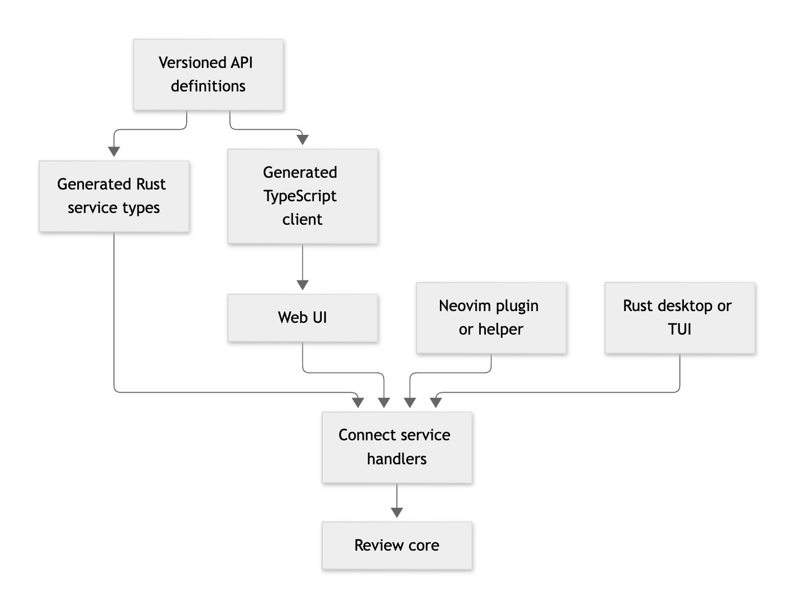

# Use Connect RPC for the review service

- Status: proposed
- Deciders: [project maintainers]
- Date: 2026-10-07

## Context and Problem Statement

[ADR-0001](0001-initial-architecture.md) proposes a Rust review service for local and remote clients. The web UI uses TypeScript. Desktop and TUI clients use Rust. A Neovim plugin needs a simple way to call the service. Which service framework gives these clients a shared API?

## Decision Drivers

- Share one API definition between Rust and TypeScript.
- Support browsers without a separate gRPC proxy.
- Let a Neovim plugin make basic calls without a Lua gRPC client.
- Protect both local and remote services.
- Keep the review core independent of the service framework.

## Considered Options

- Connect RPC gives Rust and TypeScript shared types but adds code generation.
- `jsonrpsee` supports WebSocket updates but needs separate TypeScript API types.
- Hand-written HTTP/JSON is simple but needs schema tools to prevent type drift.

## Decision Outcome

Propose Connect RPC for the Rust service. Keep the API in versioned Protocol Buffer files. Generate Rust service types and a TypeScript web client from those files. Rust desktop and TUI clients can call the service or use the review core directly. A Neovim plugin can use a small helper or Connect's HTTP/JSON form for basic calls.

[Mermaid source](diagrams/service-rpc.mmd)

Start with one-request, one-response calls for review reads and changes. Test live updates before choosing a stream, polling, or a separate event channel. Do not assume that browser clients support two-way streaming.

This choice remains proposed until a small test app proves four paths: Rust server calls, browser calls, Neovim calls, and live updates. The test must also cover sign-in, browser origins, and access to repositories. If Connect Rust proves too hard to maintain, reconsider `jsonrpsee` or plain HTTP/JSON without changing the review core.

### Positive Consequences

- One API definition drives Rust and TypeScript types.
- Browsers can call the service over HTTP.
- The review core does not depend on Connect.

### Negative Consequences

- API generation adds build work.
- Connect Rust is pre-1.0, so its API can change.
- Neovim can need a small helper, especially for live updates.

## Open Questions

- Will the browser use a live stream or poll for new review data?
- Can Neovim call the API directly, or does it need a helper?
- How will old clients work with newer service versions?

## Links

- [ADR-0001: initial architecture](0001-initial-architecture.md)
- [Connect Rust README and status](https://github.com/connectrpc/connect-rust)
- [Connect Rust user guide](https://github.com/connectrpc/connect-rust/blob/main/docs/guide.md)
- [Connect protocol reference](https://connectrpc.com/docs/protocol/)
- [Connect browser client guide](https://connectrpc.com/docs/web/getting-started/)
- [`jsonrpsee` documentation](https://docs.rs/jsonrpsee/latest/jsonrpsee/)
- [JSON-RPC 2.0 specification](https://www.jsonrpc.org/specification)
