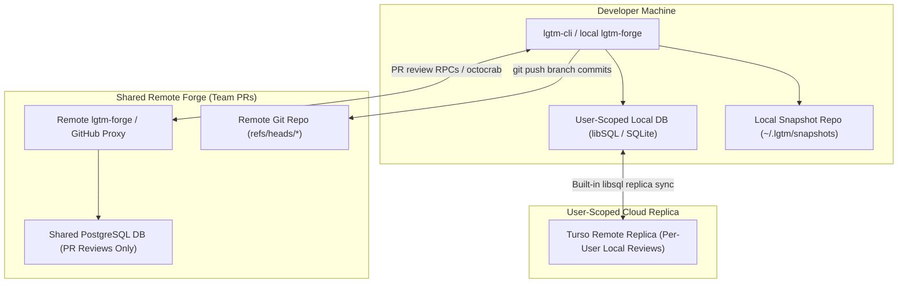
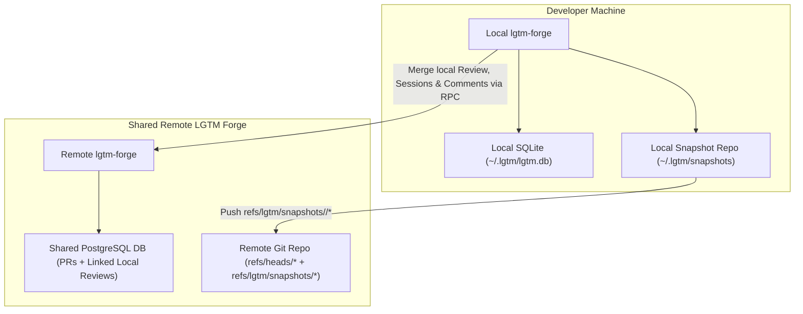
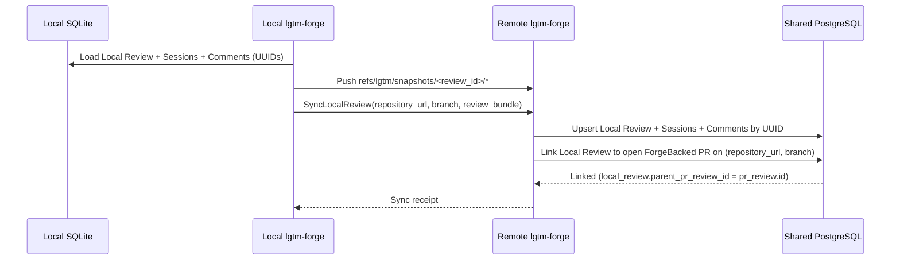
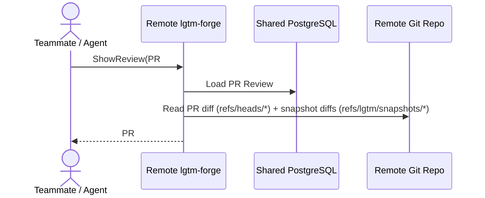
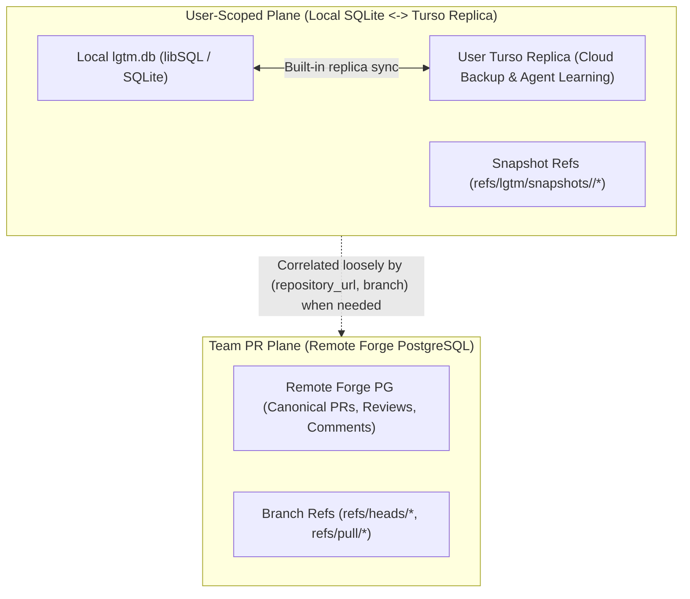
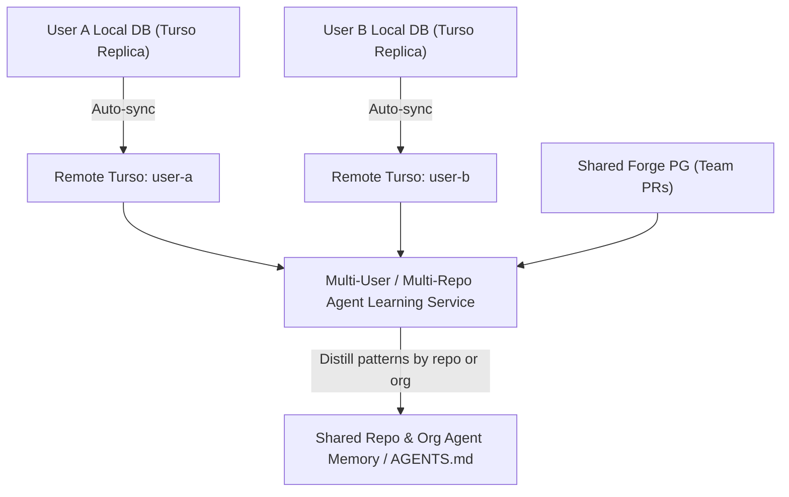
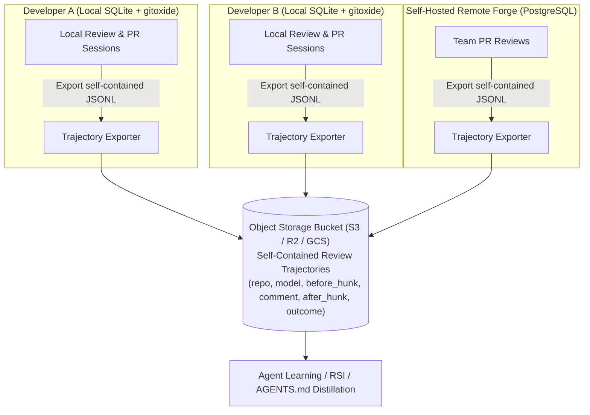

# Research: Local vs. Remote Forge Database and History Sync

- **Exploration:** Dropping the separate pre-review plane and comparing two architectures for syncing local reviews: (1) user-scoped Turso replica DB vs. (2) merging local SQLite reviews and snapshots into the shared remote PostgreSQL PR database
- **Researched:** 2026-10-30
- **Scope:** Present-day `lgtm-db` schema and Git ref design choices so we do not paint ourselves into a corner for future remote forge support and agent learning

## Existing approaches and prior art

`lgtm` is both the primary local desktop/CLI/Neovim review tool (offered alongside `diffwiki`) and the forge engine (`lgtm-forge`) that can run remotely inside the `difflab` web platform as a full self-hosted or cloud replacement for GitHub.

A separate collaborative "pre-review plane" on the remote forge is unnecessary: regular pull requests already cover multi-user branch review. The real architectural question is **how a developer's local `lgtm-forge` instance (`--local`) interacts with a remote `lgtm-forge` instance running in `difflab`**, and whether local review databases should merge into the remote forge's PR database or stay separate while feeding a shared agent learning store.

## Evidence

### Option 1: User-scoped local DB synced to Turso + separate remote PostgreSQL DB for PRs

In this model, local reviews are strictly personal to the developer (and their local agents).

- **Local & personal cloud storage:** Each user's `~/.lgtm/lgtm.db` is a user-scoped libSQL / Turso embedded replica. Syncing it (`db.sync().await`) backs up all of their local reviews, sessions, and comments to their personal Turso instance across machines with zero custom sync RPCs.
- **Shared remote forge storage:** The remote forge runs a separate PostgreSQL database that only stores shared `ForgeBacked` pull request reviews, PR sessions, and PR comments.

#### Why Option 1 is simple

- **No multi-tenant collisions on local data:** Local filesystem paths (`git_dir`), local review numbers (`#1`, `#2`), and local comment numbers (`101`, `102`) only ever live in one user's database.
- **Zero-effort sync:** Turso handles frame-level replication of the user's SQLite file automatically.

#### What Option 1 gives up

- **Disconnected PR context:** When a developer opens PR `#42`, teammates (and team agents) looking at PR `#42` in the shared PostgreSQL DB cannot see the local review sessions or shadow snapshots that led to that PR.
- **Split agent learning corpus:** Agent review trajectories live in each developer's separate Turso database rather than one queryable team database.

---

### Option 2: Merge local SQLite reviews and snapshots into the shared remote PostgreSQL DB alongside PRs

In this model, local reviews start in local SQLite (`~/.lgtm/lgtm.db`) and `~/.lgtm/snapshots/$repoSlug`, and merge into the shared remote PostgreSQL database and remote Git repository when pushed (`lgtm push`), linking local review sessions directly to the branch's PR.

#### What merging local reviews into the shared PG database looks like

##### 1. Pushing and linking a local review to a PR in the shared PG DB

##### 2. Viewing a PR with its linked local review sessions

#### Schema requirements if local SQLite merges into shared PostgreSQL

If we want Option 2 to work without a painful schema rewrite later, **four small adjustments to the `lgtm-db` schema** are required right now:

1. **Do not rely on `git_dir` as the sole key for `Local` reviews:** `git_dir` (`/Users/sid/work/repo/.git`) is a laptop-specific path. `reviews` should allow `repository_url` on `Local` reviews too (populated whenever a Git remote exists) plus `owner_id: Uuid` (`FK -> identities.id`), so a local review merged into PostgreSQL is identified by `(repository_url, owner_id, branch, number)` rather than a laptop path.
2. **Link local reviews to a PR review (`parent_review_id`):** Add an optional `parent_review_id: Option<Uuid>` (`FK -> reviews.id`) on `reviews`. When a developer opens or syncs PR `#42` on `feature/diff-241`, any `Local` reviews on `feature/diff-241` can set `parent_review_id = pr_review.id`, linking their local sessions and snapshot history directly under the PR!
3. **Scope `comments.number` per review instead of globally:** If two developers both create Comment `101` in their local SQLite databases and later merge those local reviews into the same PostgreSQL table, a global `UNIQUE (number)` constraint on `comments` will collide! Making `comments.number` unique per review (`UNIQUE (review_id, number)`)—or assigning a repo-scoped number on the server—eliminates cross-user collisions while keeping `uuid` as the primary key.
4. **Preserve `original_commit_sha` and `original_line` on `comments`:** As already added to `docs/architecture/db/index.md`, keeping both the initial snapshot anchor and the updated anchor lets the shared PG database reconstruct every `(Snapshot A -> Comment -> Snapshot B)` agent learning pair.

## Library and tool landscape

| Dimension | Option 1: User-Scoped Turso + Separate Team PG | Option 2: Local SQLite Merged into Shared Team PG |
| --- | --- | --- |
| **Local DB library** | `libsql` (Turso embedded replica) | SeaORM (`sqlx-sqlite` locally, `sqlx-postgres` remotely) |
| **Remote DB** | Turso (per-user local reviews) + PG (team PRs) | Single PostgreSQL database for both PRs and synced local reviews |
| **Local sessions visible on PRs** | No (lives in separate user-scoped Turso DB) | Yes (`reviews.parent_review_id` links local reviews to the PR) |
| **Team-wide agent learning** | Requires querying across every user's Turso replica | Single SQL query on the shared PostgreSQL database |
| **Offline local-only repos** | Works (syncs to user's Turso) | Works (stays in local SQLite until a remote LGTM forge is configured) |

## Trade-offs

### Do the local review DB and remote PR DB actually need to merge at all?

When we ask what merging local SQLite rows into the shared PostgreSQL PR database actually buys us, the answer is: **almost nothing that cannot be achieved more cleanly by keeping them separate.**

1. **Human PR reviewers do not want inner-loop noise:** When a developer opens a PR after 10 rounds of local back-and-forth with an agent, teammates reviewing the PR want to review the clean branch commits (`refs/heads/*`), not wade through abandoned intermediate worktree snapshots.
2. **Loose coupling by `(repository_url, branch)` is enough:** If a user or agent ever wants to see the local review sessions that led up to a PR on `feature/diff-241`, both databases already share `(repository_url, branch)`. The CLI or UI can query the user's local/Turso DB for `Local` reviews on `feature/diff-241` alongside the PR without merging the two databases.
3. **Agent learning does not require one physical database:** An agent learning job (`/learn` or RSI) primarily helps the developer and their own agents on their repo, which can read directly from the local SQLite / Turso replica. Even for team-wide rule distillation, an offline job can read synced Turso replicas or exported learning pairs without polluting the transactional PR database.
4. **Keeping the DBs separate eliminates every multi-tenant collision:**
   - Local review numbers (`#1`, `#2`) and comment numbers (`101`, `102`) never collide across teammates.
   - Machine-local paths (`git_dir`) never enter the shared remote PostgreSQL database.
   - Syncing a user's local reviews across machines or to cloud agents becomes a zero-code Turso replica sync (`libsql`) rather than a custom multi-table merge protocol.

### Multi-user, multi-repository agent learning

If the goal is for agents to learn patterns across **multiple users** interacting with **one or more repositories** (both local agent iterations and remote PR reviews), we have two clean ways to support that without mixing noisy local drafts into the human PR UI:

#### Path A: Per-user Turso replicas + Learning aggregator (Keep operational DBs separate)

Turso (`sqld` / Turso Cloud) is built for database-per-user tenancy. Each developer's `~/.lgtm/lgtm.db` replicates to their user-scoped Turso database (`user-<id>.turso`), and their snapshot commits push to `refs/lgtm/snapshots/<user-id>/*` on the remote Git server. When the learning service runs across one or more repositories, it fans out (or attaches the user replicas in SQLite/libSQL) and queries resolved `(original_commit_sha, comment, commit_sha)` threads filtered by `repository_url`.

#### Path B: Single shared PostgreSQL DB with `(repository_url, owner_id)` scoping

If you prefer querying a **single PostgreSQL database** across all users and repositories with standard SQL `JOIN`s (instead of fanning out across per-user Turso databases), the operational database merge only requires two small scoping rules in `lgtm-db` today:

1. **Populate `repository_url` and `owner_id` on `Local` reviews too:** Whenever a local checkout has a Git remote (`origin`), store its normalized `repository_url` alongside `git_dir` and `owner_id` (`FK -> identities.id`).
2. **Scope `number` per `(repository_url, owner_id)` for local reviews and per `review_id` for comments:** Because primary keys and foreign keys are already `uuid::Uuid`, scoping human-visible numbers prevents any collision when User A and User B both sync their local SQLite rows into the shared PostgreSQL database.

#### Path C: Self-contained trajectory files in object storage (No DB sync needed for learning)

An operational database (`reviews`, `sessions`, `comments`) only stores *pointers* to Git commits (`original_commit_sha`, `commit_sha`, `file_path`, `line`); it does not store the code diff itself. Even if you merged every user's SQLite or Turso DB into one server database, an agent learning pipeline still could not read the code changes without also fetching Git objects from every user's local snapshot repo!

Instead, when a review session closes or a comment thread resolves (in either a `Local` review or a `ForgeBacked` PR review), `lgtm-forge` already has the exact unified diff hunks and comment thread in memory. Writing a **self-contained trajectory file** (JSONL or Parquet) to local disk (`~/.lgtm/trajectories/`) and uploading it to an object storage bucket (S3, R2, or GCS) decouples agent learning from the operational database completely:

#### Path D: Git-native `NoteDb` (`refs/lgtm/reviews/*` inside Git, SQL as a read index)

Inspired by Gerrit's `NoteDb`, `git-bug`, and Radicle, all review sessions, comments, and learning metadata can be written as structured JSON blobs committed to a custom Git ref (`refs/lgtm/reviews/<review-id>`) in `~/.lgtm/snapshots/$repoSlug` right alongside the shadow snapshot commits (`refs/lgtm/snapshots/<review-id>`).

- **How it works:** Local SQLite and remote PostgreSQL are still used for fast queries and indexing, but the canonical archive of a review is a Git ref.
- **Why it is interesting:** Code snapshots and review comments travel together in a single `git push` packfile (`refs/lgtm/*`), require zero external bucket credentials, and automatically respect repository access controls on a self-hosted remote forge.

#### Path E: Append-only event log (Event Sourcing) + DuckDB over Parquet

Instead of only syncing mutable table rows, each review mutation (`CommentCreated`, `CommentUpdated`, `AnchorShifted`, `ThreadResolved`, `SessionPublished`) appends an immutable event with the surrounding diff hunk.

- **How it works:** Operational tables (`reviews`, `sessions`, `comments` in SQLite/PostgreSQL) store the latest state for low-latency CLI/UI reads, while the event log flushes to Parquet files in object storage (or local disk).
- **Why it is interesting:** Any agent or developer can run analytical SQL across all users and repositories directly against the Parquet files in the bucket using embedded DuckDB without running a dedicated analytics database server.

### Complete comparison of options

| Option | Operational Storage | Cross-User / Learning Sync | Pros | Cons |
| --- | --- | --- | --- | --- |
| **1. Per-user Turso replicas** | `libsql` locally + Turso Cloud | Fan-out queries across user replicas | Built-in file replication | Weak SeaORM support; no Git blobs in DB; cross-user queries require fan-out |
| **2. Merge SQLite into shared PG** | `sqlx-sqlite` locally + `sqlx-postgres` remotely | RPC upserts into shared PG tables | Single SQL DB for PRs and local reviews | Requires syncing Git snapshots separately; cross-user numbering/scoping rules |
| **3. Separate SQLite/PG + Bucket export** | `sqlx-sqlite` locally + `sqlx-postgres` remotely | Self-contained JSONL/Parquet files in S3/GCS (queried via DuckDB) | Zero DB merge; diffs & comments bundled together; first-party SeaORM support | Requires object storage bucket for team-wide sharing |
| **4. Git-native `NoteDb` (`refs/lgtm/*`)** | SQLite/PG as index + Git refs as source of truth | `git push refs/lgtm/*` to remote forge | Code snapshots and comments sync in one Git push; no bucket needed | Bloats remote Git repo if never pruned; still needs SQL index for fast cross-repo queries |
| **5. Event log + Bucket / PG** | SQLite/PG for current state + append-only event stream | Event stream flushed to bucket or remote forge | Captures every intermediate edit and anchor shift in full chronological order | Slightly more schema/event types to maintain |

### Why `sqlx-sqlite` locally + `sqlx-postgres` remotely + Bucket export (or `refs/lgtm/*`) is the cleanest stack

1. **SeaORM + `sqlx-sqlite` vs. Turso locally:** SeaORM does not have an official first-party `libsql` or `turso` driver (only unofficial community wrappers), whereas `sqlx-sqlite` and `sqlx-postgres` are first-party in `sea-orm` and `sea-orm-migration`. Using Turso locally only helps if you use Turso's remote replica sync; if the remote forge runs PostgreSQL, `sqlx-sqlite` locally + `sqlx-postgres` remotely lets `lgtm-db` run the exact same SeaORM entities, repositories, and migrations in both environments.
2. **No operational DB or Git snapshot merge required:** Local SQLite stays strictly single-user on the developer's machine, and remote PostgreSQL stores only shared team PRs. Neither database ever has to merge with the other, and we never have to merge multiple users' Turso databases.
3. **Self-contained learning data from both local reviews and PRs:** Because each exported JSONL file in the bucket embeds the `before_diff` hunk, the critique comment, the `after_diff` hunk, the repository, and the agent model, RSI pipelines can train or distill rules across all users and repositories directly from the bucket without querying SQLite, Turso, PostgreSQL, or Git.

- **Option 1: Keep User-Scoped Local DB (SQLite / Turso) Separate from Team PR DB (Recommended)**
  - **Good:** Zero numbering or `git_dir` collisions; no custom DB merge RPCs; built-in cloud backup and agent access via Turso embedded replicas; keeps the future remote forge PostgreSQL schema strictly focused on shared PRs.
  - **Bad:** Requires switching local `lgtm-db` to `libsql` (or keeping SQLite locally and adding Turso replica sync when needed) if we want automatic cloud replication of local reviews.
- **Option 2: Merge Local SQLite Reviews into Shared PostgreSQL PR DB**
  - **Good:** Single physical database on the server for both PRs and past local reviews.
  - **Bad:** High accidental complexity (cross-user number collisions, laptop `git_dir` paths in server tables, custom sync/merge RPCs) for a feature—showing raw inner-loop agent drafts inside teammate PRs—that users rarely want.

## Unknowns

- Should `lgtm push` automatically merge closed `Local` reviews for that branch into the remote forge when the remote is an LGTM forge, or only when `--include-local-reviews` / `lgtm push --local` is passed?
- When local review sessions are linked to a PR (`parent_review_id`), should `lgtm review show <pr>` hide local sessions by default and show them under a flag (`--include-local`), so human PR reviewers only see them when they want the pre-PR agent context?

## Sources fetched

- [ADR 0002: Core Concepts & CLI Design](../0002-cli-design/ADR.md) — local workspace — 2026-10-30
- [Database Architecture](../../docs/architecture/db/index.md) — local workspace — 2026-10-30
- [Forge Architecture](../../docs/architecture/forge/index.md) — local workspace — 2026-10-30
