# LGTM Logo & Brand System

Browse by category or view all numbered inline previews (`#1`–`#16`) below:

- [Stacked Diff Marks (`#1`–`#6`)](stacked.md)
- [App Tile Icons (`#7`–`#12`)](app-tiles.md)
- [Split Diff Brand Lockups (`#13`–`#16`)](brand-split.md)
- [Interactive HTML Sheet](index.html)

| # | Asset | Category | Case | Rail Style |
| --- | --- | --- | --- | --- |
| **#1** | `diff-stacked-upper` | Stacked Diff | Uppercase | Two-Tone Light |
| **#2** | `diff-stacked-lower` | Stacked Diff | Lowercase | Two-Tone Light |
| **#3** | `diff-stacked-solid-upper` | Stacked Diff | Uppercase | Solid Deep |
| **#4** | `diff-stacked-solid-lower` | Stacked Diff | Lowercase | Solid Deep |
| **#5** | `diff-stacked-dark-upper` | Stacked Diff | Uppercase | Two-Tone Dark |
| **#6** | `diff-stacked-dark-lower` | Stacked Diff | Lowercase | Two-Tone Dark |
| **#7** | `app-tile-upper` | App Tile | Uppercase | Two-Tone Light |
| **#8** | `app-tile-lower` | App Tile | Lowercase | Two-Tone Light |
| **#9** | `app-tile-solid-upper` | App Tile | Uppercase | Solid Deep |
| **#10** | `app-tile-solid-lower` | App Tile | Lowercase | Solid Deep |
| **#11** | `app-tile-dark-upper` | App Tile | Uppercase | Two-Tone Dark |
| **#12** | `app-tile-dark-lower` | App Tile | Lowercase | Two-Tone Dark |
| **#13** | `brand-split-upper` | Split Brand | Uppercase | Two-Tone Light |
| **#14** | `brand-split-lower` | Split Brand | Lowercase | Two-Tone Light |
| **#15** | `brand-split-solid-upper` | Split Brand | Uppercase | Solid Deep |
| **#16** | `brand-split-solid-lower` | Split Brand | Lowercase | Solid Deep |

---

## Stacked Diff Marks (`#1`–`#6`)

### #1 · Stacked Diff · Two-Tone Rail · Uppercase · Light (`+LG` / `-TM`)

SVG: [diff-stacked-upper.svg](diff-stacked-upper.svg) · PNG: [snapshots/diff-stacked-upper.png](snapshots/diff-stacked-upper.png)

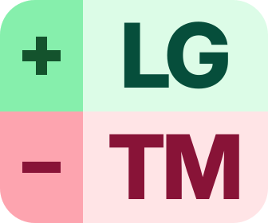

### #2 · Stacked Diff · Two-Tone Rail · Lowercase · Light (`+lg` / `-tm`)

SVG: [diff-stacked-lower.svg](diff-stacked-lower.svg) · PNG: [snapshots/diff-stacked-lower.png](snapshots/diff-stacked-lower.png)

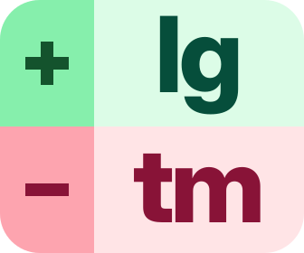

### #3 · Stacked Diff · Solid Deep Rail · Uppercase · Light (`+LG` / `-TM`)

SVG: [diff-stacked-solid-upper.svg](diff-stacked-solid-upper.svg) · PNG: [snapshots/diff-stacked-solid-upper.png](snapshots/diff-stacked-solid-upper.png)

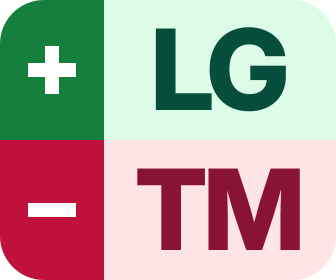

### #4 · Stacked Diff · Solid Deep Rail · Lowercase · Light (`+lg` / `-tm`)

SVG: [diff-stacked-solid-lower.svg](diff-stacked-solid-lower.svg) · PNG: [snapshots/diff-stacked-solid-lower.png](snapshots/diff-stacked-solid-lower.png)

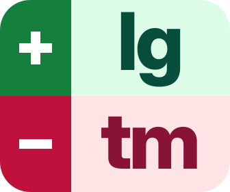

### #5 · Stacked Diff · Two-Tone Rail · Uppercase · Dark (`+LG` / `-TM`)

SVG: [diff-stacked-dark-upper.svg](diff-stacked-dark-upper.svg) · PNG: [snapshots/diff-stacked-dark-upper.png](snapshots/diff-stacked-dark-upper.png)

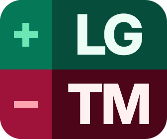

### #6 · Stacked Diff · Two-Tone Rail · Lowercase · Dark (`+lg` / `-tm`)

SVG: [diff-stacked-dark-lower.svg](diff-stacked-dark-lower.svg) · PNG: [snapshots/diff-stacked-dark-lower.png](snapshots/diff-stacked-dark-lower.png)

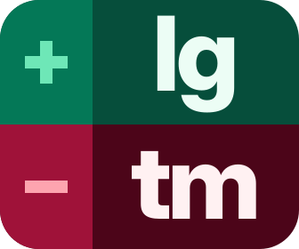

---

## App Tile Icons (`#7`–`#12`)

### #7 · App Tile · Two-Tone Rail · Uppercase · Light (`+LG` / `-TM`)

SVG: [app-tile-upper.svg](app-tile-upper.svg) · PNG: [snapshots/app-tile-upper.png](snapshots/app-tile-upper.png)

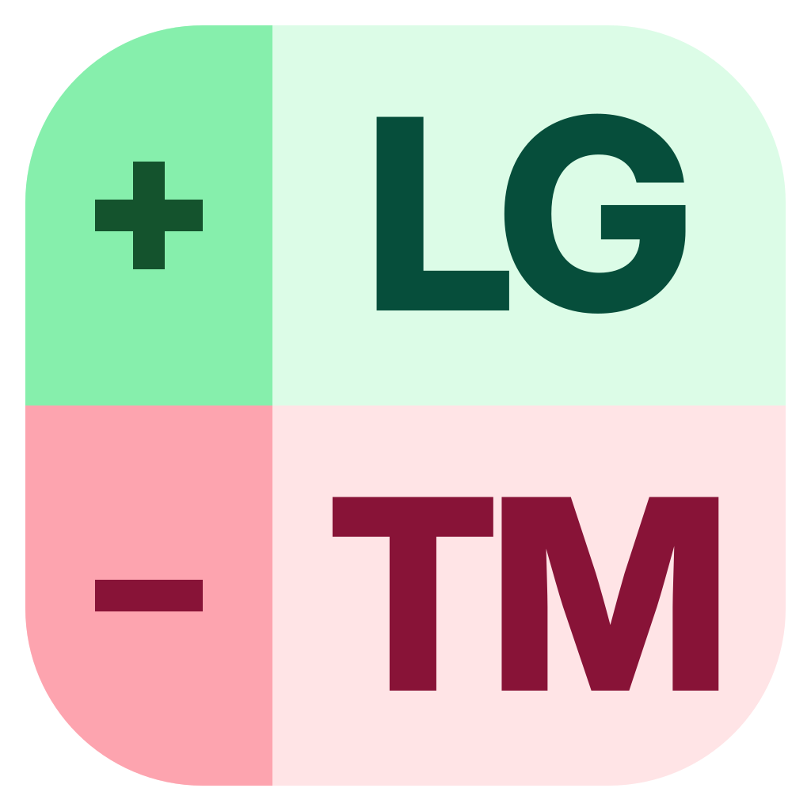

### #8 · App Tile · Two-Tone Rail · Lowercase · Light (`+lg` / `-tm`)

SVG: [app-tile-lower.svg](app-tile-lower.svg) · PNG: [snapshots/app-tile-lower.png](snapshots/app-tile-lower.png)

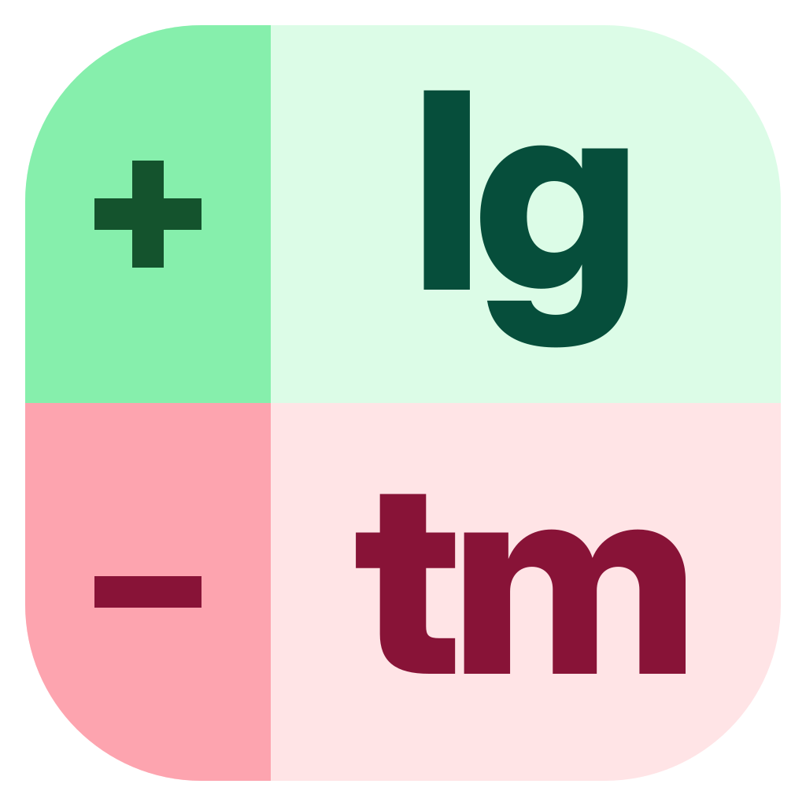

### #9 · App Tile · Solid Deep Rail · Uppercase · Light (`+LG` / `-TM`)

SVG: [app-tile-solid-upper.svg](app-tile-solid-upper.svg) · PNG: [snapshots/app-tile-solid-upper.png](snapshots/app-tile-solid-upper.png)

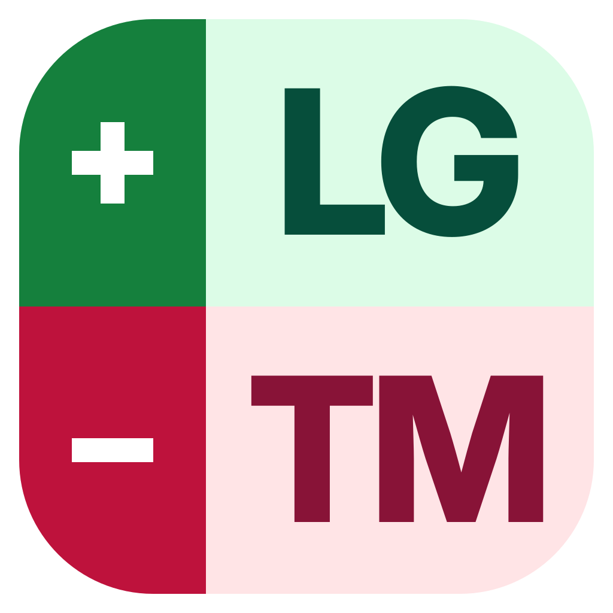

### #10 · App Tile · Solid Deep Rail · Lowercase · Light (`+lg` / `-tm`)

SVG: [app-tile-solid-lower.svg](app-tile-solid-lower.svg) · PNG: [snapshots/app-tile-solid-lower.png](snapshots/app-tile-solid-lower.png)

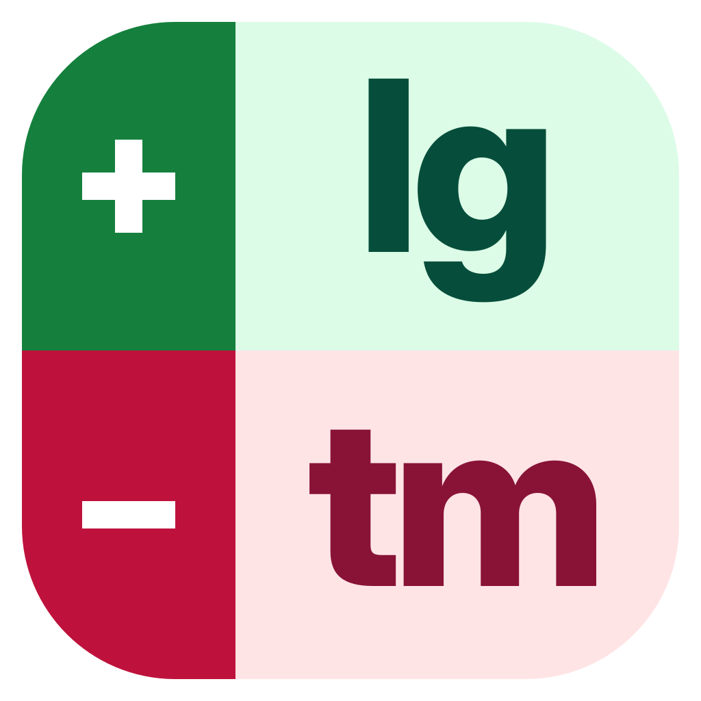

### #11 · App Tile · Two-Tone Rail · Uppercase · Dark (`+LG` / `-TM`)

SVG: [app-tile-dark-upper.svg](app-tile-dark-upper.svg) · PNG: [snapshots/app-tile-dark-upper.png](snapshots/app-tile-dark-upper.png)

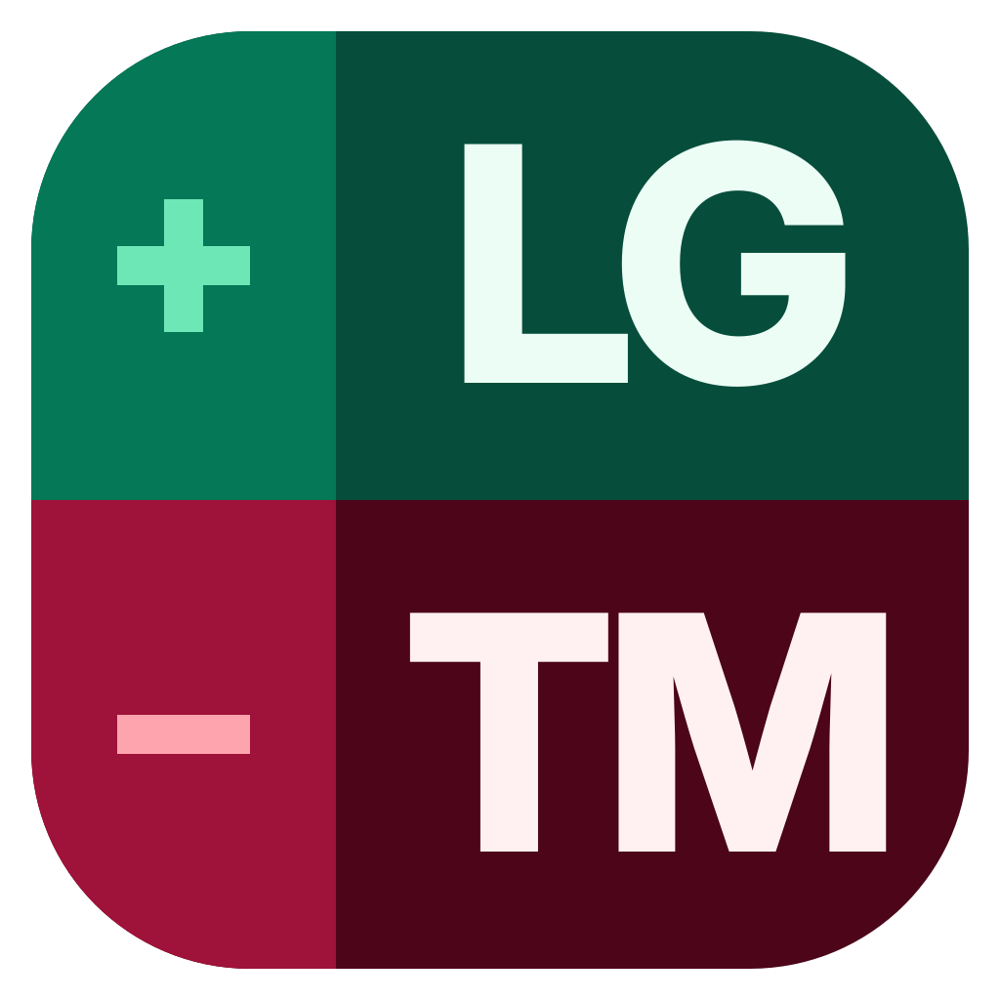

### #12 · App Tile · Two-Tone Rail · Lowercase · Dark (`+lg` / `-tm`)

SVG: [app-tile-dark-lower.svg](app-tile-dark-lower.svg) · PNG: [snapshots/app-tile-dark-lower.png](snapshots/app-tile-dark-lower.png)

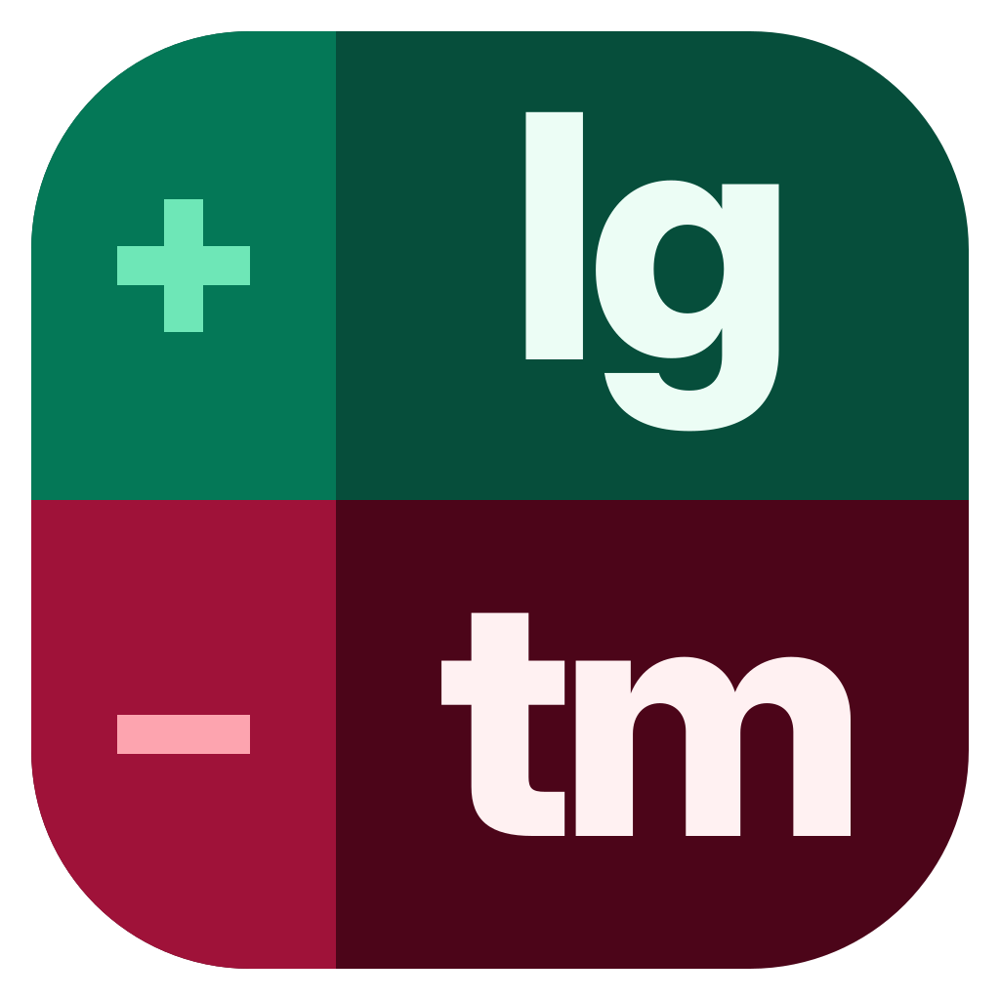

---

## Split Diff Brand Lockups (`#13`–`#16`)

### #13 · Split Brand · Two-Tone Rail · Uppercase · Light (`+LG|TM-`)

SVG: [brand-split-upper.svg](brand-split-upper.svg) · PNG: [snapshots/brand-split-upper.png](snapshots/brand-split-upper.png)

### #14 · Split Brand · Two-Tone Rail · Lowercase · Light (`+lg|tm-`)

SVG: [brand-split-lower.svg](brand-split-lower.svg) · PNG: [snapshots/brand-split-lower.png](snapshots/brand-split-lower.png)

### #15 · Split Brand · Solid Deep Rail · Uppercase · Light (`+LG|TM-`)

SVG: [brand-split-solid-upper.svg](brand-split-solid-upper.svg) · PNG: [snapshots/brand-split-solid-upper.png](snapshots/brand-split-solid-upper.png)

### #16 · Split Brand · Solid Deep Rail · Lowercase · Light (`+lg|tm-`)

SVG: [brand-split-solid-lower.svg](brand-split-solid-lower.svg) · PNG: [snapshots/brand-split-solid-lower.png](snapshots/brand-split-solid-lower.png)

