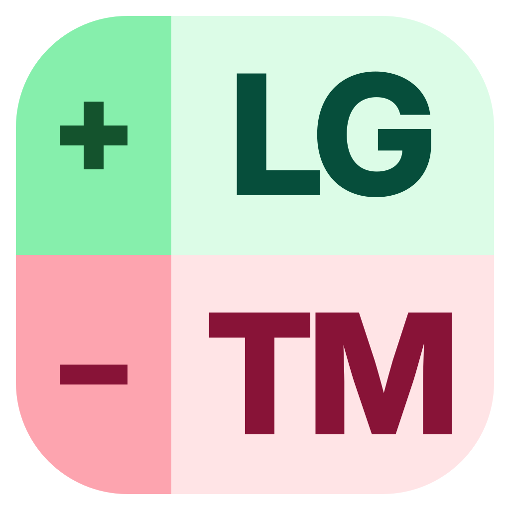
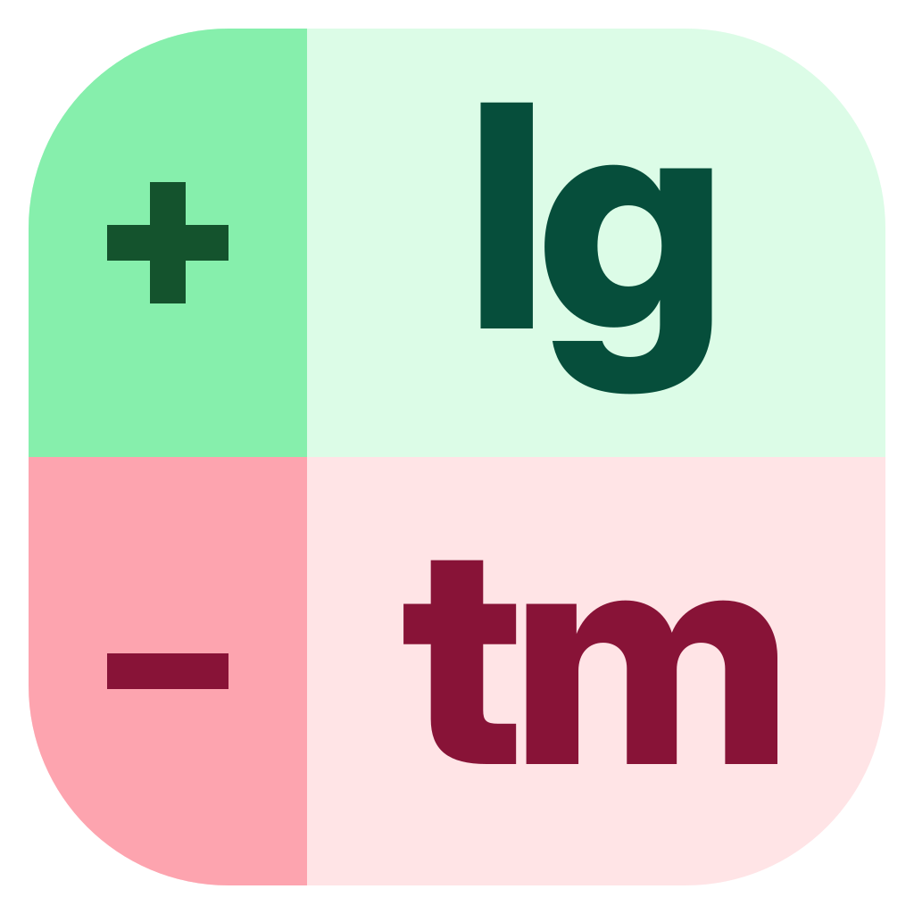
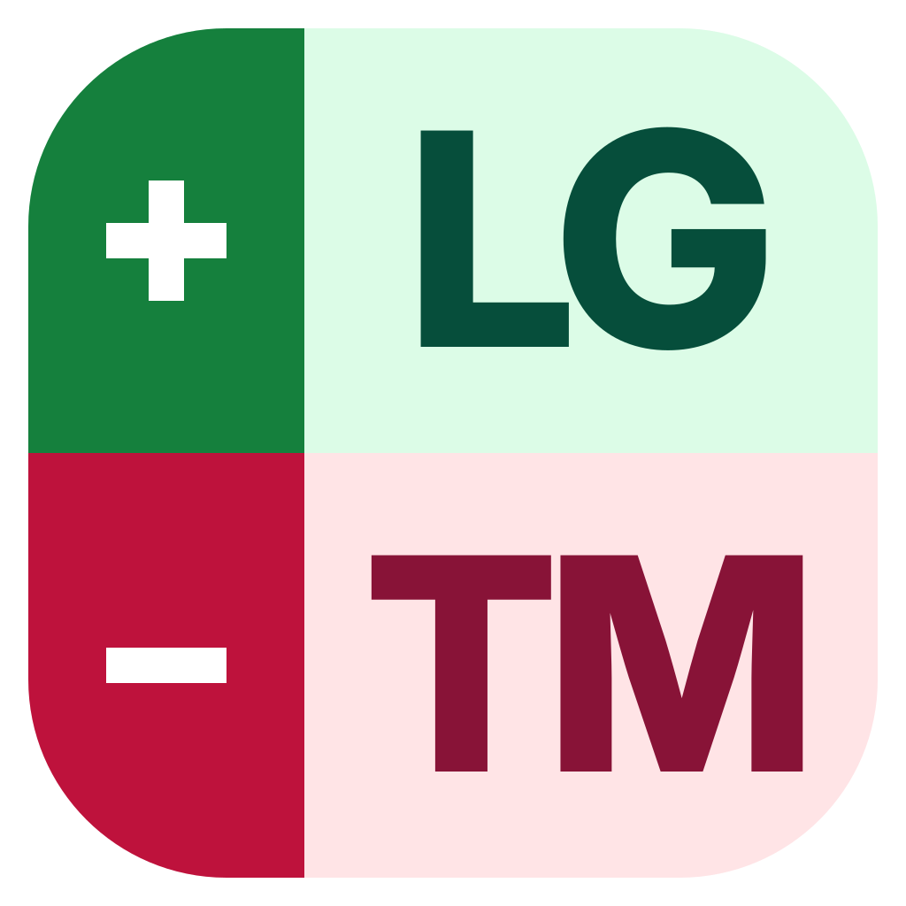
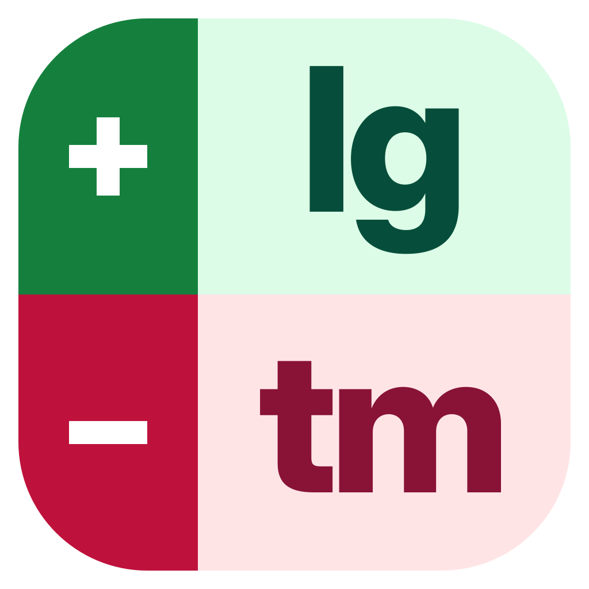
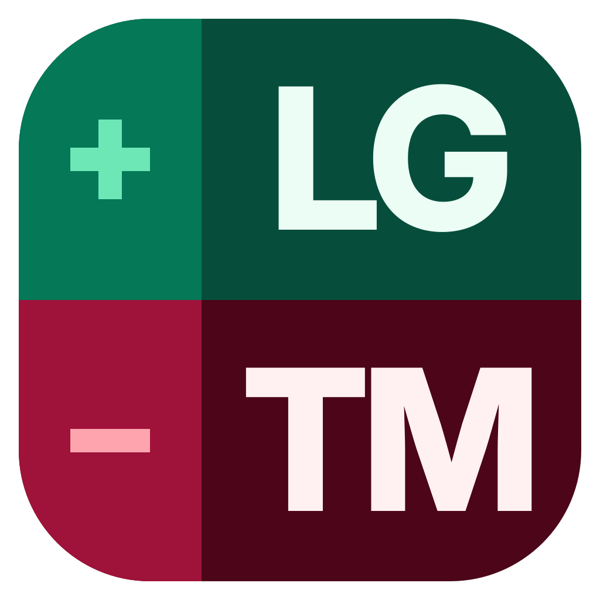
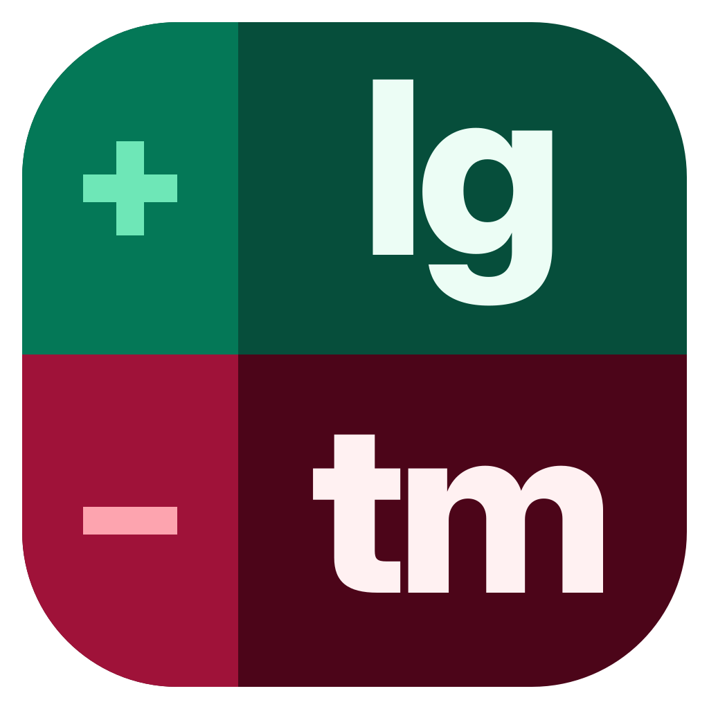

# App Tile Icons (`#7`–`#12`)

Back to [All Logos](README.md) · Previous: [Stacked Diff Marks (`#1`–`#6`)](stacked.md) · Next: [Split Brand Lockups (`#13`–`#16`)](brand-split.md)

## #7 · Two-Tone Gutter Rail · Uppercase · Light (`+LG` / `-TM`)

- SVG: [app-tile-upper.svg](app-tile-upper.svg)
- PNG: [snapshots/app-tile-upper.png](snapshots/app-tile-upper.png)

## #8 · Two-Tone Gutter Rail · Lowercase · Light (`+lg` / `-tm`)

- SVG: [app-tile-lower.svg](app-tile-lower.svg)
- PNG: [snapshots/app-tile-lower.png](snapshots/app-tile-lower.png)

## #9 · Solid Deep Rail · Uppercase · Light (`+LG` / `-TM`)

- SVG: [app-tile-solid-upper.svg](app-tile-solid-upper.svg)
- PNG: [snapshots/app-tile-solid-upper.png](snapshots/app-tile-solid-upper.png)

## #10 · Solid Deep Rail · Lowercase · Light (`+lg` / `-tm`)

- SVG: [app-tile-solid-lower.svg](app-tile-solid-lower.svg)
- PNG: [snapshots/app-tile-solid-lower.png](snapshots/app-tile-solid-lower.png)

## #11 · Two-Tone Gutter Rail · Uppercase · Dark (`+LG` / `-TM`)

- SVG: [app-tile-dark-upper.svg](app-tile-dark-upper.svg)
- PNG: [snapshots/app-tile-dark-upper.png](snapshots/app-tile-dark-upper.png)

## #12 · Two-Tone Gutter Rail · Lowercase · Dark (`+lg` / `-tm`)

- SVG: [app-tile-dark-lower.svg](app-tile-dark-lower.svg)
- PNG: [snapshots/app-tile-dark-lower.png](snapshots/app-tile-dark-lower.png)

