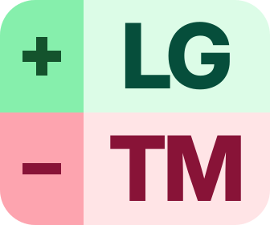
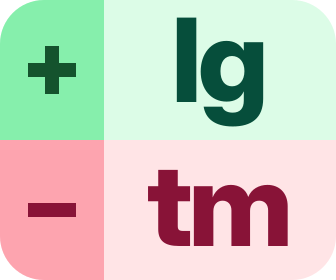
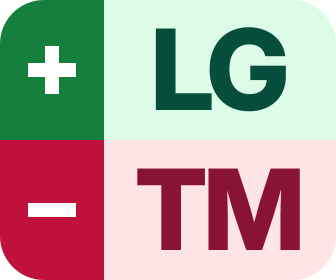
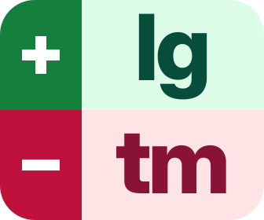
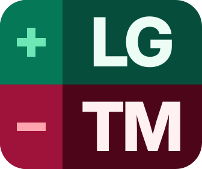
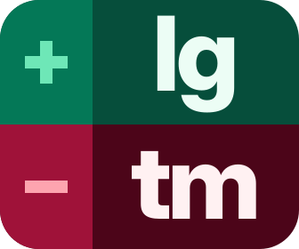

# Stacked Diff Marks (`#1`–`#6`)

Back to [All Logos](README.md) · Next: [App Tiles (`#7`–`#12`)](app-tiles.md) · [Split Brand Lockups (`#13`–`#16`)](brand-split.md)

## #1 · Two-Tone Gutter Rail · Uppercase · Light (`+LG` / `-TM`)

- SVG: [diff-stacked-upper.svg](diff-stacked-upper.svg)
- PNG: [snapshots/diff-stacked-upper.png](snapshots/diff-stacked-upper.png)

## #2 · Two-Tone Gutter Rail · Lowercase · Light (`+lg` / `-tm`)

- SVG: [diff-stacked-lower.svg](diff-stacked-lower.svg)
- PNG: [snapshots/diff-stacked-lower.png](snapshots/diff-stacked-lower.png)

## #3 · Solid Deep Rail · Uppercase · Light (`+LG` / `-TM`)

- SVG: [diff-stacked-solid-upper.svg](diff-stacked-solid-upper.svg)
- PNG: [snapshots/diff-stacked-solid-upper.png](snapshots/diff-stacked-solid-upper.png)

## #4 · Solid Deep Rail · Lowercase · Light (`+lg` / `-tm`)

- SVG: [diff-stacked-solid-lower.svg](diff-stacked-solid-lower.svg)
- PNG: [snapshots/diff-stacked-solid-lower.png](snapshots/diff-stacked-solid-lower.png)

## #5 · Two-Tone Gutter Rail · Uppercase · Dark (`+LG` / `-TM`)

- SVG: [diff-stacked-dark-upper.svg](diff-stacked-dark-upper.svg)
- PNG: [snapshots/diff-stacked-dark-upper.png](snapshots/diff-stacked-dark-upper.png)

## #6 · Two-Tone Gutter Rail · Lowercase · Dark (`+lg` / `-tm`)

- SVG: [diff-stacked-dark-lower.svg](diff-stacked-dark-lower.svg)
- PNG: [snapshots/diff-stacked-dark-lower.png](snapshots/diff-stacked-dark-lower.png)

