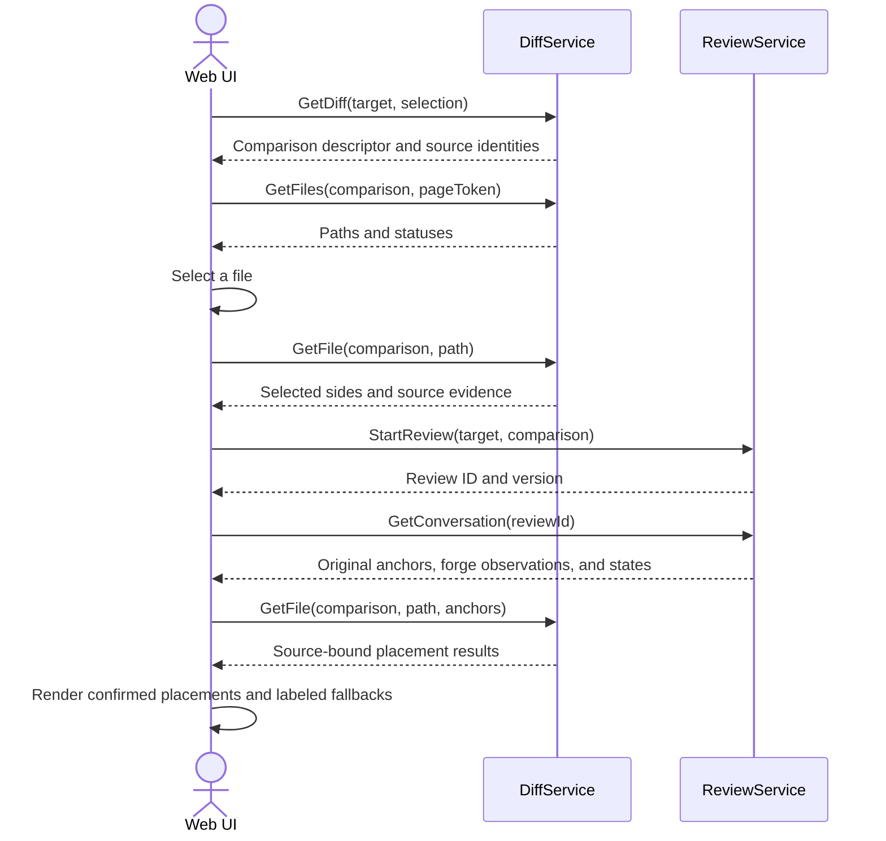
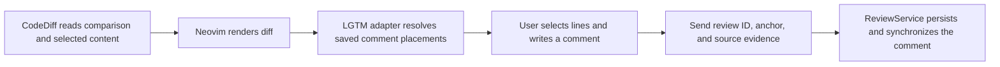
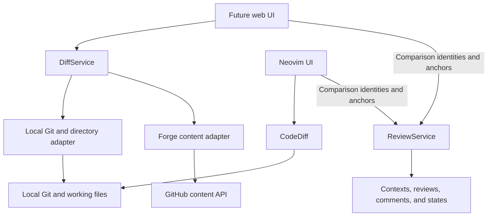
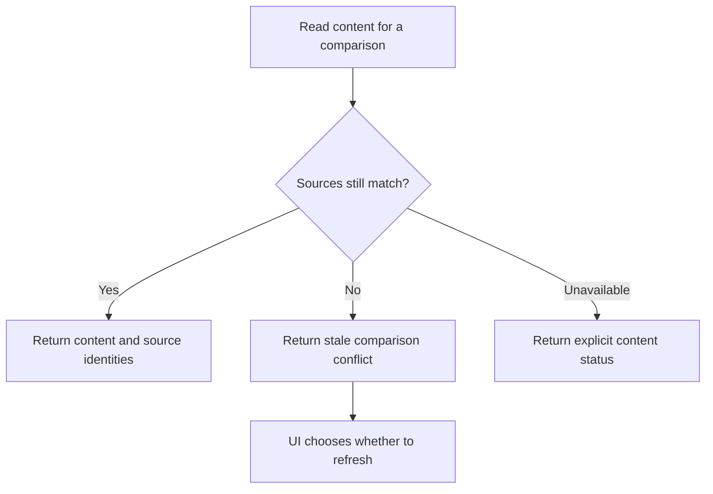
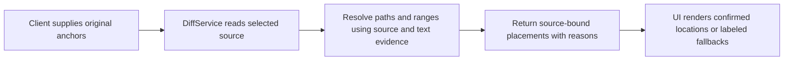

# Diffs — software architecture

## Overview

DiffService supplies comparisons, file lists, and file content to clients that need backend content access. The future web UI uses this service. Neovim uses CodeDiff for analogous functionality for now. Each UI owns file selection, navigation, layout, and comment presentation.

This page defines the service contract. [ReviewService](reviews.md) owns review contexts, comments, and state transitions. A diff request does not create or mutate review data.

## Requirement

### Functional

- FR1: Describe working, staged, branch, directory, and PR comparisons without requiring a review.
- FR2: List changed files separately from reading file bodies. Include ignored files under an explicitly selected directory.
- FR3: Read only the requested file and return the relevant comparison sides.
- FR4: Return source identities that clients can use in review comparisons and comment anchors.
- FR5: Detect changed content rather than return a file as part of an outdated comparison.
- FR6: Expose data only. Leave selection, diff rendering, navigation, and UI progress to clients.
- FR7: Resolve supplied anchors against a named displayed source without changing their originals or loading review records.

### Non-Functional

- NFR1: Open the first file without fetching all file bodies. Use bounded requests and paging.
- NFR2: Read without changing checkouts. Respect selected roots and skip nested symlinks.
- NFR3: Keep forge credentials in the backend and share the existing credential and provider infrastructure.
- NFR4: Report binary, oversized, missing, and unsupported content explicitly.
- NFR5: Avoid review persistence, duplicate repository clones, and full content snapshots.

## Design

### Usage

#### Web client



Diff browsing works without starting a review. Clients can read conversation and content independently after selecting a saved review.

#### Neovim client



Neovim does not need DiffService for local content already supplied by CodeDiff. LGTM owns its anchor resolver around CodeDiff. It computes source evidence and placement results using the [review anchor contract](reviews.md#anchor-ownership). Neovim uses DiffService for explicit directories and PR content unavailable in its local checkout. The future web UI can use the same contract.


### Components and Responsibilities



- UI: Choose the target and files. Render diffs and discussions.
- DiffService: Resolve a content comparison, return selected diff data, and map supplied anchors to that content.
- Local adapter: Read Git objects, index content, working files, and explicit directories.
- Forge adapter: Read PR file metadata and selected content using backend credentials.
- ReviewService: Validate and persist review actions independently of the content source.

DiffService and ReviewService can run in the same backend process. They share source identity types and provider infrastructure, without calling each other to perform their core operations.

### Data and Control Flow



An observation token detects stale source metadata. It does not promise a stored snapshot of all working files. If working or index content changes, return fresh identities or a conflict before treating it as the previously observed content. Review versions guard review data separately from content identities.

### Interfaces and Contracts

A comparison descriptor identifies the sources that form a diff. It is content metadata, not a review session or a durable database entity.

```text
DiffTarget = LocalGit { path }
           | Directory { path }
           | PullRequest { repositoryUrl, number }

Selection  = Working { base? }
           | Staged { base? }
           | Branch { baseBranch }

Comparison = {
  target,
  sourceKinds,
  resolvedCommitIdentities?,
  observationToken
}
```

| Method | Request → response | Contract |
| --- | --- | --- |
| `GetDiff` | Target and optional local selection → comparison | Resolve metadata without creating a review or downloading all content. |
| `GetFiles` | Comparison and page token → file metadata | Return paths, statuses, rename information, and the next page token. |
| `GetFile` | Comparison, relative path, optional anchors → content sides, source identities, and placements | Read the selected file only. Resolve supplied anchors without querying review records. |

Local selection applies only to Git targets. PR and directory targets determine their own content sources. Branch references resolve to commit identities. File responses distinguish commit, working, index, and non-Git sources. Index responses retain the actual blob object ID so staged anchors can survive a commit. Clients supply those identities to ReviewService with the selected anchor. ReviewService still enforces its own scope and lifecycle rules.

#### Anchor mapping contract

Use the same [source and placement rules](reviews.md#mapping-and-stale-content) as the LGTM Neovim adapter, including the allowed orphaning of unstaged Git anchors. Return `Exact`, `Relocated`, `Outdated`, `Orphaned`, or `Unverified` for each supplied anchor. Bind each result to the requested comparison and actual content identity. Hash exact source bytes and return bounded selected-text evidence.



DiffService does not decide whether a discussion is resolved or published. It does not change original anchors or forge outdated state. If original content is unavailable, use preserved excerpts only when they support one unambiguous mapping. For preserved sources, confirmed moves return the new path automatically. Lost lines return a file-header fallback, and confirmed file deletion returns an orphaned result. Changed unstaged Git sources can also return an orphaned result. Otherwise, return a reason without guessing a line. No full-file snapshot store is required by this contract.

## Implementation

### Module boundaries

Keep RPC handlers and content orchestration separate from review workflows. Reuse Git readers, path rules, and forge adapters where their contracts match. Do not add review database tables for diff browsing.

The router mounts `rpc/diff.rs` beside the review service. `services/diff.rs` owns metadata descriptors and selected-file reads. It reuses filesystem, Git, and forge adapters without a review database handle. A bounded in-memory cache retains verified remote blobs by repository, path, and commit; it is not review storage.

### Acceptance flows

| Flow | Required evidence |
| --- | --- |
| Browse without a review | Diff requests create no context, session, comment, or submission. |
| Open the first PR file | Fetch metadata and the selected sides without fetching unrelated file bodies. |
| Read mutable local content | Detect changes between observation and file access. Return the actual source identity. |
| Use an ignored directory | Read only the explicitly selected root, including ignored files. |
| Use CodeDiff in Neovim | Start, comment, export, and complete a local Git review without DiffService calls. |
| Preserve review independence | Rendering failures do not change review state. Review persistence does not require a file-body request. |
| Resolve supplied anchors | Return the same placement decisions as the Neovim adapter for identical evidence, including deletion, duplicate text, rename, and source changes. |
| Preserve exact bytes | Distinguish working and index content, line endings, and final newlines in returned hashes. |

## References

- [Review API architecture](reviews.md).
- [System architecture](../index.md).
- [Backend architecture](index.md).
- [Neovim CodeDiff integration](../../../apps/lgtm.nvim/lua/lgtm/codediff.lua).
