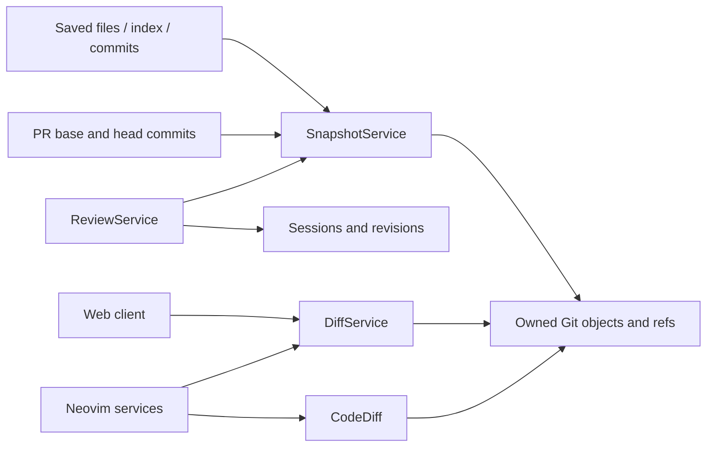
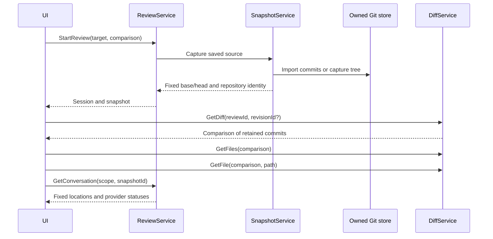

# Diffs — software architecture

## Overview

DiffService returns comparison metadata, file lists and selected file bodies. SnapshotService retains review source. ReviewService owns the session and its revisions. Clients choose files and render diffs.

## Requirement

- Browse working, staged, branch, directory and PR comparisons before starting a review.
- Read a saved review after its source repository changes or disappears.
- Fetch file metadata separately from bodies. Include ignored files in explicit directory reviews.
- Keep source capture and comment validation in the backend for every client.
- Preserve CodeDiff's explorer and navigation using two saved commits.

## Design

### Components and Responsibilities



### Data and Control Flow



Neovim lets CodeDiff read the saved Git objects directly when the backend store is available locally. Directory views and remote-backend fallbacks use selected file bodies from DiffService. Both paths show the same retained bytes. Review panes are read-only; ordinary source buffers remain independent.

### Interfaces and Contracts

| Method | Request | Result |
| --- | --- | --- |
| `GetDiff` | Target and optional comparison, or review ID and optional revision ID | Metadata descriptor. A review request selects retained commits. |
| `GetFiles` | Descriptor and page token | Paths, statuses, rename metadata and next page token. |
| `GetFile` | Descriptor and relative path | Selected content sides and content identities. |
| `GetConversation` | Review scope and optional snapshot ID | Discussions; fixed display locations for that revision. |
| `AddComment` | Review scope, snapshot ID, side, path, range and body | Backend-validated comment and local/remote save state. |

Transient browsing requests do not create a session or snapshot. An observation token detects stale mutable comparisons. Once a review starts, its descriptor names retained commits and no longer depends on the original workspace. Refresh belongs to ReviewService and captures another revision.

### Source storage

```text
$LGTM_HOME/snapshots/<repository-id>/.git/
├── objects/
└── refs/lgtm/revisions/<revision-id>/
    ├── base
    └── head
```

Imported commits keep their hashes. Clean working and staged captures reuse HEAD when their trees match it. Changed saved files and index content use synthetic commits. Gitoxide reads the source index or saved files and writes trees directly into LGTM's repository. Capture does not change the user's branch, index, files or `git status` output. Retained refs keep historical objects available.

The same normalized origin produces the same repository ID for local and forge reviews. A matching commit hash identifies shared source; it does not automatically merge their conversations.

## Implementation

`extensions/git.rs` provides typed Gitoxide operations for fetching commits, reading the index and writing trees. It does not parse Git command output. Gitoxide is a Rust dependency, so users do not install a Gitoxide executable. Existing Git and GitHub authentication requirements remain unchanged. `services/snapshot.rs` owns capture and refs. `services/diff.rs` owns descriptors and selected-file reads. `services/review.rs` persists revision metadata and validates comment ranges. RPC handlers select these workflows and convert transport data.

### Acceptance flows

| Flow | Evidence |
| --- | --- |
| Browse without a review | No context, session or comment is created. |
| Saved-source capture | Working and staged bytes remain distinct; user Git state is unchanged. |
| Resume after source deletion | Saved file bodies remain readable. |
| Refresh | Same session, next revision, original comment coordinates retained. |
| Historical navigation | Open the original saved revision and line. |
| PR update | Same pending review; new feedback uses the current revision. |

## References

- [Review lifecycle and fixed locations](reviews.md).
- [Neovim architecture](../lgtm.nvim/index.md).
- [SnapshotService](../../../apps/lgtm-backend/src/services/snapshot.rs).
- [Snapshot service tests](../../../apps/lgtm-backend/tests/snapshot_service.rs).
