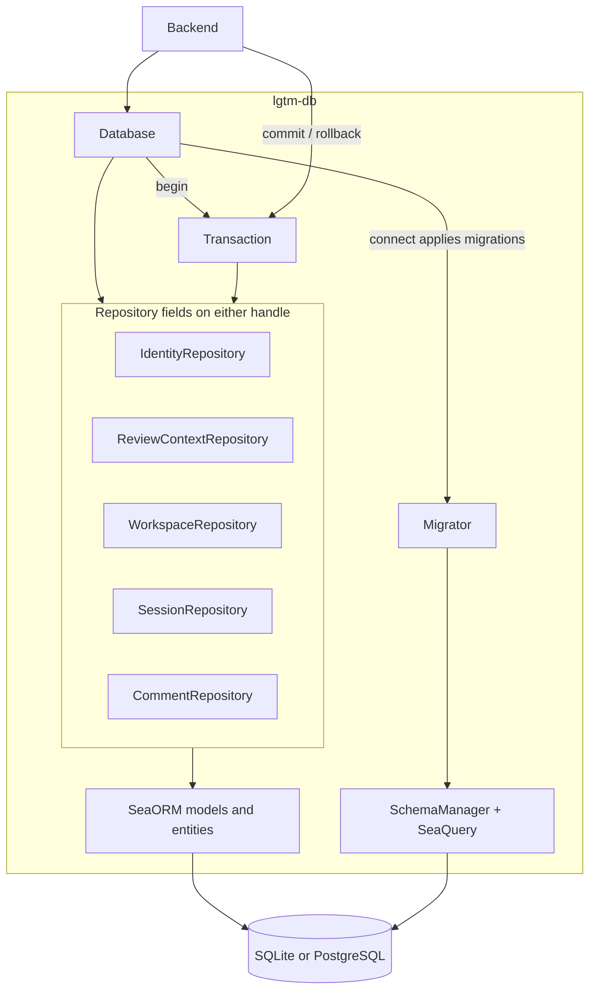
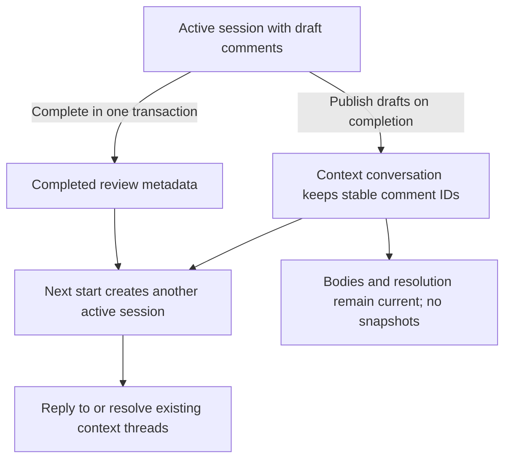
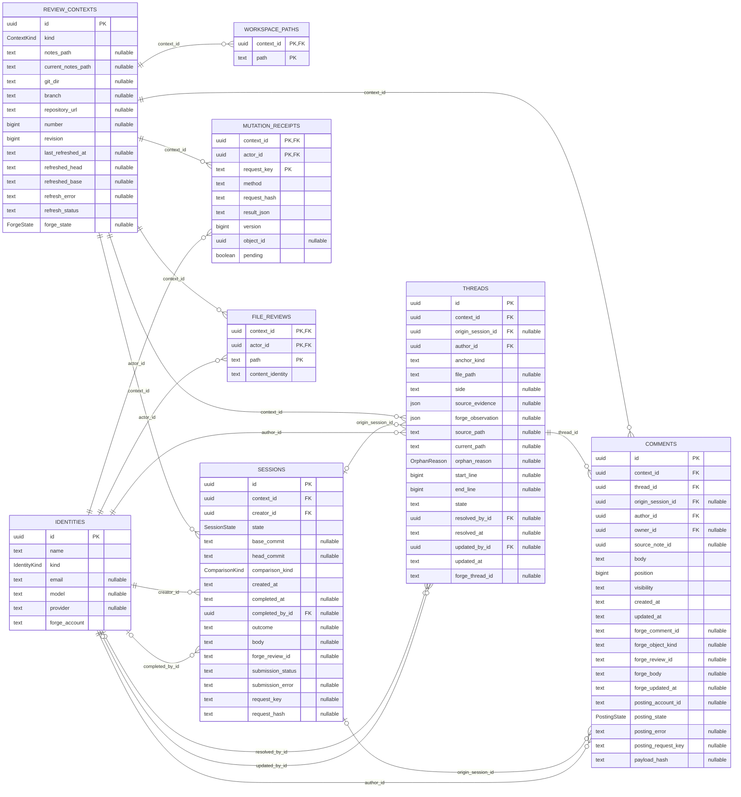
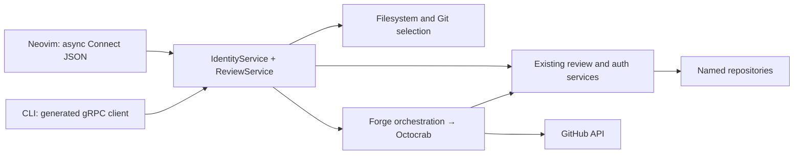

# Backend — software architecture

## Overview

The Rust backend owns domain validation, requester identity and review workflows over lgtm-db. The stateful RPC router exposes IdentityService, ReviewService and DiffService alongside greeting and health. Both native gRPC clients and direct Connect JSON clients call the same services. The CLI and Neovim plugin use these RPCs; neither owns persistence or depends on the web UI.

See [review architecture](reviews.md) for context requirements, backend data flows, and the intended review contracts. The [system architecture](../index.md) defines shared concepts and comment lifecycle behavior. The [DiffService](diffs.md) owns backend file listing and content access for the web UI. Neovim uses CodeDiff for analogous content access. The review service owns review data and state transitions. The review document's [Usage](reviews.md#usage) covers API consumer request sequences and recovery. The [LGTM user guide](../../user-guide.md) covers Neovim review workflows and the web interface's availability.

## Requirement

### Functional

- FR1: Persist local branch reviews and forge-review conversations through services.
- FR2: Track human identities (email) and agent identities (model/provider), independently of forge posting accounts.
- FR3: Keep one active session per context shared by identities; publish drafts on completion and retain completed metadata.
- FR4: Preserve context-owned threads/comments and scoped forge IDs across later sessions.
- FR5: Reconcile complete GitHub observations and verified posting receipts through the Octocrab adapter.

### Non-Functional

- NFR1: Keep all database interaction in services; models only validate, map supplied values and implement domain behavior.
- NFR2: Share transaction semantics across SQLite and PostgreSQL.
- NFR3: Keep review persistence in the backend; CLI commands call its RPCs.
- NFR4: Inherit caller tracing context without retaining request spans.

## Design

### Usage

#### API clients

Start the bundled backend with `lgtm up --no-open`. Read its endpoint through `lgtm status --json`. Use [review usage](reviews.md#usage) for review data and state transitions. Use [diff usage](diffs.md#usage) for backend content access. Neovim uses CodeDiff for now.

#### Internal callers

Create the shared database and services at startup:

```rust
let db = Database::connect(database_url).await?;
let auth = AuthService::new(db.clone());
let human = auth.ensure_human("Alice", "alice@example.com").await?;
let agent = auth.ensure_agent("Reviewer", "model-name", "provider-name").await?;
let review = ReviewService::new(db.clone(), auth);
```

Call domain services for application workflows. Keep database access behind named repository operations.


### Components and Responsibilities



- lib.rs: greeting/health router and router_with_database for stateful identity/review/diff APIs.
- rpc/: review and diff handlers, per-request tracing and requester metadata.
- services/snapshot.rs: immutable working, index, directory and commit capture. services/workspace.rs: literal Git reads and repository discovery.
- services/forge.rs and forge/: GitHub review orchestration, Octocrab HTTP calls and local credential lookup.
- models/: domain types, validators and `from_proto` / `into_proto` conversions. Each main type has its own file.
- services/auth.rs: requester metadata resolution, explicit human/agent lookup/create and requester validation. Authentication and authorization remain future work.
- services/review.rs: contexts, session lifecycle, comments, resolution, exports and forge reconciliation.
- services/actor.rs: batch actor loading into a plain UUID-to-Actor lookup for service mappings.
- forge/client.rs: typed forge discovery and snapshot contract, implemented by GithubClient.
- forge/models.rs: repository addresses and normalized forge response models.
- utils.rs: general time, path and serialization helpers.
- error.rs: application-defined errors and their Connect error conversion.
- lgtm-db: repositories, typed SeaORM models, transactions and private migrations.

### Data and Control Flow

Review RPC handlers establish tracing context, resolve the requester and call ReviewService. The service validates actions, opens a transaction, loads identities/workspace paths and converts supplied DB values into domain models. Domain conversion functions do not perform I/O.



Contexts own conversations. Completing a session publishes its drafts and stores a Completed variant with actor/time/outcome/retry metadata. Later reviewers reuse threads rather than copying them. SnapshotService retains every review revision in owned Git objects.

### Interfaces and Contracts

Context identity uses these serialized variants:

```json
{"kind":"local","location":{"kind":"branch","git_dir":"/work/project/.git","branch":"refs/heads/main"}}
```

```json
{"kind":"forge_backed","repository_url":"https://github.com/acme/project","number":42}
```

A local notes location contains `{"kind":"notes","path":"/work/notes"}` instead of branch fields. The backend validates absolute local paths and full branch refs. Forge repository URLs require HTTP(S), a host and a namespace/project path, with no credentials, query or fragment. This validates the address shape, not the existence of a live forge repository.


Internal IDs are uuid::Uuid. External forge IDs remain opaque strings scoped by host/context/object kind. Human and agent records have mutually exclusive required fields, checked in Rust and SQL. Context keys distinguish Local locations from ForgeBacked reviews. Local locations are notes paths or Git-directory/branch pairs. Forge-backed reviews require a parsed HTTP(S) repository_url and positive PR/MR number. Forge origins are derived from the URL; remote operations reject local contexts.

SessionStatus separates Active from Completed metadata. PostingStatus only carries an error for Uncertain results; confirmation cannot retain a stale error. SQL constraints protect direct repository callers too.



Repositories are db.identities, db.review_contexts, db.sessions, db.comments (including threads) and db.workspace. Reads use get_* names. Begin a transaction to compose operations, then commit or drop to roll back. DB rollback cannot undo external writes.

## Implementation

### Request identity and tracing

AuthService requires one x-lgtm-identity metadata value containing an existing UUID. This is a supplied claim, not credential verification. Profiles are loaded per request.

CLI/RPC boundaries instrument futures. Services emit ordinary tracing macros and do not retain spans. Spawned tasks require explicit propagation. Payloads and credentials are omitted from boundary instrumentation.

### Forge boundary

Octocrab performs GitHub REST/GraphQL operations using privately captured local gh credentials. Complete observations and verified receipts feed the existing review service. Scoped remote IDs preserve known logical authors independently of posting accounts. Submission preparation freezes the exact comment set, payloads and session retry identity in one transaction before network writes. Reconciliation confirms accepted outcomes, or finishes an existing pending review only after exact comment/account/head verification. Missing or ambiguous receipts never trigger replay; the user must inspect and complete or discard the pending review on GitHub before retrying.

### Verification

Service integration tests cover lifecycle, concurrency, identity normalization, immutable attribution/anchors, dummy-provider failures and remote reconciliation. Public DB-client integration tests compose repositories across notes, local and forge contexts, including successor sessions and multiple actors. Private unit tests are colocated; shared fixtures live in test modules.

### Editor and CLI API



These protobuf services share a router, process and database. Service names organize method contracts; they do not start separate daemons. Standalone endpoints have no prefix. The CLI daemon also mounts the router below `/rpc`.

`EnsureIdentity` bootstraps human or agent attribution. Mutations use one `x-lgtm-identity` UUID header. This is claimed local attribution, not remote authentication. Wire discriminators are validated into the existing ContextKey, LocalLocation and Anchor enums; incompatible combinations are rejected.

`StartReview` accepts a target and comparison. `GetConversation` and mutations accept a review or saved-file scope. Context lookup and write-session selection remain internal. Capability flags identify target, scope, anchor-evidence, and diff support; API version alone is insufficient for older clients.

DiffService supplies descriptors, paged file metadata, and selected content without review persistence. CodeDiff supplies local Git content in Neovim. Explicit symlink roots resolve to physical identities; nested links and selected escapes are rejected. Binary and oversized files have explicit statuses.

Original anchors retain a snapshot ID, commit, side, path and range. ReviewService returns fixed coordinates for the selected revision. GitHub remains authoritative for provider current coordinates and outdated status. Historical local threads open their retained source without relocation.

Standalone notes writes and promotion are removed; archived notes remain readable and exportable. Markdown exports contain numbered feedback and useful original locations without internal IDs. Export does not mutate review state. The [review contract](reviews.md) defines lifecycle and retry behavior.

PR draft saves persist locally first, then synchronize line/file comments and replies through Octocrab to one pending GitHub review. Session and comment receipts survive daemon/editor restart; no separate submission store is added. The shared forge service serializes refresh and remote mutations so a refresh cannot import a newly accepted draft before its receipt is recorded. A lost response is reconciled against exact account, review and payload evidence. General comments remain local until submission. `SyncDraftComment` explicitly recovers or synchronizes saved drafts without publishing the review. Add/reply RPC responses expose `sync_error` separately from durable local-save success.

## References

- [Database architecture](../db/index.md).
- [Services](../../../apps/lgtm-backend/src/services).
- [Domain models](../../../apps/lgtm-backend/src/models).
- [Integration tests](../../../apps/lgtm-backend/tests).
- [CLI architecture](../cli/index.md).
