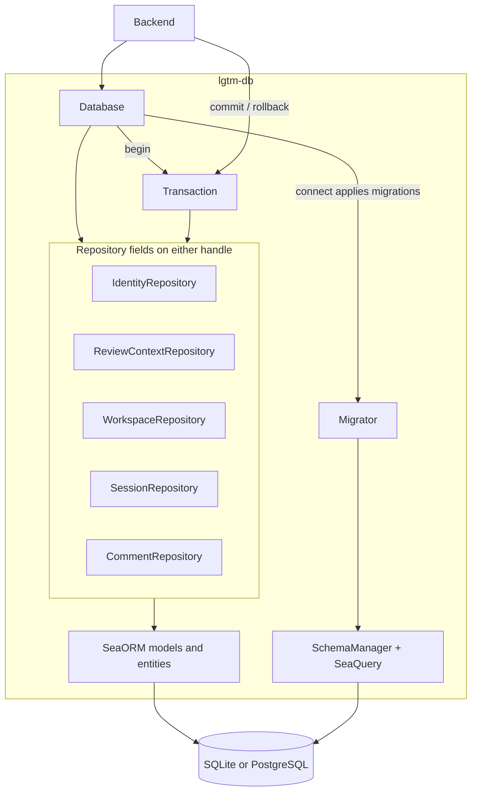
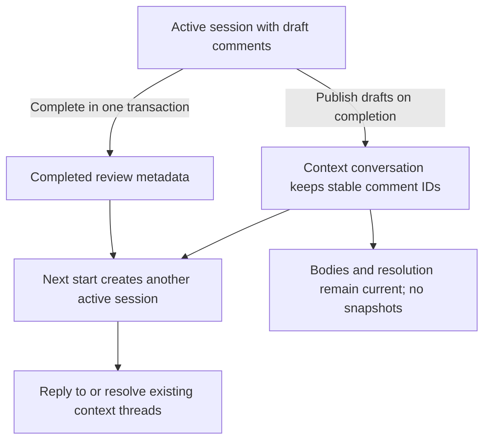
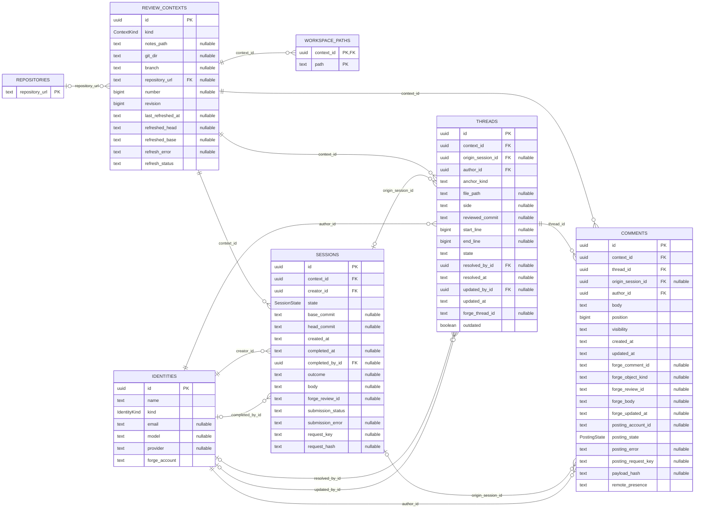

# Backend — software architecture

## Overview

The Rust backend owns domain validation, requester identity and review workflows over lgtm-db. The production RPC router currently exposes greeting and health only. Review RPCs and forge adapters are not implemented. The CLI manages the daemon and opens the dummy UI; review/session/comment commands are scaffolds and do not access persistence.

## Requirement

### Functional

- Persist notes, local branch reviews and forge-review conversations through services.
- Track human identities (email) and agent identities (model/provider), independently of forge posting accounts.
- Keep one active session per context shared by identities; publish drafts on completion and retain completed metadata.
- Preserve context-owned threads/comments and scoped forge IDs across later sessions.
- Reconcile supplied complete observations and verified posting receipts without performing network calls.

### Non-Functional

- Keep all database interaction in services; models only validate, map supplied values and implement domain behavior.
- Share transaction semantics across SQLite and PostgreSQL.
- Keep review persistence out of the CLI until backend RPCs exist.
- Inherit caller tracing context without retaining request spans.

## Design

### Components and Responsibilities



- lib.rs: greeting RPC and health router; future review handlers will translate requests into service calls.
- models/: Actor/ActorKind, Context/ContextKey, Session/SessionStatus, Comment/PostingStatus, Thread/Anchor and domain inputs.
- services/auth.rs: requester metadata resolution, explicit human/agent lookup/create and requester validation. Authentication and authorization remain future work.
- services/review.rs: contexts, session lifecycle, comments, resolution, exports and forge reconciliation.
- services/actor.rs: batch actor loading into a plain UUID-to-Actor lookup for service mappings.
- utils.rs: shared formatting/path helpers and forge import/export contracts.
- error.rs: application-defined validation, conflict and not-found errors.
- lgtm-db: repositories, typed SeaORM models, transactions and private migrations.

### Data and Control Flow

Future review RPC handlers establish tracing context, resolve the requester and call ReviewService. The service validates actions, opens a transaction, loads identities/workspace paths and converts supplied DB values into domain models. Domain conversion functions do not perform I/O.



Contexts own conversations. Completing a session publishes its drafts and stores a Completed variant with actor/time/outcome/retry metadata. Later reviewers reuse threads rather than copying them. Snapshots are deferred.

### Interfaces and Contracts

Context identity uses these serialized variants:

```json
{"kind":"local","location":{"kind":"branch","git_dir":"/work/project/.git","branch":"refs/heads/main"}}
```

```json
{"kind":"forge_backed","repository_url":"https://github.com/acme/project","number":42}
```

A local notes location contains `{"kind":"notes","path":"/work/notes"}` instead of branch fields. The backend validates absolute local paths and full branch refs. Forge repository URLs require HTTP(S), a host and a namespace/project path, with no credentials, query or fragment. This validates the address shape, not the existence of a live forge repository.


    let db = Database::connect(database_url).await?;
    let auth = AuthService::new(db.clone());
    let human = auth.ensure_human("Alice", "alice@example.com").await?;
    let agent = auth.ensure_agent("Reviewer", "model-name", "provider-name").await?;
    let review = ReviewService::new(db.clone(), auth);

Internal IDs are uuid::Uuid. External forge IDs remain opaque strings scoped by host/context/object kind. Human and agent records have mutually exclusive required fields, checked in Rust and SQL. Context keys distinguish Local locations from ForgeBacked reviews. Local locations are notes paths or Git-directory/branch pairs. Forge-backed reviews require a parsed HTTP(S) repository_url and positive PR/MR number. Forge origins are derived from the URL; remote operations reject local contexts.

SessionStatus separates Active from Completed metadata. PostingStatus only carries an error for Uncertain results; confirmation cannot retain a stale error. SQL constraints protect direct repository callers too.



Repositories are db.identities, db.review_contexts, db.sessions, db.comments (including threads) and db.workspace. Reads use get_* names. Begin a transaction to compose operations, then commit or drop to roll back. DB rollback cannot undo external writes.

## Implementation

### Request identity and tracing

AuthService requires one x-lgtm-identity metadata value containing an existing UUID. This is a supplied claim, not credential verification. Profiles are loaded per request.

CLI/RPC boundaries instrument futures. Services emit ordinary tracing macros and do not retain spans. Spawned tasks require explicit propagation. Payloads and credentials are omitted from boundary instrumentation.

### Forge boundary

Only supplied observations and receipts are supported. A fresh complete observation is required before each new PR session. Scoped remote IDs preserve known logical authors. Forge account bindings are separate from agent providers. Uncertain posts require reconciliation. Future forge adapters belong in the backend.

### Verification

Service integration tests cover lifecycle, concurrency, identity normalization, immutable attribution/anchors, dummy-provider failures and remote reconciliation. Public DB-client integration tests compose repositories across notes, local and forge contexts, including successor sessions and multiple actors. Private unit tests are colocated; shared fixtures live in test modules.

## References

- [Database architecture](../db/index.md).
- [Services](../../../apps/lgtm-backend/src/services).
- [Domain models](../../../apps/lgtm-backend/src/models).
- [Integration tests](../../../apps/lgtm-backend/tests).
- [CLI scaffold](../cli/index.md).
