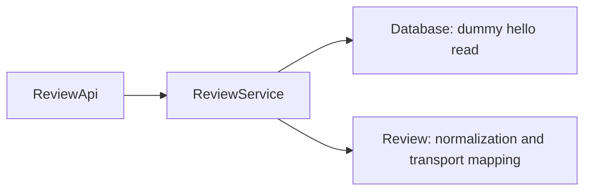

# Backend — software architecture

## Overview

The backend contains one review domain model and service plus RPC, greeting, health and startup infrastructure; it runs standalone or is bundled into the CLI.

## Requirement

NA/WIP.

### Functional

- FR1: Return hello-review data from the dummy DB facade.
- FR2: Serve generated Rust and TypeScript clients through the same contract.
- FR3: Preserve greeting and health services.

### Non-Functional

- NFR1: Keep domain mapping in the model and orchestration in the service.
- NFR2: Open no SQL connections or forge clients during startup.

## Design

NA/WIP.

### Usage

NA/WIP.

#### API clients

The CLI and Svelte frontend call `ReviewService.HelloReview`; browser calls use `/rpc` on the bundled server. See [review contract](reviews.md).

#### Internal callers

`ReviewService::get_hello` reads `Database::get_hello` and constructs `Review`; models do not query storage.

### Components and Responsibilities

### Data and Control Flow

The handler creates a request span, passes the supplied name to the service and returns the model converted to the generated response. Startup registers hello-review, greeting and health without persistence initialization.

### Interfaces and Contracts

The public domain RPC is `HelloReview(name) -> message`; old identity, comment, session and diff contracts are removed. Empty/whitespace-only names use `World`.

## Implementation

NA/WIP.

### Request identity and tracing

RPC boundaries establish tracing spans; services do not store request spans. Authentication and actor persistence are NA/WIP.

### Forge boundary

NA/WIP.

### Verification

Backend integration tests cover public service behavior, the hello RPC, greeting and health; client and E2E tests exercise the actual server.

### Editor and CLI API

CLI `review list` and the Svelte page call hello-review. The Neovim shell currently makes no backend calls.

## References

- [Review contract](reviews.md).
- [Dummy DB](../db/index.md).
- [Application architecture](../index.md).
