# Reviews — software architecture

## Overview

This page defines the review API for CLI, Neovim, and web clients. A target identifies what the client wants to review. The service owns review data and state transitions. Clients own file browsing, content loading, diff selection, and presentation.

This page describes the intended contract. It does not report implementation status. The [system architecture](../index.md#implementation) defines behavior when files, commits, or PRs change. The [product user guide](../../user-guide.md) explains Neovim usage and web UI availability.

## Requirement

### Functional

- FR1: Accept a typed target when starting or listing reviews. Resolve contexts and sessions inside services.
- FR2: Record reviews for working, staged, branch, directory, and PR comparisons selected by clients. Accept anchors for ignored files.
- FR4: Preserve comments, replies, attribution, resolution, and exports across restarts and content changes.
- FR5: Save eligible PR comments as remote private drafts. Submit them only after an explicit review submission.
- FR6: Keep local completion separate from PR submission. Preserve unsent drafts when a PR closes or merges.
- FR7: Preserve original anchor evidence and location status. Distinguish current coordinates from historical or provider-outdated locations.
- FR8: Support final review comments, exports and explicit recovery after uncertain remote writes.
- FR9: Detect changed comparisons and concurrent edits before applying a stale client request.
- FR10: Keep original anchors immutable and derived placements specific to their displayed sources.
- FR11: Preserve GitHub current locations, historical locations, and outdated status separately.
- FR12: Show provider-outdated feedback and retain access to original saved source.
- FR13: Preserve saved source after workspace files move or disappear.
- FR14: Navigate historical local discussions at their fixed original coordinates.
- FR15: Share staged and branch discussions in one local branch context. Filter each view by the files in its selected diff. Keep PR discussions in their PR context.
- FR16: Capture saved working and index bytes independently without changing the user's Git state.

### Non-Functional

- NFR1: Return review data without requiring a diff view. Starting or refreshing a review captures its source.
- NFR2: Preserve the same transaction rules in SQLite and PostgreSQL.
- NFR3: Keep GitHub credentials in the backend. Separate local attribution from remote account permissions.
- NFR4: Make retries safe. Preserve receipts that prove which remote writes succeeded.
- NFR5: Bound conversation reads and forge requests. Report incomplete observations explicitly.
- NFR6: Validate comment ranges against retained source. Respect capture roots and leave user checkouts unchanged.

## Design

### Usage

This section is for API clients. Examples show request shapes, not generated SDK code or final Protobuf messages.

#### Choose the target

| Client task | Client supplies | Service owns |
| --- | --- | --- |
| Review working files | Repository location, working comparison, and baseline identity | Review attempt and its recorded comparison |
| Review staged files | Repository location, staged comparison, and baseline identity | Review attempt and its recorded comparison |
| Review a branch | Repository location and compared commit identities | Review attempt and its pinned commits |
| Review an ignored directory | Explicit root and selected file anchors | Local review data and discussions |
| Review a PR | Repository URL and PR number | Review attempt, PR metadata, drafts, and submission |

Clients choose files and load their content through their own content integration. Neovim uses CodeDiff for now. The future web UI uses [DiffService](diffs.md). Each client chooses how to browse explicitly selected ignored directories.

Supply explicit locations. The backend cannot infer the selected repository from its own process directory. For PR selection, `ListPullRequests` returns repository PR data with search filters and paging. Clients infer the repository and branch when available, then choose how to present the results.

#### Local context and preservation policy

Working, staged and branch views share a local branch conversation. Every session has retained revisions. Each comment keeps its original revision, side, path and range. Directory reviews capture their selected root, including ignored files. Workspace edits, moves and deletions do not change saved review source.

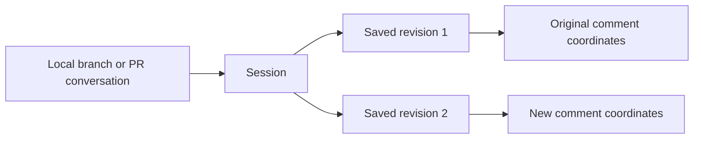

PR conversations remain separate from local conversations. Matching repository and commit identities make their source comparable; they do not copy or merge discussions. The context-wide thread list and export retain discussions outside the selected diff.

#### Start or find a review

```text
review = StartReview({
  target: { localGit: { path: "/work/project" } },
  comparison: { staged: { baseCommit: base_sha } },
  resumePolicy: "MATCHING_ONLY",
  requestKey: start_key
}).review

saved = ListReviews({
  filter: { kind: "local_git", path: "/work/project", state: "active" },
  pageToken: page_token
})
```

The client obtains `base_sha` from its selected local comparison. `StartReview` creates or resumes a matching local review. A different active local comparison returns a conflict. `ListReviews` reads saved reviews without creating anything. Use the returned review ID for later actions.

For a PR, supply its repository URL and number. `StartReview` and `RefreshReview` follow the current PR commits while retaining its active review ID and pending provider review. Use the returned comparison to reload displayed content. A supplied comparison that aged during selection can be omitted on the next start request. Frozen submissions and completed reviews retain their comparison.

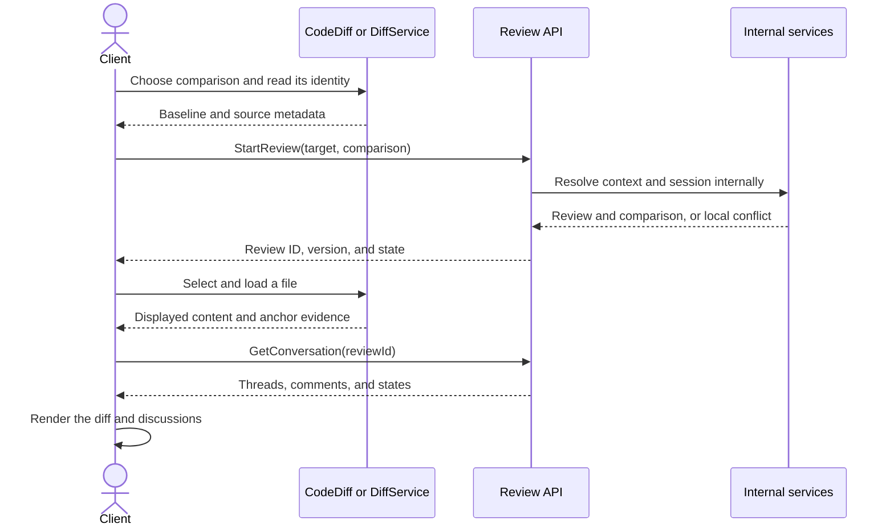

The review API returns domain data. It does not choose a file, diff tool, or layout. File loading and conversation reads can run independently.

#### Add a comment on displayed content

The client supplies selection intent. The backend reads the retained source and captures bounded evidence.

```text
AddComment({
  scope: { reviewId: review.id },
  anchor: {
    kind: "line",
    snapshotId: review.snapshot.id,
    path: "src/main.rs",
    side: "new",
    start: 11,
    end: 12
  },
  expectedVersion: review.version,
  body: "Handle this failure.",
  requestKey: comment_key
})
```

File comments use a snapshot ID and relative path. General comments need no source range. Standalone notes writes are removed; existing notes remain readable and exportable.

#### Read and manage discussions

| Task | Request |
| --- | --- |
| Read discussions | `GetConversation(scope, filePaths?, pageToken)` |
| Reply | `Reply(scope, threadId, body, expectedVersion, requestKey)` |
| Edit a selected comment | `EditComment(scope, commentId, body, expectedVersion, requestKey)` |
| Delete a selected comment | `DeleteComment(scope, commentId, expectedVersion, requestKey)` |
| Resolve or reopen a thread | `ResolveThread(scope, threadId, resolved, expectedVersion, requestKey)` |
| Retry a saved PR draft | `SyncDraftComment(reviewId, commentId, requestKey)` |

Select a comment ID for edit or delete. Select a thread ID for resolution. Responses identify the root, ordered replies, ownership, permissions, and remote save state. Keep local-save success separate from remote-save success.

#### Display and refresh saved revisions

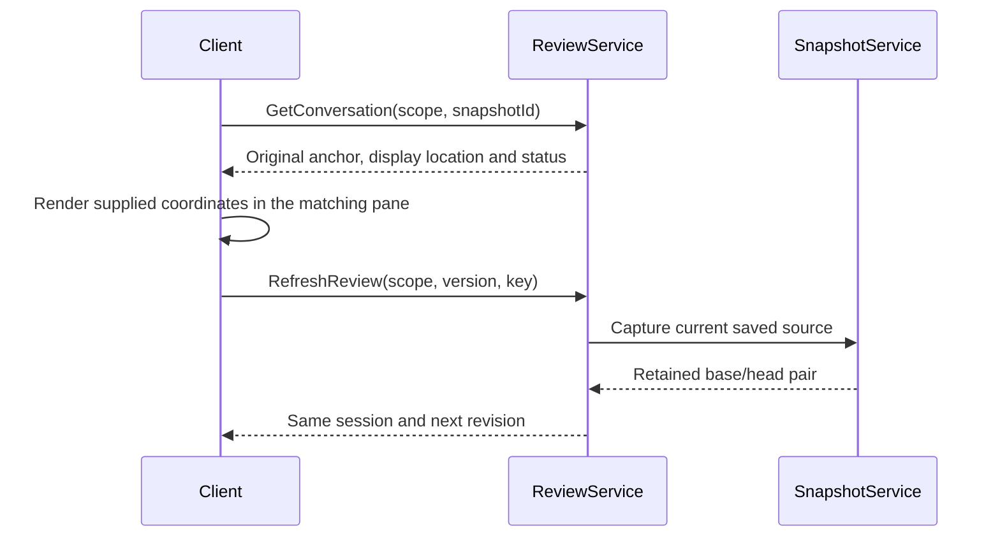

`GetReview` resumes local saved state. An observed PR update can add a revision within its active session. Explicit refresh captures current local saved bytes or PR commits. Capture failure leaves the prior revision available. A completed review keeps its recorded comparison. Refresh accepts no source moves or text-matching evidence.

#### Complete or submit

| Target | Request | Result |
| --- | --- | --- |
| Local Git or directory review | `CompleteReview(reviewId, body, expectedVersion, requestKey)` | Complete locally and keep discussions. No GitHub outcome. |
| PR review | `SubmitReview(reviewId, outcome, body, expectedVersion, requestKey)` | Publish the pending review with its final comment. |
| Uncertain PR submission | `ReconcileSubmission(reviewId, requestKey)` | Find remote evidence and finish the saved submission intent when safe. |

PR outcomes are `approve`, `comment`, and `request_changes`. GitHub self-reviews support `comment`. Reject self-approval and self-request-changes before freezing any intent. The final body can be empty. Closing the editor view does not complete or submit a review. Reconciliation is an explicit recovery action. It can finish a previously staged remote submission.

After a confirmed PR submission, clients call `StartReview` with the same PR target before creating the next draft comment or reply. Use the returned review ID and version for writes. This creates or resumes the next active attempt; it does not change the submitted attempt, its final body or its outcome. Reading the completed attempt does not create a successor.

#### Export

`Export(scope)` returns Markdown without changing review state or writing to GitHub. It includes original locations, authors, replies and resolution. The archived notes scope remains available for reads and export. Promotion is removed.

#### Retry after a failure

| Result | Client action |
| --- | --- |
| Local save succeeds and remote save fails | Keep the comment ID. Show both states and offer draft synchronization. |
| A write loses its response | Repeat the same request key and payload, or read its saved result. |
| The version is stale | Read current state and ask the user before changing the request. |
| Submission is uncertain | Keep the review ID and request key. Offer explicit reconciliation. |
| A read fails | Retry with a bounded deadline while the same review remains selected. |


### Components and Responsibilities

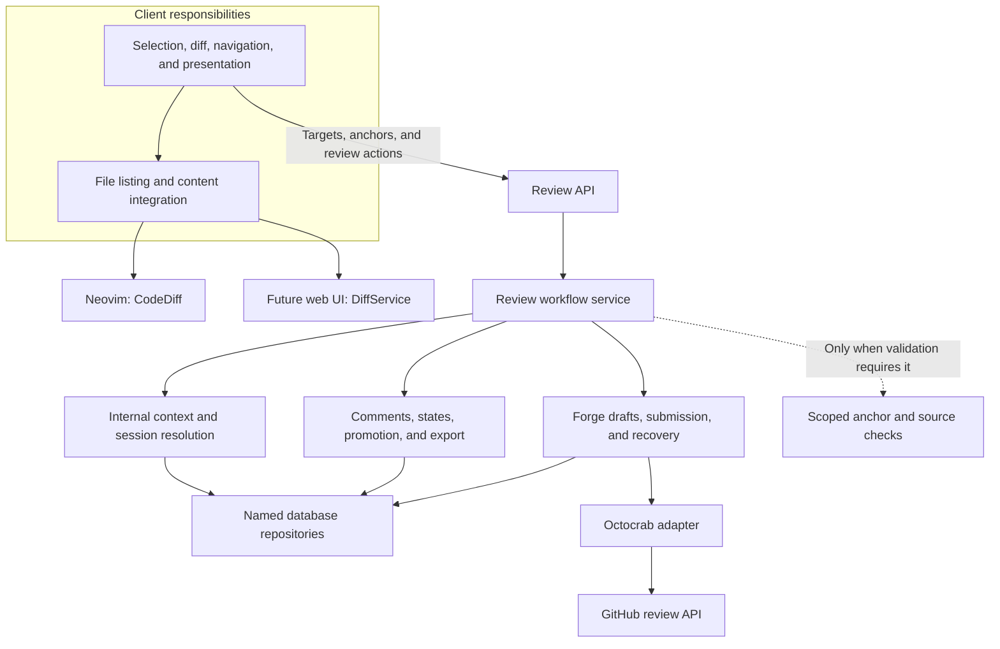

- Client: Select targets, comparisons, and files. Load content, render diffs and comments, and track viewed-file marks.
- RPC boundary: Map requests, select the actor, and start tracing spans.
- Review service: Resolve contexts and sessions. Own comments, resolution, review lifecycle, promotion, and export.
- Models: Validate shapes and implement domain behavior without database access.
- Repositories: Own named queries, mutations, constraints, and transaction rules.
- Forge service: Observe PR metadata and discussions. Own credentials, remote draft writes, submission, and recovery.
- Internal validation: Check anchor scope, source evidence, and comparison consistency without serving a file browser.

These are modules in one backend process. Separate responsibilities do not require separate deployed services. [DiffService](diffs.md) defines future backend content access. Neovim uses CodeDiff for now.

### Data and Control Flow

#### Start or resume internally

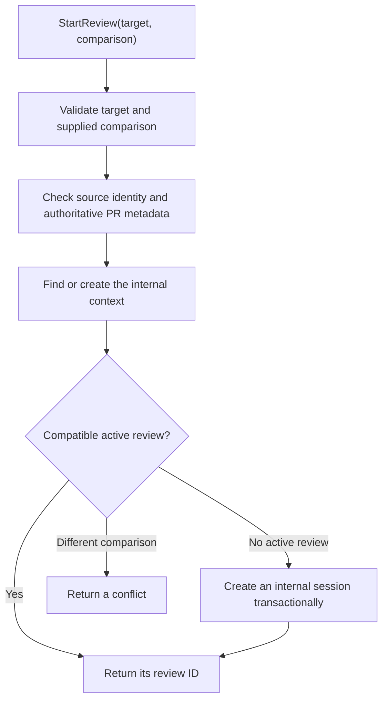

Context creation and session selection are internal method calls. The client supplies the target and desired comparison once.

#### Save locally and synchronize a PR draft

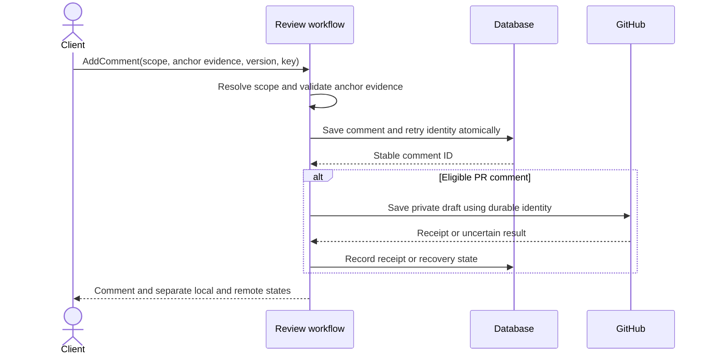

Commit local intent before the external write. A database rollback cannot undo a GitHub write. A partial remote read cannot prove that a comment was deleted.

#### Resolve and delete remote feedback

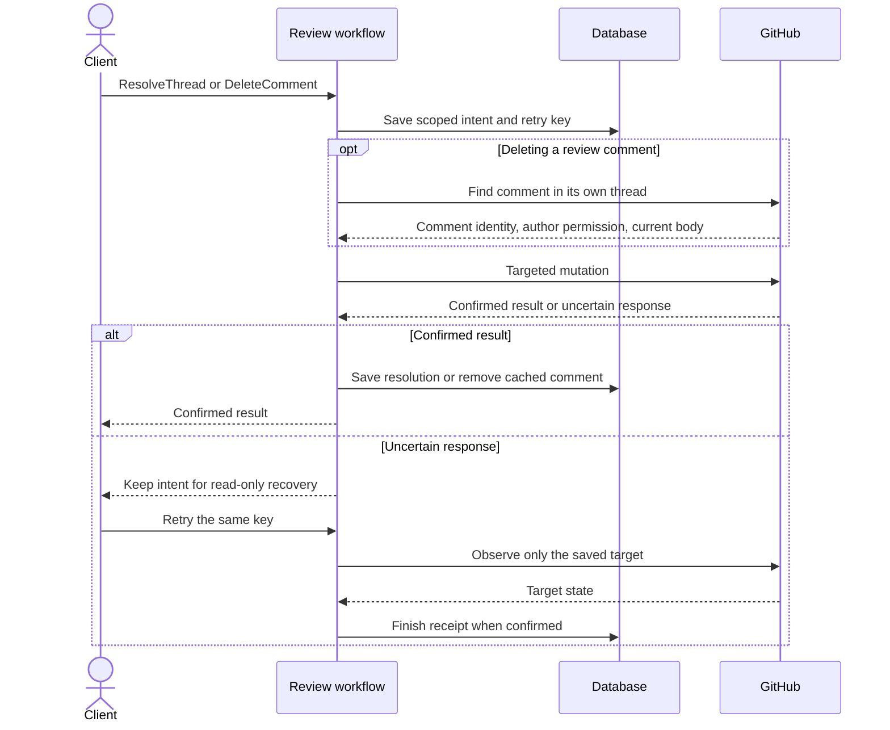

Resolve and reopen need one provider mutation. Review-comment deletion needs a thread-scoped comment lookup and one mutation. They do not load the full PR conversation or check the current account through a separate request on the normal path. The provider enforces remote permissions. Missing private comments require account and PR-access checks during recovery so an account switch cannot look like deletion.

Show progress as soon as the action starts. Apply a confirmed result immediately, then refresh local versions. Do not wait for a full PR refresh before updating the card or closing the modal. An uncertain response is not success and must not trigger another write.

Confirmed remote deletions remove cached text from conversations, cards, modals, and exports. Keep surviving replies under the same thread and anchor without a deleted-root placeholder. A successful local deletion keeps only an identity receipt so stale provider pages cannot restore it. A complete remote refresh also removes comments deleted elsewhere, including discarded GitHub drafts. Preserve comments that were never posted and comments with unresolved mutation intents. Failed or partial reads never infer deletion.


### Interfaces and Contracts

#### Public review boundary

| Client supplies | Service resolves or enforces |
| --- | --- |
| Target path or PR address | Internal context and scope boundaries |
| Selected local comparison and source identities | Recorded comparison and compatibility with the active review |
| PR target | Authoritative PR metadata and submission eligibility |
| Review ID after start or selection | Internal session, context, lifecycle, and remote account |
| Snapshot and selected range | Saved source, valid bounds and fixed location |

The client does not create storage records as setup. The review API does not list files or return file bodies.

```text
ReviewTarget = LocalGit { path }
             | Directory { path }
             | PullRequest { repositoryUrl, number }

Comparison   = Working { baseCommit }
             | Staged { baseCommit }
             | Branch { baseCommit, headCommit }

Scope        = Review { reviewId }
             | Notes { path }

Snapshot     = { id, repositoryId, root, baseCommit, headCommit }

Anchor       = General
             | File { snapshotId, path }
             | Line { snapshotId, path, side, start, end }

Thread       = { anchor, displayLocation?, displayStatus, forgeObservation? }
```

Each union becomes a typed discriminator, such as a Protobuf `oneof`. Local comparison fields describe what the client selected. The service resolves storage from the target. For PRs, the service obtains authoritative base, head, and lifecycle metadata from the forge. A review line anchor requires a relative path. Directory reviews reuse the path-scoped context model internally.

#### Storage ownership

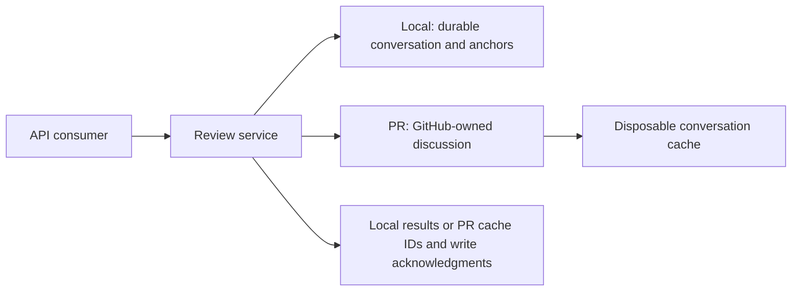

Local reviews own their discussion, source evidence and resolution state. GitHub owns PR drafts, comments, replies, resolution, submission and Viewed state. PR rows support fast reads and retain unsent input while a write fails; a complete provider observation replaces confirmed remote state. Failed or partial reads never infer deletion.

A retry record is not a second PR history. Local requests may need their committed result after later edits or deletion. PR creation requests keep cache IDs; remote mutations keep identity, a payload hash and an acknowledgment. Uncertain writes recover against GitHub before replay. Promotion uses this shared retry contract and a nullable source-note ID on the copied comment.

### Fixed comment locations

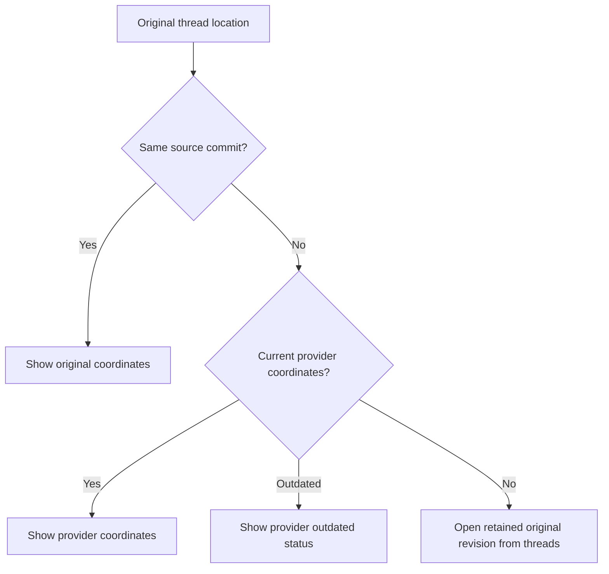

The backend validates new ranges against a retained snapshot. A comment keeps its snapshot ID and commit identity. Evidence excerpts support display and export; no client or backend searches for matching text to relocate a comment.

GitHub supplies current coordinates and outdated status for forge threads. Those observations apply only to the matching PR commits. Original coordinates remain unchanged. Historical local discussions open their original retained revision, including files that disappeared from the current diff.

A private draft created on an earlier revision stays local when GitHub cannot attach its original coordinates to the current pending review. The save response reports that synchronization error and retains its body. Existing remote drafts keep their forge identity; PR pushes preserve the session, pending review and composers.

#### Response contracts

| Response | Required data |
| --- | --- |
| Review | Stable ID, target, comparison, lifecycle, version, allowed actions, and recovery state |
| Conversation | Version, root and reply identity, authorship, order, resolution, local state, remote state, and current path associations |
| Thread location | Immutable original anchor and evidence, selected revision display coordinates, plus provider observations and their comparison identities |
| Refreshed scope state | Scope version, accepted source changes, updated path associations or orphan state, and review metadata when applicable |
| Conflict | Changed fields, current version, and allowed recovery choices |

Versions are opaque to clients. They guard saved review and object state against concurrent changes. Content identities describe displayed text separately. A review version does not prove that local file content is unchanged. Review writes also enforce the recorded comparison. PR submission checks both compared sides and lifecycle.

Before accepting a new line anchor, validate its source, range, selected text, and scope using bounded source evidence. For local content, return a conflict and preserve composer text if its source changes. For PR content, accept an earlier composer source only after verifying its exact bytes and evidence. Derive a separate posting location against the current PR: use a unique match or file-level feedback with the original range and excerpt. Keep stored original anchors unchanged. Confirmed remote comments use provider observations; do not repost them to move a thread.

#### RPC method design and contracts

The request shapes define client responsibilities. Final message fields follow this contract. Identity bootstrap remains separate from review setup.

| Method | Input → output | Required behavior |
| --- | --- | --- |
| `GetCapabilities` | Empty → API version and supported features | Report implemented features only. |
| `EnsureIdentity` | Human or agent fields → actor | Humans require email. Agents require model and provider without email. |
| `StartReview` | Target, comparison, resume policy, request key → review | Resolve storage internally. Resume a compatible local review. For a PR, observe current commits and retain its active review ID. |
| `ListReviews` | Target and lifecycle filters, page token → reviews | Read saved reviews without creating contexts or sessions. |
| `GetReview` | Review ID → review | Resume saved local source; retain a next revision when an active PR comparison advances. Never submit implicitly. |
| `RefreshReview` | Review scope, version and request key → refreshed review | Capture another revision and reconcile provider observations without replacing the active session. |
| `GetConversation` | Scope, optional snapshot ID, file filter and page token → conversation | Return original anchors, provider observations and fixed display locations for the selected revision. |
| `AddComment` | Review scope, snapshot selection, body, version and request key → comment and save states | Validate the retained source and range; synchronize eligible PR drafts. |
| `Reply` | Scope, thread ID, body, version, request key → comment and save states | Check scope and allocate reply order transactionally. |
| `EditComment` | Scope, comment ID, body, version, request key → comment | Enforce ownership and remote permissions. Preserve authorship and anchor. |
| `DeleteComment` | Scope, comment ID, version, request key → receipt | Enforce ownership and provider permissions. Confirmed remote deletion removes the cached comment; surviving replies keep their thread. Local roots require deleting replies first. |
| `ResolveThread` | Scope, thread ID, resolved, version, request key → thread | Resolve or reopen according to thread origin. Confirm remote resolution from the targeted mutation response. |
| `GetFileReviews` | Review ID → paths and content identities | Read local per-reviewer marks or GitHub Viewed state. |
| `SetFileReviewed` | Review ID, path, reviewed, content identity → acknowledgment | Upsert/delete local progress or update GitHub Viewed state. No comment or resolution changes. |
| `SyncDraftComment` | Review ID, comment ID → save state | Recover a known draft using receipts. Detect changed PR commits, update the active comparison, and require compatible original coordinates before a new private write. Reuse its pending review. Keep saved drafts on failure. |
| `CompleteReview` | Review ID, final body, version, request key → review | Complete a local review. Reject PR targets. Keep discussion and resolution. |
| `Export` | Scope, optional selected roots → Markdown | Export notes or reviews without changing state. Selected roots include their threads. |
| `ListPullRequests` | Repository URL, query, page token → PRs | Return bounded PR data. Clients own repository inference and selection UI. |
| `SubmitReview` | Review ID, outcome, final body, version, request key → review | Require an eligible PR and current comparison. Publish only the staged intent. |
| `ReconcileSubmission` | Review ID, request key → review | Recover the saved submission. Report uncertainty when evidence is incomplete. |

Mutations use `x-lgtm-identity` for local attribution. This header is not network authentication. The backend uses its user's local GitHub credentials for remote operations. Request keys bind the actor, scope, operation, and payload. Reuse with different content returns a conflict.

#### Comparison and lifecycle rules

| Event | Required result |
| --- | --- |
| Same target and comparison | Resume its compatible active review. |
| Another local comparison is active | Return a conflict. Never reinterpret existing local drafts. |
| User chooses a new local review | Complete the old attempt and create its successor internally as one workflow. |
| Pending PR submission is uncertain | Require recovery before replacing its attempt. Never discard its intent. |
| Local branch or worktree changes | Reject writes against the wrong source. Retain the saved review. |
| Index or committed content changes | Retain comment identity. Map preserved sources with evidence or float lost selections to the file header. |
| Unstaged content changes | Retain the discussion. Its anchor can become orphaned. |
| Selected diff omits a file | Hide its inline comments from that view. Keep them in the shared context, thread list, and export. |
| PR base or head changes | Update the active comparison during refresh, reopen, or draft posting without replacing its review or pending provider review. Clients reload the diff and clear reviewed marks. Final submission still checks the displayed comparison and rejects a racing push. |
| PR closes or merges | Retain discussions, private drafts, and exports. Block new submission. Do not invent a review outcome. |
| PR reopens | Observe current lifecycle and comparison before enabling new actions. |
| Another client submits or discards a pending review | Reconcile remote evidence. Do not silently recreate the pending review. |

Clients invalidate local reviewed-file marks when their compared content changes. The review service stores local marks per context, actor and path; PR marks use GitHub Viewed state directly. Notes have no reviewed-file mark. Completed attempts retain their metadata. Later discussion changes do not turn exports into historical snapshots.

#### PR continuity across commits

The context key is the repository URL and PR number. Commits describe the current comparison, not the context identity. Active reviews with no frozen final submission follow complete provider observations on refresh, reopen, and draft synchronization. Keep the review ID, authorship, comments, replies, and bound pending-review ID. Never submit, discard, or recreate a pending review merely because its creation commit is old.

The authenticated GitHub account's existing pending review is reused when a new local session has no review receipt, including reviews started on GitHub or by an earlier LGTM session. Adding feedback preserves the pending review's ID, summary and existing comments. A bound receipt cannot switch to another review; uncertain creation still requires its exact recovery evidence. Never discard a pending review to make a local session writable.

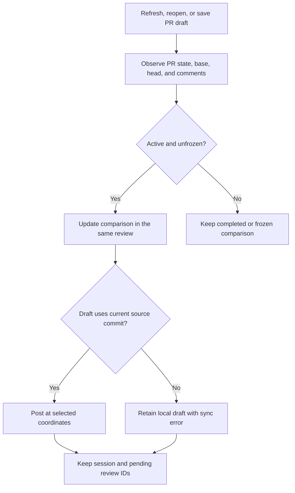

Recover uncertain pending-review creation by exact marker, account, and original commit before advancing its comparison. If those receipts do not prove ownership, keep uncertainty and do not repeat creation. Confirmed remote comments keep provider-owned coordinates. Original anchors stay immutable. Use provider-supplied rename coordinates only for their observed commits. Deleted or unavailable files retain their discussions without inventing a new location.

Final submission checks the explicitly reviewed base and head against the provider before staging and immediately before publication. A push during submission must not turn an old approval into approval of unseen content. Once a final intent is frozen, recover that exact intent rather than changing its comparison or payload.

#### Draft visibility and recovery

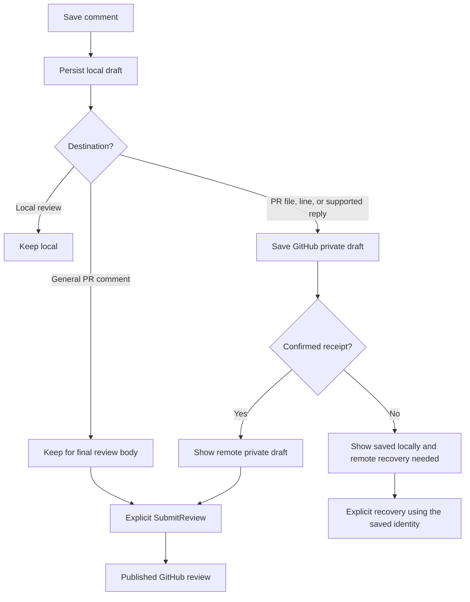

| Failure | Required contract |
| --- | --- |
| Local persistence fails | Report no local save. Do not start an external write. |
| Remote save fails | Return the local comment and a separate remote error. |
| Remote write succeeds but its response is lost | Retain uncertainty. Recover by identity and receipts before retrying. |
| Final review event is definitely rejected | Keep the same review editable, preserve its pending comments and final text, and allow a new outcome with a new request key. A rejected key cannot publish later. |
| Content version changes | Return a conflict before writing against stale content. |
| Refresh is partial | Keep existing remote objects. Do not infer deletion. |

### Rejected submission recovery

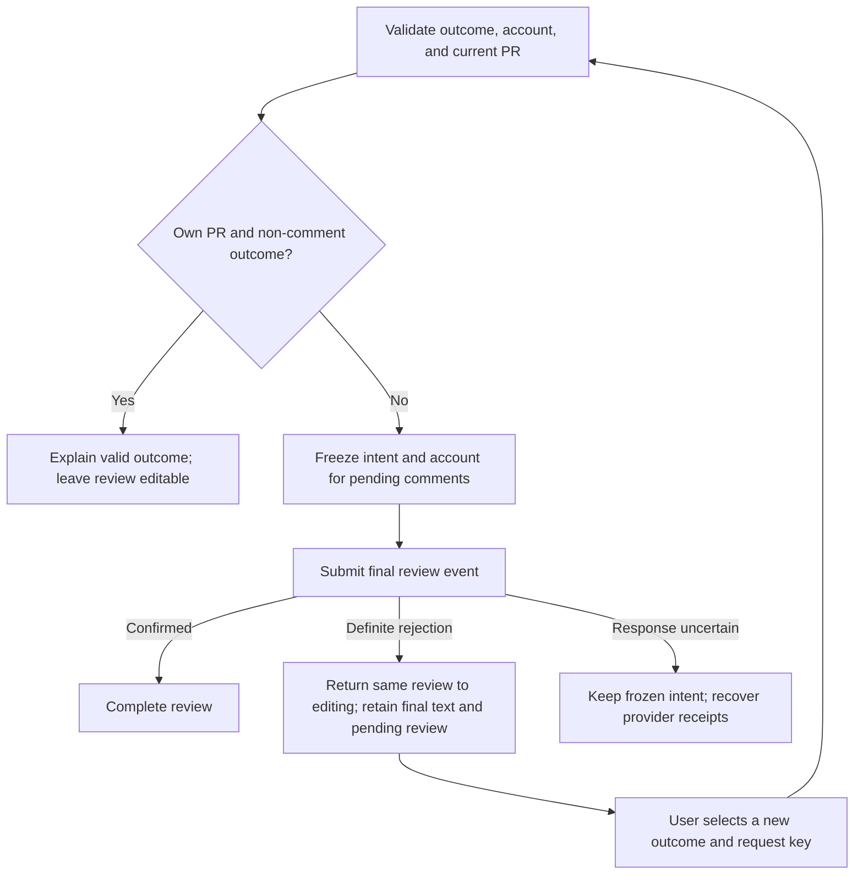

The session's existing body column retains final text while the review is active. Clearing a rejected completion does not delete comment receipts or the pending provider review. Keep the rejected key in the mutation ledger so a delayed retry cannot publish the rejected outcome. Restore private review comments to draft visibility; do not hide conversation comments that were already published.

`GetCapabilities` advertises `rejected_submission_recovery` for this contract. Clients require that capability before recovering a failed submission: an older backend may retry its final event. This check does not change recovery of an uncertain submission.

For a frozen `failed` attempt, `ReconcileSubmission` first verifies the owning account, unique pending review, and all staged comment receipts. A known rejection then resumes editing without retrying its final event. Missing receipts preserve the frozen intent. Recovery of an uncertain write still follows the existing receipt rules; it must not guess rejection or change an outcome that may already have been published.


## Implementation

### Internal persistence

Contexts and sessions organize persisted review data internally. A public review ID identifies a session-backed attempt. This mapping does not require another review table. Directory reviews reuse path-scoped context storage. Archived notes are read-only.

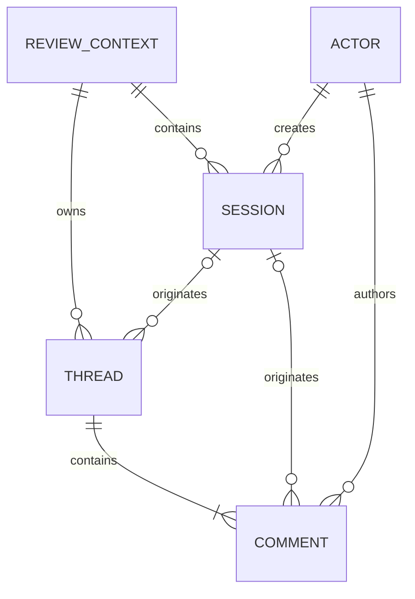

Threads belong to a context and can outlive the attempt that created them. Comments retain their original author and originating attempt. Named repository methods own persistence rules. Services coordinate their transactions.

### Module ownership and extension points

```text
apps/lgtm-backend/
├── proto/lgtm/v1/review.proto       Wire methods and messages
├── src/
│   ├── rpc/
│   │   ├── mod.rs                   Identity and shared transport errors
│   │   ├── review.rs                Review RPC handlers
│   │   └── diff.rs                  Diff RPC handlers
│   ├── models/                      One domain type per file, validation and RPC conversion
│   ├── services/
│   │   ├── auth.rs                  Logical actor selection
│   │   ├── review.rs                Persistence and conversation workflows
│   │   ├── workspace.rs             Scoped source checks used by review validation
│   │   └── forge.rs                 Drafts, submissions, and reconciliation
│   ├── extensions/
│   │   └── gh.rs                    Stateless Octocrab and gh CLI helpers
│   └── forge/
│       ├── client.rs                Typed forge discovery and snapshot contract
│       ├── models.rs                Repository and forge response models
│       └── github.rs                GithubClient and complete GitHub snapshots
└── tests/                          Service, RPC, and adapter contracts

libs/lgtm-db/src/repositories/       Named persistence operations
e2e/
├── backend/                        Public RPC workflows
├── cli/                            Public command workflows
└── nvim/                           Real editor workflows
```

Keep transport changes in the RPC boundary and domain changes in their existing models and services. Extend named repository operations only when a required workflow needs persistence changes. Keep anchor evidence and lifecycle rules in the domain services. DiffService owns anchor capture and placement for Neovim and web clients. Neovim keeps CodeDiff content loading and rendering; its adapter checks native buffers and renders backend placement results. Keep file enumeration, content delivery, and UI selection outside the review API.

### Acceptance flows

| Area | Required flow evidence |
| --- | --- |
| Client boundary | Start, comment, export and complete through public RPCs. |
| Capture | Distinguish working and index bytes; preserve CRLF, literal paths and final newlines. |
| Retained source | Delete the original checkout; read the saved revision after restart. |
| Refresh | Keep session identity, add a revision and retain original thread locations. |
| Historical navigation | Open an earlier comment's saved file and original line. |
| PR continuity | Keep an open composer and pending review across pushes; add feedback on the new revision. |
| Historical draft | Retain an unsupported old selection locally with a specific synchronization error. |
| Provider locations | Honor current coordinates and outdated status without matching text. |
| Attribution and permissions | Keep authorship, reply ordering and resolution; reject unauthorized mutations. |
| Recovery | Use saved receipts to avoid duplicate drafts or submissions. |
| Progress | Keep unchanged file marks; invalidate changed saved comparisons. |

Test database workflows against SQLite and PostgreSQL. Backend, CLI and Neovim E2E suites exercise their public boundaries. Live provider checks use the permanent private fixture and run-owned PRs and refs.

## References

- [Product user guide](../../user-guide.md).
- [System concepts and comment lifecycles](../index.md).
- [DiffService](diffs.md).
- [GitHub thread location fields](https://docs.github.com/en/graphql/reference/pulls#pullrequestreviewthread).
- [Atlas anchor handling at the inspected revision](https://github.com/emrearmagan/atlas.nvim/blob/7e8bb268f0c670fc725319f90c5b72583c1befac/lua/atlas/pulls/diff/position.lua).
- [Review.nvim extmark tracking at the inspected revision](https://github.com/georgeguimaraes/review.nvim/blob/d0b2c3821f6beed0b32608b425364296f4008524/lua/review/marks.lua).
- [Protobuf schema](../../../apps/lgtm-backend/proto/lgtm/v1/review.proto).
- [Review RPC handlers](../../../apps/lgtm-backend/src/rpc/review.rs).
- [Review workflows](../../../apps/lgtm-backend/src/services/review.rs).
- [Forge orchestration](../../../apps/lgtm-backend/src/services/forge.rs).
- [Product requirements](../../../prd/0001-core-concepts/README.md).
- [Backend architecture](index.md).
- [Database architecture](../db/index.md).
- [Backend E2E](../../../e2e/backend), [CLI E2E](../../../e2e/cli), and [Neovim E2E](../../../e2e/nvim).
