# Reviews — software architecture

## Overview

This page defines the review API for CLI, Neovim, and web clients. A target identifies what the client wants to review. The service owns review data and state transitions. Clients own file browsing, content loading, diff selection, and presentation.

This page describes the intended contract. It does not report implementation status. The [system architecture](../index.md#implementation) defines behavior when files, commits, or PRs change. The [product user guide](../../user-guide.md) explains Neovim usage and web UI availability.

## Requirement

### Functional

- FR1: Accept a typed target when starting or listing reviews. Resolve contexts and sessions inside services.
- FR2: Record reviews for working, staged, branch, directory, and PR comparisons selected by clients. Accept anchors for ignored files.
- FR3: Accept notes by file location without a visible review or separate setup call.
- FR4: Preserve comments, replies, attribution, resolution, and exports across restarts and content changes.
- FR5: Save eligible PR comments as remote private drafts. Submit them only after an explicit review submission.
- FR6: Keep local completion separate from PR submission. Preserve unsent drafts when a PR closes or merges.
- FR7: Preserve original anchor evidence and location status. Distinguish confirmed mappings from outdated or unconfirmed locations.
- FR8: Support note promotion, final review comments, exports, and explicit recovery after uncertain remote writes.
- FR9: Detect changed comparisons and concurrent edits before applying a stale client request.
- FR10: Keep original anchors immutable and derived placements specific to their displayed sources.
- FR11: Preserve GitHub current locations, historical locations, and outdated status separately.
- FR12: Automatically float comments whose selected lines are lost to the file header, with their original location and excerpt.
- FR13: Automatically follow confirmed file and directory moves while retaining comment and thread identity.
- FR14: Keep comments on confirmed deleted files as orphaned discussions. Restore preserved anchors when matching content returns.
- FR15: Share staged and branch discussions in one local branch context. Filter each view by the files in its selected diff. Keep PR discussions in their PR context.
- FR16: Allow unstaged Git anchors to become orphaned. Require staged or committed source evidence for local Git anchor preservation.

### Non-Functional

- NFR1: Return review data without enumerating files, downloading file bodies, or requiring a diff view.
- NFR2: Preserve the same transaction rules in SQLite and PostgreSQL.
- NFR3: Keep GitHub credentials in the backend. Separate local attribution from remote account permissions.
- NFR4: Make retries safe. Preserve receipts that prove which remote writes succeeded.
- NFR5: Bound conversation reads and forge requests. Report incomplete observations explicitly.
- NFR6: Limit any content validation to the relevant anchor. Respect path boundaries without changing checkouts or scanning directories.

## Design

### Usage

This section is for API clients. Examples show request shapes, not generated SDK code or final Protobuf messages.

#### Choose the target

| Client task | Client supplies | Service owns |
| --- | --- | --- |
| Review working files | Repository location, working comparison, and baseline identity | Review attempt and its recorded comparison |
| Review staged files | Repository location, staged comparison, and baseline identity | Review attempt and its recorded comparison |
| Review a branch | Repository location and compared commit identities | Review attempt and its pinned commits |
| Review an ignored directory | Explicit root and selected file anchors | Local review data and discussions |
| Review a PR | Repository URL and PR number | Review attempt, PR metadata, drafts, and submission |
| Add an ordinary note | File location and anchor evidence | Notes context, comments, and internal write session |

Clients choose files and load their content through their own content integration. Neovim uses CodeDiff for now. The future web UI uses [DiffService](diffs.md). Each client chooses how to browse explicitly selected ignored directories.

Supply explicit locations. The backend cannot infer the selected repository from its own process directory. For PR selection, `ListPullRequests` returns repository PR data with search filters and paging. Clients infer the repository and branch when available, then choose how to present the results.

#### Local context and preservation policy

Working, staged, and branch views use the same local branch context. Staged and branch comments remain in that shared conversation across review attempts. Switching a comparison changes the displayed files, not comment ownership. PR conversations use their separate forge context and do not import local comments automatically.

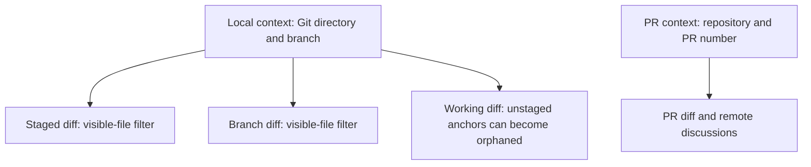

| Anchor source | Preservation contract |
| --- | --- |
| Committed content | Preserve its source commit and derive locations in later selected diffs. |
| Staged content | Preserve the index blob identity, hash, selected text, and context. Carry matching content into commits and branch views. |
| Unstaged working content | Keep it while its source matches. It can become orphaned after edits, staging, commits, or checkout changes. Carry-forward is not required. |
| Notes or explicit directory content | Preserve saved-file evidence and use the note mapping rules. These workflows do not require Git staging. |
| PR content | Keep it in the PR context and preserve separate provider current and historical observations. |

Staged content is the minimum required source for local Git anchor preservation. This depends on the annotated source, not only the UI's mode name. Staging content later does not require upgrading an earlier unstaged anchor. Its discussion remains saved even when its location becomes orphaned.

The UI selects comments whose confirmed current path or rename association belongs to the selected diff. It then resolves their range against that displayed source. A file outside the diff is a visibility filter, not an orphaning event. All saved discussions remain available in the context-wide thread list and export, including orphaned items.

`GetConversation` can accept an optional file-path filter to bound the visible-file query. Without that filter, it returns the context conversation. Filtering never deletes comments, changes their context, or marks them resolved. The staged and branch views can therefore show the same thread ID when its file appears in both diffs.

#### Start or find a review

```text
review = StartReview({
  target: { localGit: { path: "/work/project" } },
  comparison: { staged: { baseCommit: base_sha } },
  resumePolicy: "MATCHING_ONLY",
  requestKey: start_key
}).review

saved = ListReviews({
  filter: { kind: "local_git", path: "/work/project", state: "active" },
  pageToken: page_token
})
```

The client obtains `base_sha` from its selected local comparison. `StartReview` creates or resumes a matching local review. A different active local comparison returns a conflict. `ListReviews` reads saved reviews without creating anything. Use the returned review ID for later actions.

For a PR, supply its repository URL and number. `StartReview` and `RefreshReview` follow the current PR commits while retaining its active review ID and pending provider review. Use the returned comparison to reload displayed content. A supplied comparison that aged during selection can be omitted on the next start request. Frozen submissions and completed reviews retain their comparison.

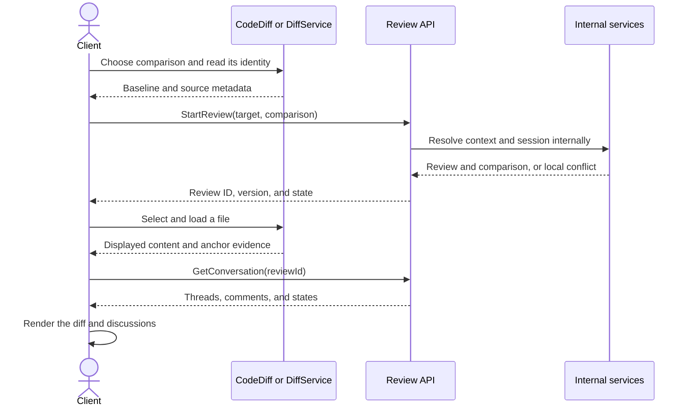

The review API returns domain data. It does not choose a file, diff tool, or layout. File loading and conversation reads can run independently.

#### Add a comment on displayed content

A scope selects either a review or a notes location. A version identifies saved review or comment state. Anchor evidence identifies the content that the client displayed.

```text
# The client reads selected staged content through its content integration.
displayed = client.selected_content()

saved = AddComment({
  scope: { reviewId: review.id },
  anchor: { line: {
    path: displayed.path, side: "new", start: 11, end: 12,
    source: { indexFile: { blobOid: displayed.blobOid, contentHash: displayed.contentHash } },
    evidence: { selectedText: displayed.selectedText, context: displayed.context }
  } },
  expectedVersion: review.version,
  body: "Handle this failure.",
  requestKey: comment_key
})
```

Use a file anchor for a file comment and a general anchor for a review comment. This example uses staged content so its source can survive a commit. Use a commit identity for committed text, the actual blob identity for index text, and a content hash for mutable or non-Git text. Capture the hash, selected text, and bounded surrounding context from the displayed saved source. The service validates the anchor against its scope and recorded comparison. It does not require a preceding file read through the review API.

#### Add notes without starting a review

```text
displayed = client.selected_content()

saved = AddComment({
  scope: { notes: { path: "/work/project/plan.md" } },
  anchor: { line: {
    side: "new", start: 4, end: 4,
    source: { localFile: { contentHash: displayed.contentHash } },
    evidence: { selectedText: displayed.selectedText, context: displayed.context }
  } },
  body: "Explain the rollback.",
  requestKey: note_key
})
```

The notes path identifies the file, so its line anchor needs no second path. The service finds or creates internal storage during the write. Reads do not create an empty note session or scan the notes directory.

#### Read and manage discussions

| Task | Request |
| --- | --- |
| Read discussions | `GetConversation(scope, filePaths?, pageToken)` |
| Reply | `Reply(scope, threadId, body, expectedVersion, requestKey)` |
| Edit a selected comment | `EditComment(scope, commentId, body, expectedVersion, requestKey)` |
| Delete a selected comment | `DeleteComment(scope, commentId, expectedVersion, requestKey)` |
| Resolve or reopen a thread | `ResolveThread(scope, threadId, resolved, expectedVersion, requestKey)` |
| Retry a saved PR draft | `SyncDraftComment(reviewId, commentId, requestKey)` |

Select a comment ID for edit or delete. Select a thread ID for resolution. Responses identify the root, ordered replies, ownership, permissions, and remote save state. Keep local-save success separate from remote-save success.

#### Place saved discussions on displayed content

```text
conversation = GetConversation({
  scope: { reviewId: review.id },
  filePaths: client.selected_diff_paths()
})
displayed = client.selected_content()

# LGTM-owned logic around CodeDiff, or DiffService mapping results.
placements = client.anchor_resolver.resolve(conversation.threads, displayed)
client.clear_comment_overlays()

for placement in placements:
  if placement.matches(displayed) and placement.status in [Exact, Relocated]:
    client.show_inline(placement)
  else:
    client.show_labeled_fallback(placement)
```

`client.*` denotes client logic, not CodeDiff methods or review RPCs. Load content and discussion independently, then resolve each placement before drawing it. Recompute placements when either source changes. The original anchor remains available in the thread window and export.

#### Refresh without replacing the review

`GetReview` reads saved state. `RefreshReview` accepts a review or notes scope and observes source metadata or PR state. It also accepts source-change evidence from the client. It updates known path associations and remote discussions without replacing the selected comparison or submitting a review.

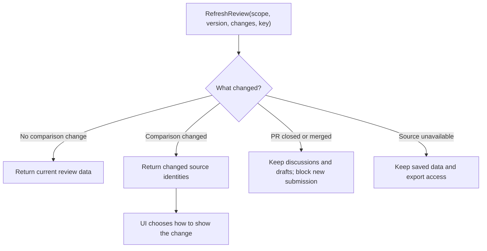

Use explicit refresh when needed. Clients do not need a continuous refresh loop to open a review. Clients detect displayed content changes and compare them with stored anchor evidence. The service reports domain state and permitted operations. Clients choose how to show those results.

#### Complete or submit

| Target | Request | Result |
| --- | --- | --- |
| Local Git or directory review | `CompleteReview(reviewId, body, expectedVersion, requestKey)` | Complete locally and keep discussions. No GitHub outcome. |
| PR review | `SubmitReview(reviewId, outcome, body, expectedVersion, requestKey)` | Publish the pending review with its final comment. |
| Uncertain PR submission | `ReconcileSubmission(reviewId, requestKey)` | Find remote evidence and finish the saved submission intent when safe. |

PR outcomes are `approve`, `comment`, and `request_changes`. GitHub self-reviews support `comment`. Reject self-approval and self-request-changes before freezing any intent. The final body can be empty. Closing the editor view does not complete or submit a review. Reconciliation is an explicit recovery action. It can finish a previously staged remote submission.

#### Promote notes or export

```text
source = { notes: { path: "/work/project/plan.md" } }
notes = GetConversation({ scope: source })

PromoteNotes({
  source: source,
  commentIds: selected_root_ids,
  targetReviewId: review.id,
  anchors: confirmed_target_anchors,
  expectedSourceVersion: notes.version,
  expectedReviewVersion: review.version,
  requestKey: promotion_key
})

markdown = Export({ scope: { reviewId: review.id } }).markdown
notes = Export({ scope: source }).markdown
```

Promotion retains source notes and original authorship. Each target anchor includes its source identity and evidence. The client confirms target locations before promotion. A PR target follows the remote draft rules. Export changes no review state and performs no GitHub write.

#### Retry after a failure

| Result | Client action |
| --- | --- |
| Local save succeeds and remote save fails | Keep the comment ID. Show both states and offer draft synchronization. |
| A write loses its response | Repeat the same request key and payload, or read its saved result. |
| The version is stale | Read current state and ask the user before changing the request. |
| Submission is uncertain | Keep the review ID and request key. Offer explicit reconciliation. |
| A read fails | Retry with a bounded deadline while the same review remains selected. |


### Components and Responsibilities

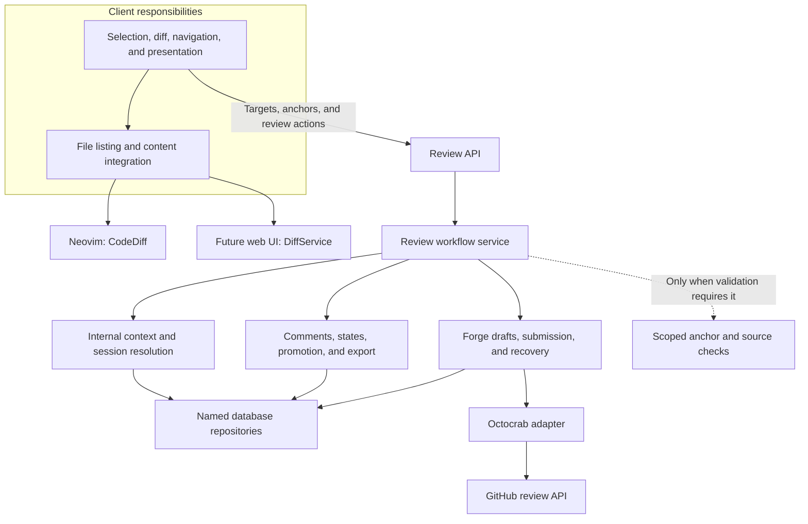

- Client: Select targets, comparisons, and files. Load content, render diffs and comments, and track viewed-file marks.
- RPC boundary: Map requests, select the actor, and start tracing spans.
- Review service: Resolve contexts and sessions. Own comments, resolution, review lifecycle, promotion, and export.
- Models: Validate shapes and implement domain behavior without database access.
- Repositories: Own named queries, mutations, constraints, and transaction rules.
- Forge service: Observe PR metadata and discussions. Own credentials, remote draft writes, submission, and recovery.
- Internal validation: Check anchor scope, source evidence, and comparison consistency without serving a file browser.

These are modules in one backend process. Separate responsibilities do not require separate deployed services. [DiffService](diffs.md) defines future backend content access. Neovim uses CodeDiff for now.

### Data and Control Flow

#### Start or resume internally

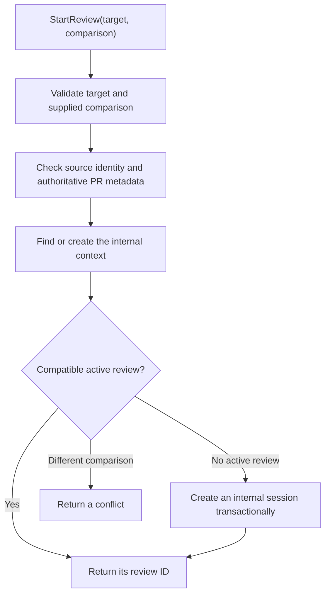

Context creation and session selection are internal method calls. The client supplies the target and desired comparison once.

#### Save locally and synchronize a PR draft

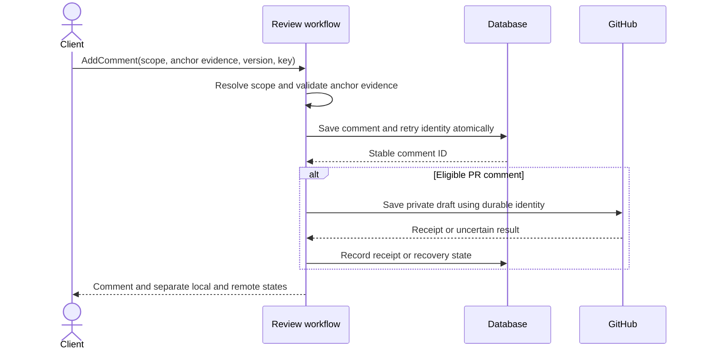

Commit local intent before the external write. A database rollback cannot undo a GitHub write. A partial remote read cannot prove that a comment was deleted.

#### Resolve and delete remote feedback

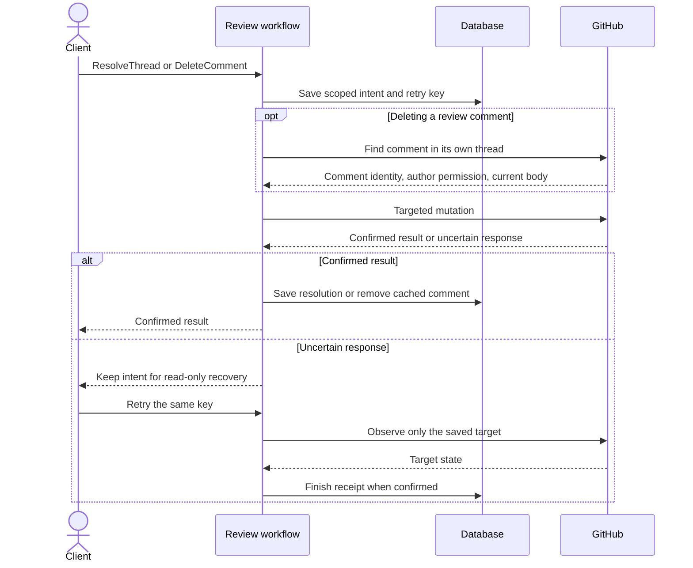

Resolve and reopen need one provider mutation. Review-comment deletion needs a thread-scoped comment lookup and one mutation. They do not load the full PR conversation or check the current account through a separate request on the normal path. The provider enforces remote permissions. Missing private comments require account and PR-access checks during recovery so an account switch cannot look like deletion.

Show progress as soon as the action starts. Apply a confirmed result immediately, then refresh local versions. Do not wait for a full PR refresh before updating the card or closing the modal. An uncertain response is not success and must not trigger another write.

Confirmed remote deletions remove cached text from conversations, cards, modals, and exports. Keep surviving replies under the same thread and anchor without a deleted-root placeholder. A successful local deletion keeps only an identity receipt so stale provider pages cannot restore it. A complete remote refresh also removes comments deleted elsewhere, including discarded GitHub drafts. Preserve comments that were never posted and comments with unresolved mutation intents. Failed or partial reads never infer deletion.


### Interfaces and Contracts

#### Public review boundary

| Client supplies | Service resolves or enforces |
| --- | --- |
| Target path or PR address | Internal context and scope boundaries |
| Selected local comparison and source identities | Recorded comparison and compatibility with the active review |
| PR target | Authoritative PR metadata and submission eligibility |
| Review ID after start or selection | Internal session, context, lifecycle, and remote account |
| Anchor and source evidence | Anchor shape, source consistency, and recorded location status |
| Notes location | Notes context and internal write session |

The client does not create storage records as setup. The review API does not list files or return file bodies.

```text
ReviewTarget = LocalGit { path }
             | Directory { path }
             | PullRequest { repositoryUrl, number }

Comparison   = Working { baseCommit }
             | Staged { baseCommit }
             | Branch { baseCommit, headCommit }

Scope        = Review { reviewId }
             | Notes { path }

Source       = Commit { sha, contentHash }
             | WorkingFile { contentHash }
             | IndexFile { blobOid, contentHash }
             | LocalFile { contentHash }

Anchor       = General
             | File { path }
             | Line { path?, side, start, end, source, evidence }
```

Each union becomes a typed discriminator, such as a Protobuf `oneof`. Local comparison fields describe what the client selected. The service resolves storage from the target. For PRs, the service obtains authoritative base, head, and lifecycle metadata from the forge. A review line anchor requires a relative path. A notes line anchor uses its scope's file path. Directory reviews use the notes context model internally.

#### Anchor ownership

An anchor records what a comment discussed. A placement records where that anchor belongs in one displayed comparison. They have separate lifetimes.

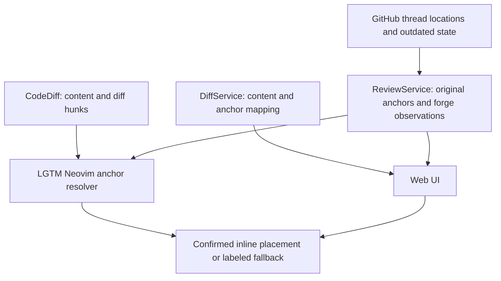

- ReviewService: Preserve original anchors and evidence. Maintain confirmed current path associations and orphan state. Enforce scope, comparison, permissions, and write guards. Store forge observations separately.
- GitHub adapter: Import current and historical locations with their actual source identities and outdated state. Refresh observations for existing threads.
- LGTM Neovim adapter: Capture source evidence and resolve placements against content supplied by CodeDiff. CodeDiff does not own comment identity or relocation.
- DiffService: Supply content evidence and resolve supplied anchors for a requested comparison. It does not load or mutate review records.
- UI: Render confirmed placements inline. Float lost-line discussions to the file header and show orphaned discussions in the review or notes list.

#### Original anchors and source evidence

```text
OriginalAnchor = {
  path, side, start, end,
  source,
  contentHash?,
  selectedText,
  surroundingContext
}

Source = Commit { sha, contentHash }
       | WorkingFile { contentHash }
       | IndexFile { blobOid, contentHash }
       | LocalFile { contentHash }

Placement = {
  threadId,
  displayedComparison,
  displayedSource,
  status: Exact | Relocated | Outdated | Orphaned | Unverified,
  location?,
  reason?,
  evidenceSource: Original | LocalMapping | ForgeObservation
}
```

The original path, side, range, source, and selected text remain immutable. Replies share their thread's anchor. Edits to comment text, resolution, commits, and refreshes do not replace it. Imported history retains the provider's original fields when its original source cannot be established. Never invent a commit identity for that history.

| Content being annotated | Required source identity |
| --- | --- |
| A committed side | Actual commit SHA, repository scope, path, and content identity of that side |
| Unstaged working text | Hash of the saved working file, with the baseline recorded separately. No carry-forward guarantee. |
| Staged text | Actual stage-zero index blob object ID and byte hash, independently of working content |
| Notes or directory content | Hash of the selected saved file, including ignored and non-Git files |

Content hashes use SHA-256 over the exact source bytes, including line endings and the final newline. Joining Neovim buffer lines does not establish that identity. The LGTM adapter obtains or reconstructs the actual saved bytes. Reject a new annotation on unsaved text until the user saves it.

Preserve the selected text and bounded surrounding context as mapping evidence. This is a selected excerpt, not a full-file snapshot. A source hash identifies a file version. It does not prove that a line in different content has the same meaning.

#### Mapping and stale content

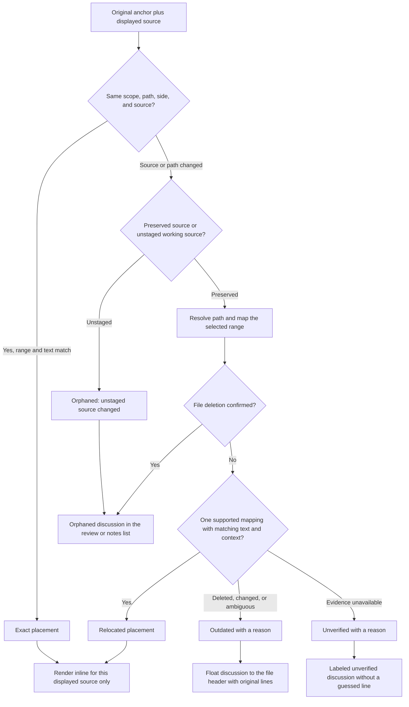

Use source identity first. For changed content, use supported Git or diff mappings and selected-text context to establish one destination. A unique text match without conflicting path or context evidence can support relocation. Repeated text, replaced ranges, uncertain renames, and missing source evidence cannot support a guessed location.

For preserved sources, a moved range must preserve its selected text and order. If any selected line changes or disappears, mark the range outdated. Do not split it or shorten it silently. Never clamp a historical line to the end of the current file.

Extmarks can track candidate positions during edits. They do not prove that the selected text survived a deletion or replacement. Revalidate candidates after a save and before rendering them as current. Preserve original coordinates instead of saving moved extmark coordinates over them.

Only `Exact` and `Relocated` placements contain a confirmed code location. `Outdated`, `Orphaned`, and `Unverified` require a reason and retain the original anchor for fallback display.

A placement applies only to its named comparison and source identities. On file changes, comparison switches, refresh, or reopening, invalidate placements before drawing new ones. Discard asynchronous results for another file generation or source. A stored review version does not validate mutable file content.

| State | Required display |
| --- | --- |
| `Exact` | Show inline at the original range in the matching source. |
| `Relocated` | Show inline at the confirmed derived range. Keep the original location available. |
| `Outdated` | Float the discussion to the file header. Show that the original selection changed, disappeared, or became ambiguous, with its original range and excerpt. |
| `Orphaned` | Keep the discussion under its original file in the review or notes list. State whether the file was deleted or an unstaged source changed. Preserve its range, excerpt, replies, and resolution. |
| `Unverified` | Show a discussion with an unverified location. Allow retry when source evidence becomes available. |
| Source unavailable | Keep the discussion accessible as unverified. A failed read or unavailable checkout does not prove file deletion. |

For preserved sources, confirmed moves and line shifts update derived locations automatically. They need no user confirmation. Unstaged Git comments can instead become orphaned when their source changes. Original anchors remain immutable in both cases.

For renamed files or directories, move file comments and every associated thread to the confirmed new path. Keep their IDs, replies, authorship, resolution, and posting state. The service retains current path associations so notes opened at the new path find the same discussions after restart. Each saved-file thread also retains its immutable absolute source location. A moved notes context retains its original lookup key and a separate current root. New comments capture their actual creation location. An old filename reused by another file must not inherit the moved discussion. Use Git rename evidence or observed filesystem moves, supported by content evidence within the selected scope.

Clients report confirmed moves and deletions through `RefreshReview(scope, sourceChanges, requestKey)` when those changes occur. The service validates the evidence and updates path associations or orphan state transactionally. A notes scope does not create a visible review. Repeating the same change keeps the same discussion IDs. Content mapping results remain specific to the displayed source. No continuous polling loop is required.

If the original line is lost but the file remains, show the discussion above the first code line. Label it as a lost or outdated selection and include the original path, range, and excerpt. Keep it editable and resolvable under the same permissions. Do not turn it into a new general comment or change its remote anchor.

If deletion is confirmed, mark the discussion orphaned and retain it in the review or notes list. If matching content returns or a confirmed move becomes known, automatically reconnect its derived location. Reusing a deleted filename for unrelated content does not reconnect a discussion.

File comments follow confirmed path mappings without needing a line match. General comments need no line mapping. Resolution, publication, and anchor validity remain separate states.

#### GitHub location observations

GitHub exposes `line`, `startLine`, `originalLine`, `originalStartLine`, `diffSide`, `startDiffSide`, and `isOutdated`. Its review comments also expose commit evidence. Import current and original coordinates separately, with the observed comparison. See the [GitHub schema](https://docs.github.com/en/graphql/reference/pulls#pullrequestreviewthread).

Treat `isOutdated` as the provider's status for that PR comparison. A missing current line or an outdated thread cannot produce a current placement from `originalLine`. Original coordinates remain historical evidence. Refresh current observations for existing threads without rewriting their original anchors.

In the live PR view, keep provider-outdated threads in the outdated fallback. A local text match does not override the provider's status. An unavailable current observation cannot establish a current provider placement.

Use a current provider location only when its comparison matches the displayed source. If the user opens historical content, resolve against that historical source explicitly. A confirmed historical placement does not make the thread current on GitHub. If metadata changes during observation, retain the last complete observation and report uncertainty.

#### Context changes

| Event | Required anchor handling |
| --- | --- |
| Insert lines before unchanged selected text | Derive the new range from supported mapping evidence. Keep the original anchor. |
| Stage or unstage | Preserve staged blob identities independently of working content. Earlier unstaged anchors can become orphaned. |
| Commit staged text | Match its saved index blob to the committed file and retain the same thread in branch views. Preserve the original staged source. |
| Change or commit previously unstaged text | Keep its discussion saved. It can remain orphaned without automatic carry-forward. |
| Amend, rebase, reset, or advance a branch | Map from original evidence to the selected comparison. A new SHA alone does not prove that text moved or became invalid. |
| Rename a file or directory | Follow the confirmed new path automatically for all associated comments and threads. Retain original paths and current path associations. |
| Lose a selected line or range | Float the intact discussion to the file header with its original range, excerpt, and lost-selection reason. |
| Delete a file | Keep its comments as orphaned discussions in the review or notes list. Do not attach them to another file. |
| Restore deleted content | Automatically reconnect when path and content evidence establish the same discussion location. |
| Reopen after edits made outside Neovim | Resolve from persisted source and text evidence. Extmarks from an old buffer are insufficient. |
| Switch PR base or head | Follow the complete provider observation within the same active review. Keep the owned pending review and original anchors. Invalidate placements and reviewed marks for the old comparison. |
| Merge or close a PR | Preserve original anchors and the last complete observation. Lifecycle changes do not resolve threads or confirm draft publication. |

The preservation rules apply to staged, committed, notes, directory, and PR sources. Unstaged Git anchors have the explicit orphaning exception above. A changed local comparison can require a new review attempt. A changed PR comparison keeps its active review and pending review identity. Frozen submission intents and completed reviews keep their recorded comparison.

#### Response contracts

| Response | Required data |
| --- | --- |
| Review | Stable ID, target, comparison, lifecycle, version, allowed actions, and recovery state |
| Conversation | Version, root and reply identity, authorship, order, resolution, local state, remote state, and current path associations |
| Thread location | Immutable original anchor and evidence, confirmed current path associations or orphan state, plus separate forge observations and their comparison identities |
| Refreshed scope state | Scope version, accepted source changes, updated path associations or orphan state, and review metadata when applicable |
| Conflict | Changed fields, current version, and allowed recovery choices |

Versions are opaque to clients. They guard saved review and object state against concurrent changes. Content identities describe displayed text separately. A review version does not prove that local file content is unchanged. Review writes also enforce the recorded comparison. PR submission checks both compared sides and lifecycle.

Before accepting a new line anchor, validate its source, range, selected text, and scope using bounded source evidence. For local content, return a conflict and preserve composer text if its source changes. For PR content, accept an earlier composer source only after verifying its exact bytes and evidence. Derive a separate posting location against the current PR: use a unique match or file-level feedback with the original range and excerpt. Keep stored original anchors unchanged. Confirmed remote comments use provider observations; do not repost them to move a thread.

#### RPC method design and contracts

The request shapes define client responsibilities. Final message fields follow this contract. Identity bootstrap remains separate from review setup.

| Method | Input → output | Required behavior |
| --- | --- | --- |
| `GetCapabilities` | Empty → API version and supported features | Report implemented features only. |
| `EnsureIdentity` | Human or agent fields → actor | Humans require email. Agents require model and provider without email. |
| `StartReview` | Target, comparison, resume policy, request key → review | Resolve storage internally. Resume a compatible local review. For a PR, observe current commits and retain its active review ID. |
| `ListReviews` | Target and lifecycle filters, page token → reviews | Read saved reviews without creating contexts or sessions. |
| `GetReview` | Review ID → review | Read saved state without implicit refresh or submission. |
| `RefreshReview` | Review or notes scope, version, optional source changes, request key → refreshed scope state | Validate moves and deletions, update path associations or orphan state, and reconcile forge observations. Keep local and frozen comparisons; update an active PR comparison after a complete provider observation. |
| `GetConversation` | Scope, optional file-path filter, page token → conversation | Read the shared context conversation or its visible-file subset. Return original anchors and separate forge observations. Filtering changes no stored state. |
| `AddComment` | Scope, anchor evidence, body, optional review version, request key → comment and save states | Validate the selected source and range before accepting the anchor. Resolve notes storage internally and synchronize eligible PR drafts. |
| `Reply` | Scope, thread ID, body, version, request key → comment and save states | Check scope and allocate reply order transactionally. |
| `EditComment` | Scope, comment ID, body, version, request key → comment | Enforce ownership and remote permissions. Preserve authorship and anchor. |
| `DeleteComment` | Scope, comment ID, version, request key → receipt | Enforce ownership and provider permissions. Confirmed remote deletion removes the cached comment; surviving replies keep their thread. Local roots require deleting replies first. |
| `ResolveThread` | Scope, thread ID, resolved, version, request key → thread | Resolve or reopen according to thread origin. Confirm remote resolution from the targeted mutation response. |
| `SyncDraftComment` | Review ID, comment ID → save state | Recover a known draft using receipts. Detect changed PR commits, update the active comparison, and derive safe placement before a new private write. Reuse its pending review. Keep saved drafts on failure. |
| `CompleteReview` | Review ID, final body, version, request key → review | Complete a local review. Reject PR targets. Keep discussion and resolution. |
| `Export` | Scope, optional selected roots → Markdown | Export notes or reviews without changing state. Selected roots include their threads. |
| `PromoteNotes` | Notes location, root IDs, target review ID, anchors, source and target versions, request key → comments | Keep source notes and provenance. Synchronize eligible PR drafts. |
| `ListPullRequests` | Repository URL, query, page token → PRs | Return bounded PR data. Clients own repository inference and selection UI. |
| `SubmitReview` | Review ID, outcome, final body, version, request key → review | Require an eligible PR and current comparison. Publish only the staged intent. |
| `ReconcileSubmission` | Review ID, request key → review | Recover the saved submission. Report uncertainty when evidence is incomplete. |

Mutations use `x-lgtm-identity` for local attribution. This header is not network authentication. The backend uses its user's local GitHub credentials for remote operations. Request keys bind the actor, scope, operation, and payload. Reuse with different content returns a conflict.

#### Comparison and lifecycle rules

| Event | Required result |
| --- | --- |
| Same target and comparison | Resume its compatible active review. |
| Another local comparison is active | Return a conflict. Never reinterpret existing local drafts. |
| User chooses a new local review | Complete the old attempt and create its successor internally as one workflow. |
| Pending PR submission is uncertain | Require recovery before replacing its attempt. Never discard its intent. |
| Local branch or worktree changes | Reject writes against the wrong source. Retain the saved review. |
| Index or committed content changes | Retain comment identity. Map preserved sources with evidence or float lost selections to the file header. |
| Unstaged content changes | Retain the discussion. Its anchor can become orphaned. |
| Selected diff omits a file | Hide its inline comments from that view. Keep them in the shared context, thread list, and export. |
| PR base or head changes | Update the active comparison during refresh, reopen, or draft posting without replacing its review or pending provider review. Clients reload the diff and clear reviewed marks. Final submission still checks the displayed comparison and rejects a racing push. |
| PR closes or merges | Retain discussions, private drafts, and exports. Block new submission. Do not invent a review outcome. |
| PR reopens | Observe current lifecycle and comparison before enabling new actions. |
| Another client submits or discards a pending review | Reconcile remote evidence. Do not silently recreate the pending review. |

Clients clear reviewed-file marks when either compared side changes. These marks are UI progress and are outside the review service. Notes have no reviewed-file mark. Completed attempts retain their metadata. Later discussion changes do not turn exports into historical snapshots.

#### PR continuity across commits

The context key is the repository URL and PR number. Commits describe the current comparison, not the context identity. Active reviews with no frozen final submission follow complete provider observations on refresh, reopen, and draft synchronization. Keep the review ID, authorship, comments, replies, and bound pending-review ID. Never submit, discard, or recreate a pending review merely because its creation commit is old.

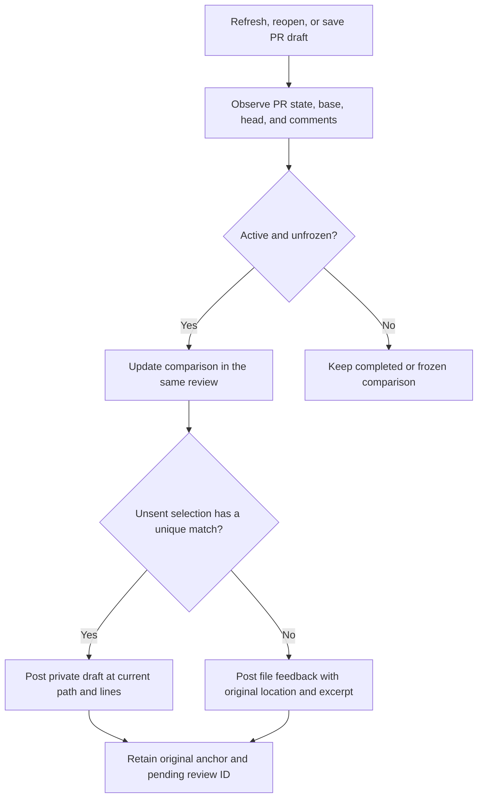

Recover uncertain pending-review creation by exact marker, account, and original commit before advancing its comparison. If those receipts do not prove ownership, keep uncertainty and do not repeat creation. Confirmed remote comments keep provider-owned coordinates. Original anchors stay immutable. Follow only confirmed file renames. Deleted or unavailable files retain their discussions without inventing a new location.

Final submission checks the explicitly reviewed base and head against the provider before staging and immediately before publication. A push during submission must not turn an old approval into approval of unseen content. Once a final intent is frozen, recover that exact intent rather than changing its comparison or payload.

#### Draft visibility and recovery

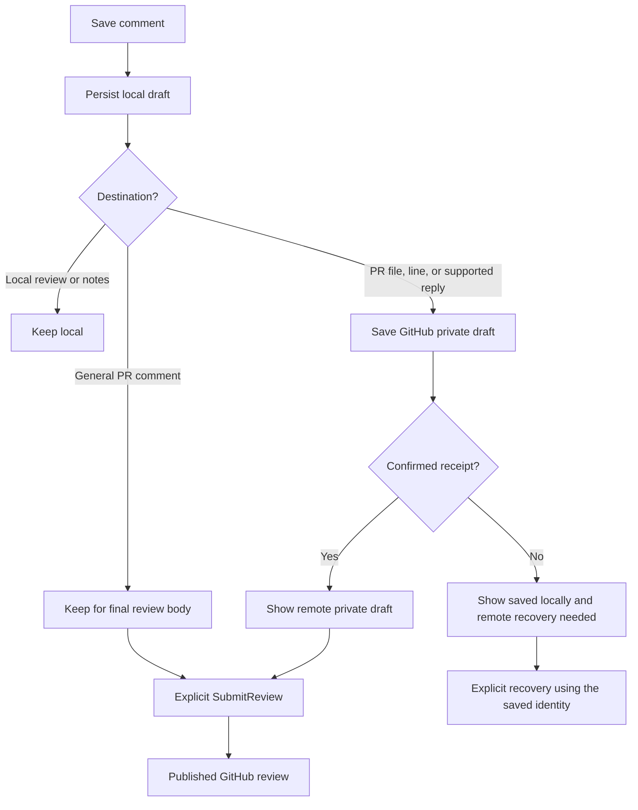

| Failure | Required contract |
| --- | --- |
| Local persistence fails | Report no local save. Do not start an external write. |
| Remote save fails | Return the local comment and a separate remote error. |
| Remote write succeeds but its response is lost | Retain uncertainty. Recover by identity and receipts before retrying. |
| Final review event is definitely rejected | Keep the same review editable, preserve its pending comments and final text, and allow a new outcome with a new request key. A rejected key cannot publish later. |
| Content version changes | Return a conflict before writing against stale content. |
| Refresh is partial | Keep existing remote objects. Do not infer deletion. |

### Rejected submission recovery

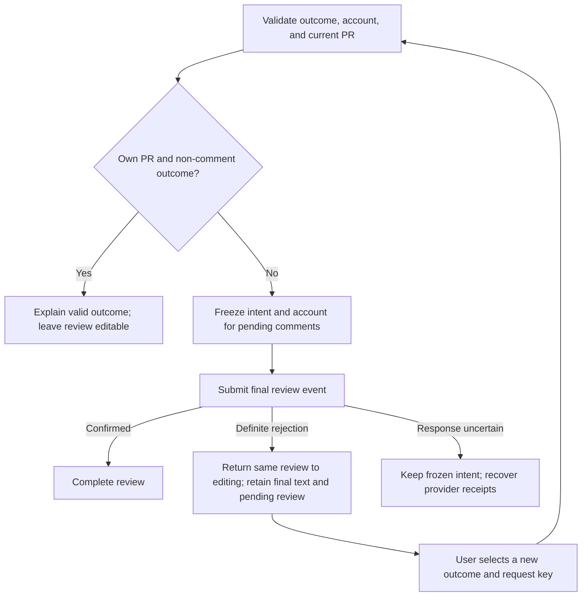

The session's existing body column retains final text while the review is active. Clearing a rejected completion does not delete comment receipts or the pending provider review. Keep the rejected key in the mutation ledger so a delayed retry cannot publish the rejected outcome. Restore private review comments to draft visibility; do not hide conversation comments that were already published.

`GetCapabilities` advertises `rejected_submission_recovery` for this contract. Clients require that capability before recovering a failed submission: an older backend may retry its final event. This check does not change recovery of an uncertain submission.

For an older frozen `failed` attempt, `ReconcileSubmission` first verifies the owning account, unique pending review, and all staged comment receipts. A known rejection then resumes editing without retrying its final event. Missing receipts preserve the frozen intent. Recovery of an uncertain write still follows the existing receipt rules; it must not guess rejection or change an outcome that may already have been published.


## Implementation

### Internal persistence

Contexts and sessions organize persisted review data internally. A public review ID identifies a session-backed attempt. This mapping does not require another review table. Directory reviews reuse notes storage. Ordinary notes resolve their internal write session on demand.

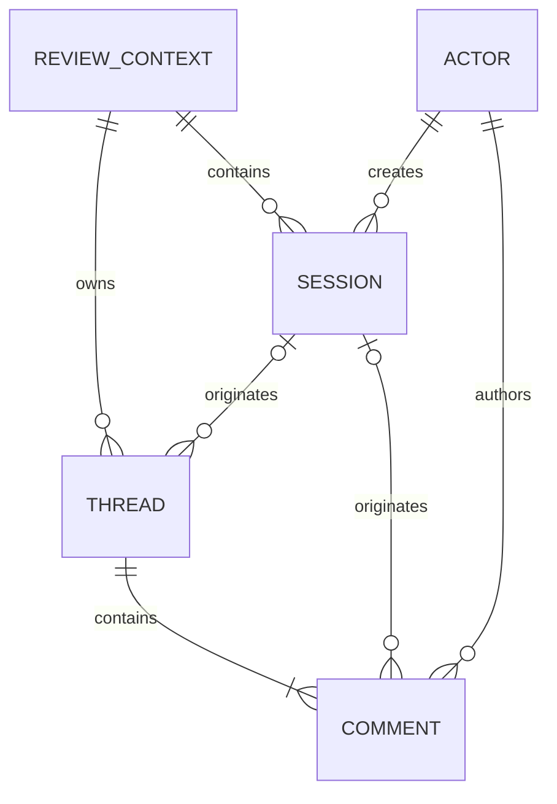

Threads belong to a context and can outlive the attempt that created them. Comments retain their original author and originating attempt. Named repository methods own persistence rules. Services coordinate their transactions.

### Module ownership and extension points

```text
apps/lgtm-backend/
├── proto/lgtm/v1/review.proto       Wire methods and messages
├── src/
│   ├── rpc/mod.rs                   Request mapping, identity, and error boundary
│   ├── models/                      Contexts, sessions, comments, and anchors
│   ├── services/
│   │   ├── auth.rs                  Logical actor selection
│   │   ├── review.rs                Persistence and conversation workflows
│   │   ├── workspace.rs             Scoped source checks used by review validation
│   │   └── forge.rs                 Drafts, submissions, and reconciliation
│   ├── extensions/
│   │   └── gh.rs                    Stateless Octocrab and gh CLI helpers
│   └── forge/
│       └── github.rs                GitHub review mapping and complete snapshots
└── tests/                          Service, RPC, and adapter contracts

libs/lgtm-db/src/repositories/       Named persistence operations
e2e/
├── backend/                        Public RPC workflows
├── cli/                            Public command workflows
└── nvim/                           Real editor workflows
```

Keep transport changes in the RPC boundary and domain changes in their existing models and services. Extend named repository operations only when a required workflow needs persistence changes. Keep anchor evidence and lifecycle rules in the domain services. The Neovim adapter owns local placement resolution around CodeDiff. DiffService owns equivalent content-based mapping for web clients. Keep file enumeration, content delivery, and UI selection outside the review API.

### Acceptance flows

| Area | Required flow evidence |
| --- | --- |
| Client-oriented boundary | Start and list reviews from targets without context, session, or workspace setup calls. |
| Notes by location | Add, reply, export, and promote notes without a visible review or storage IDs. |
| Client and service boundary | Start, read, comment, export, and complete without file-list or file-body RPCs. Two clients remain isolated. |
| Versions and safe retries | A lost creation response does not duplicate a comment. A stale edit does not overwrite another edit. |
| Working and index anchors | Record the actual reviewed content instead of assigning changed text to the starting HEAD. |
| Preserved range movement | Insert lines before a staged or committed selection, save, and reopen. Derive the new range without changing its original anchor. |
| Unstaged source changes | Change or commit previously unstaged content. Keep its discussion accessible even when its anchor becomes orphaned. |
| Staged-to-branch carry-forward | Comment on an index blob, commit it, and open a branch diff. Show the same thread ID at its supported location. |
| Shared local view filtering | Switch staged and branch views. Select comments by files in each diff without copying conversations or orphaning hidden files. |
| PR separation | Open a PR for a locally reviewed branch. Keep local comments in the local context and PR comments in the PR context. |
| Ambiguous or deleted text | Duplicate, replace, or delete selected text. Float the discussion to the file header, never a clamped current line. |
| Exact byte identity | Distinguish working and index bytes, CRLF, and a missing final newline. Hash the actual selected source. |
| GitHub current and historical locations | Import an outdated thread with no current line. Preserve original coordinates and refresh existing observations without drawing a false current placement. |
| Placement isolation | Switch files and comparisons during mapping. Discard stale asynchronous results and invalidate old overlays. |
| Composer source changes | Reject changed local bytes while retaining text. For a PR push, verify the captured source and derive a unique current placement or explicit file-level feedback. Keep original evidence. |
| Commit, amend, and rebase | Preserve stable comments and original evidence. Return verified mappings or explicit outdated fallbacks. |
| Rename and directory move | Move a file or its parent directory. Find all the same discussion IDs at the new path after reopening and restarting. |
| Lost selected lines | Delete or replace a selected range while keeping the file. Show its entire discussion at the file header with an original-location-lost label. |
| File deletion and restoration | Delete the file and keep its discussions in the orphaned list. Restore matching content and reconnect automatically. An unrelated replacement remains separate. |
| Comparison selection | Resume working, staged, and branch reviews unambiguously. Reject writes against another comparison. |
| PR lifecycle and comparison changes | Observe open, closed, merged, base, and head state. Gate mutations and stale submissions. |
| External pending-review changes | Detect external submit or discard without creating replacement drafts silently. |
| Remote write recovery | Survive lost responses for draft save, edit, delete, resolution, and submission without false success. |
| Note promotion | Retain source attribution and provenance. Save eligible promoted PR drafts remotely. Reply transfer requires an explicit policy. |
| UI progress | Client tests clear reviewed marks when either side changes. Backend tests require no viewed-file state. |

Test complete workflows through the public boundary against real SQLite and PostgreSQL. Keep dummy forge behavior at the HTTP boundary. Use separate backend, CLI, and Neovim E2E suites. The editor suite uses real Neovim, CodeDiff, WhichKey, notifications, and backend processes, plus an optional Kak profile. Any live fixture repository must be private. Confirm visibility before uploading content.

## References

- [Product user guide](../../user-guide.md).
- [System concepts and comment lifecycles](../index.md).
- [DiffService](diffs.md).
- [GitHub thread location fields](https://docs.github.com/en/graphql/reference/pulls#pullrequestreviewthread).
- [Atlas anchor handling at the inspected revision](https://github.com/emrearmagan/atlas.nvim/blob/7e8bb268f0c670fc725319f90c5b72583c1befac/lua/atlas/pulls/diff/position.lua).
- [Review.nvim extmark tracking at the inspected revision](https://github.com/georgeguimaraes/review.nvim/blob/d0b2c3821f6beed0b32608b425364296f4008524/lua/review/marks.lua).
- [Protobuf schema](../../../apps/lgtm-backend/proto/lgtm/v1/review.proto).
- [RPC boundary](../../../apps/lgtm-backend/src/rpc/mod.rs).
- [Review workflows](../../../apps/lgtm-backend/src/services/review.rs).
- [Forge orchestration](../../../apps/lgtm-backend/src/services/forge.rs).
- [Product requirements](../../../prd/0001-core-concepts/README.md).
- [Backend architecture](index.md).
- [Database architecture](../db/index.md).
- [Backend E2E](../../../e2e/backend), [CLI E2E](../../../e2e/cli), and [Neovim E2E](../../../e2e/nvim).
