# Bundled backend module architecture

## Overview

The bundled backend module provides the same greeting and health services as the private backend library.

## Requirement

### Functional

- Register `lgtm.v1.GreeterService/SayHello` and health services.
- Share the Protobuf schema between Rust and TypeScript clients.
- Return a greeting for the supplied name, with `World` as the blank-name default.

### Non-Functional

- Support native gRPC, browser gRPC-Web, and Connect JSON requests.
- Compile the Cargo package without Bun or Buf after bundle generation.

## Design

### Components and Responsibilities

- `proto` includes generated messages, service traits, and client types.
- `Greeter` implements the generated greeting service trait.
- `router` registers the greeting service and installs health checks.
- The CLI server mounts the resulting service alongside web assets.
- The bundle task copies canonical source and generated Rust files into the CLI package.

### Data and Control Flow

The schema defines request and response messages. Buf generates Rust code for the backend and TypeScript code inside the web app. The bundle task copies the Rust implementation and generated files into `lgtm-cli`.

At runtime, `server::serve` calls `backend::router` and mounts the service. A greeting request reaches `Greeter::say_hello`, which trims the name and returns `Hello, <name>!`.

### Interfaces and Contracts

`router() -> (connectrpc::Router, Arc<connectrpc_health::StaticChecker>)` returns the RPC router and its health controller. The server calls `shutdown()` on that controller during graceful exit.

<!-- prettier-ignore -->
| Service item               | Contract                                |
| -------------------------- | --------------------------------------- |
| `SayHello`                 | Unary greeting method                   |
| `SayHelloRequest.name`     | Name, trimmed before use                |
| `SayHelloResponse.message` | Greeting string                         |
| `proto`                    | Generated messages, traits, and clients |

Native clients call `/lgtm.v1.GreeterService/SayHello`. Browser clients use `/rpc/lgtm.v1.GreeterService/SayHello` through the CLI server.

## Implementation

### Code generation and packaging

The private backend's build script generates Rust files in Cargo's output directory. The bundle task copies those files, the backend source, and the static web build into an ignored directory. The CLI manifest includes that directory in the Cargo package.

The CLI build script copies protocol files into its own output directory. `connectrpc::include_generated!()` loads them there. No runtime code generation is required.

## References

- [Canonical backend source](../../../apps/lgtm-backend/src/lib.rs).
- [Protobuf schema](../../../apps/lgtm-backend/proto/lgtm/v1/hello.proto).
- [Backend build script](../../../apps/lgtm-backend/build.rs).
- [CLI bundle script](../../../apps/lgtm-cli/scripts/bundle.ts).
- [CLI build script](../../../apps/lgtm-cli/build.rs).
- [Server module](server.md).
