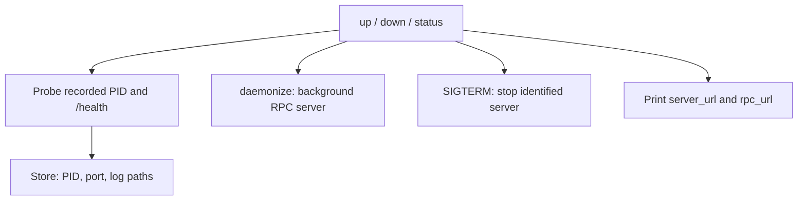

# CLI daemon — software architecture

## Overview

The daemon module starts, discovers, and stops the background process that serves the `lgtm-forge` Connect/gRPC API.

## Requirement

### Functional

- FR1: Start the background RPC server when no healthy instance exists.
- FR2: Reuse a healthy server for repeated startup requests and prevent duplicate servers through PID-file locking.
- FR3: Report the PID, `server_url`, and `rpc_url`.
- FR4: Stop the identified server with SIGTERM.

### Non-Functional

- NFR1: Use the embedded `daemonize` library without a separate daemon tool.
- NFR2: Match the stored PID to the server's health response before signaling it.
- NFR3: Return launch errors with captured output and readiness/shutdown failures with a log file location.

## Design

### Usage

Pass the same store to startup, discovery, and shutdown:

```rust
let store = Store::new()?;
up(0, &store, false).await?;
status(&store, true).await?;
down(&store).await?;
```

`up` starts or reuses a healthy instance. `status` reports discovery data without starting one. `down` stops only the process that matches the recorded health response.

### Components and Responsibilities



- `daemonize` detaches the server, locks its PID file, and redirects output.
- `Store` supplies runtime file paths and recorded PID/port values.
- `log::output` opens the file for daemon output.
- The HTTP client probes `/health` to identify a ready server.
- `nix` sends SIGTERM to the identified process on Unix.

### Data and Control Flow

`ensure_running` first probes the recorded instance. If it is healthy, the function returns it. Otherwise, it launches the same executable with `serve --daemonize` and polls for readiness.

The library's PID-file lock prevents duplicate servers. Concurrent launches compete for that lock; an unsuccessful launch returns its captured error before readiness polling. There is no separate startup lock.

`down` probes the instance, sends SIGTERM, and waits for the server to remove `server.port`. `status` only reads files and probes the server.

### Interfaces and Contracts

```rust
pub fn detach(store: &Store) -> Result<()>;
pub async fn up(port: u16, store: &Store, json: bool) -> Result<()>;
pub(crate) async fn ensure_running(port: u16, store: &Store) -> Result<Instance>;
pub async fn down(store: &Store) -> Result<()>;
pub async fn status(store: &Store, json: bool) -> Result<()>;
```

<!-- prettier-ignore -->
| API              | Contract                                    |
| ---------------- | ------------------------------------------- |
| `detach`         | Detach before runtime threads start         |
| `up`             | Ensure readiness and print server/RPC URLs  |
| `ensure_running` | Return a healthy instance                   |
| `down`           | Stop the identified Unix process            |
| `status`         | Print URLs or JSON discovery data           |

Running JSON contains `running`, `pid`, `server_url`, and `rpc_url` (`{server_url}/rpc`).

Stopped JSON is `{"running":false}`. A stored PID alone does not count as a running server.

## Implementation

### Readiness

Each HTTP probe has a one-second timeout and bypasses proxy configuration. Readiness requires a successful JSON response whose `pid` matches the stored PID. Startup performs up to 50 probes, with a 200 ms pause after each unsuccessful probe.

### Detachment and output

`detach` sets the working directory to the store and the Unix creation mask to `077`. It passes `server.pid` to `daemonize` and appends stdout and stderr to `server.log`.

The caller captures the launch command's output. If detachment fails, the error includes captured stderr. If the launched server never becomes ready, the error includes stderr and the log location.

### Shutdown

Shutdown uses SIGTERM rather than an HTTP control endpoint. The caller performs up to 50 checks for port-file removal, with a 200 ms pause between checks. A missing or mismatched health response prevents signaling a stale PID.

## References

- [Daemon implementation](../../../apps/lgtm-cli/src/daemon.rs).
- [Lifecycle tests](../../../apps/lgtm-cli/tests/daemon.rs).
- [Store module](store.md).
- [Server module](server.md).
