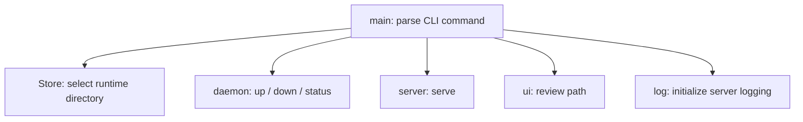
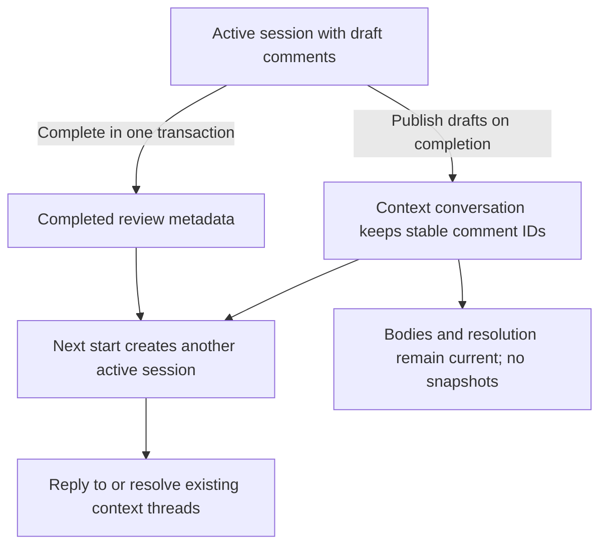
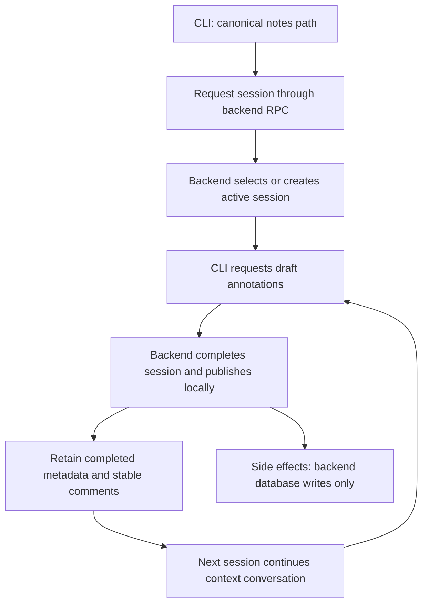
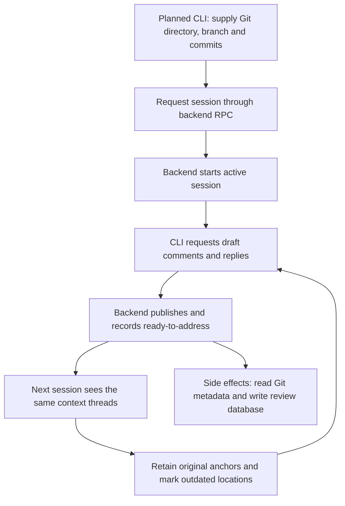
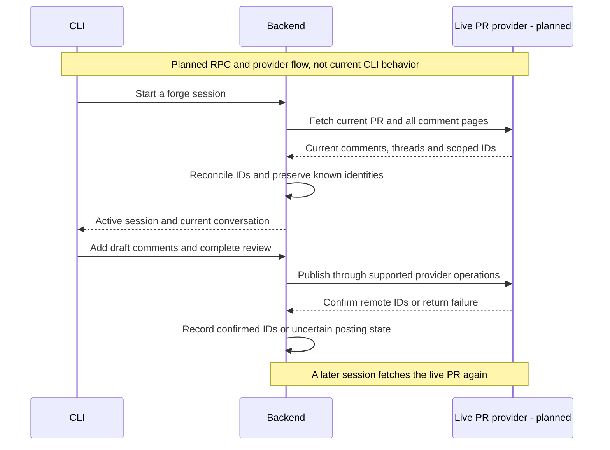

# CLI architecture

## Overview

The main module parses CLI commands and connects them to the daemon, server, store, log, and UI modules.

## Modules

<!-- prettier-ignore -->
| Module              | Responsibility                         |
| ------------------- | -------------------------------------- |
| [Daemon](daemon.md) | Start, discover, and stop the server   |
| [Server](server.md) | Serve web assets and API requests      |
| [Store](store.md)   | Own runtime paths and PID/port files   |
| `ui`                | Build review URLs and open the browser |
| Bundled backend     | Serve review, identity, greeting and health services   |

## Requirement

### Functional

- Route `up`, `down`, `status`, `review`, `session`, `sessions` and `comments` to their module APIs.
- Support foreground serving and the internal background startup command.
- Apply one store directory to every command.

### Non-Functional

- Detach the background server before starting Tokio threads.
- Return command errors through the process exit status.

## Design

### Components and Responsibilities

- `Cli`, `Command`, and `Up` define arguments through Clap.
- `Store::new` selects the runtime directory.
- `log::init` configures server logging after detachment.
- `daemon` handles background startup, shutdown, and status.
- `server` runs the shared UI/API listener.
- `ui` opens the review URL for the current directory.

### Data and Control Flow

The entry point parses arguments and constructs a store. For `serve --daemonize`, it detaches before creating the Tokio runtime. Server commands initialize logging before creating the runtime. The entry point then calls the selected module API inside it.

`review` uses the browser compatibility entry point to select a local path and passes that path to `ui::open_review`. This function obtains a ready server, encodes the path as a query parameter, and opens the browser. The server's working directory is the store.

ReviewService and database access stay in the backend. Session/comment commands use generated Rust gRPC clients; the bundled server initializes the real backend and its database. The daemon uses the store for discovery and the log module for background output. The server uses the same store for PID ownership and its listening port. These modules share one `Store` value from the entry point.

### Review-situation flows

Session/comment commands call backend RPCs. The browser `review` entry point still opens the dummy UI; machine `review --json` uses RPCs. Only the server initializes backend services/storage.

A context has one active session shared by identities. Completion publishes its drafts and retains completed metadata. Later sessions reuse the same context conversation, without copying or snapshotting comments.

Notes use a canonical local path as their context key. Planned commands create drafts and complete sessions through the backend. Their effects are database writes, without Git or forge writes.

Local branch reviews use an absolute Git directory, branch and reviewed commits. A forge remote is optional for these local contexts. Planned commands preserve original comment anchors and continue existing threads. Git metadata is read for context, while review changes remain in backend persistence.

A forge-backed context requires a repository URL and PR/MR number. A new forge session must fetch current PR comments before the backend uses them as context. The backend matches scoped forge IDs to local records and retains known agent attribution. Local history does not prove that a live PR is current.

Forge publication changes the PR and records confirmed remote IDs locally. A failed or uncertain operation requires reconciliation before retry. There is no live provider implementation yet. Backend integration tests use an explicit dummy provider, and submission remains unsubmitted in the current fixture.

### Interfaces and Contracts

<!-- prettier-ignore -->
| Command             | Action                                    |
| ------------------- | ----------------------------------------- |
| `up`                | Start or reuse the server and open its UI |
| `up --foreground`   | Serve in the current terminal             |
| `down`              | Stop the identified server                |
| `status`            | Print server URLs                         |
| `status --json`     | Print discovery data                      |
| `review`            | Open the current directory in the UI      |
| `serve --daemonize` | Internal background startup               |

The default port is `8080`. Port `0` asks the operating system for an available port. `--no-open` suppresses browser launch for `up` and `review`.

`LGTM_HOME` selects an isolated runtime directory for tests. Without it, runtime files use `~/.lgtm`.

## Implementation

### Command definitions

Clap derives argument parsing from Rust types. The internal `serve` command is hidden from normal help. `main()` returns `anyhow::Result<()>`, so parsing and runtime errors do not report command success.

### Runtime boundary

Background startup uses a fresh copy of the executable. That copy calls `daemon::detach` before creating a Tokio runtime. The foreground caller keeps its own runtime while waiting for server readiness.

### Backend inclusion

The `backend` module comes from `bundle/backend.rs`. The bundle task copies only the current greeting/health RPC router into the CLI package before compilation.

## References

- [Entry point](../../../apps/lgtm-cli/src/main.rs).
- [Daemon module](daemon.md).
- [Server module](server.md).
- [Shared application architecture](../index.md).
- [Database architecture](../db/index.md).
