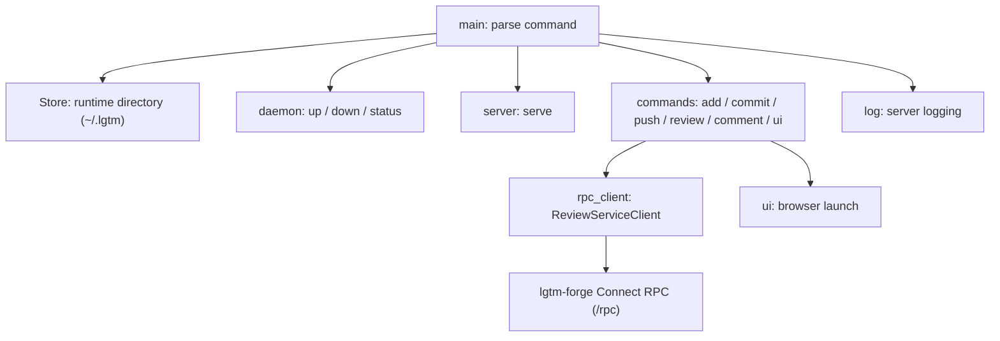
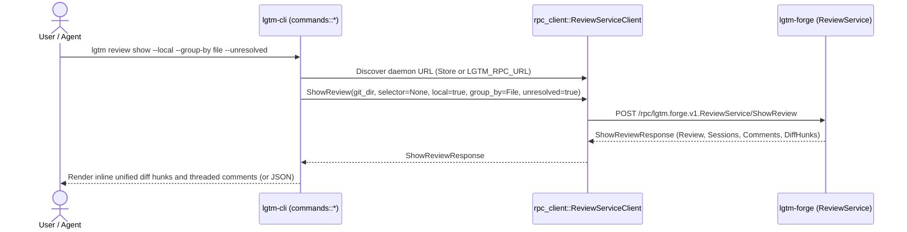

# CLI — software architecture

## Overview

`lgtm-cli` parses user and agent commands, manages the local daemon lifecycle (`up`, `down`, `status`, `ui`), and acts as a Connect RPC client to `lgtm-forge` for staging (`add`), committing (`commit`), pushing (`push`), review workflows (`review list|new|refresh|show|close`), and comment workflows (`comment new|update|delete`).

## Requirement

### Functional

- Unified local and remote commands: Use the same command surface for local snapshot reviews (`--local`) and remote pull request reviews.
- Branch-aware defaults: Default `review list`, `review refresh`, `review show`, `review close`, and `comment new` to the latest review on the current branch when the review number or name is omitted.
- Agent identity support: Allow AI assistants to pass `--as <agent-name>` on commits and comments without switching the user's active Git or GitHub account.
- Human and machine output: Render inline unified diffs and threaded comments in the terminal by default, and emit structured JSON on stdout when `--json` is passed.
- Daemon and browser management: Start, discover, inspect, and stop the background server and open the web interface from one runtime directory.

### Non-Functional

- Fast command execution: Reuse the running background daemon so CLI invocations return quickly.
- Clean process isolation: Detach the background daemon process before starting asynchronous worker threads.
- Predictable exit codes: Report all command and RPC errors on stderr (or as structured JSON with `--json`) with a nonzero exit code.

## Design

### Usage

Run local snapshot reviews, remote GitHub pull request reviews, and daemon lifecycle commands:

```sh
# Start the background daemon and inspect status
lgtm up --no-open
lgtm status --json

# Local snapshot and review flow (checkout and remote untouched)
lgtm add src/ --local
lgtm commit --local -m "Snapshot worktree"
lgtm review new --local
lgtm comment new "Extract helper" --file src/lib.rs --line 24 --local --as claude-sonnet-4-5
lgtm comment update 101 --line 26 --body "Extract helper and return a domain error" --local
lgtm review close --local --with request --body "Address feedback"
lgtm review show --local --group-by file --unresolved

# Remote GitHub PR review flow
lgtm commit --as claude-sonnet-4-5 -m "Address review feedback"
lgtm push
lgtm review refresh feature/diff-241#42
lgtm review show feature/diff-241#42 --group-by session --unresolved
lgtm comment new "Fixed error mapping" --reply-to 101 --as claude-sonnet-4-5
lgtm comment delete 102 --as claude-sonnet-4-5
lgtm review close feature/diff-241#42 --with comment --body "Ready for re-review"

# Open the web UI or stop the daemon
lgtm ui
lgtm down
```

### Components and Responsibilities

#### Modules

- [Daemon](daemon.md): Start, discover, and stop the background server.
- [Server](server.md): Serve embedded web assets and `lgtm-forge` Connect RPC endpoints.
- [Store](store.md): Own runtime paths (`~/.lgtm`), snapshot directories (`~/.lgtm/snapshots/$repoSlug`), and PID/port files.
- `commands/`: One command group per file (`add.rs`, `commit.rs`, `push.rs`, `review.rs`, `comment.rs`, `ui.rs`).
- `models.rs`: Shared command arguments (`ReviewOutcomeArg`, `ReviewGroupByArg`) and output formatting helpers.
- `rpc_client.rs`: Generated Connect RPC client for `lgtm-forge` and daemon endpoint discovery.
- `ui.rs`: Browser launching shared by `up` and `ui`.
- Bundled forge (`bundle/backend/`): Embedded `lgtm-forge` and `lgtm-db` services compiled into the single `lgtm` binary.



### Data and Control Flow

The entry point parses arguments and constructs a `Store`. For `serve --daemonize`, it detaches before creating the Tokio runtime. Server commands initialize logging before creating the runtime, and the selected command callback runs inside that runtime.

Domain commands (`add`, `commit`, `push`, `review`, and `comment`) resolve the local checkout's `git_dir`, ensure the `lgtm-forge` daemon is reachable (or connect to `LGTM_RPC_URL`), invoke the corresponding `ReviewService` RPC method, and format the response as terminal output or `--json`.



### Interfaces and Contracts

| Command | Action |
| --- | --- |
| `up [--port PORT] [--foreground] [--no-open]` | Start or reuse the background server and optionally open the web UI |
| `down` | Stop the running background server |
| `status [--json]` | Report daemon PID, port, and endpoint URLs |
| `ui [--port PORT] [--no-open] [--json]` | Ensure server readiness and print/open the web UI URL |
| `add <paths>... [--local] [--json]` | Stage paths in the working checkout or in `~/.lgtm/snapshots/$repoSlug` (`--local`) |
| `commit [--as <agent-name>] [--local] [-m <message>] [--json]` | Create a checkout commit or a shadow snapshot commit (`--local`) |
| `push [--local] [--json]` | Push committed history to the remote repository or update local snapshot refs (`--local`) |
| `review list [--local] [--all] [--json]` | List reviews for the current branch (or all branches with `--all`) |
| `review new [--local] [--json]` | Create a new local snapshot review (`--local`) or remote pull request review |
| `review refresh [<review-id-or-name>] [--local] [--json]` | Pull remote PR comments and anchors, or recompute local snapshot anchors (`--local`) |
| `review show [<review-id-or-name>] [--local] [--group-by file\|session] [--unresolved] [--json]` | Display inline unified diff hunks and comments grouped by file or session |
| `review close [<review-id-or-name>] [--local] --with comment\|reject\|approve\|request [--body <text>] [--json]` | Publish the active draft session with an outcome and optional summary comment |
| `comment new <body> [--review <review-id-or-name>] [--file <path>] [--line <line>] [--reply-to <comment-id>] [--local] [--as <agent-name>] [--json]` | Create a draft line comment or reply in the active session |
| `comment update <comment-id> [--body <text>] [--file <path>] [--line <line>] [--local] [--as <agent-name>] [--json]` | Update a comment's text or line anchor |
| `comment delete <comment-id> [--local] [--as <agent-name>] [--json]` | Delete a comment by its numeric ID |
| `serve --daemonize` | Hidden internal command used for background daemon startup |

The default port is `8080`; `0` selects an available port. `LGTM_HOME` selects the runtime directory, defaulting to `~/.lgtm`. `LGTM_RPC_URL` overrides the `lgtm-forge` RPC endpoint. All domain commands support `--json`, and failures exit with a nonzero status.

## Implementation

### File organization

```text
apps/lgtm-cli/src/
├── main.rs          Root parsing and dispatch
├── models.rs        Shared command arguments (ReviewOutcomeArg, ReviewGroupByArg)
├── rpc_client.rs    Connect RPC transport and daemon discovery
├── ui.rs            Shared browser launcher
└── commands/
    ├── mod.rs       Command module exports and shared helpers
    ├── add.rs       Add command parser and RPC callback
    ├── commit.rs    Commit command parser and RPC callback
    ├── push.rs      Push command parser and RPC callback
    ├── review.rs    Review list, new, refresh, show, and close callbacks
    ├── comment.rs   Comment new, update, and delete callbacks
    └── ui.rs        Browser command
```

Command files place local types first, then command argument structs, command callbacks, and private helpers.

### Command definitions

Clap derives argument parsing from Rust structs and enums. The internal `serve` command is hidden from normal help. `run()` returns `anyhow::Result<()>`. `main()` prints errors to stderr or as JSON and exits with a nonzero status.

### Runtime boundary

Background startup spawns a fresh copy of the executable that calls `daemon::detach` before creating a Tokio runtime. The foreground caller keeps its own runtime while polling for server readiness.

### Forge inclusion

The bundled `backend` module comes from `bundle/backend/mod.rs`. The tracked bundle task copies `lgtm-forge` and `lgtm-db` sources, generated Protobuf/Connect types, and static frontend assets before compilation. The same `lgtm-forge` implementation serves standalone and bundled deployments, and CLI review commands act purely as RPC clients without embedding database persistence directly.

## References

- [ADR 0002: Core Concepts and CLI Design](../../../adr/0002-cli-design/ADR.md).
- [Entry point](../../../apps/lgtm-cli/src/main.rs).
- [Daemon module](daemon.md).
- [Server module](server.md).
- [Forge architecture](../forge/index.md).
- [Database architecture](../db/index.md).
- [Shared application architecture](../index.md).
