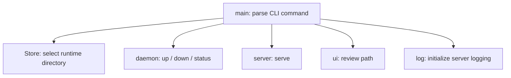
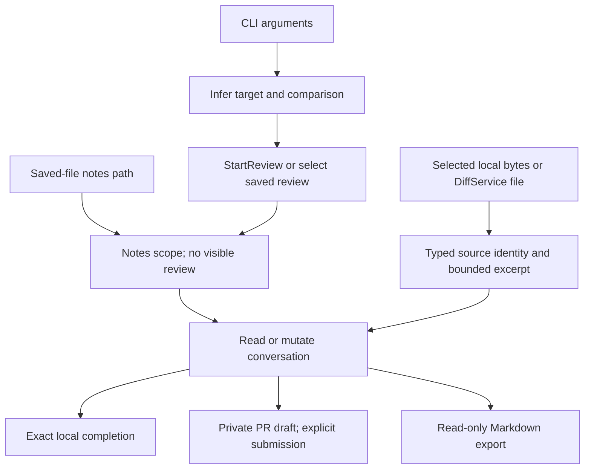
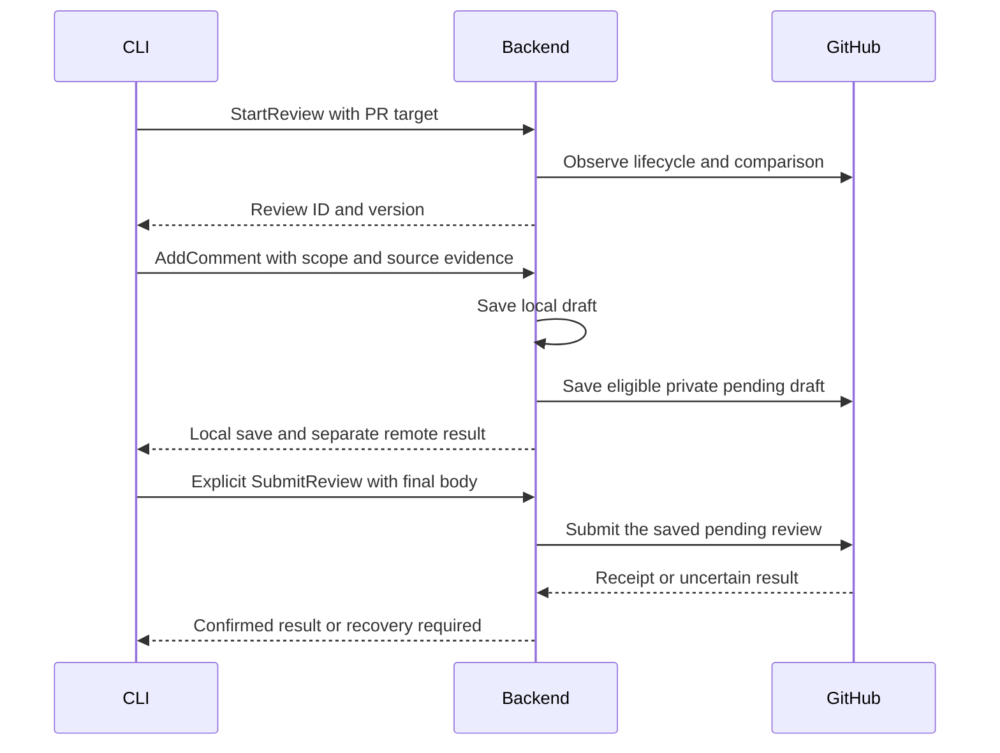

# CLI — software architecture

## Overview

The main module parses CLI commands and connects them to the daemon, server, store, log, and UI modules.

## Requirement

### Functional

- FR1: Route `up`, `down`, `status`, `review`, `session`, `sessions` and `comments` to their module APIs.
- FR2: Support foreground serving and the internal background startup command.
- FR3: Apply one store directory to every command.

### Non-Functional

- NFR1: Detach the background server before starting Tokio threads.
- NFR2: Return command errors through the process exit status.

## Design

### Usage

Start the local application, inspect its connection details, then stop it when finished:

```sh
lgtm up --no-open
lgtm status --json
lgtm down
```

Neovim connects to the running backend. Review and comment commands use the same backend data. See the [product guide](../../user-guide.md) for review workflows.


### Components and Responsibilities

#### Modules

<!-- prettier-ignore -->
- [Daemon](daemon.md): Start, discover, and stop the server
- [Server](server.md): Serve web assets and API requests
- [Store](store.md): Own runtime paths and PID/port files
- `ui`: Build review URLs and open the browser
- Bundled backend: Serve review, identity, greeting and health services




- `Cli`, `Command`, and `Up` define arguments through Clap.
- `Store::new` selects the runtime directory.
- `log::init` configures server logging after detachment.
- `daemon` handles background startup, shutdown, and status.
- `server` runs the shared UI/API listener.
- `ui` opens the review URL for the current directory.

### Data and Control Flow

The entry point parses arguments and constructs a store. For `serve --daemonize`, it detaches before creating the Tokio runtime. Server commands initialize logging before creating the runtime. The entry point then calls the selected module API inside it.

`review` uses the browser compatibility entry point to select a local path and passes that path to `ui::open_review`. This function obtains a ready server, encodes the path as a query parameter, and opens the browser. The server's working directory is the store.

ReviewService and database access stay in the backend. Session/comment commands use generated Rust gRPC clients; the bundled server initializes the real backend and its database. The daemon uses the store for discovery and the log module for background output. The server uses the same store for PID ownership and its listening port. These modules share one `Store` value from the entry point.

#### Review flows

Session and comment commands use generated backend clients. The browser `review` entry point opens the demonstration UI; `review --json` starts a review through RPC. Only the server opens review storage or calls the forge.



Working, staged, and branch comparisons share their local branch conversation. PRs retain a separate conversation. Commands capture selected source evidence before commenting. A confirmed saved-file or directory move uses `session refresh --notes NEW --moved-from OLD` and keeps discussion IDs.



Uncertain remote writes use saved receipts and explicit reconciliation. They are not blindly replayed. `--json` returns one machine-readable result; errors retain a nonzero exit status. Export contains reader-facing Markdown, not database state.

### Interfaces and Contracts

<!-- prettier-ignore -->
| Command             | Action                                    |
| ------------------- | ----------------------------------------- |
| `up`                | Start or reuse the server and open its UI |
| `up --foreground`   | Serve in the current terminal             |
| `down`              | Stop the identified server                |
| `status`            | Print server URLs                         |
| `status --json`     | Print discovery data                      |
| `review`            | Open the current directory in the UI      |
| `serve --daemonize` | Internal background startup               |

The default port is `8080`. Port `0` asks the operating system for an available port. `--no-open` suppresses browser launch for `up` and `review`.

`LGTM_HOME` selects an isolated runtime directory for tests. Without it, runtime files use `~/.lgtm`.

## Implementation

### Command definitions

Clap derives argument parsing from Rust types. The internal `serve` command is hidden from normal help. `main()` returns `anyhow::Result<()>`, so parsing and runtime errors do not report command success.

### Runtime boundary

Background startup uses a fresh copy of the executable. That copy calls `daemon::detach` before creating a Tokio runtime. The foreground caller keeps its own runtime while waiting for server readiness.

### Backend inclusion

The `backend` module comes from `bundle/backend.rs`. The tracked bundle task includes the backend router, generated review/diff protocol types, and database sources before compilation. Review commands never embed a second persistence workflow.

## References

- [Entry point](../../../apps/lgtm-cli/src/main.rs).
- [Daemon module](daemon.md).
- [Server module](server.md).
- [Shared application architecture](../index.md).
- [Database architecture](../db/index.md).
