# CLI architecture

## Overview

The main module parses CLI commands and connects them to the daemon, server, store, log, and UI modules.

## Modules

<!-- prettier-ignore -->
| Module              | Responsibility                         |
| ------------------- | -------------------------------------- |
| [Daemon](daemon.md) | Start, discover, and stop the server   |
| [Server](server.md) | Serve web assets and API requests      |
| [Store](store.md)   | Own runtime paths and PID/port files   |
| [Log](log.md)       | Configure logging and server output    |
| [Context](context.md) | Infer context and select an actor |
| [Reviews](reviews.md) | Manage sessions, comments and exports |
| `ui`                | Build review URLs and open the browser |
| Bundled backend     | Provide greeting and health services   |

## Requirement

### Functional

- Route `up`, `down`, `status`, `review`, `session`, `sessions` and `comments` to their module APIs.
- Support foreground serving and the internal background startup command.
- Apply one store directory to every command.

### Non-Functional

- Detach the background server before starting Tokio threads.
- Return command errors through the process exit status.

## Design

### Components and Responsibilities

- `Cli`, `Command`, and `Up` define arguments through Clap.
- `Store::new` selects the runtime directory.
- `log::init` configures server logging after detachment.
- `daemon` handles background startup, shutdown, and status.
- `server` runs the shared UI/API listener.
- `ui` opens the review URL for the current directory.

### Data and Control Flow

The entry point parses arguments and constructs a store. For `serve --daemonize`, it detaches before creating the Tokio runtime. Server commands initialize logging before creating the runtime. The entry point then calls the selected module API inside it.

`review` prepares a database session using the [review handlers](reviews.md), then passes the canonical path, repository and session ID to `ui::open_review`. This function obtains a ready server, encodes the path as a query parameter, and opens the browser. The server's working directory is the store.

The backend ReviewService uses lgtm-db’s entity repositories and transaction handles; runtime Store only supplies the default file path. The daemon uses the store for discovery and the log module for background output. The server uses the same store for PID ownership and its listening port. These modules share one `Store` value from the entry point.

### Interfaces and Contracts

<!-- prettier-ignore -->
| Command             | Action                                    |
| ------------------- | ----------------------------------------- |
| `up`                | Start or reuse the server and open its UI |
| `up --foreground`   | Serve in the current terminal             |
| `down`              | Stop the identified server                |
| `status`            | Print server URLs                         |
| `status --json`     | Print discovery data                      |
| `review`            | Open the current directory in the UI      |
| `serve --daemonize` | Internal background startup               |

The default port is `8080`. Port `0` asks the operating system for an available port. `--no-open` suppresses browser launch for `up` and `review`.

`LGTM_HOME` selects an isolated runtime directory for tests. Without it, runtime files use `~/.lgtm`.

## Implementation

### Command definitions

Clap derives argument parsing from Rust types. The internal `serve` command is hidden from normal help. `main()` returns `anyhow::Result<()>`, so parsing and runtime errors do not report command success.

### Runtime boundary

Background startup uses a fresh copy of the executable. That copy calls `daemon::detach` before creating a Tokio runtime. The foreground caller keeps its own runtime while waiting for server readiness.

### Backend inclusion

The `backend` module comes from `bundle/backend/lib.rs`. The bundle task copies the canonical backend implementation into the CLI package before compilation.

## References

- [Entry point](../../../apps/lgtm-cli/src/main.rs).
- [Daemon module](daemon.md).
- [Server module](server.md).
- [Shared application architecture](../index.md).
- [Review commands](reviews.md).
- [Database architecture](../db/index.md).

Context and actor selection are detailed in [context discovery](context.md).
