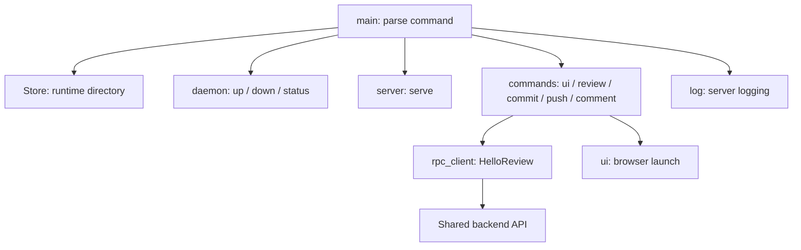
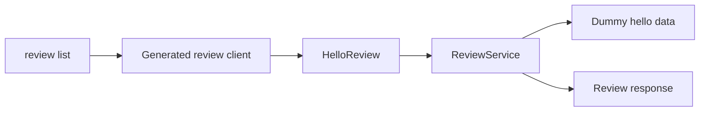

# CLI — software architecture

## Overview

The main module parses CLI commands and connects them to the daemon, server, store, log, and UI modules.

## Requirement

### Functional

- FR1: Route `up`, `down`, `status`, `ui`, `commit`, `push`, `review` and `comment` to their module APIs.
- FR2: Support foreground serving and the internal background startup command.
- FR3: Apply one store directory to every command.

### Non-Functional

- NFR1: Detach the background server before starting Tokio threads.
- NFR2: Return command errors through the process exit status.

## Design

### Usage

Start the application, call the hello-review RPC, open its interface and stop it:

```sh
lgtm up --no-open
lgtm review list --json
lgtm ui
lgtm status --json
lgtm down
```

The Neovim plugin remains a loading shell and makes no backend calls.

### Components and Responsibilities

#### Modules

- [Daemon](daemon.md): start, discover and stop the server.
- [Server](server.md): serve embedded assets and RPC requests.
- [Store](store.md): own runtime paths and PID/port files.
- `commands/`: one command group per file.
- `models.rs`: shared command arguments and outcomes.
- `rpc_client.rs`: generated review client and connection discovery.
- `ui`: browser launching shared by daemon and UI commands.
- Bundled backend: hello-review, greeting and health services.



### Data and Control Flow

The entry point parses arguments and constructs a store. For `serve --daemonize`, it detaches before creating the Tokio runtime. Server commands initialize logging before creating the runtime. The selected callback runs inside that runtime.

`ui` obtains a ready server, prints its URL and opens the browser unless `--no-open` is supplied. `review list` calls the generated hello-review client. Other domain callbacks return `not_implemented` without contacting the backend or changing Git state. Daemon and server modules share the same store for discovery, PID ownership and listening-port state.

#### Review flows

`review list` calls `ReviewService.HelloReview` and labels its result as demo data. Review creation, closure, comments, commits and publication are NA/WIP; their command shapes exist but return nonzero `not_implemented` errors.



### Interfaces and Contracts

| Command | Action |
| --- | --- |
| `up [--no-open]` | Start or reuse the server and optionally open the UI |
| `up --foreground` | Serve in the current terminal |
| `down` | Stop the identified server |
| `status [--json]` | Report discovery data |
| `ui [--no-open] [--port PORT] [--json]` | Ensure readiness and print/open the URL |
| `add PATHS... [--local]` | Unimplemented |
| `review list [--local] [--all] [--json]` | Call the real hello-review demonstration |
| `review new [--local]` | Unimplemented |
| `review refresh [REVIEW] [--local]` | Unimplemented |
| `review show [REVIEW] [--local] [--group-by file\|session] [--unresolved]` | Unimplemented |
| `review close [REVIEW] [--local] --with comment\|reject\|approve\|request [--body TEXT]` | Unimplemented |
| `commit [--local] [--as NAME] [-m MESSAGE]` | Unimplemented |
| `push [--local]` | Unimplemented |
| `comment new BODY [--review REVIEW] [--file PATH] [--line LINE] [--reply-to ID] [--local] [--as NAME]` | Unimplemented |
| `comment update ID [--body TEXT] [--file PATH] [--line LINE] [--local] [--as NAME]` | Unimplemented |
| `comment delete ID [--local] [--as NAME]` | Unimplemented |
| `serve --daemonize` | Hidden background startup |

The default port is `8080`; `0` selects an available port. `LGTM_HOME` selects the runtime directory, defaulting to `~/.lgtm`. `LGTM_RPC_URL` overrides the hello-review endpoint. Domain commands support `--json`; failures retain a nonzero exit status.

## Implementation

### File organization

```text
apps/lgtm-cli/src/
├── main.rs          Root parsing and dispatch
├── models.rs        Shared command arguments
├── rpc_client.rs    RPC transport and discovery
├── ui.rs            Shared browser launcher
└── commands/
    ├── mod.rs       Command modules and unimplemented error
    ├── commit.rs    Commit parser and stub
    ├── push.rs      Push parser and stub
    ├── review.rs    Review list RPC and lifecycle stubs
    ├── comment.rs   Comment parser and stub
    └── ui.rs        Browser command
```

Command files put local types first, then arguments, callbacks and private helpers.

### Command definitions

Clap derives argument parsing from Rust types. The internal `serve` command is hidden from normal help. `run()` returns `anyhow::Result<()>`. `main()` prints errors to stderr or as JSON and exits with a nonzero status.

### Runtime boundary

Background startup uses a fresh copy of the executable. That copy calls `daemon::detach` before creating a Tokio runtime. The foreground caller keeps its own runtime while waiting for server readiness.

### Backend inclusion

The `backend` module comes from `bundle/backend/mod.rs`. The tracked bundle task copies backend/DB source, generated hello/review protocol types and static frontend assets before compilation. The same backend serves standalone and bundled deployments; CLI review commands use RPC rather than embedding persistence.

## References

- [Entry point](../../../apps/lgtm-cli/src/main.rs).
- [Daemon module](daemon.md).
- [Server module](server.md).
- [Shared application architecture](../index.md).
- [Database architecture](../db/index.md).
