# Log module architecture

## Overview

The log module configures server logging and owns the output file under `~/.lgtm`.

## Requirement

### Functional

- Write server events through a standard logging library.
- Append background stdout and stderr to the same file.
- Apply log filtering from `RUST_LOG`.

### Non-Functional

- Initialize logging after daemonization and before runtime threads start.
- Keep logs out of CLI discovery and review output.
- Create the log file with owner-only permissions on Unix.

## Design

### Components and Responsibilities



- `tracing` records events in the server module.
- `tracing-subscriber` filters and formats those events.
- `Store` supplies the runtime root and log path.
- `output` opens the file for formatted events or daemon output.

### Data and Control Flow

Background startup opens the output file before detaching. `daemonize` redirects stdout and stderr to it. The detached process then initializes logging before creating Tokio threads.

Foreground serving initializes the same file logger. Client commands keep their normal stdout output and do not initialize server logging. Command futures are instrumented with a `cli_command` span; nested service events inherit that context when a subscriber is enabled. Services do not retain request spans.

### Interfaces and Contracts

```rust
pub fn init(store: &Store) -> Result<()>;
pub fn output(store: &Store) -> Result<File>;
```

`init` installs one global subscriber. It returns an error if initialization fails. The filter defaults to `info` when `RUST_LOG` is absent or invalid.

`output` ensures that the store exists and opens `server.log` in append mode. The returned file can be cloned for daemon stdout and stderr.

## Implementation

### Standard logging

The formatter uses `tracing-subscriber` with `EnvFilter`, timestamps, levels, and targets. ANSI colors are disabled. A standard `Mutex<File>` coordinates writes from runtime threads.

### File ownership

The log module opens the file through `OpenOptions`, with Unix creation mode `0600`. The store owns the root directory. No separate logging process or writer thread is needed.

### Process boundary

Only server commands initialize the subscriber. In background mode, initialization occurs after the fork. `status --json` and `review --no-open` therefore keep machine-readable stdout free of log events.

## References

- [Log implementation](../../../apps/lgtm-cli/src/log.rs).
- [CLI entry point](index.md).
- [Daemon module](daemon.md).
- [Store module](store.md).
- [Tracing subscriber](https://docs.rs/tracing-subscriber/latest/tracing_subscriber/fmt/struct.SubscriberBuilder.html).
