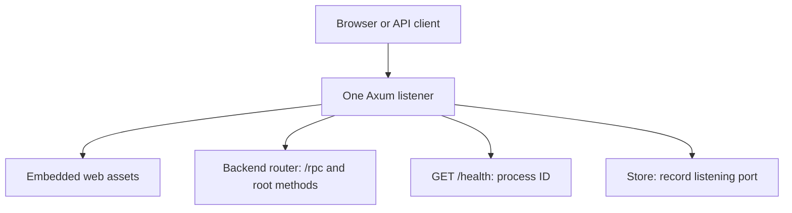

# Server module architecture

## Overview

The server module serves embedded web assets and backend methods through one local HTTP listener.

## Requirement

### Functional

- Serve the bundled UI and its static assets.
- Route browser and native clients to the same backend.
- Expose a health response with the server PID.
- Record the actual listening port and clear it after shutdown.

### Non-Functional

- Serve the installed application without a frontend development server.
- Limit connection draining to five seconds after a shutdown signal.

## Design

### Components and Responsibilities

- Axum owns the HTTP listener and request routing.
- The generated asset table maps URLs to embedded bytes and content types.
- `backend::router` provides the greeting and health services.
- `Store` records the listening port and protects foreground ownership.
- Tokio receives shutdown signals and bounds connection draining.
- `tracing` records server startup and shutdown through the log module.

### Data and Control Flow

`serve` creates the runtime directory and establishes PID-file ownership. It binds the listener, builds the router, and records the assigned port. The CLI's readiness probe succeeds once the listener handles `/health`.

Browser requests use `/rpc`. Native clients use root service paths. UI requests resolve through the embedded asset table.

On SIGTERM or Ctrl-C, the server marks backend health as stopped and begins graceful shutdown. It waits up to five seconds for connections, then removes `server.port`.

### Interfaces and Contracts

`serve(port: u16, store: &Store, detached: bool) -> anyhow::Result<()>` runs until shutdown or a server error. Port `0` selects an available port. `detached = true` means `daemonize` already owns the PID-file lock.

<!-- prettier-ignore -->
| Route              | Response                         |
| ------------------ | -------------------------------- |
| `GET /health`      | JSON containing the process PID  |
| `GET /`            | Embedded `index.html`            |
| Asset GET or HEAD  | Asset content and content type   |
| Unknown asset      | HTTP `404`                       |
| `/rpc/*`           | Browser RPC calls                |
| Root service paths | Native gRPC and Connect requests |

The `path` query parameter reaches the frontend without changing asset lookup. The server does not interpret it as a filesystem request.

## Implementation

### Static assets

The CLI build script generates `assets.rs` in Cargo's output directory. Each entry uses `include_bytes!` and a detected content type. Responses use `Cache-Control: no-cache`.

### Backend routing

Axum mounts a copy of the backend service at `/rpc`. Its fallback serves GET/HEAD assets and forwards other requests to the backend service. There is no separate UI process or backend process in the installed application.

### Process ownership and shutdown

Foreground mode obtains a lock on the same `server.pid` file that `daemonize` uses in background mode. This prevents a foreground server from overwriting a running daemon's port file.

A one-shot notification starts the bounded drain after the signal handler begins shutdown. Graceful exit removes the port file. An abrupt process termination can leave files behind, so discovery also probes the server.

## References

- [Server implementation](../../../apps/lgtm-cli/src/server.rs).
- [Asset build script](../../../apps/lgtm-cli/build.rs).
- [Lifecycle tests](../../../apps/lgtm-cli/tests/daemon.rs).
- [Shared application architecture](../index.md).
- [Store module](store.md).
