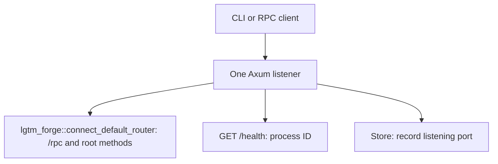

# CLI server — software architecture

## Overview

The server module hosts the `lgtm-forge` Connect/gRPC router and a `/health` endpoint through a single local Axum HTTP listener.

## Requirement

### Functional

- FR1: Route Connect and gRPC clients to the `lgtm-forge` RPC service at both `/rpc` and root service paths.
- FR2: Expose a `GET /health` response containing the server PID.
- FR3: Return HTTP `404` for non-health `GET` and `HEAD` requests.
- FR4: Record the actual listening port and clear it after shutdown.

### Non-Functional

- NFR1: Limit connection draining to five seconds after a shutdown signal.

## Design

### Usage

Call `serve` from an initialized Tokio runtime. Use port `0` to select an available port.

```rust
let store = Store::new()?;
serve(0, &store, false).await?;
```

The call runs until shutdown or failure. Use `detached = true` only after daemon detachment. For foreground CLI use, run `lgtm up --foreground`.

### Components and Responsibilities



- Axum owns the HTTP listener and request routing.
- `lgtm_forge::connect_default_router` provides the `ReviewService`, `GreeterService`, and gRPC health services backed by `lgtm-db`.
- `Store` records the listening port and protects foreground ownership.
- Tokio receives shutdown signals and bounds connection draining.
- `tracing` records server startup and shutdown through the log module.

### Data and Control Flow

`serve` creates the runtime directory and establishes PID-file ownership. It binds the listener, builds the `lgtm-forge` router, and records the assigned port. The CLI's readiness probe succeeds once the listener handles `/health`.

Connect clients use `/rpc/*` or root service paths; non-health `GET` and `HEAD` requests receive `404 Not Found`.

On SIGTERM or Ctrl-C, the server marks backend health as stopped and begins graceful shutdown. It waits up to five seconds for connections, then removes `server.port`.

### Interfaces and Contracts

`serve(port: u16, store: &Store, detached: bool) -> anyhow::Result<()>` runs until shutdown or a server error. Port `0` selects an available port. `detached = true` means `daemonize` already owns the PID-file lock.

<!-- prettier-ignore -->
| Route              | Response                         |
| ------------------ | -------------------------------- |
| `GET /health`      | JSON containing the process PID  |
| Other `GET`/`HEAD` | HTTP `404`                       |
| `/rpc/*`           | Connect and gRPC requests        |
| Root service paths | Connect and gRPC requests        |

## Implementation

### Backend routing

Axum mounts a copy of the `lgtm-forge` Connect service at `/rpc`. Its fallback returns `404 Not Found` for `GET`/`HEAD` requests and forwards other requests (`POST`) to the Connect service.

### Process ownership and shutdown

Foreground mode obtains a lock on the same `server.pid` file that `daemonize` uses in background mode. This prevents a foreground server from overwriting a running daemon's port file.

A one-shot notification starts the bounded drain after the signal handler begins shutdown. Graceful exit removes the port file. An abrupt process termination can leave files behind, so discovery also probes `/health`.

## References

- [Server implementation](../../../apps/lgtm-cli/src/server.rs).
- [Lifecycle tests](../../../apps/lgtm-cli/tests/daemon.rs).
- [Shared application architecture](../index.md).
- [Store module](store.md).
