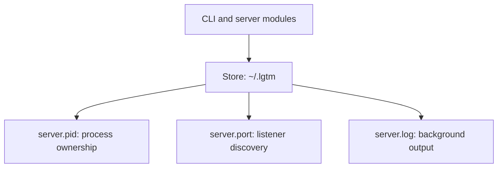

# CLI store — software architecture

## Overview

The store module owns LGTM's runtime files under `~/.lgtm`.

## Requirement

### Functional

- FR1: Select one directory for runtime files.
- FR2: Create the directory when the server needs it.
- FR3: Read the recorded PID and port.
- FR4: Write the port and lock foreground PID ownership.

### Non-Functional

- NFR1: Restrict directory access to its owner on Unix.
- NFR2: Keep read-only discovery from creating directories.
- NFR3: Support isolated stores for tests and explicit directory overrides.

## Design

### Usage

Construct one store and pass it to the daemon and server modules:

```rust
let store = Store::new()?;
let port_path = store.path("server.port");
```

Construction reads the selected root without creating it. Call `ensure_exists()` before writing runtime files. Use `LGTM_HOME` for an isolated runtime directory.


### Components and Responsibilities



- `Store` owns the root path and filesystem operations.
- `Instance` carries a recorded PID and port.
- `daemonize` writes and locks the background PID file.
- The server writes the port file and removes it on graceful exit.
- The daemon reads these values and confirms them through `/health`.

### Data and Control Flow

`Store::new` selects `~/.lgtm`, or resolves `LGTM_HOME` against the current directory. Construction does not create files. `ensure_exists` creates the directory and applies Unix permissions.

Background startup passes the PID path and log file from the log module to `daemonize`. Foreground startup obtains the same PID lock through the store. Both modes record the actual port after binding.

### Interfaces and Contracts

```rust
pub fn new() -> Result<Store>;
pub fn dir(&self) -> &Path;
pub fn path(&self, name: &str) -> PathBuf;
pub fn ensure_exists(&self) -> Result<()>;
pub(crate) fn instance(&self) -> Option<Instance>;
pub fn write_port(&self, port: u16) -> Result<()>;
pub fn clear_port(&self);
pub fn foreground_pid_lock(&self) -> Result<File>;
```

<!-- prettier-ignore -->
| API                   | Contract                                   |
| --------------------- | ------------------------------------------ |
| `new`                 | Use `LGTM_HOME` or `~/.lgtm`               |
| `dir`                 | Return the root directory                  |
| `path`                | Join an internal filename to the root      |
| `ensure_exists`       | Create the directory with Unix mode `0700` |
| `instance`            | Read the numeric PID and port              |
| `write_port`          | Record the assigned port                   |
| `clear_port`          | Remove the port file                       |
| `foreground_pid_lock` | Lock the PID file and write the PID        |
| `Instance::url`       | Return the loopback URL for the port       |

<!-- prettier-ignore -->
| File          | Content                                |
| ------------- | -------------------------------------- |
| `server.pid`  | PID, locked by the owning server       |
| `server.port` | Port, removed on graceful shutdown     |
| `server.log`  | Formatted events and background output |

These files describe a running process. Review data lives separately in `reviews.sqlite`, with a sibling migration lock for SQLite startup. The review handlers derive that default path from `Store::path`; database services own schema/migrations. `LGTM_DATABASE_URL` overrides database selection without changing daemon discovery. Read-only `status` does not initialize the database or create the store directory.

## Implementation

### Paths and permissions

The root defaults to the home directory plus `.lgtm`. `LGTM_HOME` provides the explicit override. A missing home directory without an override returns an error.

`ensure_exists` uses `create_dir_all` and sets directory mode `0700` on Unix. The foreground PID helper creates files with mode `0600` on Unix. The log module owns log file creation.

### PID ownership

The foreground lock uses `fs2` on `server.pid`. The returned `File` keeps that lock alive. Background serving uses the `daemonize` library's lock on the same path.

### Recorded values

The PID and port use plain numeric text. `instance` reads them without contacting the server. The daemon performs the health check before reporting a live instance or sending SIGTERM.

## References

- [Store implementation](../../../apps/lgtm-cli/src/store.rs).
- [Lifecycle tests](../../../apps/lgtm-cli/tests/daemon.rs).
- [Daemon module](daemon.md).
- [Server module](server.md).
