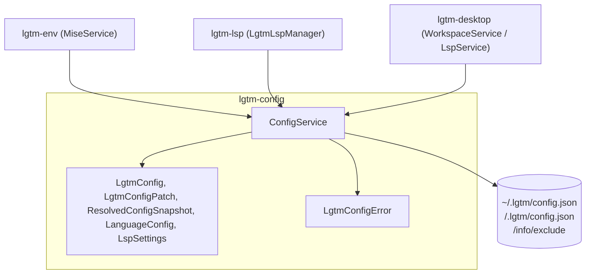
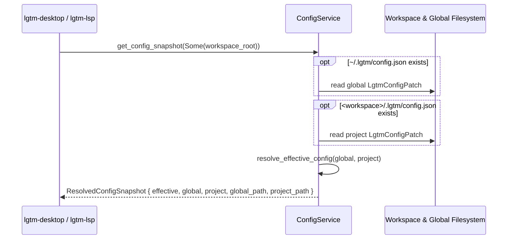

# Configuration library (`lgtm-config`) — software architecture

## Overview

`lgtm-config` is the pure-Rust configuration, JSON Schema generation, Specta type definition, language discovery, and workspace `.lgtm/` directory layout library for LGTM (`lgtm-cli`, `lgtm-env`, `lgtm-lsp`, and `lgtm-desktop`). It treats configuration and user settings as a single unified model (`LgtmConfig` and `LgtmConfigPatch`) persisted in `~/.lgtm/config.json` (global) and `<workspace>/.lgtm/config.json` (project), covering appearance (`appearance.theme`), workspace history (`workspace.activeRoot`, `workspace.recentRoots`), editor behavior (`editor.lineWrapping`), LSP settings (`lsp.*`), and language presets (`languages.*`). Developer tools and tasks live outside `config.json` in `mise.toml` files (`~/.lgtm/mise.toml` and `<workspace>/.lgtm/mise.toml`) managed by [`lgtm-env`](../env/index.md) (`manage_dev_tools`, `add_dev_tool`, `remove_dev_tool`).

## Requirement

### Functional

- Load built-in language and tool presets, merge `~/.lgtm/config.json` (or `$LGTM_HOME/config.json`), and overlay leaf-level overrides from `<workspace>/.lgtm/config.json`.
- Generate `schemas/config.schema.json` and TypeScript bindings from the unified configuration model.
- Resolve a file's language from its extension and walk ancestor directories up to the workspace root to find the nearest project root marker.
- Create `<workspace>/.lgtm/` and register `.lgtm/` in `<git-dir>/info/exclude` without modifying tracked `.gitignore` files.

### Non-Functional

- Produce deterministic merged configurations and language lists across platforms.
- Perform configuration loading and discovery without spawning subprocesses.

## Design

### Usage

```rust
use std::path::Path;
use lgtm_config::ConfigService;

let workspace_root = Path::new("/path/to/workspace");
let config_service = ConfigService::new();

// Merge built-in presets, ~/.lgtm/config.json, and <workspace>/.lgtm/config.json into LgtmConfig
let config = config_service.get_config(workspace_root)?;

// Load and deep-merge LgtmConfig together with per-scope LgtmConfigPatch trees and file paths
let snapshot = config_service.get_config_snapshot(Some(workspace_root))?;

// Ensure <workspace>/.lgtm/ and <git-dir>/info/exclude are initialized
let lgtm_dir = config_service.ensure_workspace_dir(workspace_root)?;

// Discover enabled languages present in the workspace
let languages = ConfigService::detect_workspace_languages(&config, workspace_root);
```

### Components and Responsibilities



- `ConfigService`: Resolves `<lgtm_home>`, global and workspace configuration paths (`config.json`) and Mise paths (`mise.toml`), deep-merges `LgtmConfig` and `LgtmConfigPatch`, discovers ancestor project roots and workspace languages, creates `<workspace>/.lgtm/`, and updates `<git-dir>/info/exclude`.
- `LgtmConfig`, `LgtmConfigPatch`, `AppearanceSettings*`, `WorkspaceSettings*`, `EditorSettings*`, `LspSettings*`, `LanguageConfig`, `MiseTaskConfig`, `LineWrap`, `ThemeMode`, and `ResolvedConfigSnapshot`: Pure domain models with `optfield`, `schemars::JsonSchema`, and `specta::Type` derives, JSON Schema generation, versioned jsDelivr `$schema` references (`DEFAULT_SCHEMA_URL`), built-in language presets (including `mise`-managed Biome `json`), and extension-to-language lookup.
- `LgtmConfigError`: Typed error enum distinguishing global config I/O and parse errors from project config I/O and parse errors.

### Data and Control Flow



### Interfaces and Contracts

| Type / Method | Signature | Description |
| --- | --- | --- |
| `ConfigService::new` | `fn new() -> Self` | Construct a configuration service reading `~/.lgtm/config.json` (or `$LGTM_HOME/config.json`). |
| `ConfigService::from_home` | `fn from_home(home: PathBuf) -> Self` | Construct a configuration service rooted at `<home>/.lgtm/config.json`. |
| `ConfigService::with_global_config_path` | `fn with_global_config_path(path: PathBuf) -> Self` | Construct a configuration service with an explicit global config path for isolated tests. |
| `ConfigService::get_lgtm_home_dir` | `fn get_lgtm_home_dir(&self) -> PathBuf` | Return the resolved LGTM home directory (`$LGTM_HOME` or `~/.lgtm`). |
| `ConfigService::get_global_config_path` | `fn get_global_config_path(&self) -> PathBuf` | Return the path to `~/.lgtm/config.json` (or `$LGTM_HOME/config.json`). |
| `ConfigService::get_project_config_path` | `fn get_project_config_path(workspace_root: &Path) -> PathBuf` | Return the path to `<workspace>/.lgtm/config.json`. |
| `ConfigService::get_config` | `fn get_config(&self, workspace_root: &Path) -> Result<LgtmConfig>` | Return merged built-in presets, global config, and `<workspace>/.lgtm/config.json`. |
| `ConfigService::get_config_snapshot` | `fn get_config_snapshot(&self, workspace_root: Option<&Path>) -> Result<ResolvedConfigSnapshot>` | Return deep-merged `LgtmConfig` plus global and project `LgtmConfigPatch` trees. |
| `ConfigService::ensure_workspace_dir` | `fn ensure_workspace_dir(&self, workspace_root: &Path) -> Result<PathBuf>` | Ensure `<workspace>/.lgtm/` and `<git-dir>/info/exclude` are initialized. |
| `ConfigService::detect_project_root` | `fn detect_project_root(workspace_root: &Path, file_path: &Path, language: &LanguageConfig) -> (PathBuf, Option<String>)` | Walk ancestor directories up to `workspace_root` to find the nearest root marker. |
| `ConfigService::detect_workspace_languages` | `fn detect_workspace_languages(config: &LgtmConfig, workspace_root: &Path) -> Vec<String>` | Scan workspace root and subdirectories for enabled language root markers and extensions. |
| `LgtmConfig::detect_file_language` | `fn detect_file_language(&self, file_path: &Path) -> Option<(String, &LanguageConfig)>` | Resolve the enabled language ID and configuration for a file extension. |

## Implementation

### Package layout

```text
libs/lgtm-config/
├── Cargo.toml
├── mise.toml
├── README.md
├── src/
│   ├── lib.rs                 Public ConfigService, LgtmConfig, LgtmConfigPatch, and ResolvedConfigSnapshot exports
│   ├── error.rs               LgtmConfigError and Result alias
│   ├── models/
│   │   ├── mod.rs
│   │   └── config.rs          Unified LgtmConfig, LgtmConfigPatch, section models, JSON Schema, and presets
│   └── services/
│       ├── mod.rs
│       └── config.rs          ConfigService, cross-scope merging, and .git/info/exclude hygiene
└── tests/
    └── config.rs              ConfigService BDD integration suite
```

## References

- [Environment library (`lgtm-env`) architecture](../env/index.md).
- [LSP library (`lgtm-lsp`) architecture](../lsp/index.md).
- [Desktop application (`lgtm-desktop`) architecture](../desktop/index.md).
- [Application architecture](../index.md).
