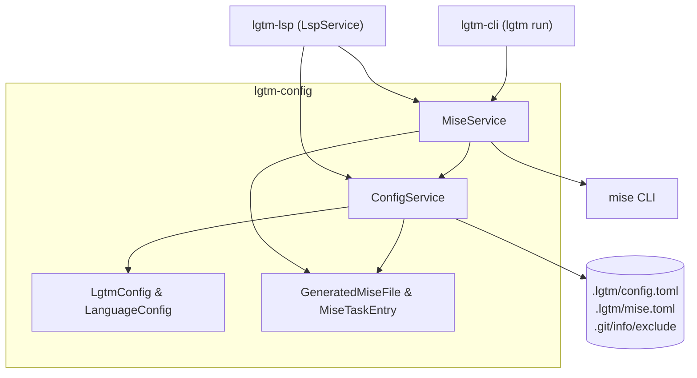
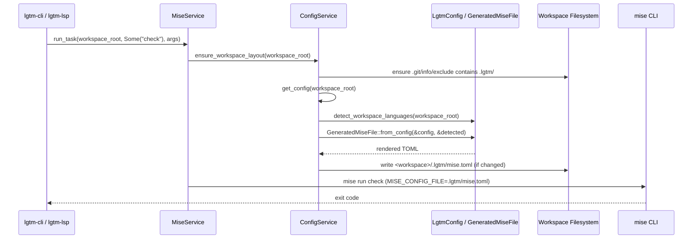

# Configuration library — software architecture

## Overview

`lgtm-config` is the configuration, language discovery, and Mise task orchestration library for LGTM (`lgtm-cli`, `lgtm-lsp`, and `lgtm-desktop`). It merges global (`~/.lgtm/config.toml`) and project (`<workspace>/.lgtm/config.toml`) settings over built-in language presets (Rust, TypeScript, JavaScript, Python, and Go), detects project roots and workspace languages, synthesizes a deterministic `<workspace>/.lgtm/mise.toml` file, registers `.lgtm/` in `<git-dir>/info/exclude`, and proxies task execution via `mise`.

## Requirement

### Functional

- Layered configuration: Load built-in language and tool presets, merge `~/.lgtm/config.toml` (or `$LGTM_HOME/config.toml`), and overlay `<workspace>/.lgtm/config.toml`.
- Language and root discovery: Resolve a file's language from its extension and walk ancestor directories up to the workspace boundary to find the nearest language root marker (`Cargo.toml`, `tsconfig.json`, `package.json`, `pyproject.toml`, `requirements.txt`, `go.mod`).
- Managed Mise file generation: Synthesize `<workspace>/.lgtm/mise.toml` with `[tools]` and `[tasks]` for detected languages plus user-configured tools and tasks, setting `dir = "{{cwd}}"` so tasks execute in the caller's working directory.
- Git worktree hygiene: Register `.lgtm/` idempotently in `<git-dir>/info/exclude` (supporting both standard `.git` directories and worktree `.git` pointer files) without modifying tracked `.gitignore` files.
- Task execution proxy: List synthesized tasks and proxy `lgtm run [task] [args...]` to `mise run` with `MISE_CONFIG_FILE=<workspace>/.lgtm/mise.toml`.

### Non-Functional

- Deterministic output: Use `BTreeMap` and `BTreeSet` across all config and Mise models so generated `.lgtm/mise.toml` files are byte-for-byte deterministic and only written when contents change.
- Safe tool installation defaults: Default `lsp.auto_install` to `false` and pass `MISE_TASK_RUN_AUTO_INSTALL=false` and `--skip-tools` during `run_task` unless auto-install is explicitly enabled.

## Design

### Usage

```rust
use std::path::Path;
use lgtm_config::{ConfigService, MiseService};

let workspace_root = Path::new("/path/to/workspace");
let config_service = ConfigService::new();
let mise_service = MiseService::new(config_service.clone());

// Merge defaults, ~/.lgtm/config.toml, and <workspace>/.lgtm/config.toml
let config = config_service.get_config(workspace_root)?;

// Synchronize <workspace>/.lgtm/mise.toml and <git-dir>/info/exclude
let mise_path = mise_service.sync_workspace(workspace_root)?;

// List or execute tasks defined in the managed mise.toml
let tasks = mise_service.get_tasks(workspace_root)?;
let exit_code = mise_service.run_task(workspace_root, Some("check"), &[])?;
```

### Components and Responsibilities



- `ConfigService`: Resolves global and workspace configuration paths, merges TOML overlays onto `LgtmConfig::default_presets()`, writes `<workspace>/.lgtm/mise.toml` when changed, and updates `<git-dir>/info/exclude`.
- `MiseService`: Synchronizes the workspace `.lgtm/mise.toml`, returns structured `MiseTaskSummary` entries for `lgtm run --list`, executes tasks via `mise run`, and installs language server toolchains via `mise install` when `lsp.auto_install` is enabled.
- `LgtmConfig` and `LanguageConfig`: Pure domain models holding `[lsp]`, `[mise]`, and `[languages.<id>]` settings, extension-to-language lookup, ancestor root-marker resolution, and workspace language scanning.
- `GeneratedMiseFile`: Pure model that combines detected language tools and default tasks (`<lang>:<task>` and `<task>`) with explicit `[mise.tools]` and `[mise.tasks]` overrides and renders `.lgtm/mise.toml`.

### Data and Control Flow



### Interfaces and Contracts

| Type / Method | Signature | Description |
| --- | --- | --- |
| `ConfigService::new` | `fn new() -> Self` | Construct a configuration service reading `~/.lgtm/config.toml` (or `$LGTM_HOME/config.toml`). |
| `ConfigService::with_global_config_path` | `fn with_global_config_path(path: PathBuf) -> Self` | Construct a configuration service with an explicit global config path for isolated tests. |
| `ConfigService::get_config` | `fn get_config(&self, workspace_root: &Path) -> Result<LgtmConfig>` | Return merged defaults, global config, and `<workspace>/.lgtm/config.toml`. |
| `ConfigService::ensure_workspace_layout` | `fn ensure_workspace_layout(&self, workspace_root: &Path) -> Result<PathBuf>` | Ensure `.lgtm/`, `<git-dir>/info/exclude`, and `<workspace>/.lgtm/mise.toml` are up to date. |
| `MiseService::sync_workspace` | `fn sync_workspace(&self, workspace_root: &Path) -> Result<PathBuf>` | Synchronize `<workspace>/.lgtm/mise.toml` and return its path. |
| `MiseService::get_tasks` | `fn get_tasks(&self, workspace_root: &Path) -> Result<Vec<MiseTaskSummary>>` | Sync `.lgtm/mise.toml` and list all synthesized and user-defined tasks. |
| `MiseService::run_task` | `fn run_task(&self, workspace_root: &Path, task: Option<&str>, args: &[String]) -> Result<i32>` | Sync `.lgtm/mise.toml` and execute `mise run <task> [args...]` with `MISE_CONFIG_FILE`. |
| `LgtmConfig::detect_file_language` | `fn detect_file_language(&self, file_path: &Path) -> Option<(String, &LanguageConfig)>` | Resolve the enabled language ID and configuration for a file extension. |
| `LgtmConfig::detect_project_root` | `fn detect_project_root(&self, workspace_root: &Path, file_path: &Path, language: &LanguageConfig) -> (PathBuf, Option<String>)` | Walk ancestor directories up to `workspace_root` to find the nearest root marker. |

## Implementation

### Package layout

```text
libs/lgtm-config/
├── Cargo.toml
├── mise.toml
└── src/
    ├── lib.rs                 Public ConfigService, MiseService, and model exports
    ├── error.rs               ConfigError and Result alias
    ├── models/
    │   ├── mod.rs
    │   ├── config.rs          LgtmConfig, LanguageConfig, presets, and detection logic
    │   └── mise.rs            GeneratedMiseFile, MiseTaskEntry, and TOML rendering
    └── services/
        ├── mod.rs
        ├── config.rs          ConfigService and .git/info/exclude hygiene
        └── mise.rs            MiseService task listing, execution, and tool installation
```

### Configuration layering and task working directory

Because `<workspace>/.lgtm/mise.toml` resides inside the `.lgtm/` subdirectory, `GeneratedMiseFile` sets `dir = "{{cwd}}"` on every synthesized `MiseTaskEntry`. When `lgtm run <task>` invokes `mise run` with `MISE_CONFIG_FILE=<workspace>/.lgtm/mise.toml`, commands run in the user's working directory rather than `.lgtm/`.

## References

- [LSP library architecture](../lsp/index.md).
- [CLI architecture](../cli/index.md).
- [Application architecture](../index.md).
