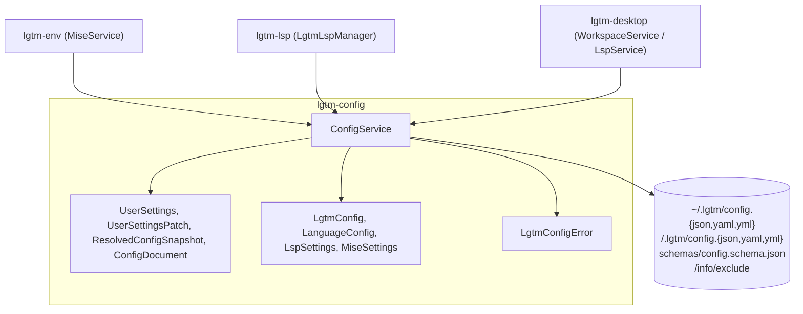
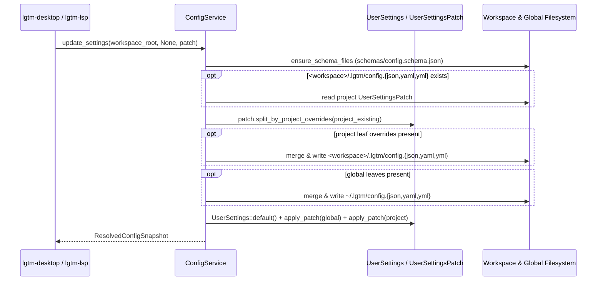

# Configuration library (`lgtm-config`) — software architecture

## Overview

`lgtm-config` is the pure-Rust configuration, JSON Schema generation, Specta type definition, language discovery, and workspace `.lgtm/` directory layout library for LGTM (`lgtm-cli`, `lgtm-env`, `lgtm-lsp`, and `lgtm-desktop`). It deep-merges global (`~/.lgtm/config.{json,yaml,yml}`) and project (`<workspace>/.lgtm/config.{json,yaml,yml}`) nested settings (`appearance.theme`, `workspace.activeRoot`, `workspace.recentRoots`, `editor.lineWrapping`) over defaults, provides built-in language presets (Rust, TypeScript, JavaScript, Python, Go, Markdown, `mise`-managed Biome `json`, and `yaml`), generates `schemas/config.schema.json` via `schemars`, detects project roots and workspace languages, and registers `.lgtm/` idempotently in `<git-dir>/info/exclude`.

## Requirement

### Functional

- Layered nested configuration: Load defaults (`UserSettings`), deep-merge `~/.lgtm/config.{json,yaml,yml}` (or `$LGTM_HOME/config.{json,yaml,yml}`), and overlay leaf-level overrides from `<workspace>/.lgtm/config.{json,yaml,yml}`.
- Leaf-level override-aware patching: Route each modified leaf in `UserSettingsPatch` to `<workspace>/.lgtm/config.{json,yaml,yml}` when that leaf is already overridden in the project config, and otherwise to `~/.lgtm/config.{json,yaml,yml}` without clobbering sibling sections.
- Schema and TypeScript parity: Derive `schemars::JsonSchema` and `specta::Type` on all nested settings and patch structs so `schemas/config.schema.json` and `apps/lgtm-web/src/lib/gen/bindings.ts` share a single Rust source of truth.
- Language and root discovery: Resolve a file's language from its extension and walk ancestor directories up to the workspace boundary to find the nearest language root marker (`Cargo.toml`, `tsconfig.json`, `package.json`, `pyproject.toml`, `requirements.txt`, `go.mod`, `.marksman.toml`, `biome.json`, `biome.jsonc`, `.yamllint`).
- Git worktree hygiene: Create `<workspace>/.lgtm/` and register `.lgtm/` idempotently in `<git-dir>/info/exclude` (supporting both standard `.git` directories and worktree `.git` pointer files) without modifying tracked `.gitignore` files.

### Non-Functional

- Produce deterministic merged configurations and language lists across platforms.
- Perform configuration loading and discovery without spawning subprocesses.

## Design

### Usage

```rust
use std::path::Path;
use lgtm_config::{AppearanceSettingsPatch, ConfigService, ThemeMode, UserSettingsPatch};

let workspace_root = Path::new("/path/to/workspace");
let config_service = ConfigService::new();

// Merge built-in presets, ~/.lgtm/config.{json,yaml,yml}, and <workspace>/.lgtm/config.{json,yaml,yml}
let config = config_service.get_config(workspace_root)?;

// Load and deep-merge nested user settings across defaults, global config, and project config
let snapshot = config_service.get_settings_snapshot(Some(workspace_root))?;

// Patch appearance.theme (routes to project config if already overridden there, otherwise global)
let updated = config_service.update_settings(
    Some(workspace_root),
    None,
    UserSettingsPatch {
        appearance: Some(AppearanceSettingsPatch {
            theme: Some(ThemeMode::Dark),
        }),
        ..Default::default()
    },
)?;

// Ensure <workspace>/.lgtm/ and <git-dir>/info/exclude are initialized
let lgtm_dir = config_service.ensure_workspace_dir(workspace_root)?;

// Discover enabled languages present in the workspace
let languages = ConfigService::detect_workspace_languages(&config, workspace_root);
```

### Components and Responsibilities



- `ConfigService`: Resolves `<lgtm_home>`, global and workspace configuration paths (`config.json` -> `config.yaml` -> `config.yml`), writes `schemas/config.schema.json`, deep-merges and leaf-patches `UserSettings` / `UserSettingsPatch`, merges runtime preset overlays onto `LgtmConfig::default_presets()`, discovers ancestor project roots and workspace languages, creates `<workspace>/.lgtm/`, and updates `<git-dir>/info/exclude`.
- `UserSettings`, `UserSettingsPatch`, `AppearanceSettings*`, `WorkspaceSettings*`, `EditorSettings*`, `ResolvedConfigSnapshot`, and `ConfigDocument`: Pure domain models with `schemars::JsonSchema` and `specta::Type` derives, recursive leaf-level patch merging, project-override partitioning, and schema-backed document validation/hover documentation.
- `LgtmConfig`, `LanguageConfig`, `LspSettings`, `MiseSettings`, and `MiseTaskConfig`: Pure domain models holding runtime `[lsp]`, `[mise]`, and `[languages.<id>]` presets (including `mise`-managed Biome `json` and `yaml`) and extension-to-language lookup.
- `LgtmConfigError`: Typed error enum distinguishing global config I/O and parse errors from project config I/O and parse errors.

### Data and Control Flow



### Interfaces and Contracts

| Type / Method | Signature | Description |
| --- | --- | --- |
| `ConfigService::new` | `fn new() -> Self` | Construct a configuration service reading `~/.lgtm/config.{json,yaml,yml}` (or `$LGTM_HOME/config.{json,yaml,yml}`). |
| `ConfigService::from_home` | `fn from_home(home: PathBuf) -> Self` | Construct a configuration service rooted at `<home>/.lgtm/config.{json,yaml,yml}`. |
| `ConfigService::with_global_config_path` | `fn with_global_config_path(path: PathBuf) -> Self` | Construct a configuration service with an explicit global config path for isolated tests. |
| `ConfigService::get_lgtm_home_dir` | `fn get_lgtm_home_dir(&self) -> PathBuf` | Return the resolved LGTM home directory (`$LGTM_HOME` or `~/.lgtm`). |
| `ConfigService::ensure_schema_files` | `fn ensure_schema_files(&self, workspace_root: Option<&Path>) -> Result<PathBuf>` | Write `schemas/config.schema.json` under `<lgtm_home>` (and `<workspace>/.lgtm/` when present). |
| `ConfigService::get_config` | `fn get_config(&self, workspace_root: &Path) -> Result<LgtmConfig>` | Return merged built-in presets, global config, and `<workspace>/.lgtm/config.{json,yaml,yml}`. |
| `ConfigService::get_settings_snapshot` | `fn get_settings_snapshot(&self, workspace_root: Option<&Path>) -> Result<ResolvedConfigSnapshot>` | Return deep-merged `UserSettings` plus global and project `UserSettingsPatch` trees. |
| `ConfigService::update_settings` | `fn update_settings(&self, workspace_root: Option<&Path>, scope: Option<ConfigScope>, patch: UserSettingsPatch) -> Result<ResolvedConfigSnapshot>` | Persist nested settings to `scope` or route each leaf by project override presence when `scope` is `None`. |
| `ConfigService::open_config_document` | `fn open_config_document(&self, workspace_root: Option<&Path>, scope: ConfigScope, preferred_format: Option<ConfigFormat>) -> Result<ConfigDocument>` | Ensure the target config file and JSON Schema exist on disk and return raw text and LSP metadata. |
| `ConfigService::write_config_document` | `fn write_config_document(&self, workspace_root: Option<&Path>, scope: ConfigScope, content: &str, preferred_format: Option<ConfigFormat>) -> Result<(ConfigDocument, Option<ResolvedConfigSnapshot>)>` | Write raw editor text to disk and return the updated `ConfigDocument` and parsed `ResolvedConfigSnapshot`. |
| `ConfigService::ensure_workspace_dir` | `fn ensure_workspace_dir(&self, workspace_root: &Path) -> Result<PathBuf>` | Ensure `<workspace>/.lgtm/` and `<git-dir>/info/exclude` are initialized. |
| `ConfigService::detect_project_root` | `fn detect_project_root(workspace_root: &Path, file_path: &Path, language: &LanguageConfig) -> (PathBuf, Option<String>)` | Walk ancestor directories up to `workspace_root` to find the nearest root marker. |
| `ConfigService::detect_workspace_languages` | `fn detect_workspace_languages(config: &LgtmConfig, workspace_root: &Path) -> Vec<String>` | Scan workspace root and subdirectories for enabled language root markers and extensions. |
| `LgtmConfig::detect_file_language` | `fn detect_file_language(&self, file_path: &Path) -> Option<(String, &LanguageConfig)>` | Resolve the enabled language ID and configuration for a file extension. |

## Implementation

### Package layout

```text
libs/lgtm-config/
├── Cargo.toml
├── mise.toml
├── README.md
├── src/
│   ├── lib.rs                 Public ConfigService, UserSettings*, and LgtmConfig exports
│   ├── error.rs               LgtmConfigError and Result alias
│   ├── models/
│   │   ├── mod.rs
│   │   ├── config.rs          LgtmConfig, LanguageConfig, presets, and detection logic
│   │   └── settings.rs        UserSettings, UserSettingsPatch, JSON Schema, and validation
│   └── services/
│       ├── mod.rs
│       └── config.rs          ConfigService, JSON/YAML persistence, and .git/info/exclude hygiene
└── tests/
    └── config.rs              ConfigService BDD integration suite
```

## References

- [Environment library (`lgtm-env`) architecture](../env/index.md).
- [LSP library (`lgtm-lsp`) architecture](../lsp/index.md).
- [Desktop application (`lgtm-desktop`) architecture](../desktop/index.md).
- [Application architecture](../index.md).
