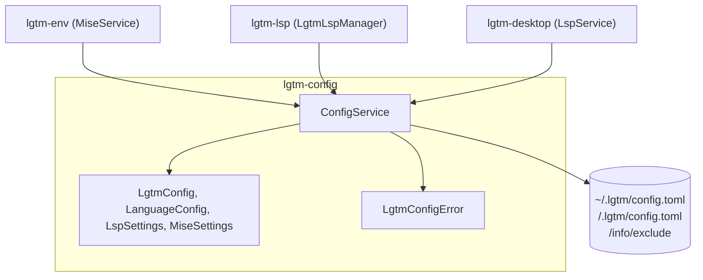
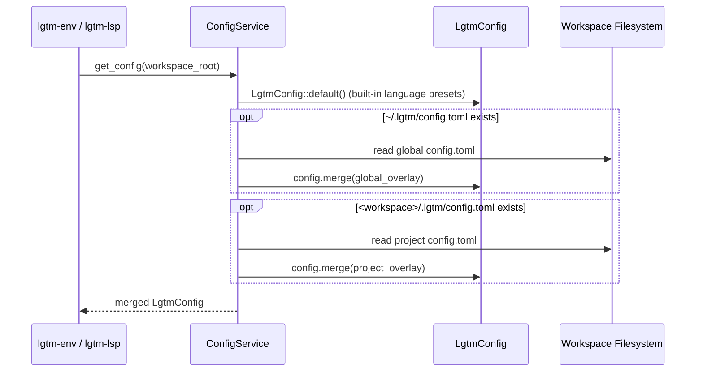

# Configuration library (`lgtm-config`) — software architecture

## Overview

`lgtm-config` is the pure-Rust configuration, JSON Schema generation, Specta type definition, language discovery, and workspace `.lgtm/` directory layout library for LGTM (`lgtm-cli`, `lgtm-env`, `lgtm-lsp`, and `lgtm-desktop`). It deep-merges global (`~/.lgtm/config.{json,yaml,yml}`) and project (`<workspace>/.lgtm/config.{json,yaml,yml}`) nested settings (`appearance.theme`, `workspace.activeRoot`, `workspace.recentRoots`, `editor.lineWrapping`) over defaults, provides built-in language presets (Rust, TypeScript, JavaScript, Python, Go, Markdown, `mise`-managed Biome `json`, and `yaml`), generates `schemas/config.schema.json` via `schemars`, detects project roots and workspace languages, and registers `.lgtm/` idempotently in `<git-dir>/info/exclude`.

## Requirement

### Functional

- Layered nested configuration: Load defaults (`UserSettings`), deep-merge `~/.lgtm/config.{json,yaml,yml}` (or `$LGTM_HOME/config.{json,yaml,yml}`), and overlay leaf-level overrides from `<workspace>/.lgtm/config.{json,yaml,yml}`.
- Leaf-level override-aware patching: Route each modified leaf in `UserSettingsPatch` to `<workspace>/.lgtm/config.{json,yaml,yml}` when that leaf is already overridden in the project config, and otherwise to `~/.lgtm/config.{json,yaml,yml}` without clobbering sibling sections.
- Schema and TypeScript parity: Derive `schemars::JsonSchema` and `specta::Type` on all nested settings and patch structs so `schemas/config.schema.json` and `apps/lgtm-web/src/lib/gen/bindings.ts` share a single Rust source of truth.
- Language and root discovery: Resolve a file's language from its extension and walk ancestor directories up to the workspace boundary to find the nearest language root marker (`Cargo.toml`, `tsconfig.json`, `package.json`, `pyproject.toml`, `requirements.txt`, `go.mod`, `.marksman.toml`, `biome.json`, `biome.jsonc`, `.yamllint`).
- Git worktree hygiene: Create `<workspace>/.lgtm/` and register `.lgtm/` idempotently in `<git-dir>/info/exclude` (supporting both standard `.git` directories and worktree `.git` pointer files) without modifying tracked `.gitignore` files.

### Non-Functional

- Deterministic output: Use `BTreeMap` and `BTreeSet` across all configuration and language discovery models so merged configurations and detected language lists are deterministic.
- Pure configuration boundary: Keep `lgtm-config` free of subprocess execution; delegate `mise` binary management and `.lgtm/mise.toml` synthesis/execution to [`lgtm-env`](../env/index.md).

## Design

### Usage

```rust
use std::path::Path;
use lgtm_config::ConfigService;

let workspace_root = Path::new("/path/to/workspace");
let config_service = ConfigService::new();

// Merge defaults, ~/.lgtm/config.toml, and <workspace>/.lgtm/config.toml
let config = config_service.get_config(workspace_root)?;

// Ensure <workspace>/.lgtm/ and <git-dir>/info/exclude are initialized
let lgtm_dir = config_service.ensure_workspace_dir(workspace_root)?;

// Discover enabled languages present in the workspace
let languages = ConfigService::detect_workspace_languages(&config, workspace_root);
```

### Components and Responsibilities



- `ConfigService`: Resolves `<lgtm_home>`, global and workspace configuration paths, merges TOML overlays onto `LgtmConfig::default_presets()`, discovers ancestor project roots and workspace languages, creates `<workspace>/.lgtm/`, and updates `<git-dir>/info/exclude`.
- `LgtmConfig`, `LanguageConfig`, `LspSettings`, `MiseSettings`, and `MiseTaskConfig`: Pure domain models holding `[lsp]`, `[mise]`, and `[languages.<id>]` settings and extension-to-language lookup.
- `LgtmConfigError`: Typed error enum distinguishing global config I/O and parse errors from project config I/O and parse errors.

### Data and Control Flow



### Interfaces and Contracts

| Type / Method | Signature | Description |
| --- | --- | --- |
| `ConfigService::new` | `fn new() -> Self` | Construct a configuration service reading `~/.lgtm/config.toml` (or `$LGTM_HOME/config.toml`). |
| `ConfigService::from_home` | `fn from_home(home: PathBuf) -> Self` | Construct a configuration service rooted at `<home>/.lgtm/config.toml`. |
| `ConfigService::with_global_config_path` | `fn with_global_config_path(path: PathBuf) -> Self` | Construct a configuration service with an explicit global config path for isolated tests. |
| `ConfigService::get_lgtm_home_dir` | `fn get_lgtm_home_dir(&self) -> PathBuf` | Return the resolved LGTM home directory (`$LGTM_HOME` or `~/.lgtm`). |
| `ConfigService::get_config` | `fn get_config(&self, workspace_root: &Path) -> Result<LgtmConfig>` | Return merged defaults, global config, and `<workspace>/.lgtm/config.toml`. |
| `ConfigService::ensure_workspace_dir` | `fn ensure_workspace_dir(&self, workspace_root: &Path) -> Result<PathBuf>` | Ensure `<workspace>/.lgtm/` and `<git-dir>/info/exclude` are initialized. |
| `ConfigService::detect_project_root` | `fn detect_project_root(workspace_root: &Path, file_path: &Path, language: &LanguageConfig) -> (PathBuf, Option<String>)` | Walk ancestor directories up to `workspace_root` to find the nearest root marker. |
| `ConfigService::detect_workspace_languages` | `fn detect_workspace_languages(config: &LgtmConfig, workspace_root: &Path) -> Vec<String>` | Scan workspace root and subdirectories for enabled language root markers and extensions. |
| `LgtmConfig::detect_file_language` | `fn detect_file_language(&self, file_path: &Path) -> Option<(String, &LanguageConfig)>` | Resolve the enabled language ID and configuration for a file extension. |

## Implementation

### Package layout

```text
libs/lgtm-config/
├── Cargo.toml
├── mise.toml
├── README.md
├── src/
│   ├── lib.rs                 Public ConfigService and configuration model exports
│   ├── error.rs               LgtmConfigError and Result alias
│   ├── models/
│   │   ├── mod.rs
│   │   └── config.rs          LgtmConfig, LanguageConfig, presets, and detection logic
│   └── services/
│       ├── mod.rs
│       └── config.rs          ConfigService and .git/info/exclude hygiene
└── tests/
    └── config.rs              ConfigService BDD integration suite
```

## References

- [Environment library (`lgtm-env`) architecture](../env/index.md).
- [LSP library (`lgtm-lsp`) architecture](../lsp/index.md).
- [Desktop application (`lgtm-desktop`) architecture](../desktop/index.md).
- [Application architecture](../index.md).
