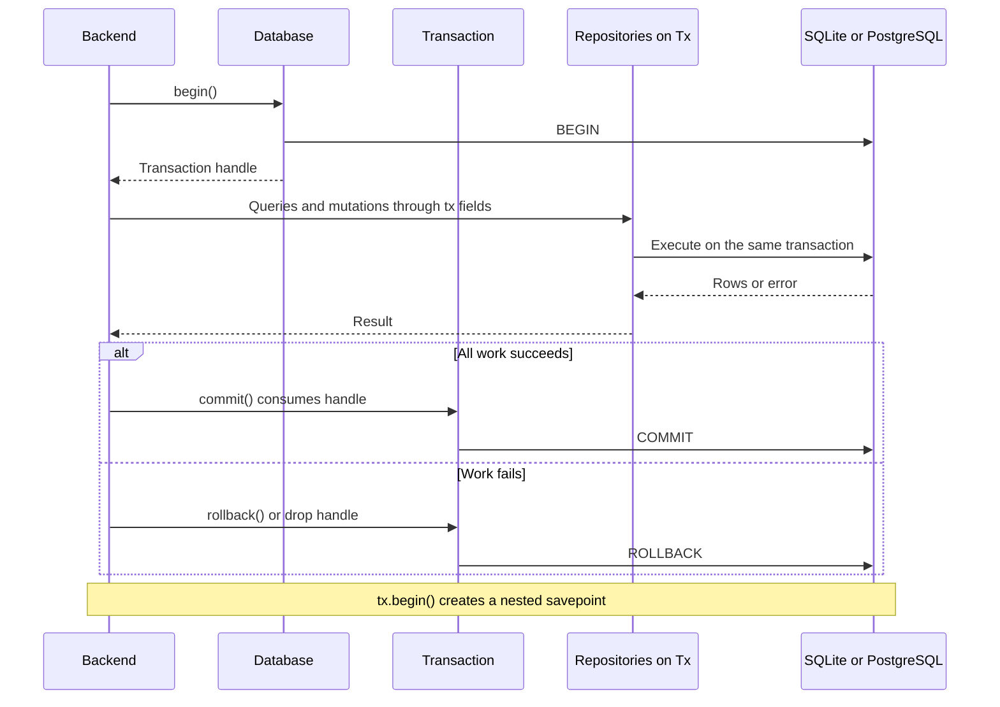
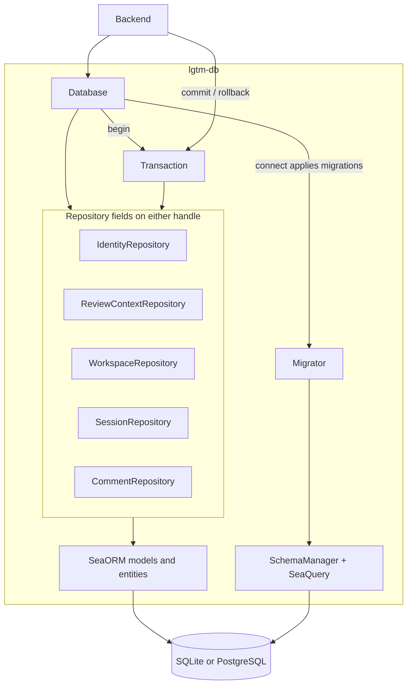
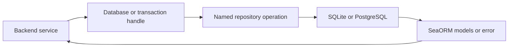
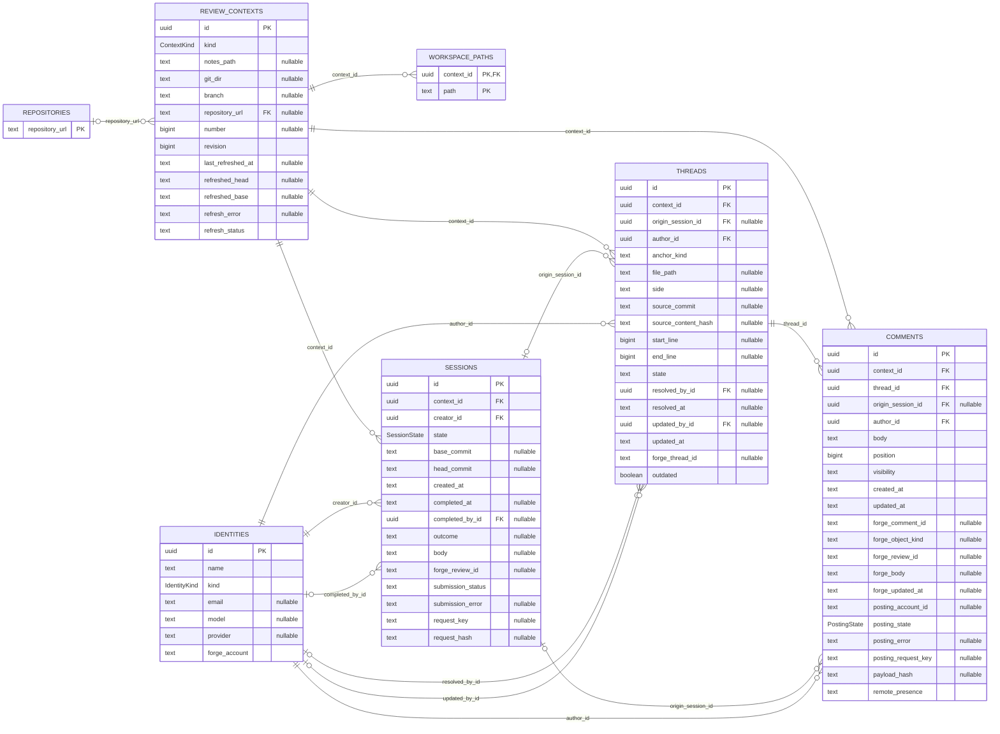
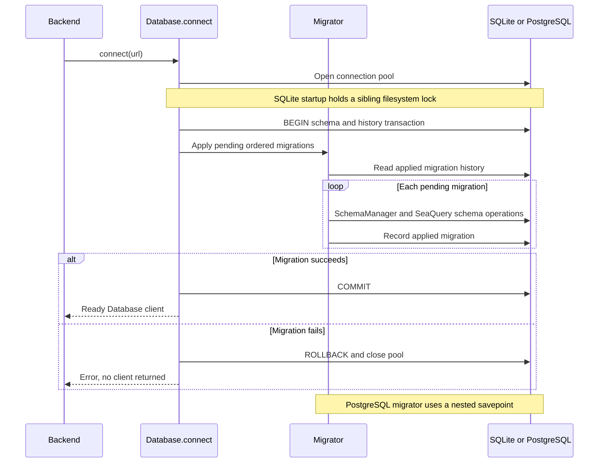
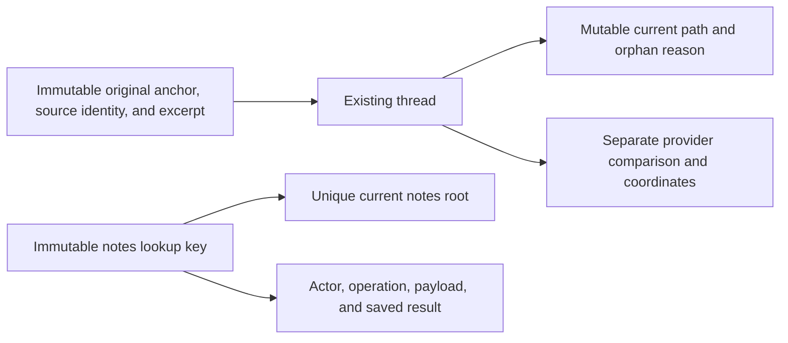

# Database library — software architecture

## Overview

`lgtm-db` provides persistence for the backend. It owns repositories, connections, transactions and a shared migration history for SQLite and PostgreSQL. A repository groups database queries and mutations for related records.

The backend is the library's application client. Backend services own domain validation and coordinate actions across repositories. Review-situation flows belong to the [CLI architecture](../cli/index.md#review-situation-flows).

## Requirement

### Functional

- FR1: Persist identities, forge repository URLs, workspace paths, contexts, sessions, threads and comments.
- FR2: Expose the queries and mutations required by backend services.
- FR3: Support transactions across repositories, with explicit commit and rollback.
- FR4: Apply pending schema migrations before returning a connected client.
- FR5: Enforce record relationships, unique keys and valid field combinations.

### Non-Functional

- NFR1: Share repository implementations and Rust migrations across SQLite and PostgreSQL.
- NFR2: Expose SeaORM `Model` values while keeping entity operations and raw connections private.
- NFR3: Keep backend services, forge providers and network operations outside the library.

## Design

### Usage

This mini tutorial shows the API that backend code uses. Start with a connection, insert and query a record, then compose operations in a transaction. The comment-edit example assumes that its context and comment already exist.

#### Connect, insert and query

The default feature enables SQLite. A PostgreSQL build must enable the `postgres` feature. Both drivers use the same client and repository API.

```rust
use lgtm_db::{Database, error::Result, models::identities, types::IdentityKind};
use uuid::Uuid;

async fn example() -> Result<()> {
    // connect() applies pending migrations before returning.
    let db = Database::connect("sqlite::memory:").await?;
    let identity = identities::Model {
        id: Uuid::new_v4(),
        name: "Alice".to_owned(),
        kind: IdentityKind::Human,
        email: Some("alice@example.com".to_owned()),
        model: None,
        provider: None,
        forge_account: String::new(),
    };

    db.identities.insert(&identity).await?;
    let stored = db.identities
        .get_by_human_email("alice@example.com")
        .await?;
    assert!(stored.is_some());

    db.close().await;
    Ok(())
}
```

#### Look up a context

The database `ContextKey` is independent of the backend domain type:

```rust
use lgtm_db::repositories::review_context::{ContextKey, LocalLocation};

let context = db.review_contexts
    .get_by_key(ContextKey::Local(LocalLocation::Branch {
        git_dir: "/work/project/.git",
        branch: "refs/heads/feature",
    }))
    .await?;
```

#### Change records atomically



Use the transaction's repository fields for every operation that must commit together. In this example, the backend supplies an existing context and comment. Returning an error drops the transaction and rolls back earlier writes.

```rust
use lgtm_db::{Database, error::{Error, Result}};
use uuid::Uuid;

async fn edit_comment(
    db: &Database,
    context_id: Uuid,
    comment_id: Uuid,
    body: &str,
) -> Result<()> {
    let tx = db.begin().await?;
    if !tx.review_contexts.advance_revision(&context_id, None).await? {
        return Err(Error::Invalid("Context not found".to_owned()));
    }

    let mut comment = tx.comments
        .get_by_id(&context_id, &comment_id)
        .await?
        .ok_or_else(|| Error::Invalid("Comment not found".to_owned()))?;
    comment.body = body.to_owned();
    comment.updated_at = chrono::Utc::now()
        .to_rfc3339_opts(chrono::SecondsFormat::Millis, true);

    if !tx.comments.update(&comment).await? {
        return Err(Error::Invalid("Comment no longer exists".to_owned()));
    }
    tx.commit().await?;
    Ok(())
}
```

#### Cancel or nest work

For explicit cancellation, call `tx.rollback().await?`. For a nested boundary, call `let nested = tx.begin().await?`, use `nested` repository fields, then commit or roll back `nested`. The outer transaction still controls the final database commit.

`commit()` and `rollback()` consume the transaction handle. Do not retain cloned transaction or repository handles when finalizing it. Outstanding handles produce `Error::Invalid("Transaction still has repository handles in use")`.

The backend can await other fallible work before commit and roll back database changes if that work fails. A database rollback cannot undo a completed network operation. External side effects require a separate application policy.

#### Handle startup and shutdown

`Database::connect()` applies pending migrations automatically. Callers do not run a separate migration API. If startup or migration fails, the call returns an error instead of a client.

Cloned database clients share their connection pool. Call `db.close().await` after all users finish. Closing one client closes that shared pool.


### Components and Responsibilities



- Backend services: Supply validated values, call repository methods and decide transaction boundaries.
- `Database<C>`: Bind repository fields to one shared connection or transaction. The default `C` is SeaORM's pool-backed `DatabaseConnection`.
- `Transaction`: Alias for `Database<DatabaseTransaction>`. Expose the same repositories, plus consuming `commit()` and `rollback()` methods.
- Repository structs: Execute the supported queries and mutations. Select writable columns explicitly.
- `models`: Re-export each table's actual SeaORM `Model` type through a public namespace.
- Private `entities/`: Define columns and relationships. Shared SeaORM enums live in `entities/common.rs` and are re-exported as `types`.
- Private `Migrator`: Apply ordered Rust migrations and maintain the framework's migration history.
- SchemaManager and SeaQuery: Build schema operations for the selected database driver.

The client exposes five fields: `identities`, `review_contexts`, `workspace`, `sessions` and `comments`. The comment repository also owns thread operations. Callers use `db.sessions.get_active(&context_id)` directly.

### Data and Control Flow



The caller chooses the transaction boundary. All operations on its transaction use the same SQL transaction. Repositories return records. Backend services apply domain rules to those records.

### Interfaces and Contracts

#### Schema and relationships



The ERD above includes every stored field. `PK` marks a primary key and `FK` marks a foreign key. A `nullable` field can contain SQL `NULL`.

The diagram describes the current schema. UUID fields use native PostgreSQL UUID storage and SQLite UUID text storage. Timestamp fields currently use text in both the models and migration. The diagram does not imply a timestamp-type conversion.

The shared migration also enforces constraints that relationship lines cannot express:

- `workspace_paths` uses the composite primary key `(context_id, path)`.
- Context kind is `local` or `forge_backed`. Local keys use either a notes path or a Git-directory/branch pair. Forge-backed keys use a repository URL and PR/MR number.
- Local contexts exclude forge URLs, PR/MR numbers and refresh metadata. Forge-backed contexts require a repository URL and positive PR/MR number.
- A partial unique index permits one active session per context across all identities.
- Composite foreign keys keep thread, comment and origin-session references within the same context.
- Comment positions are unique within each thread. Position zero identifies its root comment, and later positions identify flat replies.
- Remote thread IDs are unique within a context. Remote comment IDs are unique by context, object kind and ID.
- Human identities require email and exclude model/provider. Agent identities require model/provider and exclude email.
- Active/completed sessions and posting states have constraints for their associated metadata and errors.

Fields that contain complete URLs use a `_url` suffix. `repositories.repository_url` identifies a forge repository, and `review_contexts.repository_url` references it. Local branch contexts use `git_dir` instead. The backend derives the forge origin from the URL, including its scheme and port.

The backend represents local locations as `LocalLocation::Notes` or `LocalLocation::Branch`. Forge-backed contexts require a parsed `ForgeRepositoryUrl`. Refresh, posting and remote receipt operations reject persisted local contexts before mutating records.

Identity foreign keys distinguish creators, authors, completers, resolvers and editors. The backend loads those records when it builds domain results. There are no duplicated identity profiles or separate forge-link records.

The migration framework also owns `seaql_migrations`, which records applied migration names and application times. It is infrastructure metadata, outside the application ERD.

#### Repository queries

Every query below is asynchronous and returns `lgtm_db::error::Result<T>`. UUID parameters are borrowed as `&Uuid`. Returned records are SeaORM `models::<table>::Model` values.

| Repository field | Query | Result and scope |
| --- | --- | --- |
| `identities` | `get_by_id(id)` | Optional identity by UUID. |
| `identities` | `get_many(ids)` | Identities for a `Vec<Uuid>`. Missing IDs are omitted. |
| `identities` | `get_by_human_email(email)` | Optional local human identity. The caller supplies normalized email. |
| `identities` | `get_by_agent(name, model, provider)` | Optional agent with the supplied identity key. |
| `identities` | `get_by_forge_account(account)` | Optional identity for a scoped forge-account string. |
| `review_contexts` | `get_by_id(id)` | Optional context by UUID. |
| `review_contexts` | `get_by_key(key)` | Optional context matching a borrowed `ContextKey`. |
| `workspace` | `get_paths(context_id)` | Workspace paths in ascending path order. |
| `sessions` | `get_by_id(id)` | Optional session by UUID. |
| `sessions` | `get_active(context_id)` | Optional active session for the context. |
| `sessions` | `get_completion_by_key(context_id, key)` | Optional session matching the context-scoped completion retry key. |
| `sessions` | `get_all(context_id, active_only)` | Sessions ordered by creation time and UUID. `None` selects all contexts. |
| `comments` | `get_thread(context_id, id)` | Optional thread within the selected context. |
| `comments` | `get_thread_by_remote_id(context_id, remote)` | Optional thread matching a context-scoped forge ID. |
| `comments` | `get_threads(context_id)` | Context threads ordered by UUID. |
| `comments` | `get_by_id(context_id, id)` | Optional comment within the selected context. |
| `comments` | `get_by_remote_id(context_id, kind, remote)` | Optional comment matching a scoped forge object. |
| `comments` | `get_all(context_id)` | Comments ordered by thread UUID and reply position. Includes drafts. |
| `comments` | `get_remote(context_id)` | Comments with a forge comment ID. |
| `comments` | `get_session_drafts(session_id)` | Draft comments originating in the selected session. |
| `comments` | `get_next_position(thread_id)` | Next reply position, or zero for an empty thread. Hold the context write lock before using it. |

A single-record query returns `Ok(None)` when no record matches. Context-scoped comment/thread queries also return `None` when the UUID belongs to another context. Query ordering exists only where the table specifies it.

#### Repository mutations

All record arguments below are borrowed SeaORM models. Mutations return `Result<()>` unless the table specifies `Result<bool>`.

| Repository field | Mutation | Contract |
| --- | --- | --- |
| `identities` | `insert(row)` | Insert without replacing conflicting records. Re-read the natural key to obtain an existing identity. |
| `workspace` | `insert_repository(row)` | Insert a forge repository URL if absent. |
| `workspace` | `insert_path(row)` | Associate a path with a context if absent. |
| `review_contexts` | `insert(row)` | Insert without replacing a conflicting context. Re-read its key after insertion. |
| `review_contexts` | `advance_revision(id, expected)` | Return `bool`. Increment the revision and acquire the context write lock. If `expected` is supplied, require that revision. |
| `review_contexts` | `update_refresh(row)` | Write only refresh metadata. Preserve UUID, context key and revision. |
| `sessions` | `insert(row)` | Insert a session. Conflicting keys or invalid field combinations return errors. |
| `sessions` | `complete(row)` | Return `bool`. Complete only a matching active session, without changing its creator, creation time or reviewed commits. |
| `comments` | `insert_thread(row)` | Insert a thread with its author, ownership and original anchor. |
| `comments` | `insert(row)` | Insert a root comment or reply. Constraint violations return errors. |
| `comments` | `update_thread(row)` | Return `bool`. Update resolution, latest editor, remote linkage and applicability. Preserve author, ownership and original anchor. |
| `comments` | `update(row)` | Return `bool`. Update content, publication and posting fields. Preserve author, ownership, origin session, position and creation time. |

A boolean mutation returns `false` when no eligible row matches. A unit-returning mutation does not report whether it inserted or updated a row. Insert-if-absent methods ignore conflicts and do not merge supplied values into existing records.

These methods enforce persistence contracts, not complete backend workflows. The backend validates domain input, authorizes actions and applies lifecycle rules. For concurrent context mutations, it advances the context revision before dependent reads and writes in the same transaction.

#### Public values and errors

The public model namespaces are `identities`, `repositories`, `workspace_paths`, `review_contexts`, `sessions`, `threads` and `comments`. The `types` module exports `IdentityKind`, `ContextKind`, `SessionState` and `PostingState`.

Model fields are mutable in memory. Repository methods persist only their explicit writable columns. Entity and ActiveModel module paths remain private, as do connection access and migration entry points.

| Error variant | Meaning |
| --- | --- |
| `Error::Invalid` | Unsupported connection configuration or transaction ownership that prevents finalization. |
| `Error::Sql` | Driver, constraint, migration, connection or query failure. |
| `Error::Io` | Filesystem failure during SQLite startup coordination. |

## Implementation

### Repositories define the database API

The DB client is the single source of truth for database operations and the business rules encapsulated by those operations. Clients access persisted data through the queries and mutations on its repositories. They cannot construct ad hoc queries through the supplied client or transaction handle.

The library keeps SeaORM entities, ActiveModel module paths, raw connections and migration entry points private. `Database` and `Transaction` expose repository methods without implementing a public raw-connection interface. Public `Model` values carry data, and editing their fields does not persist changes.

Repositories own selection scopes, writable columns, state-transition predicates and conflict behavior. Schema constraints reinforce keys, relationships and valid field combinations. These rules apply to every caller of the DB client, including callers inside transactions.

When a client needs a new database operation, add a named repository method with an explicit contract. Do not expose a generic query builder, raw SQL entry point or connection escape hatch. Backend services compose those operations and own domain validation, authorization and workflows across repositories or external systems.

Compile-fail doctests cover the public boundary. They reject entity/ActiveModel module imports, direct connection access and ORM writes through the supplied client.

### SeaORM supports local SQLite and remote PostgreSQL

We use SeaORM so the same DB client can support SQLite on local clients and PostgreSQL as a remote database. Repository contracts and model types remain the same for both deployments. Backend services do not need separate persistence implementations for each database.

SeaORM selects the driver from the connection URL and the enabled Cargo features. SQLite support is enabled by default. Remote PostgreSQL deployments enable the `postgres` feature and supply a PostgreSQL connection URL.

SeaQuery and SchemaManager also let the library express its migration history in shared Rust code. Driver-specific SQL generation stays within that persistence layer. Database-specific connection and concurrency behavior remains explicit where required.

Supporting both databases does not provide synchronization between them. A local SQLite database and a remote PostgreSQL database remain independent stores until a separate synchronization design is implemented.

### Migration implementation



`Database::connect()` runs the private `Migrator` before returning. Each ordered entry uses SchemaManager and SeaQuery to build driver-specific schema operations. There is one Rust migration history for both databases.

The library wraps schema changes and `seaql_migrations` history in an explicit transaction. This also provides atomic schema changes for SQLite. PostgreSQL's migrator uses a nested transaction within that boundary.

To add a schema change, add a migration under `src/migration/` and register it in `Migrator::migrations()`. Keep applied migrations unchanged. The framework rejects unknown applied migration names but does not checksum source files.

SQLite startup uses a sibling filesystem lock to serialize migration attempts. PostgreSQL deployments must complete startup migrations before launching parallel backend instances. The library exposes no public migrate, downgrade or reset method.

Additive migrations preserve populated databases and their original anchors. Desktop distribution upgrade policy and local/remote synchronization remain [future ADR topics](../../../adr/README.md).

### Drivers and verification

SQLx is a transitive driver dependency behind SeaORM. The library has no custom placeholder rewriting or duplicate dialect-specific migration files.

SQLite uses one connection per pool. PostgreSQL permits up to eight connections per pool.

SQLite enables foreign keys and uses the driver's five-second busy timeout with its default journal mode. Updating the context revision serializes dependent writes. PostgreSQL acquires the corresponding row lock through that update.

Private tests cover entity relationships and migration history. Public integration tests compose repository queries and mutations, transactions, rollback and savepoints. The contracts run on real SQLite and PostgreSQL databases.

### Review workflow additions

The additive `m20261018_200000_note_promotions` migration creates `note_promotions`. Its composite key is `(source_comment_id, target_session_id)`, so each note is promoted once per target review. The row stores the target draft UUID, request key and hash of the source body, author and chosen target anchor. The service inserts the receipt and draft in one transaction.

The source UUID remains after source-note deletion. Target deletion sets `target_comment_id` to NULL and retains a retry tombstone. A target-session foreign key preserves review ownership. `PromotionRepository` exposes named reads/insertion rather than raw database access.

`Anchor` stores location only. `AnchorSource` stores the immutable source identity: a commit SHA and content hash, an index blob ID and content hash, or a saved-file content hash. The database stores these in `source_commit`, `source_blob_oid`, and `source_content_hash`. Forge observations use their base/head revisions and diff side; they do not store a second per-line commit.

`CommentRepository::delete_draft` and `delete_empty_thread` support owned unposted draft deletion under the service's context transaction. A root with replies must have its replies removed first. Submission receipt/state updates use the existing session columns and named repository methods; no second submission store exists.

The additive `m20261018_210000_selected_text` migration adds nullable `threads.selected_text`. It contains only the original selected lines for new non-Git line notes. Domain relocation accepts one exact match in current content and otherwise leaves an outdated file-level fallback. The original line/commit columns and excerpt are immutable after insertion; this is not full-file snapshot history. Existing rows with no excerpt retain hash-only fallback behavior.

### Source evidence and mutation receipts

Additive migrations 090–093 extend existing review records. They do not replace contexts, sessions, or submission ownership.



The database constrains source shapes, forge-state shapes, unique current notes locations, and unresolved mutation ownership. Named repository updates preserve original evidence and saved-file source paths. A confirmed move changes current associations, not the original anchor or thread ID. A later comment records its own actual source location. Legacy unknown evidence stays unknown. Real SQLite and PostgreSQL contracts cover populated upgrades, immutable origins, unique locations, transaction rollback, and durable retry receipts.

## References

- [Client and transaction implementation](../../../libs/lgtm-db/src/connection.rs).
- [Repository implementations](../../../libs/lgtm-db/src/repositories/mod.rs) and [public models](../../../libs/lgtm-db/src/models.rs).
- [Shared entity types](../../../libs/lgtm-db/src/entities/common.rs) and [initial migration](../../../libs/lgtm-db/src/migration/m20261015_220400_review.rs).
- [Migration runner](../../../libs/lgtm-db/src/migration/mod.rs) and [public integration tests](../../../libs/lgtm-db/tests).
- [Backend architecture](../backend/index.md) and [CLI review flows](../cli/index.md#review-situation-flows).
