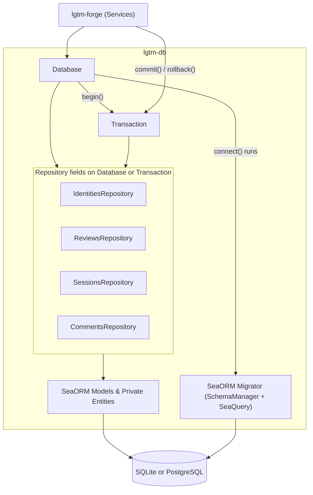
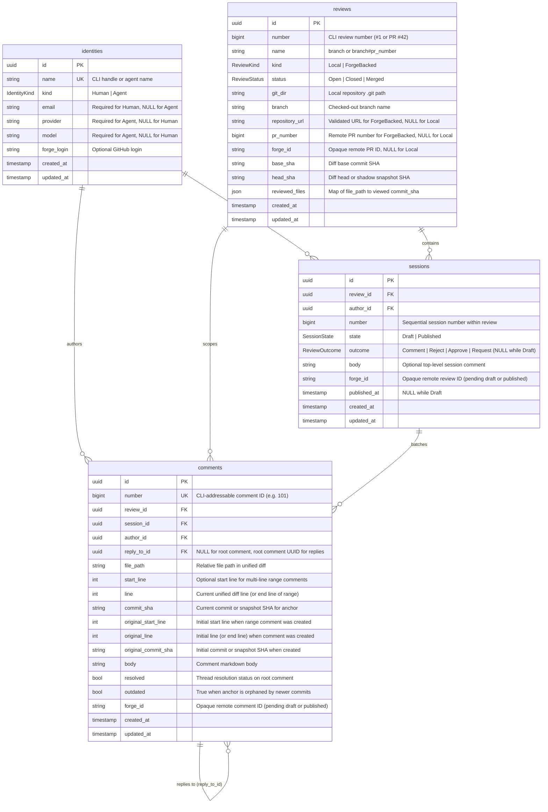
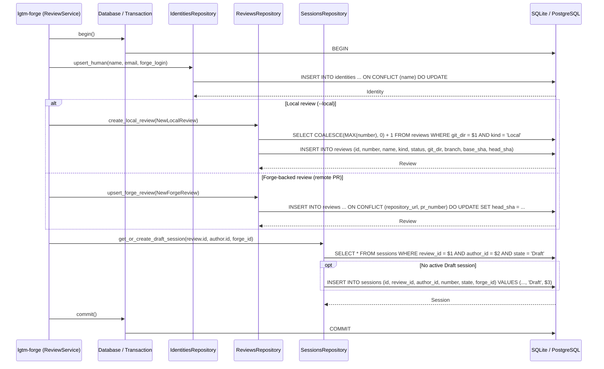
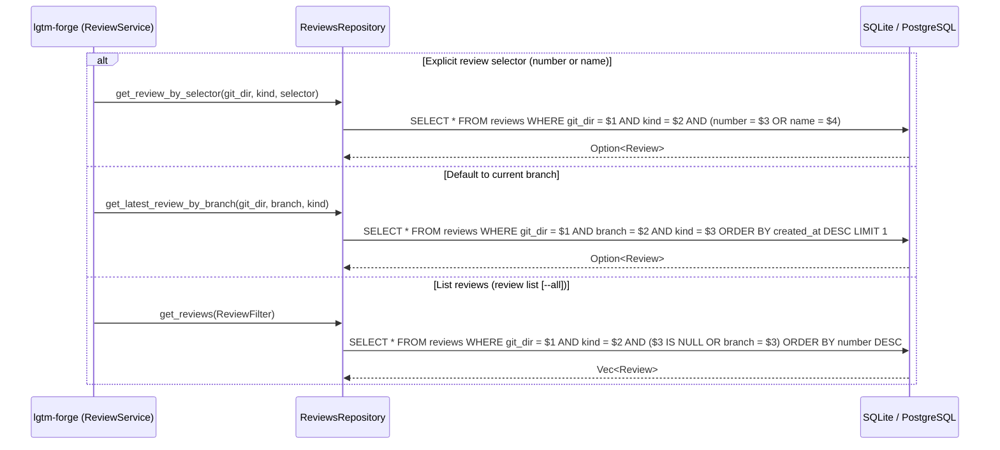
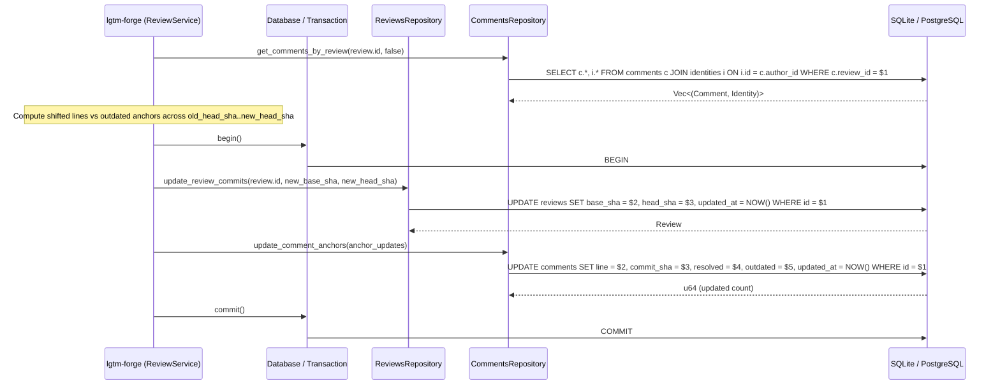
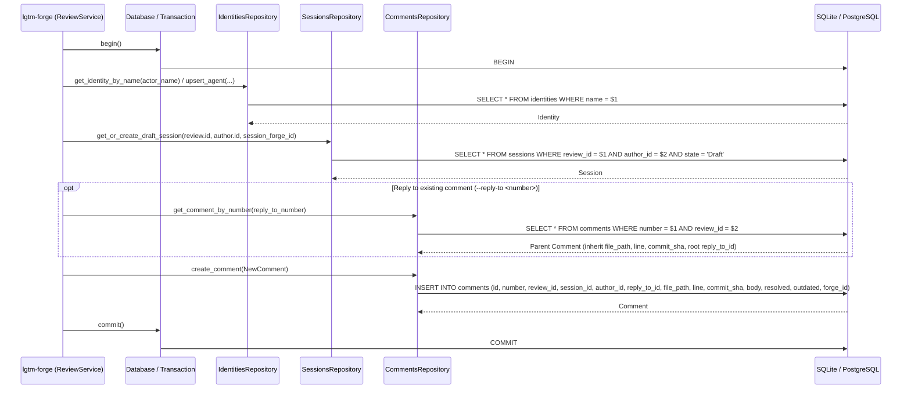
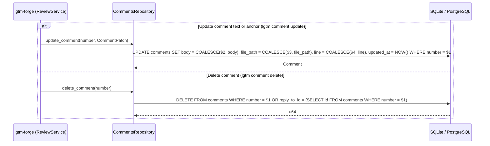
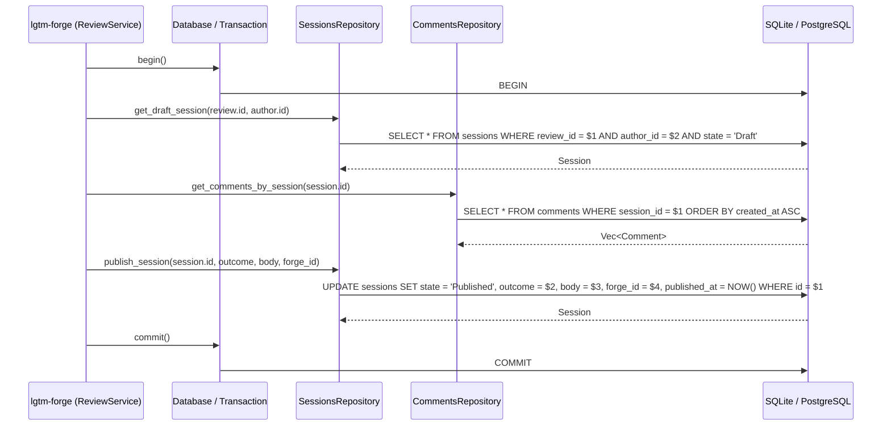
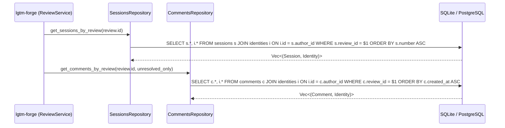

# Database library — software architecture

## Overview

`lgtm-db` is the persistence layer for `lgtm-forge`. It stores human and agent identities, local and forge-backed reviews, transactional review sessions, and inline diff comments in SQLite or PostgreSQL through SeaORM. The schema follows a simple GitHub-style review model while keeping SQL queries, table definitions, and connection details private behind repository methods.

## Requirement

### Functional

- Author attribution: Distinguish human reviewers from AI agents and remember who created each review session and comment.
- Review tracking: Keep track of both local reviews and remote pull request reviews across branches.
- Draft review sessions: Hold unpublished comments in a draft session for each reviewer without mixing local, remote, or cross-branch work, keep remote draft sessions and comments paired with their remote IDs as they sync, and publish them together with an overall review decision.
- Comment conversations: Keep line and range comments, replies, and open or resolved status attached to their file and line positions.
- Viewed file progress: Track which files a reviewer has marked as viewed on a review and reset a file's viewed status when newer changes modify that file.
- Review and comment lookup: Find the latest review for a branch or look up a specific review by number or name, and return comments grouped by file or by session.

### Non-Functional

- Low latency: Return review and comment lookups quickly so CLI commands and UI views feel instantaneous.
- Transactional consistency: Complete multi-step updates all at once so crashes or errors never leave partial review sessions or orphaned comments.
- Data durability: Keep saved reviews, sessions, and comments intact across daemon restarts.

## Design

### Usage

Connect to the database (which applies pending SeaORM migrations automatically), create local and remote reviews, draft and resolve comments, handle mid-flight commit updates, and synchronize remote forge state inside transactions:

```rust
// Database::connect automatically applies pending SeaORM migrations before returning.
let db = Database::connect(&database_url).await?;

// 1. Create a local review, draft a root comment and reply, and resolve the thread
let tx = db.begin().await?;
let human = tx
    .identities
    .upsert_human("sid", "sid@example.com", Some("siddharthkapoor"))
    .await?;
let agent = tx
    .identities
    .upsert_agent("claude-sonnet-4-5", "anthropic", "claude-sonnet-4-5")
    .await?;
let review = tx
    .reviews
    .create_local_review(NewLocalReview {
        git_dir: "/repo/.git".into(),
        branch: "feature/diff-241".into(),
        base_sha: "a1b2c3d".into(),
        head_sha: "9f8e7d6".into(),
    })
    .await?;
let session = tx
    .sessions
    .get_or_create_draft_session(review.id, human.id, None)
    .await?;
let root = tx
    .comments
    .create_comment(NewComment {
        review_id: review.id,
        session_id: session.id,
        author_id: human.id,
        reply_to_id: None,
        file_path: Some("src/lib.rs".into()),
        line: Some(24),
        commit_sha: Some("9f8e7d6".into()),
        body: "Extract this block into a helper.".into(),
        forge_id: None,
    })
    .await?;

// Agent replies in its own draft session and resolves the root thread
let agent_session = tx
    .sessions
    .get_or_create_draft_session(review.id, agent.id, None)
    .await?;
tx.comments
    .create_comment(NewComment {
        review_id: review.id,
        session_id: agent_session.id,
        author_id: agent.id,
        reply_to_id: Some(root.id),
        file_path: root.file_path.clone(),
        line: root.line,
        commit_sha: root.commit_sha.clone(),
        body: "Extracted helper and added unit test.".into(),
        forge_id: None,
    })
    .await?;
let resolved_root = tx
    .comments
    .update_comment(
        root.number,
        CommentPatch {
            resolved: Some(true),
            ..Default::default()
        },
    )
    .await?;

// Mid-flight snapshot commit arrives: advance head_sha, clear viewed status for modified files, and shift anchors
tx.reviews
    .mark_file_reviewed(review.id, "src/lib.rs", "9f8e7d6")
    .await?;
tx.reviews
    .update_review_commits(review.id, "a1b2c3d", "d4e5f6a")
    .await?;
tx.reviews
    .unmark_file_reviewed(review.id, "src/lib.rs")
    .await?;
tx.comments
    .update_comment_anchors(&[CommentAnchorUpdate {
        id: resolved_root.id,
        line: Some(28),
        commit_sha: "d4e5f6a".into(),
        resolved: true,
        outdated: false,
    }])
    .await?;
tx.commit().await?;

// 2. Sync a ForgeBacked review with GitHub, reconcile draft comments, and publish
let tx = db.begin().await?;
let author = tx
    .identities
    .upsert_human("sid", "sid@example.com", Some("siddharthkapoor"))
    .await?;
let pr_review = tx
    .reviews
    .upsert_forge_review(NewForgeReview {
        git_dir: "/repo/.git".into(),
        branch: "feature/diff-241".into(),
        repository_url: "https://github.com/org/repo".into(),
        pr_number: 42,
        forge_id: Some("PR_kwDO123".into()),
        base_sha: "a1b2c3d".into(),
        head_sha: "c0ffee1".into(),
    })
    .await?;

// Import remote reviews and comments pulled from GitHub on refresh
let imported_session = tx
    .sessions
    .upsert_forge_session(NewForgeSession {
        review_id: pr_review.id,
        author_id: author.id,
        state: SessionState::Published,
        outcome: Some(ReviewOutcome::Request),
        body: Some("Please handle the error cases.".into()),
        forge_id: "PRR_kwDO111".into(),
    })
    .await?;
let imported_comment = tx
    .comments
    .upsert_forge_comment(NewForgeComment {
        review_id: pr_review.id,
        session_id: imported_session.id,
        author_id: author.id,
        reply_to_id: None,
        file_path: Some("src/services/review.rs".into()),
        line: Some(38),
        commit_sha: Some("a1b2c3d".into()),
        body: "Handle missing review selector.".into(),
        resolved: false,
        outdated: false,
        forge_id: "PRRC_kwDO222".into(),
    })
    .await?;

// Update comment anchors after new commits move line positions
tx.comments
    .update_comment_anchors(&[CommentAnchorUpdate {
        id: imported_comment.id,
        line: Some(40),
        commit_sha: "c0ffee1".into(),
        resolved: false,
        outdated: false,
    }])
    .await?;

// Create a local draft session and comment paired with a pending remote review
let draft_session = tx
    .sessions
    .get_or_create_draft_session(pr_review.id, author.id, Some("PRR_kwDO456"))
    .await?;
let draft_comment = tx
    .comments
    .create_comment(NewComment {
        review_id: pr_review.id,
        session_id: draft_session.id,
        author_id: author.id,
        reply_to_id: None,
        file_path: Some("src/services/review.rs".into()),
        line: Some(42),
        commit_sha: Some("c0ffee1".into()),
        body: "Ensure unsynced drafts are flushed before close.".into(),
        forge_id: Some("PRRC_kwDO789".into()),
    })
    .await?;

// Reconcile any locally saved comments that lacked a remote forge_id
let unsynced = tx
    .comments
    .get_unsynced_comments_by_review(pr_review.id)
    .await?;
for (comment, _) in unsynced {
    tx.comments
        .update_comment(
            comment.number,
            CommentPatch {
                forge_id: Some("PRRC_kwDO999".into()),
                ..Default::default()
            },
        )
        .await?;
}

// Resolve the comment thread and publish the session after remote submission
tx.comments
    .update_comment(
        draft_comment.number,
        CommentPatch {
            resolved: Some(true),
            ..Default::default()
        },
    )
    .await?;
tx.sessions
    .publish_session(
        draft_session.id,
        ReviewOutcome::Approve,
        Some("Looks good to merge."),
        Some("PRR_kwDO456"),
    )
    .await?;
tx.commit().await?;
db.close().await?;
```

### Components and Responsibilities

- `Database<C>`: Binds repository fields (`identities`, `reviews`, `sessions`, `comments`) to a shared SeaORM `DatabaseConnection` or `DatabaseTransaction`. `Database::connect()` automatically runs pending migrations through `sea-orm-migration` (`MigratorTrait` + `SchemaManager`) before returning the client.
- `Transaction`: Type alias for `Database<DatabaseTransaction>` returned by `db.begin().await?`, exposing the same repository fields plus consuming `commit()` and `rollback()` methods.
- `IdentitiesRepository`: Looks up and upserts `Human` and `Agent` identities and binds optional remote forge logins.
- `ReviewsRepository`: Creates, updates, and queries `Local` and `ForgeBacked` reviews by UUID, numeric review number, review name (`<branch>` or `<branch>#N`), or branch.
- `SessionsRepository`: Manages the active `Draft` session for a review and author, lists sessions in chronological order, and transitions a session to `Published` with a `ReviewOutcome` and optional top-level `body`.
- `CommentsRepository`: Creates root comments and replies in a draft session, updates comment text or line anchors, deletes comments, updates anchor positions during `review refresh`, and queries comments with their sessions and authors for `review show`.
- `models` and `entities`: Public SeaORM `Model` structs and shared enums (`entities::common`), backed by private SeaORM entity definitions.



#### Schema and relationships



### Data and Control Flow

#### Creating a review (`lgtm review new`)

When `lgtm review new` runs, `lgtm-forge` resolves the active branch and commit SHAs and opens a database transaction to upsert the caller identity, insert a `Local` or `ForgeBacked` review, and create or return its open `Draft` session.



#### Resolving and listing reviews (`lgtm review list` / `show` / `refresh`)

When a command passes an explicit review number or name, `get_review_by_selector` matches either `number` or `name` for that checkout and review kind. When the selector is omitted, `get_latest_review_by_branch` selects the most recent review for `(git_dir, branch, kind)`, and `get_reviews` lists reviews for the current branch or all branches (`--all`).



#### Advancing review commits and anchors after mid-flight changes (`lgtm review refresh`)

When new commits or snapshot changes arrive while a review is already in progress, `lgtm-forge` computes which comment lines shifted and which lines were overwritten, then runs a transaction to advance the review's `head_sha` and batch-update every affected comment's current `line`, `commit_sha`, and `outdated` flag while preserving `original_line` and `original_commit_sha`.



#### Creating a draft comment or reply (`lgtm comment new`)

Drafting a new comment or reply resolves the actor (`Human` or `Agent` via `--as`), locates or creates that actor's open `Draft` session on the target review, inherits anchor fields when replying to an existing comment, and inserts the comment row with a sequential `number`.



#### Updating or deleting a comment (`lgtm comment update` / `delete`)

Updating a comment modifies its markdown `body`, line anchor (`file_path`, `line`, `commit_sha`), or `resolved` / `outdated` status by its CLI-visible `number`. Deleting a comment removes the row and any replies pointing to it via `reply_to_id`.



#### Publishing a session on review close (`lgtm review close`)

Closing a review (`lgtm review close --with <outcome>`) loads the caller's open `Draft` session and its draft comments, and transitions the session to `Published` inside a transaction with the chosen `outcome`, optional top-level `body`, and optional remote `forge_id`.



#### Loading review threads for display (`lgtm review show`)

`lgtm review show` loads all sessions, comments, and author identities for a review in two indexed join queries so `lgtm-forge` can group output by file or by session and filter to unresolved threads when `--unresolved` is passed.



### Interfaces and Contracts

#### Database client and transaction lifecycle

| Method / Field | Signature | Description |
| --- | --- | --- |
| `Database::connect` | `async fn connect(database_url: &str) -> Result<Database<DatabaseConnection>, DbError>` | Open a connection pool to SQLite or PostgreSQL and automatically apply pending SeaORM migrations (`sea_orm_migration::MigratorTrait::up`). |
| `Database::begin` | `async fn begin(&self) -> Result<Transaction, DbError>` | Start a database transaction (`Database<DatabaseTransaction>`) or nested savepoint when called on an existing `Transaction`. |
| `Transaction::commit` | `async fn commit(self) -> Result<(), DbError>` | Commit the active transaction and consume the handle. |
| `Transaction::rollback` | `async fn rollback(self) -> Result<(), DbError>` | Roll back the active transaction and consume the handle (dropping an uncommitted `Transaction` also rolls it back). |
| `Database::ping` | `async fn ping(&self) -> Result<(), DbError>` | Check database connectivity for health endpoints. |
| `Database::close` | `async fn close(self) -> Result<(), DbError>` | Close the underlying database connection pool. |
| `db.identities` | `IdentitiesRepository<C>` | Identities repository field on a `Database` or `Transaction` handle. |
| `db.reviews` | `ReviewsRepository<C>` | Reviews repository field on a `Database` or `Transaction` handle. |
| `db.sessions` | `SessionsRepository<C>` | Sessions repository field on a `Database` or `Transaction` handle. |
| `db.comments` | `CommentsRepository<C>` | Comments repository field on a `Database` or `Transaction` handle. |

#### `IdentitiesRepository` methods

| Method | Signature | Description |
| --- | --- | --- |
| `get_identity` | `async fn get_identity(&self, id: Uuid) -> Result<Option<Identity>, DbError>` | Fetch an identity by its internal UUID. |
| `get_identity_by_name` | `async fn get_identity_by_name(&self, name: &str) -> Result<Option<Identity>, DbError>` | Fetch a human or agent identity by its unique CLI handle (`name`). |
| `get_identities_by_ids` | `async fn get_identities_by_ids(&self, ids: &[Uuid]) -> Result<Vec<Identity>, DbError>` | Batch-load identities for a set of sessions or comments. |
| `upsert_human` | `async fn upsert_human(&self, name: &str, email: &str, forge_login: Option<&str>) -> Result<Identity, DbError>` | Create or update a `Human` identity (email required, model/provider `NULL`). |
| `upsert_agent` | `async fn upsert_agent(&self, name: &str, provider: &str, model: &str) -> Result<Identity, DbError>` | Create or update an `Agent` identity (provider and model required, email `NULL`). |

#### `ReviewsRepository` methods

| Method | Signature | Description |
| --- | --- | --- |
| `get_review` | `async fn get_review(&self, id: Uuid) -> Result<Option<Review>, DbError>` | Fetch a review by its internal UUID. |
| `get_review_by_selector` | `async fn get_review_by_selector(&self, git_dir: &str, kind: ReviewKind, selector: &str) -> Result<Option<Review>, DbError>` | Resolve a review by numeric `number` (e.g. `"1"`, `"42"`) or `name` (e.g. `"feature/diff-241"`, `"feature/diff-241#42"`). |
| `get_latest_review_by_branch` | `async fn get_latest_review_by_branch(&self, git_dir: &str, branch: &str, kind: ReviewKind) -> Result<Option<Review>, DbError>` | Fetch the most recent review for the given checkout, branch, and review kind when the CLI selector is omitted. |
| `get_reviews` | `async fn get_reviews(&self, filter: ReviewFilter) -> Result<Vec<Review>, DbError>` | List reviews for `lgtm review list`, filtered by `git_dir`, `kind`, and optional `branch` (omitted when `--all` is passed). |
| `create_local_review` | `async fn create_local_review(&self, input: NewLocalReview) -> Result<Review, DbError>` | Insert a new `Local` review with the next sequential `number` for `git_dir` and `name = branch`. |
| `upsert_forge_review` | `async fn upsert_forge_review(&self, input: NewForgeReview) -> Result<Review, DbError>` | Insert or update a `ForgeBacked` review keyed by `(repository_url, pr_number)` with `number = pr_number` and `name = "{branch}#{pr_number}"`. |
| `update_review_commits` | `async fn update_review_commits(&self, id: Uuid, base_sha: &str, head_sha: &str) -> Result<Review, DbError>` | Update `base_sha` and `head_sha` when refreshing a review against a new snapshot or remote PR head. |
| `update_review_status` | `async fn update_review_status(&self, id: Uuid, status: ReviewStatus) -> Result<Review, DbError>` | Transition a review between `Open`, `Closed`, and `Merged`. |
| `mark_file_reviewed` | `async fn mark_file_reviewed(&self, id: Uuid, file_path: &str, commit_sha: &str) -> Result<Review, DbError>` | Record `file_path -> commit_sha` in `review.reviewed_files`. |
| `unmark_file_reviewed` | `async fn unmark_file_reviewed(&self, id: Uuid, file_path: &str) -> Result<Review, DbError>` | Remove `file_path` from `review.reviewed_files`. |
| `update_reviewed_files` | `async fn update_reviewed_files(&self, id: Uuid, reviewed_files: &BTreeMap<String, String>) -> Result<Review, DbError>` | Replace or prune `review.reviewed_files` during remote sync or mid-flight commit refresh. |

#### `SessionsRepository` methods

| Method | Signature | Description |
| --- | --- | --- |
| `get_session` | `async fn get_session(&self, id: Uuid) -> Result<Option<Session>, DbError>` | Fetch a session by its internal UUID. |
| `get_draft_session` | `async fn get_draft_session(&self, review_id: Uuid, author_id: Uuid) -> Result<Option<Session>, DbError>` | Fetch the active `Draft` session for `(review_id, author_id)`, if one exists. |
| `get_or_create_draft_session` | `async fn get_or_create_draft_session(&self, review_id: Uuid, author_id: Uuid, forge_id: Option<&str>) -> Result<Session, DbError>` | Return the existing `Draft` session for `(review_id, author_id)` or insert a new one with the next session `number` and optional remote pending review `forge_id`. |
| `get_sessions_by_review` | `async fn get_sessions_by_review(&self, review_id: Uuid) -> Result<Vec<(Session, Identity)>, DbError>` | Return all sessions for a review ordered by `number ASC`, joined with their author `Identity`. |
| `publish_session` | `async fn publish_session(&self, id: Uuid, outcome: ReviewOutcome, body: Option<&str>, forge_id: Option<&str>) -> Result<Session, DbError>` | Mark a `Draft` session as `Published`, recording `outcome`, optional top-level `body`, optional remote `forge_id`, and `published_at`. |
| `upsert_forge_session` | `async fn upsert_forge_session(&self, input: NewForgeSession) -> Result<Session, DbError>` | Import or update a remote pull request review session pulled during `lgtm review refresh`. |

#### `CommentsRepository` methods

| Method | Signature | Description |
| --- | --- | --- |
| `get_comment` | `async fn get_comment(&self, id: Uuid) -> Result<Option<Comment>, DbError>` | Fetch a comment by its internal UUID. |
| `get_comment_by_number` | `async fn get_comment_by_number(&self, number: i64) -> Result<Option<Comment>, DbError>` | Fetch a comment by its CLI-visible numeric ID (`number`). |
| `get_comments_by_session` | `async fn get_comments_by_session(&self, session_id: Uuid) -> Result<Vec<Comment>, DbError>` | List all comments belonging to a specific session in creation order. |
| `get_unsynced_comments_by_review` | `async fn get_unsynced_comments_by_review(&self, review_id: Uuid) -> Result<Vec<(Comment, Identity)>, DbError>` | List draft comments on a `ForgeBacked` review that have `forge_id IS NULL` so `lgtm-forge` can reconcile and push them to the remote forge. |
| `get_comments_by_review` | `async fn get_comments_by_review(&self, review_id: Uuid, unresolved_only: bool) -> Result<Vec<(Comment, Identity)>, DbError>` | List all comments and their author identities for a review, optionally filtering to threads whose root comment has `resolved = false`. |
| `create_comment` | `async fn create_comment(&self, input: NewComment) -> Result<Comment, DbError>` | Insert a root comment or reply in a session with the next sequential comment `number`. |
| `update_comment` | `async fn update_comment(&self, number: i64, patch: CommentPatch) -> Result<Comment, DbError>` | Update a comment's `body`, anchor (`file_path`, `start_line`, `line`, `commit_sha`), or `resolved` / `outdated` status. |
| `update_comment_anchors` | `async fn update_comment_anchors(&self, updates: &[CommentAnchorUpdate]) -> Result<u64, DbError>` | Batch-update `start_line`, `line`, `commit_sha`, `resolved`, and `outdated` flags for comments during `lgtm review refresh`. |
| `upsert_forge_comment` | `async fn upsert_forge_comment(&self, input: NewForgeComment) -> Result<Comment, DbError>` | Insert or update a comment imported from a remote forge keyed by `forge_id`. |
| `delete_comment` | `async fn delete_comment(&self, number: i64) -> Result<u64, DbError>` | Delete a comment (and its child replies if it is a root comment) by its CLI-visible `number`. |

#### Shared enums and errors

`libs/lgtm-db/src/entities/common.rs` defines the database enums shared with `lgtm-forge`:

- `IdentityKind`: `Human`, `Agent`
- `ReviewKind`: `Local`, `ForgeBacked`
- `ReviewStatus`: `Open`, `Closed`, `Merged`
- `SessionState`: `Draft`, `Published`
- `ReviewOutcome`: `Comment`, `Reject`, `Approve`, `Request`

`DbError` wraps SeaORM execution and constraint errors into typed variants (`NotFound`, `Conflict`, `ConstraintViolation`, `Connection`, and `Migration`) so `lgtm-forge` can map database failures into domain errors without inspecting driver strings.

## Implementation

### Package layout

```text
libs/lgtm-db/
├── Cargo.toml
├── src/
│   ├── lib.rs                 Public Database, Transaction, and model re-exports
│   ├── client.rs              Database<C> connection, migration, and transaction API
│   ├── error.rs               DbError definitions and SeaORM error mapping
│   ├── entities/
│   │   ├── mod.rs             Private SeaORM entities, public Model re-exports
│   │   ├── common.rs          Shared SeaORM enums (IdentityKind, ReviewKind, etc.)
│   │   ├── identity.rs        identities table and constraint checks
│   │   ├── review.rs          reviews table and Local/ForgeBacked shape checks
│   │   ├── session.rs         sessions table
│   │   └── comment.rs         comments table
│   └── repositories/
│       ├── mod.rs
│       ├── identities.rs      IdentitiesRepository
│       ├── reviews.rs         ReviewsRepository
│       ├── sessions.rs        SessionsRepository
│       └── comments.rs        CommentsRepository
├── migration/
│   └── src/
│       ├── lib.rs             Migrator
│       └── m20261030_000001_init.rs
└── tests/
    ├── common/
    │   └── mod.rs             SQLite and PostgreSQL test database fixtures
    ├── identities_repository.rs
    ├── reviews_repository.rs
    ├── sessions_repository.rs
    └── comments_repository.rs
```

### SQL constraints and indexes

The initial migration enforces core domain invariants directly in SQL:

- `identities`: `CHECK ((kind = 'Human' AND email IS NOT NULL AND provider IS NULL AND model IS NULL) OR (kind = 'Agent' AND email IS NULL AND provider IS NOT NULL AND model IS NOT NULL))`
- `reviews`: `CHECK ((kind = 'Local' AND repository_url IS NULL AND pr_number IS NULL) OR (kind = 'ForgeBacked' AND repository_url IS NOT NULL AND pr_number IS NOT NULL))`
- `sessions`: Partial unique index on `(review_id, author_id) WHERE state = 'Draft'` so an actor never has two open draft sessions on the same review, plus `CHECK ((state = 'Draft' AND outcome IS NULL) OR (state = 'Published' AND outcome IS NOT NULL))`.
- `comments`: Indexes on `(review_id, file_path, line)`, `(session_id, created_at)`, and `(reply_to_id)` to support fast grouping by file or session and `--unresolved` filtering.

### Local vs remote migrations and future remote sync

SeaORM tracks applied migrations in the `seaql_migrations` table on both SQLite and PostgreSQL. For local SQLite (`~/.lgtm/lgtm.db`), a single daemon owns the database file, so `Database::connect` safely applies any pending migrations on startup. When connecting to a shared remote PostgreSQL database or supporting future local-to-remote database sync, clients should verify the `seaql_migrations` version on connect rather than racing to run DDL without coordination, use additive (expand-and-contract) schema changes so slightly older clients remain compatible during rollouts, and return a clear version-mismatch error if the remote schema is newer than the client binary.

## References

- [ADR 0002: Core Concepts and CLI Design](../../../adr/0002-cli-design/ADR.md).
- [Forge architecture](../forge/index.md).
- [CLI architecture](../cli/index.md).
- [Application architecture](../index.md).
