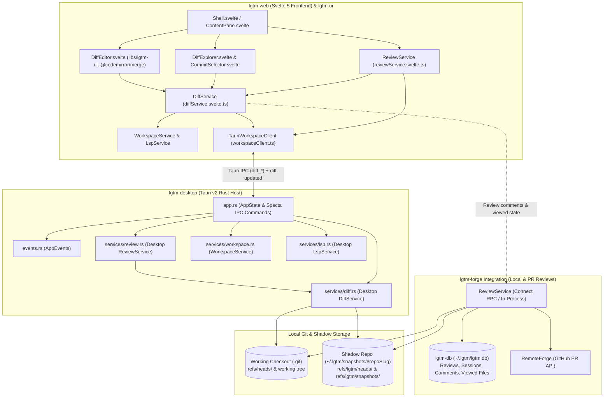
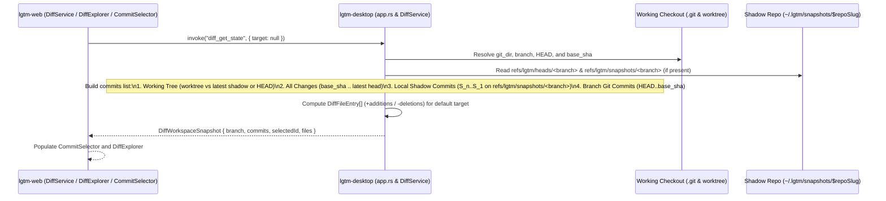
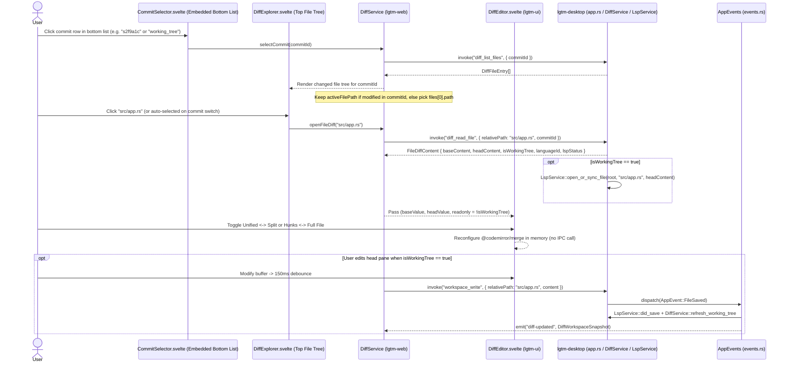
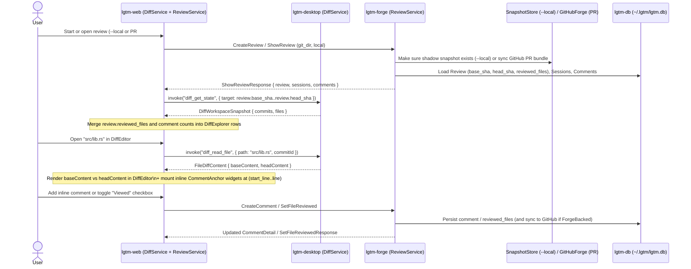
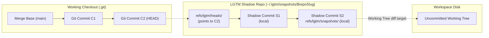
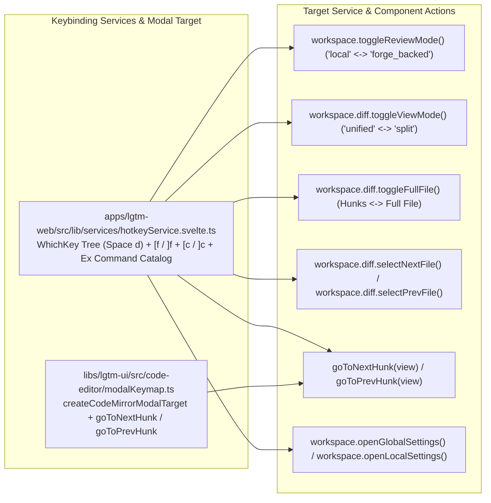

# Desktop diff viewer and commit inspection - software architecture

## Overview

`lgtm-desktop` and `lgtm-web` provide a CodeDiff.nvim-style single-file diff viewer backed by `ReviewService` (`apps/lgtm-desktop/src/services/review.rs` and `apps/lgtm-web/src/lib/services/reviewService.svelte.ts`) and `DiffService` (`apps/lgtm-desktop/src/services/diff.rs` and `apps/lgtm-web/src/lib/services/diffService.svelte.ts`). `ReviewService` selects the diff entry mode (`ReviewMode::Local` for LGTM shadow commits under `~/.lgtm/snapshots/$repoSlug` and working-tree changes, or `ReviewMode::ForgeBacked` for branch Git commits in `.git`), and `DiffService` lists the commit checklist, changed files with line counts, and raw `(base_content, head_content)` file pairs for `DiffEditor` (`libs/lgtm-ui`). Full review session and comment mutations land in a subsequent PR on top of this `ReviewService` and `DiffService` foundation.

## Requirement

### Functional

- Enter diff viewing through `ReviewService` in either `Local` mode (LGTM shadow commits on `refs/lgtm/snapshots/<branch>` plus uncommitted working-tree changes) or `ForgeBacked` mode (standard Git branch commits in `.git`).
- List selectable commits for the active workspace and review mode as an embedded checklist in `CommitSelector`.
- List all files added, modified, deleted, or renamed in the selected commit or range in `DiffExplorer` with `+additions` and `-deletions` counts.
- Open one file at a time in `DiffEditor`, keep left and right panes synchronized in `split` mode, and switch between single-column (`unified`) and two-column (`split`) layouts or between collapsed hunks (`showFullFile = false`) and the full uncollapsed file (`showFullFile = true`) without re-reading blobs from disk.
- Synchronize the `head` side of working-tree diffs with `LspService` and `WorkspaceService` so live diagnostics, hover tooltips, go-to-definition, and `150ms` debounced saves work inside the diff view.
- Provide full keyboard navigation to toggle `Local` vs. `ForgeBacked` review modes, switch between `unified` and `split` views, toggle `showFullFile` (`Hunks Only` vs. `Full File`), step to the next or previous changed file, and jump to the next or previous diff hunk.
- Refresh the changed file list and line counts automatically through `AppEvents` whenever a workspace file is saved, created, renamed, or deleted.
- Support attaching `lgtm-forge` review state (`ReviewSummary`, inline `CommentDetail` threads, and `SetFileReviewed` checkmarks) to the same `DiffService` and `DiffEditor` pipeline in a subsequent phase without changing how commit and file diffs are fetched or rendered.

### Non-Functional

- Never modify `.git/index`, `HEAD`, or remote refs when inspecting working-tree diffs or local shadow commits under `~/.lgtm/snapshots/$repoSlug`.
- Keep `DiffService` decoupled from `WorkspaceService` and `LspService` by routing workspace switches and file saves through `AppEvents` in `apps/lgtm-desktop/src/app.rs`.
- Constrain all keyboard shortcut definitions to `HotkeyService` (`apps/lgtm-web/src/lib/services/hotkeyService.svelte.ts`) and `modalKeymap.ts` (`libs/lgtm-ui/src/code-editor/modalKeymap.ts`) so they plug directly into Helical UI `WhichKeyProvider`, `CommandMenu`, and `CommandPalette` primitives without modifying component files.
- Compute line hunks, word-level highlights, and collapsed context regions in `DiffEditor` (`@codemirror/merge`) on the client so layout toggles (`unified` vs `split`) are instantaneous.

## Design

### Components and Responsibilities



- `AppState` (`apps/lgtm-desktop/src/app.rs`): Registers `review: Arc<Mutex<ReviewService>>` and `diff: Arc<Mutex<DiffService>>` alongside `workspace`, `config`, `lsp`, and `events`, and exposes `review_set_mode`, `diff_get_state`, `diff_list_files`, and `diff_read_file` via Specta IPC commands.
- `services::review::ReviewService` (`apps/lgtm-desktop/src/services/review.rs`): Owns the active `ReviewMode` (`Local` or `ForgeBacked`) for the workspace so the user can enter diff inspection in either local shadow-commit mode (`--local`) or branch Git-commit mode (`ForgeBacked`).
- `services::diff::DiffService` (`apps/lgtm-desktop/src/services/diff.rs`): Resolves the active workspace's `.git` directory and `~/.lgtm/snapshots/$repoSlug` shadow repository, enumerates commits for the active `ReviewMode`, computes changed file manifests (`Added`, `Modified`, `Deleted`, `Renamed`, `+additions`, `-deletions`), and reads `(base_content, head_content)` blob pairs.
- `AppEvents` (`apps/lgtm-desktop/src/events.rs`): Dispatches `WorkspaceOpened` and `FileSaved` to `DiffService` in `app.rs` and emits `"diff-updated"` to the webview when working-tree changes alter the active diff summary.
- `ReviewService` (`apps/lgtm-web/src/lib/services/reviewService.svelte.ts`): Reactive Svelte 5 `$state` service that switches the diff entry mode (`'local' | 'forge_backed'`) and coordinates with `DiffService`.
- `DiffService` (`apps/lgtm-web/src/lib/services/diffService.svelte.ts`): Reactive Svelte 5 `$state` service that owns the commit checklist (`commits`), checked commit IDs (`selectedCommitIds`), changed file list (`files`), active diff file (`activeFile`), column layout (`viewMode: 'unified' | 'split'`), and full-file vs. hunks-only state (`showFullFile: boolean`, toggled via `toggleFullFile()`).
- `DiffExplorer.svelte` & `CommitSelector.svelte` (`apps/lgtm-web/src/lib/components/`): Render the changed file tree in the left sidebar and the commit/range selector at the bottom of the sidebar. See [DiffExplorer & CommitSelector architecture](../web/diff-explorer.md).
- `DiffEditor.svelte` (`libs/lgtm-ui/src/diff-editor/DiffEditor.svelte`): Renders the single-file diff in `unified` or `split` mode using `@codemirror/merge`. See [DiffEditor component architecture](../ui/diff-editor.md).

### Data and Control Flow

#### 1. Workspace Open, Commit Discovery, and File Tree Listing

When a workspace opens or the user switches the sidebar to `Diffs`, `DiffService` inspects both the checkout's `.git` history and `~/.lgtm/snapshots/$repoSlug` (`refs/lgtm/snapshots/<branch>` and `refs/lgtm/heads/<branch>`) to build the unified commit selector list and the changed file list:



#### 2. Commit Selection, Single-File Diff Loading, and Live Working-Tree Edits

Clicking a commit row in the embedded `CommitSelector` at the bottom of `DiffExplorer` updates `selectedCommitId` in `DiffService`, refreshes the changed file list in `DiffExplorer`, and reloads `(base_content, head_content)` for the active file (or the first changed file in the newly selected commit) into `DiffEditor`. `DiffEditor` itself stays commit-agnostic and only receives `(baseValue, headValue, readonly)` props:



#### 3. Future Integration with `lgtm-forge` (`--local` and `ForgeBacked` Reviews)

Comments and viewed-file checkboxes are not part of the initial diff viewer stage. Because `DiffService` already resolves the exact same `base_sha`, `head_sha`, and `~/.lgtm/snapshots/$repoSlug` shadow commits used by `lgtm-forge`, a future phase can connect `lgtm-forge` (`ReviewService`) to layer review sessions, inline comment threads, and viewed-file synchronization onto `DiffExplorer` and `DiffEditor` without changing how diffs are fetched or rendered:



### Interfaces and Contracts

#### 1. Tauri IPC Commands and Events (`apps/lgtm-desktop/src/app.rs`)

| Command / Event | Direction | Signature | Description |
| --- | --- | --- | --- |
| `review_set_mode` | UI -> Host | `(mode: ReviewMode) -> DiffWorkspaceSnapshot` | Set the active review diff mode (`"local"` or `"forge_backed"`) in `ReviewService` and return the corresponding `DiffWorkspaceSnapshot`. |
| `diff_get_state` | UI -> Host | `() -> DiffWorkspaceSnapshot` | Discover Git and LGTM local shadow commits for the active workspace and review mode, and return the changed files across `selected_commit_ids`. |
| `diff_list_files` | UI -> Host | `(selectedCommitIds: string[]) -> DiffFileEntry[]` | Return the sorted list of changed files (`status`, `additions`, `deletions`) across the checked commits (`oldest.parent_sha .. newest.id`) via `DiffService::get_files`. |
| `diff_read_file` | UI -> Host | `(relativePath: string, selectedCommitIds: string[]) -> FileDiffContent` | Read `base_content` and `head_content` for `relativePath` across `selectedCommitIds` via `DiffService::get_file_diff`, and sync `LspService` when `"working_tree"` is the head target. |
| `diff-updated` | Host -> UI | `DiffWorkspaceSnapshot` | Push updated working-tree file statuses and line counts after `AppEvent::FileSaved`, `FileClosed`, or `WorkspaceOpened`. |

#### 2. Rust & Specta Domain Models (`apps/lgtm-desktop/src/models/diff.rs`)

```rust
#[derive(Debug, Default, Clone, Copy, PartialEq, Eq, Serialize, Deserialize, Type)]
#[serde(rename_all = "snake_case")]
pub enum ReviewMode {
    #[default]
    Local,
    ForgeBacked,
}

#[derive(Debug, Clone, Copy, PartialEq, Eq, Serialize, Deserialize, Type)]
#[serde(rename_all = "snake_case")]
pub enum DiffCommitSource {
    WorkingTree,
    LocalSnapshot,
    GitCommit,
}

#[derive(Debug, Clone, PartialEq, Eq, Serialize, Deserialize, Type)]
#[serde(rename_all = "camelCase")]
pub struct DiffCommitItem {
    pub id: String,
    pub short_sha: String,
    pub title: String,
    pub author: String,
    pub timestamp: i64,
    pub parent_sha: Option<String>,
    pub source: DiffCommitSource,
}

#[derive(Debug, Clone, Copy, PartialEq, Eq, Serialize, Deserialize, Type)]
#[serde(rename_all = "snake_case")]
pub enum DiffFileStatus {
    Added,
    Modified,
    Deleted,
    Renamed,
}

#[derive(Debug, Clone, PartialEq, Eq, Serialize, Deserialize, Type)]
#[serde(rename_all = "camelCase")]
pub struct DiffFileEntry {
    pub path: String,
    pub old_path: Option<String>,
    pub status: DiffFileStatus,
    pub additions: u32,
    pub deletions: u32,
}

#[derive(Debug, Clone, PartialEq, Eq, Serialize, Deserialize, Type)]
#[serde(rename_all = "camelCase")]
pub struct FileDiffContent {
    pub path: String,
    pub old_path: Option<String>,
    pub status: DiffFileStatus,
    pub base_sha: String,
    pub head_sha: String,
    pub base_content: String,
    pub head_content: String,
    pub is_binary: bool,
    pub readonly: bool,
}

#[derive(Debug, Clone, PartialEq, Eq, Serialize, Deserialize, Type)]
#[serde(rename_all = "camelCase")]
pub struct DiffWorkspaceSnapshot {
    pub review_mode: ReviewMode,
    pub branch: String,
    pub commits: Vec<DiffCommitItem>,
    pub selected_commit_ids: Vec<String>,
    pub files: Vec<DiffFileEntry>,
}
```

## Implementation

### Package Layout

```text
lgtm/
├── libs/lgtm-ui/src/
│   ├── code-editor/
│   │   ├── modalKeymap.ts                 Helical UI modal editor registration and goToNextHunk / goToPrevHunk commands
│   │   └── shared.ts                      Shared highlight style, line wrapping, and diagnostic helpers
│   └── diff-editor/
│       ├── DiffEditor.svelte              Unified and synced Split CodeMirror 6 diff viewer (@codemirror/merge)
│       ├── styles.ts                      cva variants and diff color tokens
│       └── types.ts                       DiffEditorMode and DiffEditorProps
├── apps/lgtm-desktop/src/
│   ├── app.rs                             Registers ReviewService and DiffService in AppState and wires review_* / diff_* commands
│   ├── events.rs                          Routes WorkspaceOpened / FileSaved / FileClosed to DiffService
│   ├── models/
│   │   └── diff.rs                        ReviewMode, DiffCommitItem, DiffFileEntry, FileDiffContent, DiffWorkspaceSnapshot
│   └── services/
│       ├── review.rs                      ReviewService managing Local vs ForgeBacked diff entry modes
│       └── diff.rs                        DiffService resolving .git and ~/.lgtm/snapshots/$repoSlug
└── apps/lgtm-web/src/lib/
    ├── clients/workspaceClient.ts         Adds reviewSetMode, diffGetState, diffListFiles, diffReadFile, and registerDiffHandlers
    ├── services/
    │   ├── hotkeyService.svelte.ts        Centralized WhichKey leader tree, [f / ]f, [c / ]c, and Ex command catalog
    │   ├── reviewService.svelte.ts        Reactive ReviewMode ('local' | 'forge_backed') entry service
    │   └── diffService.svelte.ts          Reactive commit checklist, changed file list, active diff tab, viewMode, and showFullFile
    └── components/
        ├── DiffExplorer.svelte            Sidebar changed-file tree with A/M/D/R badges and +additions/-deletions
        ├── CommitSelector.svelte          Embedded bottom-of-sidebar checklist for Working Tree, Local shadow, and Git commits
        └── ContentPane.svelte             Hosts DiffEditor and the Unified/Split + Hunks/Full + Hunk/File toolbar
```

### Commit Topology and Local Shadow Commit Resolution

`DiffService` combines standard Git commits from `<workspace>/.git` and LGTM local shadow commits from `~/.lgtm/snapshots/$repoSlug` into a single timeline for `CommitSelector`:



| `CommitSelector` Entry | `source` | `parent_sha` | `id` | How `DiffService` Reads Blobs |
| --- | --- | --- | --- | --- |
| `Working Tree` | `WorkingTree` | Latest shadow commit `S2` (or `HEAD` `C2` if no shadow ref exists) | `"working_tree"` | `base`: read from `~/.lgtm/snapshots/$repoSlug` or `.git`. `head`: read from workspace disk via `WorkspaceService`. |
| `Shadow Commit S_k` | `LocalSnapshot` | Parent `S_{k-1}` (or `refs/lgtm/heads/<branch>` for `S1`) | `S_k` | Read trees and blobs from `~/.lgtm/snapshots/$repoSlug` via `gitoxide`. |
| `Git Commit C_k` | `GitCommit` | Parent `C_{k-1}` | `C_k` | Read trees and blobs from `<workspace>/.git` via `gitoxide`. |

### Keyboard Navigation and Modal Keybinding Integration

All desktop and diff keyboard shortcuts live in `HotkeyService` (`apps/lgtm-web/src/lib/services/hotkeyService.svelte.ts`), paired with `libs/lgtm-ui/src/code-editor/modalKeymap.ts` for CodeMirror buffer commands (`goToNextHunk` and `goToPrevHunk`). Components never attach ad-hoc `keydown` listeners. `Shell.svelte` mounts `WhichKeyProvider`, `CommandMenu`, and `CommandPalette` using `HotkeyService`:



| Action ID | Default Shortcut | Ex Command | Target Call | Description |
| --- | --- | --- | --- | --- |
| `diff.toggleSidebar` | `Space d d` | `:diffs` | `workspace.setSidebarMode(...)` | Toggle between the `Diffs` sidebar and `Explorer` sidebar. |
| `diff.nextFile` | `]f` / `Space d n` | `:dfn` | `workspace.diff.selectNextFile()` | Open the next changed file in `DiffExplorer` inside `DiffEditor`. |
| `diff.prevFile` | `[f` / `Space d p` | `:dfp` | `workspace.diff.selectPrevFile()` | Open the previous changed file in `DiffExplorer` inside `DiffEditor`. |
| `diff.nextHunk` | `]c` / `Space d j` | `:dhn` | `goToNextHunk(view)` | Scroll both synced panes to the next diff hunk in the active file. |
| `diff.prevHunk` | `[c` / `Space d k` | `:dhp` | `goToPrevHunk(view)` | Scroll both synced panes to the previous diff hunk in the active file. |
| `diff.toggleViewMode` | `Space d m` | `:diff-mode` | `workspace.diff.toggleViewMode()` | Toggle `DiffEditor` between `unified` (single-column) and `split` (two-column) views. |
| `diff.toggleFullFile` | `Space d f` | `:diff-full` | `workspace.diff.toggleFullFile()` | Toggle `DiffEditor` between collapsed diff hunks (`showFullFile = false`) and the full file (`showFullFile = true`). |
| `review.toggleMode` | `Space d r` | `:review-mode` | `workspace.toggleReviewMode()` | Switch diff inspection between `Local` (`~/.lgtm/snapshots/$repoSlug`) and `ForgeBacked` (`.git`). |
| `settings.openGlobal` | `Mod+,` / `Space f c` | `:settings` | `workspace.openGlobalSettings()` | Open global configuration in a `Settings` tab. |
| `settings.openLocal` | `Mod+Shift+,` / `Space f p` | `:project-settings` | `workspace.openLocalSettings()` | Open project configuration in a `Settings (project)` tab. |

### `lgtm-forge` Alignment Invariants

- Compute the exact same `<repo-name>-<6-byte-sha256(common_git_dir)>` directory name under `~/.lgtm/snapshots/$repoSlug` in both `DiffService` and `lgtm-forge` (`SnapshotStore`) so linked worktrees and local reviews resolve to the same bare repository.
- Resolve `oldest.parent_sha` from `<workspace>/.git/objects` and `newest.id` from `~/.lgtm/snapshots/$repoSlug/objects` when a user checks both a `GitCommit` and a `LocalSnapshot` in `CommitSelector` rather than assuming a single Git object database.
- Walk both `refs/lgtm/snapshots/<branch>` and `HEAD` history when building the commit list so commits on `<workspace>/.git` and local shadow commits relative to `refs/lgtm/heads/<branch>` resolve accurately across both `Local` and `ForgeBacked` modes.

## References

- [DiffEditor UI component (`libs/lgtm-ui`)](../ui/diff-editor.md).
- [DiffExplorer & CommitSelector UI components (`lgtm-web`)](../web/diff-explorer.md).
- [Snapshot store architecture (`lgtm-forge`)](../forge/snapshot-store.md).
- [Forge review architecture (`lgtm-forge`)](../forge/index.md).
- [Desktop application architecture (`lgtm-desktop`)](index.md).
- [Desktop event handling & service orchestration](events.md).
- [Web frontend architecture (`lgtm-web`)](../web/index.md).
