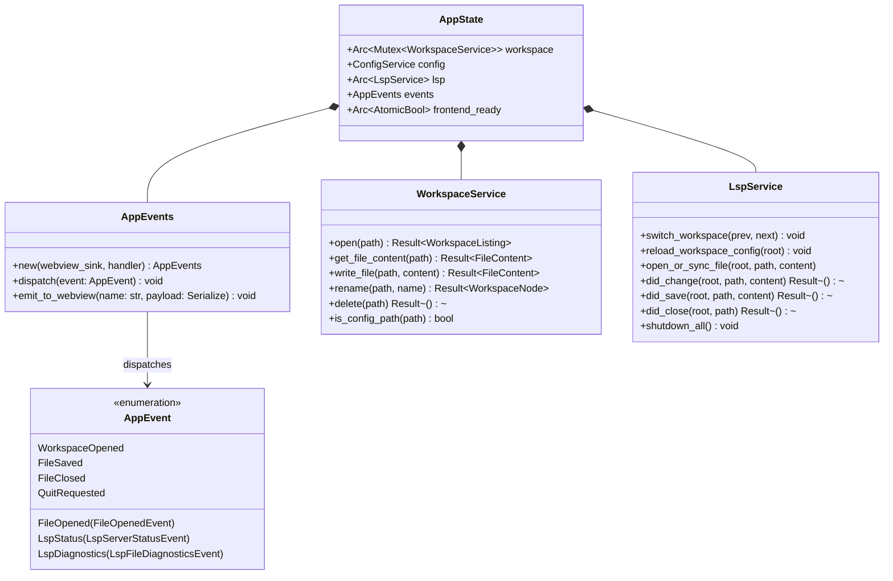
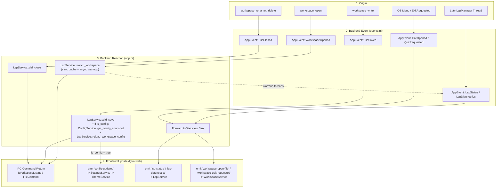
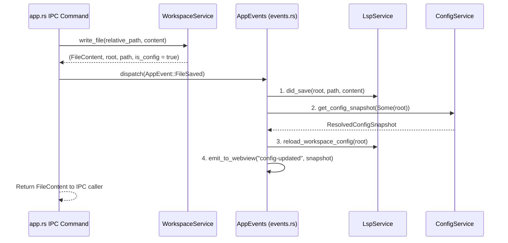
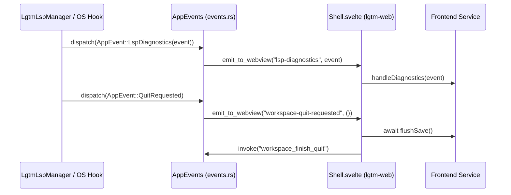

# Desktop event handling & service orchestration — software architecture

## Overview

`apps/lgtm-desktop/src/events.rs` provides an in-process backend event bus (`AppEvents` and `AppEvent`) wired in `apps/lgtm-desktop/src/app.rs`. It decouples backend domain services (`WorkspaceService`, `ConfigService`, `LspService`) to eliminate circular imports, runs synchronous state transitions before notifying the UI, and offloads slow work onto background threads without blocking callers.

## Requirement

### Functional

- Typed backend event bus (`events.rs`): Dispatch all backend domain and lifecycle events as strongly typed `AppEvent` variants through `AppEvents`.
- Centralized backend orchestration (`app.rs`): Register the `AppEvents` handler in `app.rs` to invoke `LspService` and `ConfigService` methods and push UI updates over Tauri IPC only after synchronous backend state is consistent.
- Dual frontend update path: Update the frontend via direct IPC command return values for request/response operations, and via `app_handle.emit` (plus `BridgeEventForwarder` in E2E) for background thread, OS menu/window, or cross-domain side-effect notifications.

### Non-Functional

- Strong typing & auditable patterns: Define all events in `AppEvent` (`events.rs`) and handle them in a single `match` in `app.rs` so dispatch and reaction sites are immediately identifiable during code review.
- No circular dependencies: `WorkspaceService`, `ConfigService`, and `LspService` never import each other or `tauri::AppHandle`.
- Non-blocking concurrency: Background LSP and toolchain tasks run outside service locks and emit follow-up `AppEvent::LspStatus` and `AppEvent::LspDiagnostics` events when complete.

## Design

### Usage

#### Dispatching and Handling Events (`apps/lgtm-desktop/src/app.rs` & `events.rs`)

```rust
// Dispatching a backend domain event
state.events.dispatch(AppEvent::FileSaved {
    root,
    path,
    content,
    is_config,
});

// Central handler in app.rs
match event {
    AppEvent::WorkspaceOpened { previous_root, next_root } => {
        lsp.switch_workspace(previous_root.as_deref(), &next_root);
    }
    AppEvent::FileOpened(payload) => events.emit_to_webview("workspace-open-file", &payload),
    AppEvent::FileSaved { root, path, content, is_config } => {
        let _ = lsp.did_save(&root, &path, &content);
        if is_config && let Ok(snapshot) = config.get_config_snapshot(Some(&root)) {
            lsp.reload_workspace_config(&root);
            events.emit_to_webview("config-updated", &snapshot);
        }
    }
    AppEvent::FileClosed { root, path } => {
        let _ = lsp.did_close(&root, &path);
    }
    AppEvent::LspStatus(payload) => events.emit_to_webview("lsp-status", &payload),
    AppEvent::LspDiagnostics(payload) => events.emit_to_webview("lsp-diagnostics", &payload),
    AppEvent::QuitRequested => events.emit_to_webview("workspace-quit-requested", &()),
}
```

### Components and Responsibilities

#### 1. Backend Class Structure (`lgtm-desktop`)



#### 2. Event Propagation Across Lanes



### Data and Control Flow

#### 1. Backend Event Dispatch (`WorkspaceOpened` & `FileSaved`)



#### 2. Background LSP & OS Lifecycle Push to Frontend



### Interfaces and Contracts

#### 1. Backend Event Shapes (`apps/lgtm-desktop/src/events.rs`)

```rust
pub enum AppEvent {
    WorkspaceOpened {
        previous_root: Option<PathBuf>,
        next_root: PathBuf,
    },
    FileOpened(FileOpenedEvent),
    FileSaved {
        root: PathBuf,
        path: PathBuf,
        content: String,
        is_config: bool,
    },
    FileClosed {
        root: PathBuf,
        path: PathBuf,
    },
    LspStatus(LspServerStatusEvent),
    LspDiagnostics(LspFileDiagnosticsEvent),
    QuitRequested,
}
```

#### 2. Webview Push Events (`AppEvents::emit_to_webview`)

| Wire Event Name | Payload Shape | Source `AppEvent` |
| --- | --- | --- |
| `"lsp-status"` | `LspServerStatusEvent` | `AppEvent::LspStatus` |
| `"lsp-diagnostics"` | `LspFileDiagnosticsEvent` | `AppEvent::LspDiagnostics` |
| `"config-updated"` | `ResolvedConfigSnapshot` | `AppEvent::FileSaved { is_config: true, .. }` |
| `"workspace-open-file"` | `FileOpenedEvent` | `AppEvent::FileOpened` |
| `"workspace-quit-requested"` | `()` | `AppEvent::QuitRequested` |

## References

- [Desktop application (`lgtm-desktop`) architecture](index.md).
- [Web frontend (`lgtm-web`) architecture](../web/index.md).
- [LSP library (`lgtm-lsp`) architecture](../lsp/index.md).
- [Configuration library (`lgtm-config`) architecture](../config/index.md).
