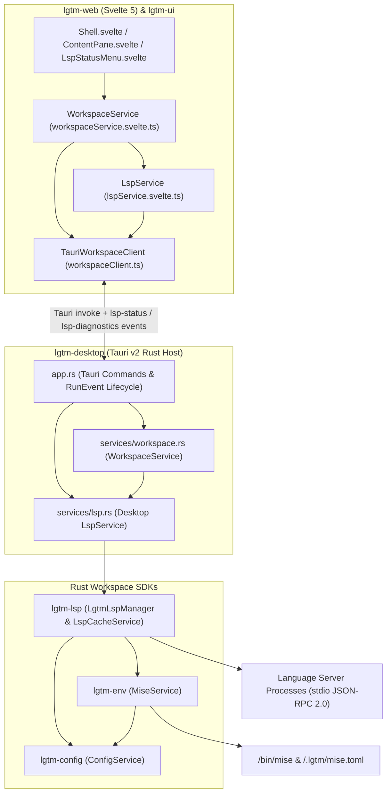
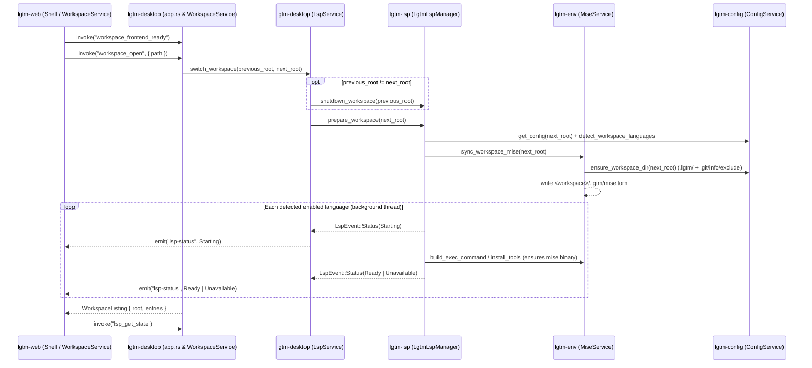
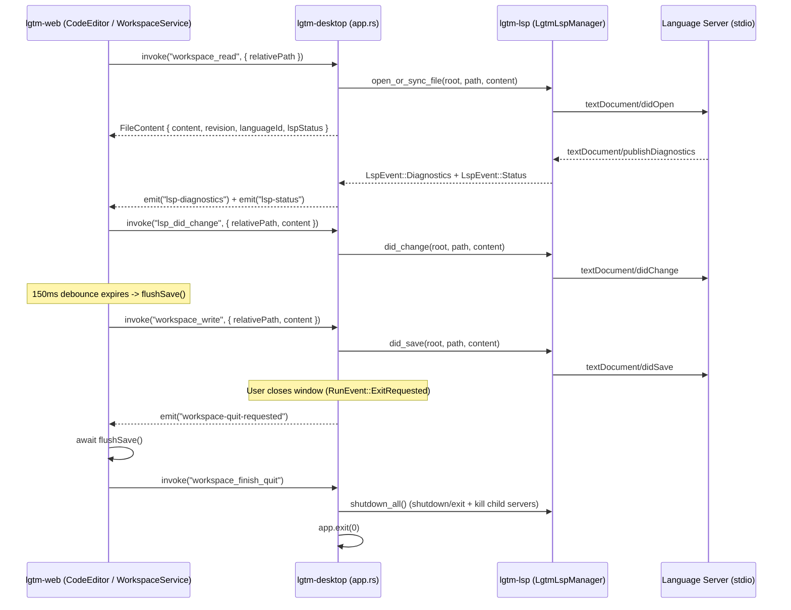

# Desktop application (`lgtm-desktop` & `lgtm-web`) — software architecture

## Overview

`lgtm-desktop` is the native Tauri v2 desktop application shell for LGTM, paired with the reactive Svelte 5 IDE shell in `lgtm-web` and reusable UI primitives in `lgtm-ui`. It provides local workspace browsing and file editing, coordinates workspace lifecycle transitions with `lgtm-lsp`, `lgtm-env`, and `lgtm-config`, streams asynchronous LSP server statuses and file diagnostics to the frontend over Tauri events, and guarantees clean language server process shutdown and unsaved-buffer flushing on workspace switch or application exit.

## Requirement

### Functional

- Workspace lifecycle management (`WorkspaceService`): Open the default workspace (`~/.lgtm/workspace`) or any chosen directory on disk, list directories and files while hiding internal `.lgtm` metadata, and create, read, save, rename, or move entries to the OS Trash with path-traversal and symlink-escape protection.
- Automatic environment and LSP warmup on workspace switch: When opening or switching a workspace, terminate language servers from the previous workspace, discover workspace languages via `lgtm-config`, synchronize `<workspace>/.lgtm/mise.toml` via `lgtm-env`, write `<workspace>/.lgtm/cache/discovery.json` via `lgtm-lsp`, and warm up language servers on background threads.
- Real-time editor and LSP synchronization: Synchronize file open (`workspace_read` -> `textDocument/didOpen`), in-memory buffer edits (`lsp_did_change` -> `textDocument/didChange`), file saves (`workspace_write` -> `textDocument/didSave`), and file renames/deletes (`textDocument/didClose`) between the CodeMirror 6 editor and active language server sessions.
- Asynchronous event streaming and IDE controls: Emit `lsp-status` and `lsp-diagnostics` Tauri events from background reader threads to update the header `LspStatusMenu`, file tree diagnostic badges, editor squiggles, hover tooltips (`lsp_hover`), go-to-definition jumps (`lsp_goto_definition`), read-only diagnostics buffers (`lsp_get_diagnostics_buffer`), and server restarts (`lsp_restart`).
- Coordinated quit handshake: Intercept window/application close (`RunEvent::ExitRequested`), emit `workspace-quit-requested` so the Svelte frontend flushes pending debounced edits, and invoke `workspace_finish_quit` to terminate all child language server processes before exiting.

### Non-Functional

- Non-blocking UI thread: Execute all filesystem and LSP IPC commands on Tauri's blocking thread pool (`spawn_blocking`) and warm up language servers asynchronously so workspace opening and typing remain responsive even when `mise` installs toolchains or language servers index large projects.
- Sandboxed workspace boundaries: Canonicalize all paths and reject symlinks or relative paths that resolve outside the active workspace root.

## Design

### Components and Responsibilities



- `app.rs` (`lgtm-desktop`): Registers a unified `AppState` (`workspace`, `config`, `lsp`, `frontend_ready`, `events`) in Tauri managed state, dispatches `workspace_*`, `lsp_*`, and `config_get` IPC commands onto `spawn_blocking`, emits `config-updated` when `workspace_write` saves a configuration file, and coordinates the `RunEvent::ExitRequested` quit handshake.
- `services::workspace::WorkspaceService` (`lgtm-desktop`): Owns the active `Workspace` root, validates workspace-relative paths (plus `~/.lgtm/config.json` and `.lgtm/config.json`), opens global and local configuration files (`open_global_config`, `open_local_config`), and performs atomic file/folder CRUD.
- `services::lsp::LspService` (`lgtm-desktop`): Bridges `lgtm-lsp`'s `LgtmLspManager` to the Tauri `AppHandle` (and optional E2E stdio bridge forwarder), translating `LspEvent::Status` and `LspEvent::Diagnostics` callbacks into `app_handle.emit("lsp-status", ...)` and `app_handle.emit("lsp-diagnostics", ...)`.
- `LgtmLspManager` & `LspCacheService` (`lgtm-lsp`): Manage per-`(workspace_root, language_id, project_root)` stdio JSON-RPC 2.0 sessions, cache open UTF-8 document snapshots and diagnostics, and coordinate with `MiseService` (`lgtm-env`) and `ConfigService` (`lgtm-config`) to launch language servers.
- `WorkspaceService`, `LspService`, & `SettingsService` (`lgtm-web`): Reactive Svelte 5 `$state` services that manage open editor tabs, 150ms debounced auto-save (`flushSave`), live `lsp_did_change` notifications, active language server indicators, read-only diagnostics buffer tabs, and live `config-updated` preference synchronization. See [Web frontend architecture](../web/index.md).

### Data and Control Flow

#### 1. Startup, Workspace Switch, and Warmup Lifecycle



#### 2. File Editing, Diagnostics, Navigation, and Quit Handshake



### Interfaces and Contracts

| Tauri Command / Event | Direction | Payload / Signature | Description |
| --- | --- | --- | --- |
| `workspace_open` | UI -> Host | `(path?: string) -> WorkspaceListing` | Open default or selected workspace directory, switch LSP workspace context, and list root entries. |
| `workspace_list` | UI -> Host | `(relativePath: string) -> WorkspaceNode[]` | List sorted child directories and files inside a workspace-relative folder. |
| `workspace_read` | UI -> Host | `(relativePath: string) -> FileContent` | Read UTF-8 file content, synchronize `didOpen` with `LgtmLspManager`, and return language ID and server status. |
| `workspace_write` | UI -> Host | `(relativePath: string, content: string) -> FileContent` | Atomically write UTF-8 file content to disk and send `textDocument/didSave`. |
| `workspace_create_file` / `workspace_create_folder` | UI -> Host | `(name: string, parentPath?: string) -> WorkspaceNode` | Exclusively create a new file or folder inside the workspace. |
| `workspace_rename` | UI -> Host | `(relativePath: string, name: string) -> WorkspaceNode` | Rename a workspace entry without overwriting existing targets and close its old LSP document URI. |
| `workspace_delete` | UI -> Host | `(relativePath: string) -> void` | Move a workspace entry to OS Trash and close its LSP document URI. |
| `workspace_frontend_ready` | UI -> Host | `() -> void` | Mark the frontend quit listener ready so `ExitRequested` waits for `flushSave()`. |
| `workspace_finish_quit` | UI -> Host | `() -> void` | Terminate all active language server processes via `LspService::shutdown_all` and exit. |
| `lsp_did_change` | UI -> Host | `(relativePath: string, content: string) -> void` | Update cached buffer text and send `textDocument/didChange`. |
| `lsp_hover` | UI -> Host | `(relativePath: string, offset: number) -> LspHoverResult \| null` | Query `textDocument/hover` at a CodeMirror UTF-16 offset. |
| `lsp_goto_definition` | UI -> Host | `(relativePath: string, offset: number) -> LspLocation[]` | Query `textDocument/definition` at a CodeMirror UTF-16 offset and return workspace-relative locations. |
| `lsp_get_state` | UI -> Host | `() -> LspWorkspaceSnapshot` | Return all tracked language server statuses and file diagnostics for the active workspace. |
| `lsp_get_diagnostics_buffer` | UI -> Host | `(languageId?: string) -> LspDiagnosticsBuffer` | Render a read-only plain-text diagnostics report for all active servers or a single language. |
| `lsp_restart` | UI -> Host | `(languageId: string) -> LspServerStatusEvent` | Restart all sessions for `languageId` in the active workspace and re-open tracked documents. |
| `workspace_open_global_config` | UI -> Host | `() -> FileContent` | Ensure `~/.lgtm/config.json` exists with `$schema`, synchronize LSP (`vscode-json-language-server --stdio`) asynchronously, and return `FileContent` for `Cmd+,` editing. |
| `workspace_open_local_config` | UI -> Host | `() -> FileContent` | Ensure `~/.lgtm/config.json` exists, return an empty JSON temp buffer (`{\n}\n`) when `<workspace>/.lgtm/config.json` is absent (or read it if present), synchronize LSP (`vscode-json-language-server --stdio`) asynchronously, and return `FileContent` for `Cmd+Shift+,` editing. |
| `config_get` | UI -> Host | `() -> ResolvedConfigSnapshot` | Return effective deep-merged `LgtmConfig` plus global and project `LgtmConfigPatch` trees. |
| `lsp-status` | Host -> UI | `LspServerStatusEvent` | Real-time language server lifecycle status and error/warning counts. |
| `lsp-diagnostics` | Host -> UI | `LspFileDiagnosticsEvent` | Real-time workspace-relative or global config file diagnostics with UTF-16 offsets. |
| `config-updated` | Host -> UI | `ResolvedConfigSnapshot` | Live resolved nested settings snapshot emitted when `workspace_write` saves `~/.lgtm/config.json` or `<workspace>/.lgtm/config.json`. |
| `workspace-quit-requested` | Host -> UI | `()` | Signals the frontend to flush pending saves before calling `workspace_finish_quit`. |

## Implementation

### Package layout

```text
apps/
├── lgtm-desktop/
│   ├── Cargo.toml
│   ├── Tauri.toml
│   └── src/
│       ├── main.rs                    Desktop binary entrypoint and --ipc-bridge E2E mode
│       ├── lib.rs                     Public crate exports
│       ├── app.rs                     Tauri state registration, IPC command handlers, and quit lifecycle
│       ├── events.rs                  AppEvents and EventSink emitter abstraction
│       ├── error.rs                   Serializable IPC error codes and messages
│       ├── models/
│       │   ├── file_content.rs        UTF-8 FileContent with SHA-256 revision and LSP metadata
│       │   └── workspace.rs           Workspace, WorkspaceListing, and WorkspaceNode validation
│       └── services/
│           ├── workspace.rs           WorkspaceService filesystem orchestration and LSP hooks
│           ├── lsp.rs                 Desktop LspService event emitter and workspace lifecycle adapter
│           └── ipc_bridge.rs          JSON-over-stdio bridge for headless Playwright E2E tests
└── lgtm-web/src/lib/
    ├── clients/workspaceClient.ts     WorkspaceClient interface and TauriWorkspaceClient adapter
    ├── services/
    │   ├── workspaceService.svelte.ts Reactive workspace state, tab management, and debounced save orchestration
    │   └── lspService.svelte.ts       Reactive LSP status, diagnostics, hover, and navigation service
    └── components/
        ├── Shell.svelte               Top-level IDE chrome, breadcrumbs, and LspStatusMenu mount
        ├── WorkspaceExplorer.svelte   Sidebar workspace selector, file tree, and context menu
        ├── ContentPane.svelte         TabBar and CodeEditor / Markdown / Diagnostics view host
        └── LspStatusMenu.svelte       Compact header menu displaying per-language server health and actions
```

### Headless E2E IPC Bridge

When compiled with the `e2e-bridge` feature and launched with `--ipc-bridge <home>`, `lgtm-desktop` initializes the exact same `WorkspaceService` and `LspService` graph used by the native Wry window, forwarding `lsp-status` and `lsp-diagnostics` events over stdout lines so Playwright Chromium/WebKit tests exercise the full Rust workspace, `lgtm-lsp`, `lgtm-env`, and `lgtm-config` stack deterministically.

## References

- [LSP library (`lgtm-lsp`) architecture](../lsp/index.md).
- [Environment library (`lgtm-env`) architecture](../env/index.md).
- [Configuration library (`lgtm-config`) architecture](../config/index.md).
- [End-to-end testing architecture](../e2e/index.md).
- [Application architecture](../index.md).
