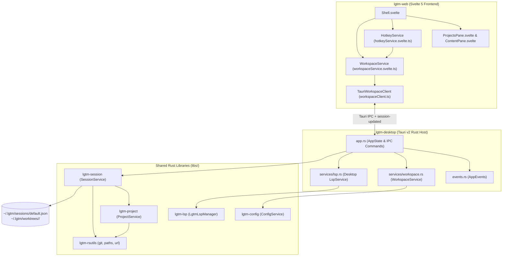
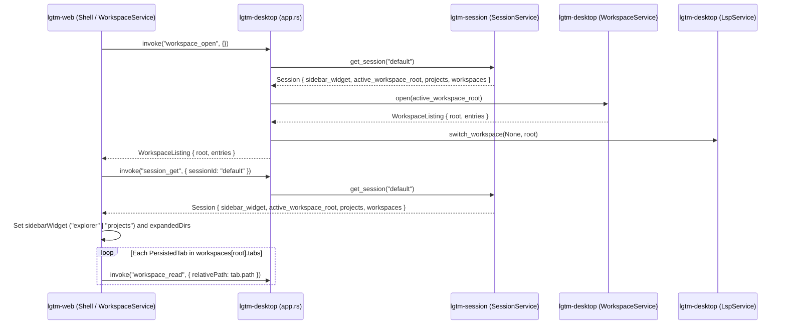
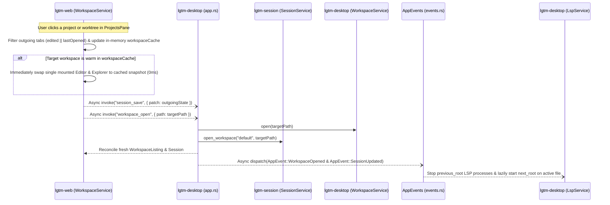
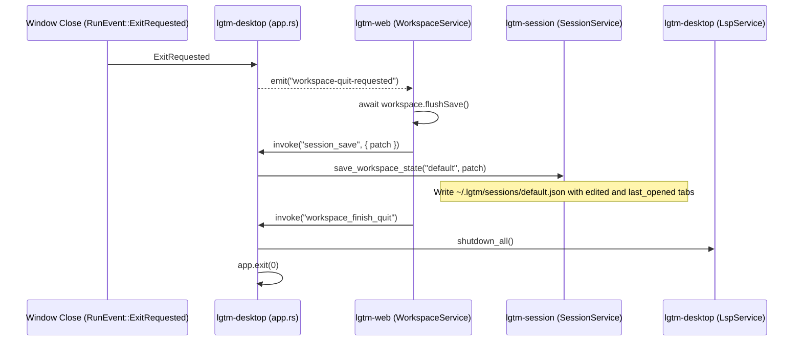
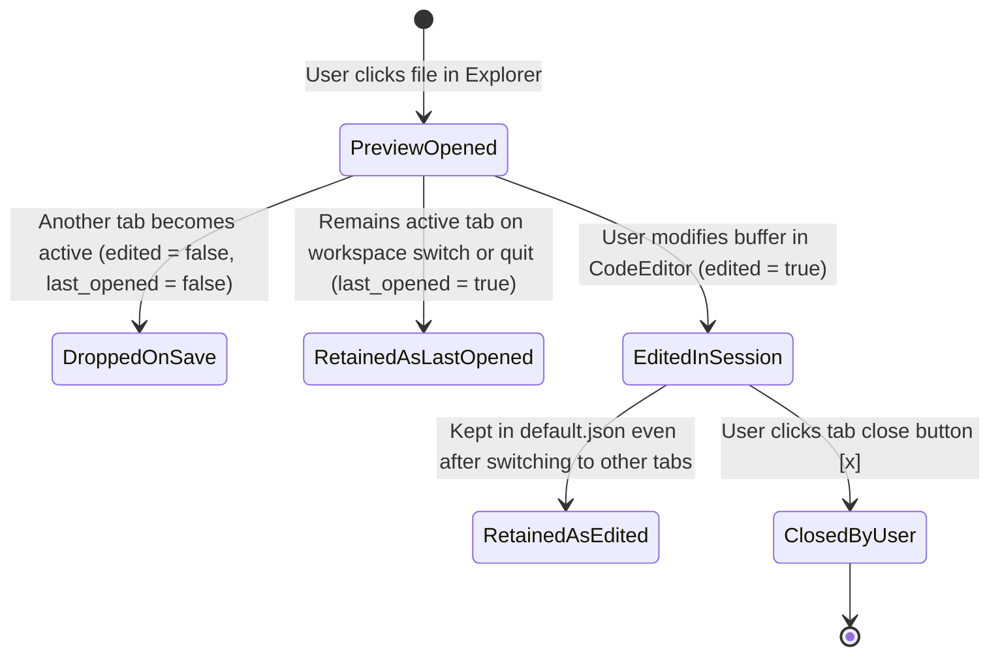

# Desktop project and session management - software architecture

## Overview

`lgtm-desktop` coordinates sessions, projects, workspaces, and language servers for the desktop application. The session tracks open projects and per-checkout tabs, each project groups a primary checkout and its linked Git worktrees, and the workspace service edits the active checkout directory.

## Requirement

### Functional

- Restore the previous session on startup, including the active sidebar view, open projects, open worktrees, and active workspace.
- Remember each project checkout and worktree state separately, including modified tabs, the last active tab, and expanded explorer folders.
- Switch between a project primary checkout and its worktrees immediately by swapping active state on a single mounted editor and explorer view.
- Create, attach, or remove project worktrees, deleting disk storage for LGTM-managed worktrees while only detaching external worktrees from the session.
- Save pending file changes and session state before the application window closes.

### Non-Functional

- Switch workspaces with zero UI blocking by applying in-memory workspace snapshots immediately and flushing disk writes and session saves asynchronously in the background.
- Keep only the active workspace mounted in the UI and stop language servers for inactive workspaces so inactive projects and worktrees consume no background processes or DOM nodes.
- Run all project, worktree, and session operations locally without a background daemon.
- Isolate session, workspace, and language server services so an error in one service does not corrupt another.

## Design

### Components and Responsibilities



- `AppState` (`apps/lgtm-desktop/src/app.rs`): Holds `session` (`lgtm_session::SessionService`), `workspace` (`WorkspaceService`), `config` (`ConfigService`), `lsp` (`LspService`), and `events` (`AppEvents`).
- `AppEvents` (`apps/lgtm-desktop/src/events.rs`): Routes workspace-switch events between `SessionService`, `WorkspaceService`, and `LspService` so the services stay decoupled.
- `SessionService` (`libs/lgtm-session`): Owns `~/.lgtm/sessions/default.json`, tracks the ordered `projects`, `sidebar_widget`, and `active_workspace_root`, and stores per-workspace `PersistedTab` lists (`edited || last_opened`).
- `ProjectService` (`libs/lgtm-project`): Resolves repository root checkouts (`Project`) and linked Git worktrees (`Worktree`) using `lgtm-rsutils`.
- `WorkspaceService` (`apps/lgtm-desktop/src/services/workspace.rs`): Operates on the single active checkout directory (`active_workspace_root`), which is either a project `root_path` or a linked `Worktree.path`. It reads files, writes files, and lists directory entries.
- `WorkspaceService` & `HotkeyService` (`apps/lgtm-web`): Reactive Svelte 5 services. `WorkspaceService` manages the active checkout file tree, open editor tabs, in-memory workspace cache, and session/project state, while `HotkeyService` registers `WhichKey` leader bindings and `CommandPalette` commands.

### Data and Control Flow

#### 1. Startup Session Restore (`~/.lgtm/sessions/default.json`)



#### 2. Immediate Switching Between Project Primary Checkout and Linked Worktrees



#### 3. Application Exit and Session Snapshot Save



### Interfaces and Contracts

| Tauri Command / Event | Direction | Payload / Signature | Description |
| --- | --- | --- | --- |
| `workspace_open` | UI -> Host | `(path?: string) -> WorkspaceListing` | Open the active session workspace (when `path` is omitted) or resolve `path` via `SessionService::open_workspace`, switch `WorkspaceService` and `LspService`, and emit `session-updated`. |
| `session_get` | UI -> Host | `(sessionId?: string) -> Session` | Load `~/.lgtm/sessions/default.json` (including `sidebar_widget`, `projects`, and per-workspace `WorkspaceSessionState`). |
| `session_save` | UI -> Host | `(patch: WorkspaceStatePatch) -> Session` | Save the active `sidebar_widget`, `expanded_dirs`, and filtered `edited \|\| last_opened` tabs for a workspace to `default.json`. |
| `project_set_collapsed` | UI -> Host | `(projectId: string, collapsed: boolean) -> Session` | Collapse or expand the linked worktrees under a project in `default.json`. |
| `project_update_appearance` | UI -> Host | `(projectId: string, name?: string \| null, icon?: string \| null, color?: string \| null) -> Session` | Update a project's custom display name, icon, and color in `default.json`. |
| `project_rename_worktree` | UI -> Host | `(worktreePath: string, name: string) -> Session` | Rename a worktree section's display label in `default.json` without changing its Git branch or checkout path. |
| `project_create_worktree` | UI -> Host | `(projectId: string, branch: string, baseRef?: string) -> Session` | Create a `Managed` Git worktree under `~/.lgtm/worktrees/<project>/<branch-slug>` and attach it to the session, or return a typed creation error. |
| `project_remove_worktree` | UI -> Host | `(projectId: string, worktreePath: string, force?: boolean) -> Session` | Remove a worktree from the session, deleting checkout storage on disk when `WorktreeSource::Managed` (or returning a `dirty_worktree` error when `force` is false). |
| `project_remove` | UI -> Host | `(projectId: string) -> Session` | Remove a project and its workspace states from the `default` session. |
| `session-updated` | Host -> UI | `Session` | Push updated session state to the webview when native menus, CLI `lgtm open`, or `workspace_open` change the active workspace. |

## Implementation

### Package Layout

```text
apps/
├── lgtm-desktop/src/
│   ├── app.rs                         Registers SessionService in AppState and wires session_* / project_* IPC commands
│   ├── events.rs                      Routes WorkspaceOpened to LspService and emits session-updated
│   └── services/
│       └── workspace.rs               Edits the single active checkout directory (default spot or worktree)
└── lgtm-web/src/lib/
    ├── clients/workspaceClient.ts     Adds session_* and project_* IPC bindings
    ├── services/
    │   ├── hotkeyService.svelte.ts    Registers global shortcuts (Mod+Shift+B, Mod+B), WhichKey leader chords, and CommandMenu items
    │   └── workspaceService.svelte.ts Owns active workspace file tree, tabs (tab.edited), per-workspace cache, and session/project state
    └── components/
        ├── Shell.svelte               Mounts independent #projects-dock-pane and #explorer-dock-pane in the left dock and renders the SidebarFooter icon switcher
        ├── ContentPane.svelte         Renders the active workspace editor tabs, CodeEditor, and bottom status bar
        └── ProjectsPane.svelte        Renders compact collapsible project branches, worktree items, context menus, and modal dialogs
```

### Tab Retention State Machine



## References

- [Session library (`lgtm-session`) architecture](../session/index.md).
- [Project library (`lgtm-project`) architecture](../project/index.md).
- [Rust utilities library (`lgtm-rsutils`) architecture](../rsutils/index.md).
- [ProjectsPane UI component](../web/projects-pane.md).
- [Desktop application architecture](index.md).
- [Desktop event handling and service orchestration](events.md).
