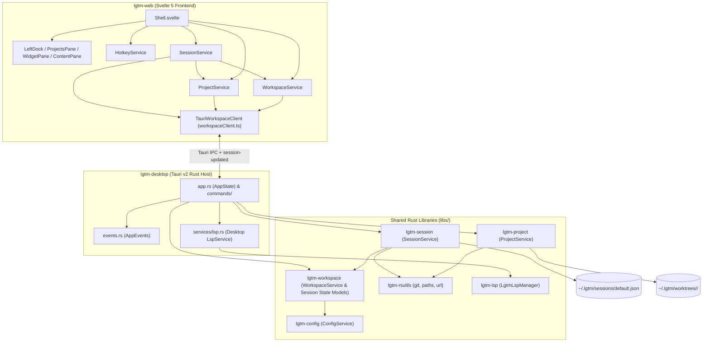
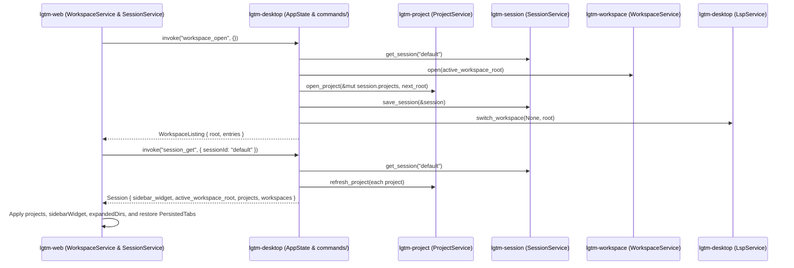
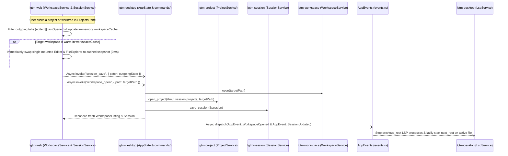
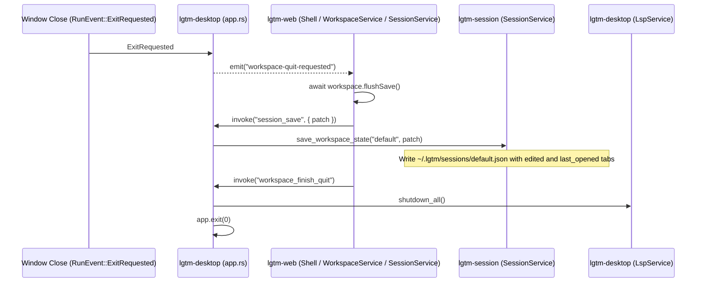
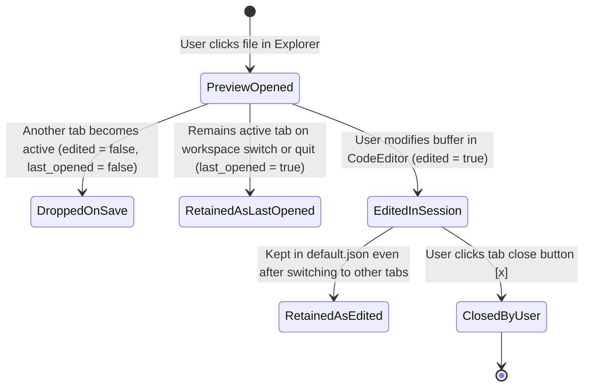

# Desktop project and session management - software architecture

## Overview

`lgtm-desktop` coordinates sessions, projects, workspaces, and language servers for the desktop application. `AppState` holds peer domain services (`WorkspaceService`, `ProjectService`, `SessionService`, `ConfigService`, and `LspService`) and wires cross-service mutations in `apps/lgtm-desktop/src/commands/`.

## Requirement

### Functional

- Restore the previous session on startup, including the active sidebar view, open projects, open worktrees, and active workspace.
- Remember each project checkout and worktree state separately, including modified tabs, the last active tab, and expanded explorer folders.
- Switch between a project primary checkout and its worktrees immediately by swapping active state on a single mounted editor and explorer view.
- Create, attach, or remove project worktrees under `~/.lgtm/worktrees/<project>/<branch-slug>`, deleting worktree disk storage on removal (with dirty-checkout confirmation).
- Save pending file changes and session state before the application window closes.

### Non-Functional

- Switch workspaces with zero UI blocking by applying in-memory workspace snapshots immediately and flushing disk writes and session saves asynchronously in the background.
- Keep only the active workspace mounted in the UI and stop language servers for inactive workspaces so inactive projects and worktrees consume no background processes or DOM nodes.
- Run all project, worktree, and session operations locally without a background daemon.
- Isolate session, project, workspace, and language server services so an error in one service does not corrupt another.

## Design

### Components and Responsibilities



- `AppState` & `commands/` (`apps/lgtm-desktop/src/`): Holds peer services (`workspace`, `project`, `session`, `config`, `lsp`, `events`) and orchestrates project and session updates via `AppState::get_refreshed_session` and `AppState::update_session`.
- `AppEvents` (`apps/lgtm-desktop/src/events.rs`): Routes `WorkspaceOpened` and `SessionUpdated` events between host services and the webview so domain services stay decoupled.
- `SessionService` (`libs/lgtm-session`): Persists `~/.lgtm/sessions/default.json` atomically and delegates tab filtering to `WorkspaceService::prepare_session_state`.
- `ProjectService` (`libs/lgtm-project`): Resolves primary repository checkouts (`Project`) and manages linked Git worktrees (`Worktree`) under `~/.lgtm/worktrees/<project>/<branch-slug>` using `lgtm-rsutils`.
- `WorkspaceService` (`libs/lgtm-workspace`): Operates on the active checkout directory (`active_workspace_root`) for file/folder CRUD and defines `WorkspaceSessionState`, `PersistedTab`, `TabCandidate`, `SidebarWidget`, and `WorkspaceStatePatch`.
- `WorkspaceService`, `ProjectService`, `SessionService`, & `HotkeyService` (`apps/lgtm-web`): Peer Svelte 5 `$state` services exposed via `useService`. `WorkspaceService` owns active workspace shell state (tabs, dock widgets/widths, explorer tree, buffer I/O), `ProjectService` owns projects and worktrees, `SessionService` orchestrates session save/restore across both, and `HotkeyService` registers `WhichKey` and `CommandMenu` commands.

### Data and Control Flow

#### 1. Startup Session Restore (`~/.lgtm/sessions/default.json`)



#### 2. Immediate Switching Between Project Primary Checkout and Linked Worktrees



#### 3. Application Exit and Session Snapshot Save



### Interfaces and Contracts

| Tauri Command / Event | Direction | Payload / Signature | Description |
| --- | --- | --- | --- |
| `workspace_open` | UI -> Host | `(path?: string) -> WorkspaceListing` | Open the active session workspace (when `path` is omitted) or resolve `path` via `ProjectService::open_project`, save `Session`, switch `WorkspaceService` and `LspService`, and emit `session-updated`. |
| `session_get` | UI -> Host | `(sessionId?: string) -> Session` | Load `~/.lgtm/sessions/default.json` and refresh project branches and worktrees via `ProjectService`. |
| `session_save` | UI -> Host | `(patch: WorkspaceStatePatch) -> Session` | Save the active `sidebar_widget`, `expanded_dirs`, and filtered `edited \|\| last_opened` tabs for a workspace to `default.json`. |
| `project_set_collapsed` | UI -> Host | `(projectId: string, collapsed: boolean) -> Session` | Collapse or expand the linked worktrees under a project in `default.json`. |
| `project_update_appearance` | UI -> Host | `(projectId: string, name?: string \| null, icon?: string \| null, color?: string \| null) -> Session` | Update a project's custom display name, icon, and color in `default.json`. |
| `project_rename_worktree` | UI -> Host | `(projectId: string, worktreePath: string, name: string) -> Session` | Rename a worktree section's display label in `default.json` without changing its Git branch or checkout path. |
| `project_create_worktree` | UI -> Host | `(projectId: string, branch: string, baseRef?: string) -> Session` | Create a Git worktree under `~/.lgtm/worktrees/<project>/<branch-slug>` and attach it to the session, or return a typed creation error. |
| `project_remove_worktree` | UI -> Host | `(projectId: string, worktreePath: string, force?: boolean) -> Session` | Remove a worktree from the session and delete its checkout storage on disk (or return a `dirtyWorktree` error when `force` is false). |
| `project_remove` | UI -> Host | `(projectId: string) -> Session` | Remove a project and its workspace states from the `default` session. |
| `project_checkout_branch` | UI -> Host | `(workspaceRoot: string, branch: string, create?: boolean) -> Session` | Switch `workspaceRoot` to `branch` (or create `-b <branch>`) via `ProjectService` and return the refreshed session. |
| `session-updated` | Host -> UI | `Session` | Push updated session state to the webview when native menus, CLI `lgtm open`, or mutating commands update the session. |

## Implementation

### Package Layout

```text
apps/
├── lgtm-desktop/src/
│   ├── app.rs                         Registers AppState (workspace, project, session, config, lsp, events) and wires commands::*
│   ├── commands/                      Thin domain IPC command modules (workspace, lsp, config, session, project)
│   ├── events.rs                      Routes WorkspaceOpened to LspService and emits session-updated
│   └── services/
│       └── lsp.rs                     Desktop language server orchestration
└── lgtm-web/src/lib/
    ├── clients/workspaceClient.ts     Typed IPC client wrapping Specta bindings
    ├── constants.ts                   Project icon/color palettes and worktree branch word lists
    ├── types/                         Domain TypeScript interfaces and Git branch name validators
    ├── services/
    │   ├── context.ts                 Svelte context DI registry (createAppServices, setServicesContext, useService)
    │   ├── hotkeyService.svelte.ts    Registers global shortcuts (Mod+Shift+B, Mod+B), WhichKey leader chords, and CommandMenu items
    │   ├── projectService.svelte.ts   Owns open projects, worktrees, project/worktree dialogs, and context actions
    │   ├── sessionService.svelte.ts   Orchestrates session load, save, and resurrection across ProjectService and WorkspaceService
    │   └── workspaceService.svelte.ts Owns active workspace root, dock panes/widths, open tabs, snapshot cache, file tree, and buffer I/O
    └── components/
        ├── Shell.svelte               Composes Titlebar, LeftDock, ContentPane, LeftDockToolbar, EditorToolbar, CommandMenu, and WhichKey
        ├── Titlebar.svelte            Renders SidebarTrigger, brand, and branch switcher Select
        ├── LeftDock.svelte            Mounts resizable #projects-dock-pane and WidgetPane
        ├── WidgetPane.svelte          Hosts FileExplorer inside #explorer-dock-pane
        ├── FileExplorer.svelte        Renders the active workspace file tree
        ├── LeftDockToolbar.svelte     Renders Projects and Explorer toggle buttons sized to match LeftDock
        ├── EditorToolbar.svelte       Renders LspStatusMenu, breadcrumbs, and editor status
        ├── ContentPane.svelte         Renders editor Pane containing open Tabs and CodeEditor
        ├── ProjectsPane.svelte        Renders compact collapsible project branches, worktree items, and context menus
        └── ProjectEditDialog.svelte, ProjectIconSelector.svelte, WorktreeNewDialog.svelte, WorktreeRemoveDialog.svelte, BranchNewDialog.svelte
```

### Tab Retention State Machine



## References

- [Session library (`lgtm-session`) architecture](../session/index.md).
- [Project library (`lgtm-project`) architecture](../project/index.md).
- [Rust utilities library (`lgtm-rsutils`) architecture](../rsutils/index.md).
- [ProjectsPane UI component](../web/projects-pane.md).
- [Desktop application architecture](index.md).
- [Desktop event handling and service orchestration](events.md).
