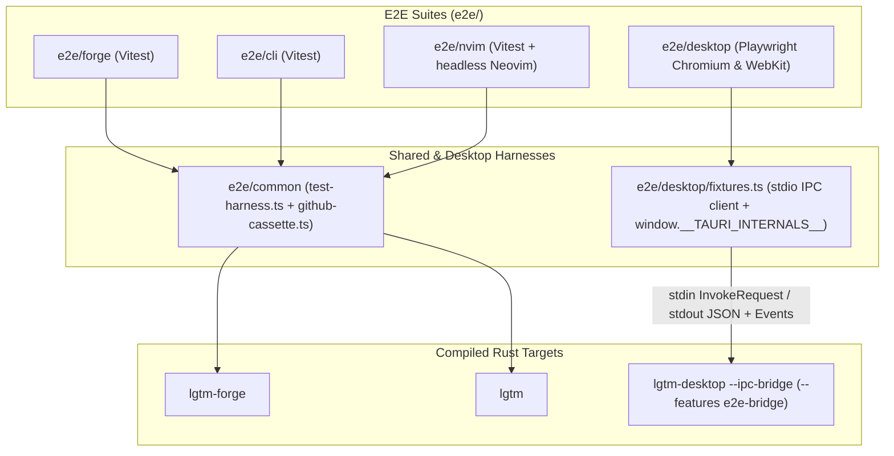
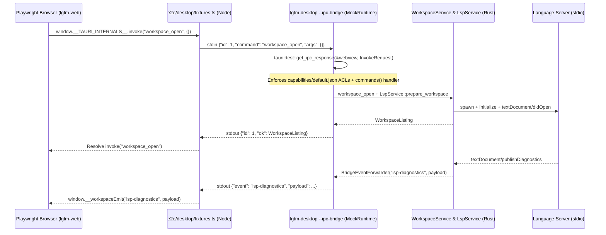

# End-to-end testing — software architecture

## Overview

`e2e/` is the end-to-end verification suite for LGTM across the `lgtm-forge` backend, `lgtm-cli` binary, `lgtm.nvim` Neovim plugin shell, and `lgtm-desktop` Tauri application. Each suite runs real compiled Rust binaries against isolated temporary workspaces and `LGTM_HOME` directories without mocks in the application layer. For `lgtm-desktop`, Playwright drives the production Svelte UI in headless Chromium and WebKit while routing every `window.__TAURI_INTERNALS__.invoke` command and backend event through a feature-gated Rust stdio bridge (`lgtm-desktop --ipc-bridge`) backed by `tauri::test::MockRuntime`.

## Requirement

### Functional

- Full-stack binary execution: Exercise compiled `lgtm-forge`, `lgtm`, Neovim (`nvim --headless`), and `lgtm-desktop` binaries against real filesystem and Git state rather than TypeScript service stubs.
- Real Tauri IPC routing and ACL verification: Execute desktop browser tests through `tauri::test::get_ipc_response` with `tauri::generate_context!()` so missing `#[tauri::command]` registrations, capability ACL denials (`capabilities/default.json`), and Rust `WorkspaceService`/`LspService` errors fail E2E immediately.
- Bidirectional Tauri event streaming: Forward asynchronous backend events (`lsp-status`, `lsp-diagnostics`, and `workspace-quit-requested`) from `LspService` and `lgtm-desktop` to Playwright browser listeners in real time.
- Offline deterministic provider replay: Replay recorded GitHub REST/GraphQL exchanges and Git object bundles via `github-cassette.ts` with strict request matching, runtime UUID binding, and mutation barriers.

### Non-Functional

- Production binary isolation: Gate `tauri/test` (`MockRuntime`), `--ipc-bridge`, `BridgeEventForwarder`, and `LGTM_E2E_PERMANENT_DELETE` behind `#[cfg(any(test, feature = "e2e-bridge"))]` so production desktop builds (`cargo tauri build` and `cargo tauri dev`) contain zero test runtime or headless stdio bridge code.
- Isolated Vite dependency cache: Configure `e2e/desktop/vite.config.ts` with `cacheDir: 'e2e/desktop/.vite'` so E2E static builds never invalidate `apps/lgtm-web`'s development dependency optimizer cache (`node_modules/.vite`).
- Workspace and host hygiene: Scope all E2E filesystem mutations, SQLite databases, Git repositories, and `.lgtm/` configurations to temporary per-test directories and clean up child language server processes on teardown.

## Design

### Usage

```sh
# Run smoke E2E journeys across forge, CLI, Neovim, and desktop
premise run e2e:smoke

# Run the full desktop Playwright suite (Chromium + WebKit)
mise run //e2e/desktop:test

# Run all E2E suites in parallel
premise run e2e
```

### Components and Responsibilities



- `e2e/common/test-harness.ts`: Spawns isolated `lgtm-forge` and `lgtm` processes per test with dedicated `LGTM_HOME`, SQLite database, Git snapshot store, and cassette proxy ports.
- `e2e/common/github-cassette.ts` and `github-recording.ts`: Provide strict offline HTTP replay and recording for GitHub PR journeys without touching live repositories during default runs.
- `e2e/desktop/fixtures.ts`: Injects a thin `window.__TAURI_INTERNALS__` transport shim into Playwright Chromium/WebKit pages, forwards `invoke(cmd, args)` calls over Node `exposeBinding` to `lgtm-desktop --ipc-bridge <home>`, and dispatches streamed backend events (`lsp-status`, `lsp-diagnostics`) to registered browser listeners.
- `apps/lgtm-desktop/src/services/ipc_bridge.rs` (`IpcBridgeService`): Feature-gated (`e2e-bridge`) headless service that constructs the application with `tauri::test::mock_builder()` and `tauri::generate_context!()`, dispatches incoming JSON commands through `tauri::test::get_ipc_response`, and forwards `LspEvent` notifications to `stdout` via `BridgeEventForwarder`.

### Data and Control Flow



### Interfaces and Contracts

| Component / Task | Contract / Signature | Description |
| --- | --- | --- |
| `//e2e/desktop:build-bridge` | `cargo build --manifest-path apps/lgtm-desktop/Cargo.toml --bin lgtm-desktop --features e2e-bridge` | Compile `lgtm-desktop` with `tauri/test` and `--ipc-bridge` enabled after `//apps/lgtm-desktop:install` and `//apps/lgtm-web:build`. |
| `IpcBridgeService::run` | `#[cfg(any(test, feature = "e2e-bridge"))] pub fn run(&self)` | Run the stdio JSON-line Tauri IPC bridge rooted at `home` using `tauri::test::MockRuntime` and `tauri::generate_context!()`. |
| `BridgeEventForwarder` | `#[cfg(any(test, feature = "e2e-bridge"))] type BridgeEventForwarder = Arc<dyn Fn(&str, Value) + Send + Sync>` | Forward `LspEvent::Status` (`lsp-status`) and `LspEvent::Diagnostics` (`lsp-diagnostics`) payloads as JSON lines on `stdout`. |
| `stdin` request frame | `{"id": u64, "command": String, "args": Object}` | Single-line JSON IPC request sent from `e2e/desktop/fixtures.ts` to `lgtm-desktop --ipc-bridge`. |
| `stdout` response frame | `{"id": u64, "ok": Value} \| {"id": u64, "error": Value}` | Single-line JSON IPC response returned from `tauri::test::get_ipc_response`. |
| `stdout` event frame | `{"event": String, "payload": Value}` | Asynchronous backend event pushed from `BridgeEventForwarder` to Playwright browser listeners. |

## Implementation

### Package layout

```text
e2e/
├── README.md
├── tsconfig.json
├── common/
│   ├── config.ts
│   ├── fixtures.ts
│   ├── github-cassette.test.ts
│   ├── github-cassette.ts
│   ├── github-driver.ts
│   ├── github-recording.ts
│   ├── github.ts
│   ├── pr.fixtures.ts
│   ├── record.ts
│   ├── test-harness.ts
│   └── test-utils.ts
├── forge/
│   ├── mise.toml
│   ├── review-service.spec.ts
│   └── vitest.config.ts
├── cli/
│   ├── mise.toml
│   ├── vitest.config.ts
│   ├── commands.spec.ts
│   ├── daemon.spec.ts
│   ├── local-review.fixtures.ts
│   ├── local-review.spec.ts
│   ├── parity.spec.ts
│   ├── pr-review.fixtures.ts
│   ├── pr-review.spec.ts
│   └── run.spec.ts
├── nvim/
│   ├── mise.toml
│   ├── vitest.config.ts
│   ├── dependencies.ts
│   ├── editor.spec.ts
│   ├── editor.ts
│   ├── fixtures.ts
│   ├── install.ts
│   ├── pr-review.fixtures.ts
│   └── profiles.ts
└── desktop/
    ├── mise.toml
    ├── playwright.config.ts
    ├── tsconfig.json
    ├── vite.config.ts
    ├── fixture.html
    ├── fixture.ts
    ├── fixtures.ts
    ├── workspace-file-tree.spec.ts
    └── workspace-lsp.spec.ts
```

### Why Tauri E2E uses `MockRuntime` over stdio instead of WebDriver or TypeScript mocks

Unlike a standard web application where the browser communicates with an HTTP/gRPC server over a network port, a Tauri desktop application communicates in-process between the native OS WebView (`WKWebView` on macOS, `WebKitGTK` on Linux, `WebView2` on Windows) and Rust via `window.__TAURI_INTERNALS__`. Apple does not provide a WebDriver implementation for `WKWebView` on macOS, and Playwright drives its own bundled Chromium and WebKit engines rather than native `.app` bundles.

Re-implementing Tauri commands in TypeScript inside `e2e/desktop/fixtures.ts` bypasses the Rust binary entirely, hiding missing `#[tauri::command]` handlers, capability ACL regressions, and Rust service bugs. By compiling `lgtm-desktop` with `--features e2e-bridge` for E2E and routing Playwright's `window.__TAURI_INTERNALS__.invoke` calls over stdio into `tauri::test::get_ipc_response` with `tauri::generate_context!()`, every E2E test exercises the exact Rust command handler table, ACL capabilities, `WorkspaceService`, `LspService`, and `lgtm-config` synthesis across both Chromium and WebKit while keeping production builds completely free of test or headless bridge code.

## References

- [E2E operational guide](../../e2e/README.md).
- [LSP library architecture](../lsp/index.md).
- [Configuration library architecture](../config/index.md).
- [Application architecture](../index.md).
