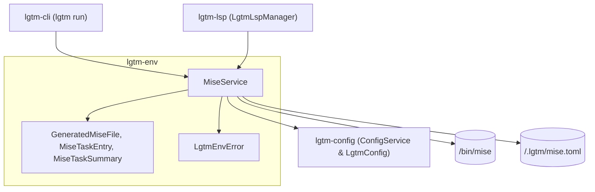
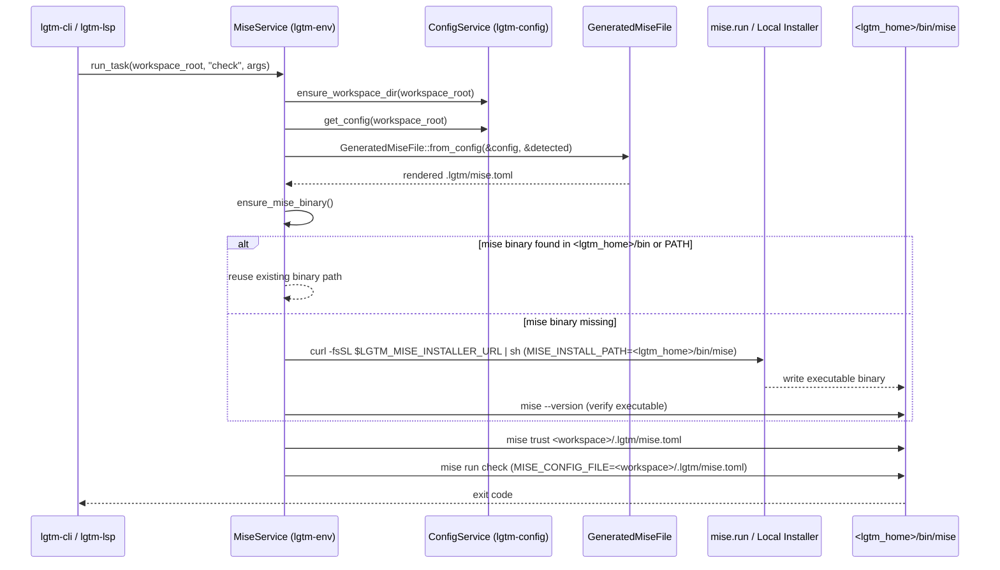

# Environment library (`lgtm-env`) — software architecture

## Overview

`lgtm-env` is the Mise binary lifecycle, `<workspace>/.lgtm/mise.toml` synthesis, and task/tool execution SDK for LGTM (`lgtm-cli`, `lgtm-lsp`, and `lgtm-desktop`). Consuming `lgtm-config` (`ConfigService` and `LgtmConfig`), it detects whether a usable `mise` binary is present on the host, automatically bootstraps `mise` into `<lgtm_home>/bin/mise` when missing, synthesizes a deterministic `<workspace>/.lgtm/mise.toml` without touching any user-owned root `mise.toml`, and executes workspace tasks and language server tool installations.

## Requirement

### Functional

- Manage developer tooling required for building, linting, formatting, testing, and powering diagnostics.
- Allow global and project-level management of developer tooling.
- Provide first-class support for Rust, TypeScript, JavaScript, Python, Go, and Markdown.
- Enable adding support for additional languages (future).

### Non-Functional

- Use `mise` for developer tool management instead of a custom tool manager.
- Hide IDE-backed `mise` usage for projects that do not use `mise`, and integrate cleanly with projects that do.
- Enable exporting managed `mise` configuration into the project (future, for example via an `lgtm env export` command).

## Design

### Usage

```rust
use std::path::Path;
use lgtm_config::ConfigService;
use lgtm_env::MiseService;

let workspace_root = Path::new("/path/to/workspace");
let config_service = ConfigService::new();
let mise_service = MiseService::new(config_service);

// Synchronize <workspace>/.lgtm/mise.toml and .git/info/exclude
let mise_path = mise_service.sync_workspace_mise(workspace_root)?;

// Ensure a usable mise binary exists (installing to ~/.lgtm/bin/mise if absent)
let mise_bin = mise_service.ensure_mise_binary()?;

// List or execute tasks defined in the managed mise.toml
let tasks = mise_service.get_tasks(workspace_root)?;
let exit_code = mise_service.run_task(workspace_root, "check", &[])?;
```

### Components and Responsibilities



- `MiseService`: Stateful service that locates or installs the `mise` binary, synchronizes `<workspace>/.lgtm/mise.toml` via `ConfigService`, trusts the generated file, and runs `mise run`, `mise install`, and `mise exec` subprocesses.
- `GeneratedMiseFile`: Pure domain model that merges language preset tools and default tasks (`<lang>:<task>` and `<task>`) with explicit `[mise.tools]` and `[mise.tasks]` overrides and renders TOML with an LGTM header comment.
- `MiseTaskEntry` and `MiseTaskSummary`: Serializable task representations for `.lgtm/mise.toml` persistence and CLI/UI task listing.
- `LgtmEnvError`: Typed error enum distinguishing configuration errors, `.lgtm/mise.toml` I/O errors, missing `mise` binary errors (`MiseNotInstalled`), bootstrap failures (`MiseInstallFailed`), and command execution failures (`MiseFailed`).

### Data and Control Flow



### Interfaces and Contracts

| Type / Method | Signature | Description |
| --- | --- | --- |
| `MiseService::new` | `fn new(config_service: ConfigService) -> Self` | Create a `MiseService` searching `<lgtm_home>/bin/mise` and standard system paths. |
| `MiseService::with_isolated_env` | `fn with_isolated_env(config_service: ConfigService, installer_url: Option<String>) -> Self` | Create an isolated `MiseService` that ignores system `PATH` and installs from `installer_url`. |
| `MiseService::get_managed_mise_binary_path` | `fn get_managed_mise_binary_path(&self) -> PathBuf` | Return `<lgtm_home>/bin/mise` (`mise.exe` on Windows). |
| `MiseService::find_mise_binary` | `fn find_mise_binary(&self) -> Option<PathBuf>` | Locate a usable `mise` binary and verify it with `mise --version`. |
| `MiseService::is_mise_installed` | `fn is_mise_installed(&self) -> bool` | Return `true` when `find_mise_binary` resolves a working binary. |
| `MiseService::ensure_mise_binary` | `fn ensure_mise_binary(&self) -> Result<PathBuf>` | Return an existing `mise` binary or install it into `<lgtm_home>/bin/mise`. |
| `MiseService::install_mise_binary` | `fn install_mise_binary(&self) -> Result<PathBuf>` | Download and install `mise` into `<lgtm_home>/bin/mise` and verify `--version`. |
| `MiseService::sync_workspace_mise` | `fn sync_workspace_mise(&self, workspace_root: &Path) -> Result<PathBuf>` | Ensure `.lgtm/` and `.git/info/exclude` exist and write `<workspace>/.lgtm/mise.toml`. |
| `MiseService::get_tasks` | `fn get_tasks(&self, workspace_root: &Path) -> Result<Vec<MiseTaskSummary>>` | Synchronize `.lgtm/mise.toml` and return sorted task summaries. |
| `MiseService::run_task` | `fn run_task(&self, workspace_root: &Path, task: &str, args: &[String]) -> Result<i32>` | Synchronize `.lgtm/mise.toml`, bootstrap `mise` if needed, and run `mise run <task>`. |
| `MiseService::install_tools` | `fn install_tools(&self, workspace_root: &Path, tools: &[(&str, &str)]) -> Result<()>` | Bootstrap `mise` if needed and install `tool@version` pairs scoped to `.lgtm/mise.toml`. |
| `MiseService::build_exec_command` | `fn build_exec_command(&self, workspace_root: &Path, project_root: &Path, tools: &BTreeMap<String, String>, program: &str, args: &[String], auto_install_mise: bool) -> Result<Command>` | Build an isolated `mise exec --cd <project_root>` command for `lgtm-lsp`. |

## Implementation

### Package layout

```text
libs/lgtm-env/
├── Cargo.toml
├── mise.toml
├── README.md
├── src/
│   ├── lib.rs                 Public MiseService, GeneratedMiseFile, MiseTaskEntry, MiseTaskSummary, and LgtmEnvError exports
│   ├── error.rs               LgtmEnvError and Result alias
│   ├── models/
│   │   ├── mod.rs
│   │   └── mise.rs            GeneratedMiseFile, MiseTaskEntry, MiseTaskSummary, and TOML rendering
│   └── services/
│       ├── mod.rs
│       └── mise.rs            MiseService binary discovery, auto-installer, .lgtm/mise.toml sync, and task/tool runner
└── tests/
    └── mise.rs                BDD integration suite for mise presence, installation, error handling, and task execution
```

### Subprocess isolation and working directory preservation

Every `GeneratedMiseFile` task entry sets `dir = "{{cwd}}"` so that even though `MISE_CONFIG_FILE` points to `<workspace>/.lgtm/mise.toml`, task commands execute in the workspace root (or caller working directory) rather than `.lgtm/`. Furthermore, setting both `MISE_CONFIG_FILE` and `MISE_GLOBAL_CONFIG_FILE` to `<workspace>/.lgtm/mise.toml` isolates LGTM-managed toolchains from unrelated global or project `mise.toml` files.

## References

- [Configuration library (`lgtm-config`) architecture](../config/index.md).
- [LSP library (`lgtm-lsp`) architecture](../lsp/index.md).
- [Desktop application (`lgtm-desktop`) architecture](../desktop/index.md).
- [Environment variables reference](../../environment.md).
