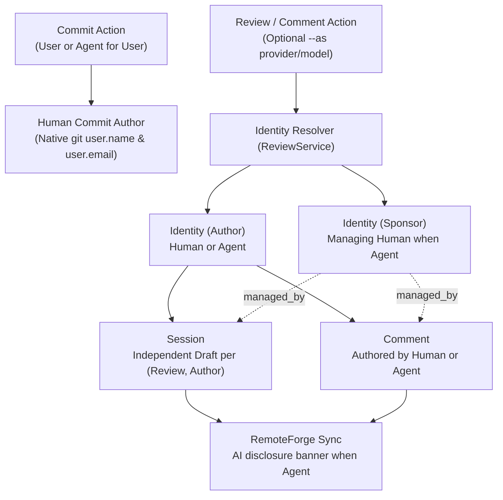
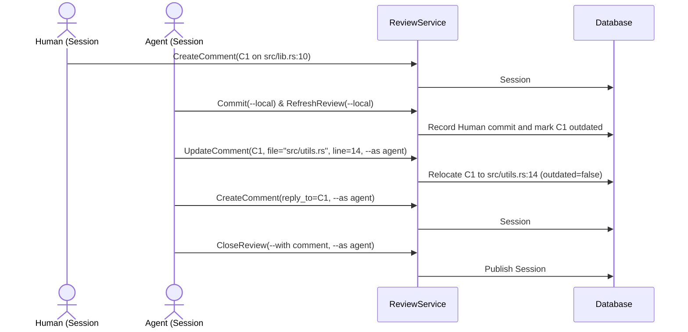
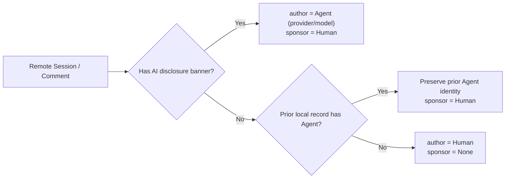

# Authorship and agent identity — software architecture

## Overview

`lgtm-forge` separates **code and commit authorship** from **review session and comment authorship**. In local and checkout workflows, commits always belong to the human user, even when an agent creates a commit on the user's behalf. Review sessions and comments, however, can be authored by either a `Human` or an `Agent`, with AI-generated disclosure banners attached whenever an agent authors a session or comment on a remote forge.

## Requirement

### Functional

- **Human commit authorship in local workflows**: Attribute all local and checkout commits (`lgtm commit` and `lgtm commit --local`) to the human user (`git config user.name` and `user.email`), whether run directly by the user or by an agent acting for the user.
- **Future remote-triggered agent PRs**: Reserve agent-authored commits and agent-authored pull requests for future remote-orchestrated workflows initiated by external triggers, where code authorship becomes mixed once human reviewers or committers participate.
- **Session and comment identity attribution**: Distinguish `Human` identities (`email`, `forge_login`) from `Agent` identities (`provider`, `model`, sponsored by the managing `Human`) on review sessions and comments.
- **Concurrent human and agent sessions**: Allow human and agent `Draft` sessions to overlap on the same review so an agent can review code, relocate comment anchors, reply, and close its session while the user's `Draft` session remains open.
- **Remote AI disclosure banners**: Attach an AI-generated disclosure banner whenever an agent is involved in authoring or updating a comment or review session on a remote forge, and parse that banner back into an `Agent` identity on import.

### Non-Functional

- **Non-invasive credentials**: Never mutate the user's active `git config` or `gh auth` account when `--as <agent>` is passed on review or comment commands.
- **Schema integrity**: Enforce `Human` vs. `Agent` field rules and `managed_by_id` foreign keys in SQL constraints.

## Design

### Usage

```sh
# 1. User or agent commits code (commit authorship always belongs to the human user)
lgtm commit --local -m "Extract validation helper"

# 2. Agent authors a review session and comments (--as applies to review/comment actions)
lgtm review new --local --as anthropic/claude-sonnet-4-5
lgtm comment new "Extract validation helper" --file src/lib.rs --line 24 --local --as anthropic/claude-sonnet-4-5
lgtm review close --local --with request --body "1 blocking issue" --as anthropic/claude-sonnet-4-5

# 3. Agent responds, moves comment anchors, and resolves threads while human session stays open
lgtm comment update 1 --file src/utils.rs --line 14 --local --as anthropic/claude-sonnet-4-5
lgtm comment new "Moved to src/utils.rs:14" --reply-to 1 --local --as anthropic/claude-sonnet-4-5
lgtm comment update 1 --resolved true --local --as anthropic/claude-sonnet-4-5
```

### Components and Responsibilities



- `Identity` represents a `Human` (`email`, optional `forge_login`) or an `Agent` (`provider`, `model`).
- `Session` batches draft and published comments per `(Review, Author)`, allowing human and agent sessions to overlap on the same review.
- `Comment` records its `author` (`Human` or `Agent`), optional `sponsor` (`managed_by`), thread resolution, and diff `CommentAnchor`.
- `ReviewService` resolves the human commit identity for commits and the `(author, sponsor)` pair for review sessions and comments.
- `RemoteForge` attaches AI-generated disclosure banners whenever an agent authors a remote session or comment, and reconstructs `(author, sponsor)` on import.

#### Three authorship cases

<!-- prettier-ignore -->
| Case | Workflow | Commit / Code Author | Session & Comment Author | Remote AI Disclosure Banner | Status |
| --- | --- | --- | --- | --- | --- |
| **1. User commits** | Local or remote checkout | `Human` (from `git config`) | `Human` or `Agent` (`--as`) | Only on `Agent` sessions/comments | Supported |
| **2. Agent commits for user** | Local or remote checkout | `Human` (from `git config`) | `Human` or `Agent` (`--as`) | Only on `Agent` sessions/comments | Supported |
| **3. Remote trigger -> Agent PR** | Remote-orchestrated bot workflow | `Agent` (inferred from Git/forge bot identity; mixed once human commits) | `Human` or `Agent` | On `Agent` PR, sessions, and comments | Future topic |

### Data and Control Flow

#### How the architecture supports all three cases

The domain model (`Identity` with `IdentityKind::Human` and `IdentityKind::Agent`) and persistence schema (`reviews`, `sessions`, `comments` referencing `identities.id` and optional `managed_by_id`) already support both human and agent authorship across reviews, sessions, and comments without schema changes:

- **Cases 1 & 2 (Local and checkout workflows)**: `ReviewService` resolves commit authorship exclusively from the repository's native `git config` (`user.name` and `user.email`), so user commits and agent-assisted commits on the user's workstation always record the `Human` as the Git commit author. Session and comment authorship is resolved per action: omitting `--as` binds the `Human` identity, while passing `--as <provider>/<model>` binds the `Agent` identity (with `managed_by_id` set to the sponsoring `Human`).
- **Case 3 (Future remote-triggered agent PRs)**: When a remote trigger or autonomous bot opens a PR and pushes commits, `ReviewService` and `RemoteForge` can infer `IdentityKind::Agent` directly from the remote forge's native bot/app identity (for example, GitHub App `[bot]` logins or PR body disclosures) and from Git commit author signatures/trailers in the commit range `base_sha..head_sha`. As soon as a human pushes a commit or edits the branch, inspecting the commit range `base_sha..head_sha` naturally yields both `Agent` and `Human` commit authors (mixed code authorship), while individual sessions and comments continue to resolve independently to `Human` or `Agent`.

#### Overlapping human and agent sessions

In local and remote reviews, commits always use the human's Git identity. When an agent participates in the review (`--as <provider>/<model>`), `ReviewService` scopes its `Draft` session to the agent's `Identity` so the agent can relocate anchors across files, reply, and close its session without disturbing the human's open `Draft` session:



#### Remote AI disclosure banners

Whenever an agent authors or updates a session or comment on a `ForgeBacked` review, `ReviewService` attaches an AI disclosure banner (`> Generated by AI agent <provider>/<model> via LGTM`) before sending it to `RemoteForge`. On `refresh_review`, `ReviewService` parses and strips the banner to restore the `Agent` identity. If a remote comment or session is missing the banner (for example, if edited on the remote forge UI), `ReviewService` preserves the existing local `Agent` identity whenever the prior local record was already associated with an `Agent` (monotonic agent attribution), and re-emits the banner on the next LGTM export:



### Interfaces and Contracts

```rust
pub enum IdentityKind {
    Human { email: String, forge_login: Option<String> },
    Agent { provider: String, model: String },
}

pub struct Identity {
    pub id: Uuid,
    pub name: String,
    pub kind: IdentityKind,
}
```

<!-- prettier-ignore -->
| Contract | Rule |
| --- | --- |
| `Commit` authorship | Always uses the human user's Git identity in local and checkout workflows |
| `Identity::format_disclosure` | Return `> Generated by AI agent \`<provider>/<model>\` via LGTM` for `Agent`, or `None` for `Human` |
| `Comment::parse_disclosure` | Extract `(clean_body, provider, model)` from a remote body with an AI disclosure banner |
| Monotonic agent attribution | Preserve the prior local `Agent` identity during remote refresh even if the remote banner was removed |
| `Session` draft uniqueness | One active `Draft` session per `(review_id, author_id)` |

## Implementation

### Remote disclosure stripping

`Comment::parse_disclosure` strips the AI disclosure banner before storing `body` in `lgtm-db` so terminal, Neovim, and web views render clean prose without duplicating banners on subsequent refreshes.

### Future work: remote-orchestrated agent PRs

Fully remote-orchestrated agent workflows (Case 3, triggered via webhooks or CI where an autonomous bot authors commits and opens the pull request directly) are a future topic. Once a human pushes commits or edits to such a branch, code authorship becomes mixed while session and comment authorship continues to follow the per-item `Human` or `Agent` rules above.

## References

- [Forge architecture](index.md).
- [Snapshot store architecture](snapshot-store.md).
- [Database architecture](../db/index.md).
