# LGTM Forge — software architecture

## Overview

`lgtm-forge` is the application and RPC server behind the LGTM CLI and web interface. It acts as both a local review engine backed by `SnapshotStore` (managing `~/.lgtm/snapshots/$repoSlug` through general local Git operations in `extensions::gitoxide`) and a near real-time pull request proxy through the `RemoteForge` trait (`GitHubForge` backed by `extensions::octocrab` today, extensible to GitLab and other forges), syncing remote draft sessions and comments immediately while persisting reviews, sessions, comments, and human or agent identities in `lgtm-db`.

## Requirement

### Functional

- Local and remote review workflows: Let users and AI agents stage changes, commit, push, review diffs, and manage comments both locally and on remote pull requests.
- Non-destructive local reviews: Review uncommitted local work and update comment line positions across edits without changing the user's working files or branch history.
- Near real-time pull request proxy: Sync draft review sessions, draft comments, and viewed file status immediately to and from the remote forge, refresh pull request changes and thread status on demand, and submit finished review sessions back to the remote forge.
- Viewed file tracking: Record when a reviewer marks a file as viewed, sync that status with the remote forge, and clear the viewed mark whenever a new commit or snapshot modifies the file.
- Transparent AI participation: Show when an AI agent wrote a commit or comment locally, and include a clear disclosure note when syncing or submitting agent comments to a remote pull request.

### Non-Functional

- Low latency: Keep local snapshot, diff, and comment operations fast so interactive CLI and agent workflows never stall.
- Offline availability: Run all local review, diff, and comment workflows without network access.
- Reliability and recoverability on failure: Save draft sessions and comments locally before syncing to the remote forge so work is never lost on a network error, and reconcile any unsynced draft comments on the next refresh or review close so comments never get stuck in the proxy.

## Design

### Usage

RPC clients (`lgtm-cli` and `lgtm-web`) connect to `ReviewService` over Connect RPC (`http://127.0.0.1:<port>/rpc`) and invoke typed methods for local snapshots, comment creation and resolution, and full near real-time interaction with remote GitHub pull requests:

```rust
let client = ReviewServiceClient::new(rpc_url);

// 1. Local snapshot flow: stage, shadow-commit, create review, comment, resolve, and close
client
    .add(AddRequest {
        git_dir: "/repo/.git".into(),
        paths: vec!["src/".into()],
        local: true,
    })
    .await?;

client
    .commit(CommitRequest {
        git_dir: "/repo/.git".into(),
        message: Some("Snapshot worktree".into()),
        as_agent: None,
        local: true,
    })
    .await?;

let local_review = client
    .create_review(CreateReviewRequest {
        git_dir: "/repo/.git".into(),
        local: true,
    })
    .await?;

let root_comment = client
    .create_comment(CreateCommentRequest {
        git_dir: "/repo/.git".into(),
        review_selector: Some(local_review.review.name.clone()),
        body: "Extract helper".into(),
        file_path: Some("src/lib.rs".into()),
        line: Some(24),
        reply_to: None,
        local: true,
        as_agent: None,
    })
    .await?;

// Agent replies to the comment and resolves the thread
client
    .create_comment(CreateCommentRequest {
        git_dir: "/repo/.git".into(),
        review_selector: Some(local_review.review.name.clone()),
        body: "Extracted helper into utils.rs".into(),
        file_path: None,
        line: None,
        reply_to: Some(root_comment.comment.number),
        local: true,
        as_agent: Some("claude-sonnet-4-5".into()),
    })
    .await?;

client
    .update_comment(UpdateCommentRequest {
        git_dir: "/repo/.git".into(),
        comment_number: root_comment.comment.number,
        body: None,
        file_path: None,
        line: None,
        resolved: Some(true),
        local: true,
        as_agent: Some("claude-sonnet-4-5".into()),
    })
    .await?;

// Mid-flight local changes: create a new shadow commit and refresh to remap comment anchors
client
    .commit(CommitRequest {
        git_dir: "/repo/.git".into(),
        message: Some("Snapshot helper extraction".into()),
        as_agent: Some("claude-sonnet-4-5".into()),
        local: true,
    })
    .await?;

client
    .refresh_review(RefreshReviewRequest {
        git_dir: "/repo/.git".into(),
        selector: Some(local_review.review.name.clone()),
        local: true,
    })
    .await?;

client
    .close_review(CloseReviewRequest {
        git_dir: "/repo/.git".into(),
        selector: Some(local_review.review.name),
        local: true,
        with_outcome: ReviewOutcome::Request.into(),
        body: Some("Address remaining open threads".into()),
        as_agent: None,
    })
    .await?;

// 2. Remote GitHub PR flow: commit, push, sync PR review, draft/reply/resolve on remote, and submit
client
    .commit(CommitRequest {
        git_dir: "/repo/.git".into(),
        message: Some("Address review feedback".into()),
        as_agent: Some("claude-sonnet-4-5".into()),
        local: false,
    })
    .await?;

client
    .push(PushRequest {
        git_dir: "/repo/.git".into(),
        local: false,
    })
    .await?;

// Pull PR commits, remote sessions, comments, and updated anchors from GitHub
let remote_review = client
    .refresh_review(RefreshReviewRequest {
        git_dir: "/repo/.git".into(),
        selector: Some("feature/diff-241#42".into()),
        local: false,
    })
    .await?;

// Create a draft comment (saved locally and synced in near real-time to GitHub pending review)
let remote_comment = client
    .create_comment(CreateCommentRequest {
        git_dir: "/repo/.git".into(),
        review_selector: Some(remote_review.review.name.clone()),
        body: "Check transaction rollback on error".into(),
        file_path: Some("src/services/review.rs".into()),
        line: Some(42),
        reply_to: None,
        local: false,
        as_agent: None,
    })
    .await?;

// Reply as an agent (with AI disclosure banner synced to GitHub) and resolve the thread
client
    .create_comment(CreateCommentRequest {
        git_dir: "/repo/.git".into(),
        review_selector: Some(remote_review.review.name.clone()),
        body: "Added rollback test coverage".into(),
        file_path: None,
        line: None,
        reply_to: Some(remote_comment.comment.number),
        local: false,
        as_agent: Some("claude-sonnet-4-5".into()),
    })
    .await?;

client
    .update_comment(UpdateCommentRequest {
        git_dir: "/repo/.git".into(),
        comment_number: remote_comment.comment.number,
        body: None,
        file_path: None,
        line: None,
        resolved: Some(true),
        local: false,
        as_agent: Some("claude-sonnet-4-5".into()),
    })
    .await?;

// Inspect inline unified diff hunks and unresolved threads, mark a file viewed, and submit to GitHub
client
    .set_file_reviewed(SetFileReviewedRequest {
        git_dir: "/repo/.git".into(),
        review_selector: Some(remote_review.review.name.clone()),
        file_path: "src/services/review.rs".into(),
        viewed: true,
        local: false,
    })
    .await?;

let shown = client
    .show_review(ShowReviewRequest {
        git_dir: "/repo/.git".into(),
        selector: Some(remote_review.review.name.clone()),
        local: false,
        group_by: ReviewGroupBy::Session.into(),
        unresolved: true,
    })
    .await?;

// Submit the pending review session to GitHub and mark it Published in lgtm-db
client
    .close_review(CloseReviewRequest {
        git_dir: "/repo/.git".into(),
        selector: Some(remote_review.review.name),
        local: false,
        with_outcome: ReviewOutcome::Approve.into(),
        body: Some("Ready to merge".into()),
        as_agent: None,
    })
    .await?;
```

### Components and Responsibilities

- `rpc/review.rs`: Connect RPC handlers that establish request tracing spans, decode Protobuf requests, call `ReviewService`, and convert domain models into Protobuf responses.
- `services/review.rs` (`ReviewService`): Orchestrates workflows across `lgtm-db`, `SnapshotStore`, `extensions::gitoxide`, and the `RemoteForge` facade.
- `models/`: Domain entities (`Review`, `ReviewContext`, `Session`, `Comment`, `Identity`, `DiffHunk`) that own validation, `from_*` / `into_*` conversions, and agent disclosure formatting.
- `snapshots.rs` (`SnapshotStore`): Concrete local snapshot manager that owns the `~/.lgtm/snapshots/$repoSlug` layout and `refs/lgtm/snapshots/<branch>` lifecycle, delegating general Git object, index, diff, and line-remapping operations to `extensions::gitoxide`.
- `forge/mod.rs` and `forge/github.rs` (`RemoteForge`, `GitHubForge`): Provider-agnostic remote forge trait and GitHub implementation (wrapping `extensions::octocrab`, extensible to GitLab and dummy test doubles) for pulling PR/MR bundles, syncing draft comments, toggling viewed-file states, and submitting reviews.
- `forge/models.rs`: Provider-neutral import/export contracts for remote pull requests, review sessions, and review comments.
- `extensions/gitoxide.rs`: General, stateless adapter around `gix` for inspecting and manipulating any local Git repository (reading repo context, staging paths, creating commits, pushing branches, computing unified diff hunks, and remapping line anchors across commits).
- `extensions/octocrab.rs`: Stateless adapter around `octocrab` that executes GitHub REST and GraphQL requests for pull requests, review threads, comments, and viewed-file mutations.
- `lgtm-db`: Transactional persistence for `identities`, `reviews`, `sessions`, and `comments`.

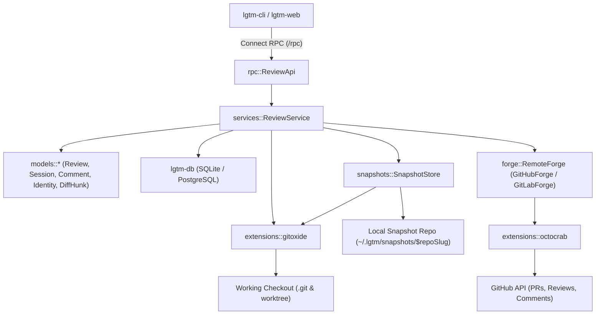

### Data and Control Flow

#### Local staging and shadow commit (`Add --local`, `Commit --local`)

When `local = true`, `lgtm-forge` delegates to `SnapshotStore`, which reads the requested worktree paths from `git_dir` and writes blobs, a shadow index, and a shadow commit directly into `~/.lgtm/snapshots/$repoSlug` (`refs/lgtm/snapshots/<branch>`) via `extensions::gitoxide`, leaving the working checkout untouched.

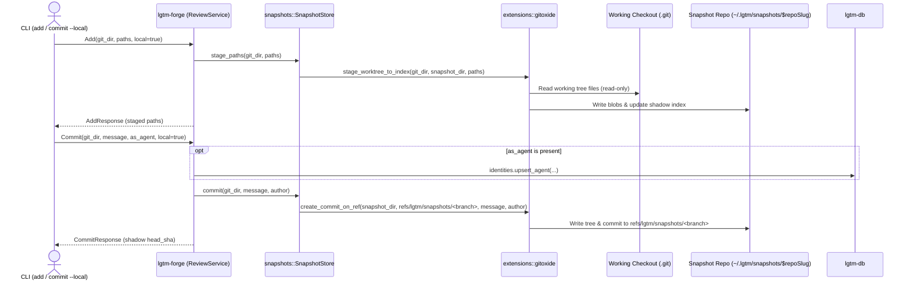

#### Remote-tracked staging, commit, and push (`Add`, `Commit`, `Push`)

When `local = false`, `lgtm-forge` stages and commits in the working checkout via `extensions::gitoxide` (recording `--as <agent-name>` in `lgtm-db` and commit trailers when specified), mirrors the committed branch tip into `SnapshotStore` (`~/.lgtm/snapshots/$repoSlug`), and pushes committed history to the remote repository on `Push`.

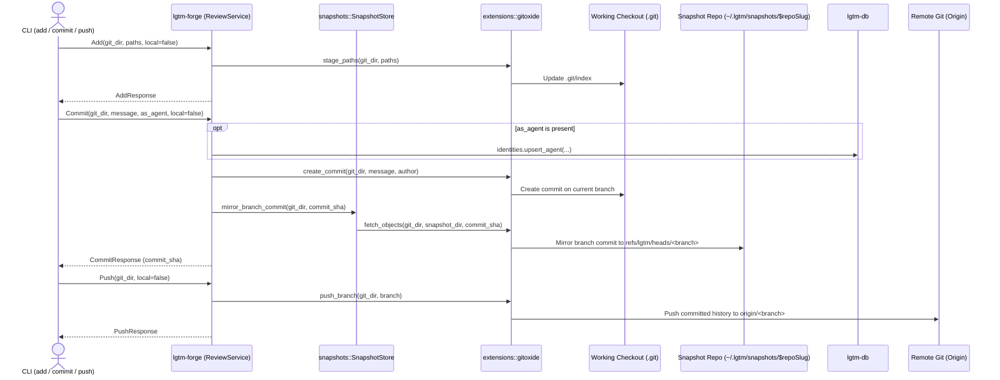

#### Creating and refreshing a local review (`CreateReview --local`, `RefreshReview --local`)

For a `Local` review, `lgtm-forge` uses `SnapshotStore` to snapshot any pending worktree changes into `~/.lgtm/snapshots/$repoSlug` and records `base_sha` (branch base) and `head_sha` (shadow commit) in `lgtm-db`. When new worktree changes or shadow commits happen mid-flight during an open review, `RefreshReview` diffs `old_head_sha..new_head_sha` in `SnapshotStore` via `extensions::gitoxide::recompute_anchors`, shifts surviving line numbers to `new_head_sha`, and marks overwritten anchors `outdated = true` while preserving their `original_line` and `original_commit_sha`.

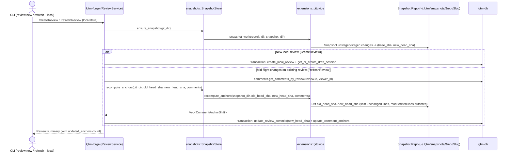

#### Creating and refreshing a forge-backed review (`CreateReview`, `RefreshReview`)

For a `ForgeBacked` review, `lgtm-forge` first pushes any unsynced local draft comments (`forge_id IS NULL`) through the `RemoteForge` trait (`GitHubForge` backed by `extensions::octocrab`), then pulls the latest PR commits, published and pending draft review sessions, and remote anchor states into `lgtm-db`, and mirrors the new commit objects into `SnapshotStore` (`~/.lgtm/snapshots/$repoSlug`). When new commits have been pushed to the PR mid-flight while a draft session is still open, `lgtm-forge` remaps open draft comments onto the new `head_sha` via `SnapshotStore` and syncs their updated positions to the pending review through `RemoteForge`.

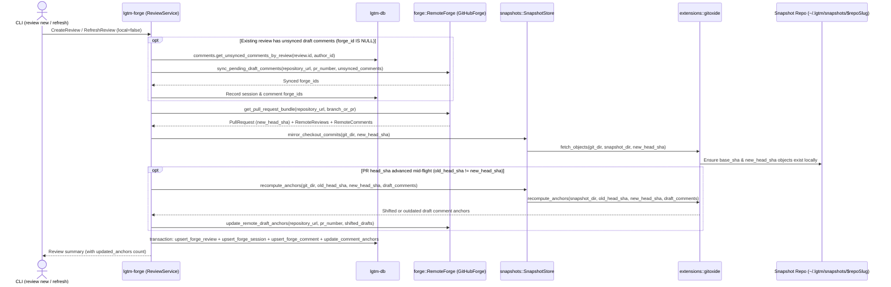

#### Showing a review with inline diff hunks (`ShowReview`)

`ShowReview` loads the review, its sessions, and its comments from `lgtm-db`, then extracts inline unified diff hunks (`DiffHunk`) around each comment anchor from `SnapshotStore` (`~/.lgtm/snapshots/$repoSlug`) via `extensions::gitoxide`.

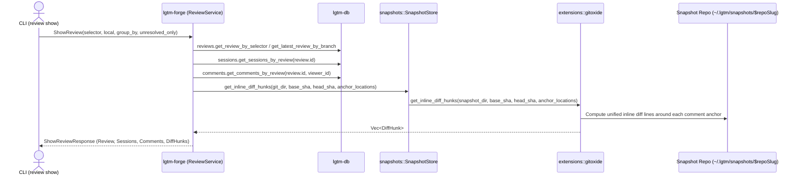

#### Marking and unmarking files as viewed (`SetFileReviewed`)

`SetFileReviewed` records or removes `file_path -> head_sha` in `review.reviewed_files` in `lgtm-db`, and when the review is `ForgeBacked`, syncs the viewed state in near real-time to the remote forge via `RemoteForge::set_remote_file_viewed`. During `RefreshReview`, any file modified between its recorded `commit_sha` and `new_head_sha` is automatically pruned from `review.reviewed_files`.

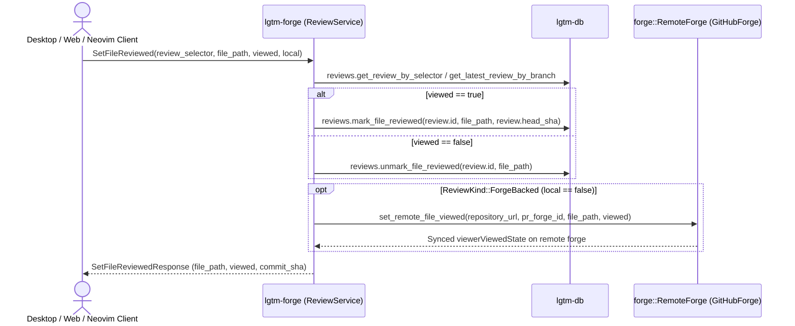

#### Drafting, updating, and deleting local comments (`CreateComment --local`, `UpdateComment --local`, `DeleteComment --local`)

In local mode (`--local`), creating, updating, or deleting a comment resolves the caller's `Human` or `Agent` identity (`--as`), validates any unified diff line anchor against `SnapshotStore` (`~/.lgtm/snapshots/$repoSlug`), and mutates the open `Draft` session in `lgtm-db` without contacting any remote forge.

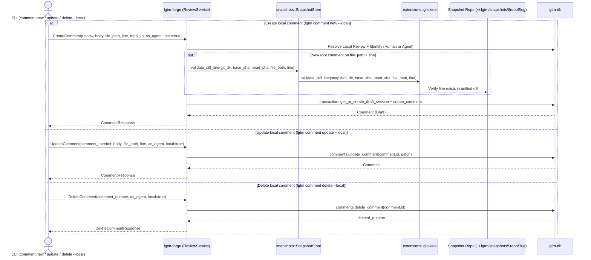

#### Drafting, updating, and deleting remote comments (`CreateComment`, `UpdateComment`, `DeleteComment`)

For a `ForgeBacked` review, `lgtm-forge` saves draft comments in `lgtm-db` first so work is never lost on a network failure, then syncs the change in near real-time to the pending review on the remote forge via `RemoteForge` (`GitHubForge` backed by `extensions::octocrab`) and records the resulting `forge_id` in `lgtm-db`.

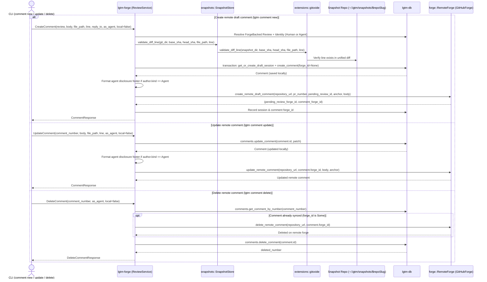

#### Closing a local review session (`CloseReview --local`)

When `CloseReview` is called on a `Local` review, `lgtm-forge` transitions the caller's open `Draft` session to `Published` directly in `lgtm-db` without contacting any remote forge.

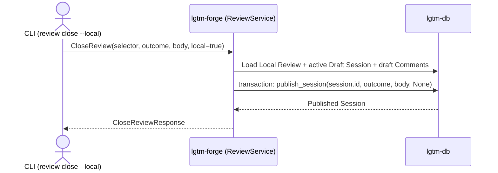

#### Closing a forge-backed review session (`CloseReview`)

When `CloseReview` is called on a `ForgeBacked` review, `lgtm-forge` first flushes any unsynced draft comments (`forge_id IS NULL`) to the pending review on the remote forge via `RemoteForge` so no comment gets stuck locally, formats any agent disclosure footer on the top-level session `body`, submits the pending review (`Comment`, `Approve`, or `RequestChanges`) via `RemoteForge::submit_pending_review`, and marks the session `Published` in `lgtm-db`.

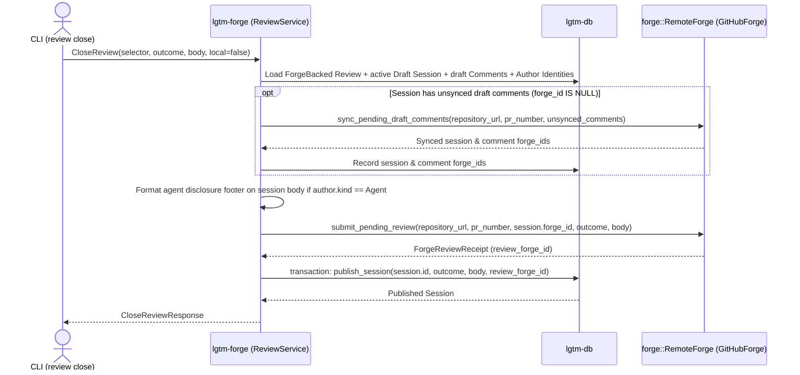

### Interfaces and Contracts

#### Core domain types (`apps/lgtm-forge/src/models/`)

| Type | File | Description |
| --- | --- | --- |
| `Identity` | `src/models/identity.rs` | Represents an actor with `id: Uuid`, `name: String`, and `kind: IdentityKind`. |
| `IdentityKind` | `src/models/identity.rs` | `Human { email: String, forge_login: Option<String> }` or `Agent { provider: String, model: String }`. |
| `Review` | `src/models/review.rs` | Application review entity with `id: Uuid`, `number: u64`, `name: String`, `context: ReviewContext`, `status: ReviewStatus`, `base_sha: String`, `head_sha: String`, and `reviewed_files: BTreeMap<String, String>` (`file_path -> viewed_commit_sha`). |
| `ReviewContext` | `src/models/review.rs` | Discriminated context: `Local { git_dir: String, branch: String }` or `ForgeBacked { git_dir: String, branch: String, repository_url: String, pr_number: u64, forge_id: Option<String> }`. Rejects remote operations when `Local`. |
| `ReviewStatus` | `src/models/review.rs` | `Open`, `Closed`, or `Merged`. |
| `ReviewOutcome` | `src/models/review.rs` | Session submission disposition: `Comment`, `Reject`, `Approve`, or `Request`. |
| `ReviewGroupBy` | `src/models/review.rs` | Presentation grouping for `ShowReview`: `File` (default) or `Session`. |
| `Session` | `src/models/session.rs` | Transactional comment batch with `id: Uuid`, `review_id: Uuid`, `number: u64`, `author: Identity`, `state: SessionState`, `outcome: Option<ReviewOutcome>`, `body: Option<String>`, and `published_at: Option<DateTime<Utc>>`. |
| `SessionState` | `src/models/session.rs` | `Draft` or `Published`. |
| `Comment` | `src/models/comment.rs` | Inline diff comment or reply with `id: Uuid`, `number: u64`, `review_id: Uuid`, `session_id: Uuid`, `author: Identity`, `reply_to_number: Option<u64>`, `anchor: Option<CommentAnchor>`, `body: String`, `resolved: bool`, and `outdated: bool`. |
| `CommentAnchor` | `src/models/comment.rs` | Unified diff anchor with `file_path: String`, `start_line: Option<u32>`, `line: u32`, `commit_sha: String`, `original_start_line: Option<u32>`, `original_line: u32`, and `original_commit_sha: String`. |
| `DiffHunk` | `src/models/diff.rs` | Inline unified diff block around an anchor with `file_path: String`, `commit_sha: String`, `start_line: u32`, and `lines: Vec<DiffLine>`. |
| `DiffLine` | `src/models/diff.rs` | Single unified diff line with `kind: DiffLineKind` (`Context`, `Added`, `Removed`), `line_number: u32`, and `content: String`. |

#### Connect / Protobuf RPC methods (`lgtm.forge.v1.ReviewService`)

| RPC Method | Request Fields | Response Fields | CLI Command |
| --- | --- | --- | --- |
| `Add` | `git_dir`, `paths`, `local` | `staged_paths`, `local` | `lgtm add <paths>... [--local]` |
| `Commit` | `git_dir`, `message`, `as_agent`, `local` | `commit_sha`, `branch`, `author`, `local` | `lgtm commit [--as <agent>] [--local] [-m <msg>]` |
| `Push` | `git_dir`, `local` | `branch`, `head_sha`, `repository_url`, `local` | `lgtm push [--local]` |
| `ListReviews` | `git_dir`, `local`, `all` | `reviews: Vec<ReviewSummary>` | `lgtm review list [--local] [--all]` |
| `CreateReview` | `git_dir`, `local` | `review: ReviewSummary`, `session: SessionSummary` | `lgtm review new [--local]` |
| `RefreshReview` | `git_dir`, `selector`, `local` | `review: ReviewSummary`, `updated_anchors: u32` | `lgtm review refresh [<review>] [--local]` |
| `ShowReview` | `git_dir`, `selector`, `local`, `group_by`, `unresolved` | `review`, `sessions`, `comments`, `diff_hunks` | `lgtm review show [<review>] [--local] [--group-by <file\|session>] [--unresolved]` |
| `CloseReview` | `git_dir`, `selector`, `local`, `with_outcome`, `body`, `as_agent` | `review: ReviewSummary`, `session: SessionSummary` | `lgtm review close [<review>] --with <outcome> [--body <text>]` |
| `CreateComment` | `git_dir`, `review_selector`, `body`, `file_path`, `start_line`, `line`, `reply_to`, `local`, `as_agent` | `comment: CommentDetail` | `lgtm comment new <body> [--review <r>] [--file <f>] [--start-line <s>] [--line <l>] [--reply-to <id>] [--local] [--as <agent>]` |
| `UpdateComment` | `git_dir`, `comment_number`, `body`, `file_path`, `start_line`, `line`, `resolved`, `local`, `as_agent` | `comment: CommentDetail` | `lgtm comment update <id> [--body <text>] [--file <f>] [--start-line <s>] [--line <l>] [--resolved <bool>] [--local] [--as <agent>]` |
| `DeleteComment` | `git_dir`, `comment_number`, `local`, `as_agent` | `deleted_number: u64` | `lgtm comment delete <id> [--local] [--as <agent>]` |
| `SetFileReviewed` | `git_dir`, `review_selector`, `file_path`, `viewed`, `local` | `file_path`, `viewed`, `commit_sha` | Desktop / Web / Neovim viewed checkbox toggle |
| `HelloReview` | `name` | `message` | Health/smoke demonstration endpoint |

#### Service and extension methods

`ReviewService` (`apps/lgtm-forge/src/services/review.rs`) exposes async domain methods corresponding to each RPC (`add_paths`, `commit_changes`, `push_changes`, `get_reviews`, `create_review`, `refresh_review`, `get_review_detail`, `close_review`, `create_comment`, `update_comment`, `delete_comment`, `set_file_reviewed`, and `get_hello`).

Between `ReviewService` and the low-level SDK extensions sit two focused domain boundaries:

- `snapshots::SnapshotStore` (concrete struct in `apps/lgtm-forge/src/snapshots.rs` owning `~/.lgtm/snapshots/$repoSlug` and `refs/lgtm/snapshots/<branch>`, delegating general Git operations to `extensions::gitoxide`):
  - `stage_paths(&self, git_dir, paths) -> Result<Vec<String>, ForgeError>`
  - `commit(&self, git_dir, message, author) -> Result<String, ForgeError>`
  - `ensure_snapshot(&self, git_dir) -> Result<(String, String), ForgeError>`
  - `mirror_checkout_commits(&self, git_dir, head_sha) -> Result<(), ForgeError>`
  - `get_inline_diff_hunks(&self, git_dir, base_sha, head_sha, anchors) -> Result<Vec<DiffHunk>, ForgeError>`
  - `get_changed_files(&self, git_dir, old_sha, new_sha) -> Result<Vec<String>, ForgeError>`
  - `validate_diff_line(&self, git_dir, base_sha, head_sha, file_path, line) -> Result<(), ForgeError>`
  - `recompute_anchors(&self, git_dir, old_head_sha, new_head_sha, comments) -> Result<Vec<CommentAnchorShift>, ForgeError>`
- `forge::RemoteForge` (trait in `apps/lgtm-forge/src/forge/mod.rs` implemented by `GitHubForge` in `src/forge/github.rs` via `extensions::octocrab`, extensible to `GitLabForge`, and replaceable with `DummyForge` in integration tests):
  - `get_pull_request_bundle(&self, repository_url, branch_or_pr) -> Result<ForgePullRequestBundle, ForgeError>`
  - `create_pending_review(&self, repository_url, pr_number, head_sha) -> Result<String, ForgeError>`
  - `create_remote_draft_comment(&self, repository_url, pr_number, pending_review_id, anchor, body) -> Result<ForgeDraftCommentReceipt, ForgeError>`
  - `update_remote_comment(&self, repository_url, forge_id, body, anchor) -> Result<(), ForgeError>`
  - `delete_remote_comment(&self, repository_url, forge_id) -> Result<(), ForgeError>`
  - `set_remote_file_viewed(&self, repository_url, pr_forge_id, file_path, viewed) -> Result<(), ForgeError>`
  - `submit_pending_review(&self, repository_url, pr_number, pending_review_id, outcome, body) -> Result<ForgeReviewReceipt, ForgeError>`

Stateless adapters in `apps/lgtm-forge/src/extensions/` encapsulate external libraries directly:

- `extensions::gitoxide` (general operations on any local Git repository):
  - `get_repo_context(git_dir) -> Result<RepoContext, ForgeError>`
  - `stage_paths(git_dir, paths) -> Result<Vec<String>, ForgeError>`
  - `stage_worktree_to_index(git_dir, target_repo_dir, paths) -> Result<Vec<String>, ForgeError>`
  - `create_commit(git_dir, message, author) -> Result<String, ForgeError>`
  - `create_commit_on_ref(repo_dir, ref_name, message, author) -> Result<String, ForgeError>`
  - `fetch_objects(source_git_dir, target_repo_dir, commit_sha) -> Result<(), ForgeError>`
  - `push_branch(git_dir, branch) -> Result<String, ForgeError>`
  - `get_inline_diff_hunks(repo_dir, base_sha, head_sha, anchors) -> Result<Vec<DiffHunk>, ForgeError>`
  - `get_changed_files(repo_dir, old_sha, new_sha) -> Result<Vec<String>, ForgeError>`
  - `validate_diff_line(repo_dir, base_sha, head_sha, file_path, line) -> Result<(), ForgeError>`
  - `recompute_anchors(repo_dir, old_head_sha, new_head_sha, comments) -> Result<Vec<CommentAnchorShift>, ForgeError>`
- `extensions::octocrab` (stateless GitHub REST/GraphQL client helpers):
  - `fetch_pull_request_bundle(client, owner, repo, branch_or_pr) -> Result<ForgePullRequestBundle, ForgeError>`
  - `create_pending_review(client, owner, repo, pr_number, head_sha) -> Result<String, ForgeError>`
  - `create_draft_comment(client, owner, repo, pr_number, pending_review_id, anchor, body) -> Result<ForgeDraftCommentReceipt, ForgeError>`
  - `update_comment(client, owner, repo, forge_id, body, anchor) -> Result<(), ForgeError>`
  - `delete_comment(client, owner, repo, forge_id) -> Result<(), ForgeError>`
  - `set_file_viewed(client, pr_node_id, file_path, viewed) -> Result<(), ForgeError>`
  - `submit_review(client, owner, repo, pr_number, pending_review_id, outcome, body) -> Result<ForgeReviewReceipt, ForgeError>`

## Implementation

### Package layout

```text
apps/lgtm-forge/
├── Cargo.toml
├── build.rs                       Protobuf and Connect RPC code generation
├── proto/
│   └── lgtm/forge/v1/
│       └── review.proto           Shared RPC schema for CLI and web clients
├── src/
│   ├── lib.rs
│   ├── main.rs                    Standalone server entry point
│   ├── error.rs                   Application error types and Connect status mapping
│   ├── snapshots.rs               SnapshotStore managing ~/.lgtm/snapshots/$repoSlug via extensions::gitoxide
│   ├── utils.rs                   Repository slug and path helpers
│   ├── extensions/
│   │   ├── mod.rs
│   │   ├── gitoxide.rs            General stateless gix local Git and unified diff adapter
│   │   └── octocrab.rs            Stateless GitHub REST and GraphQL adapter
│   ├── forge/
│   │   ├── mod.rs                 RemoteForge trait for remote PR/MR providers
│   │   ├── github.rs              GitHubForge implementation backed by extensions::octocrab
│   │   └── models.rs              Remote forge import/export contracts
│   ├── models/
│   │   ├── mod.rs
│   │   ├── identity.rs            Identity and IdentityKind
│   │   ├── review.rs              Review, ReviewContext, ReviewStatus, ReviewOutcome
│   │   ├── session.rs             Session and SessionState
│   │   ├── comment.rs             Comment and CommentAnchor
│   │   └── diff.rs                DiffHunk and DiffLine
│   ├── services/
│   │   ├── mod.rs
│   │   └── review.rs              ReviewService orchestration
│   └── rpc/
│       ├── mod.rs
│       └── review.rs              Connect RPC transport handlers
└── tests/
    ├── common/
    │   └── mod.rs                 Test fixtures for SQLite/PostgreSQL, SnapshotStore, and DummyForge
    └── review_service.rs          Integration tests for local and forge-backed lifecycles
```

### Snapshot repository isolation

Each local checkout maps deterministically to `~/.lgtm/snapshots/$repoSlug` (derived from the canonicalized `git_dir`). `SnapshotStore` initializes a bare Git repository at that path and delegates to `extensions::gitoxide` to fetch or mirror objects from `git_dir` without modifying `.git/index`, `HEAD`, or remote refs in the user's working tree during `--local` operations.

## References

- [ADR 0002: Core Concepts and CLI Design](../../../adr/0002-cli-design/ADR.md).
- [Database architecture](../db/index.md).
- [CLI architecture](../cli/index.md).
- [Application architecture](../index.md).
