# LGTM Forge — software architecture

## Overview

`lgtm-forge` is the application and RPC server behind the LGTM CLI and web interface. It acts as both a local review engine backed by `SnapshotStore` (managing `~/.lgtm/snapshots/$repoSlug` through general local Git operations in `extensions::gitoxide`) and a near real-time pull request proxy through the `RemoteForge` trait (`GitHubForge` backed by `extensions::octocrab` today, extensible to GitLab and other forges), syncing remote draft sessions and comments immediately while persisting reviews, sessions, comments, and human or agent identities in `lgtm-db`.

## Requirement

### Functional

- **Local and remote review workflows**: Let users and AI agents stage changes, commit, push, review diffs, and manage comments both locally and on remote pull requests.
- **External VCS compatibility**: Interoperate cleanly with native `git` and `jj` workflows, branches, and linked worktrees (`git worktree` / `jj workspace`), restricting LGTM-managed shadow commits and snapshots strictly to `--local` reviews.
- **Non-destructive local reviews**: Review uncommitted local work and update comment line positions across edits without changing the user's working files or branch history.
- **Agent-assisted comment anchor relocation**: Let agents move comments to different lines and files after automated hunk, diff, and anchor placement tracking so local reviews stay accurate across rapid edits and file extractions.
- **Concurrent overlapping sessions**: Allow agent and user review sessions to overlap simultaneously on the same review (just as on remote forges) so an agent can start a session, reply to comments, and close its session while a user has an active session open.
- **Near real-time pull request proxy**: Sync draft review sessions, draft comments, and viewed file status immediately to and from the remote forge, refresh pull request changes and thread status on demand, and submit finished review sessions back to the remote forge.
- **Viewed file tracking**: Record when a reviewer marks a file as viewed, sync that status with the remote forge, and clear the viewed mark whenever a new commit or snapshot modifies the file.
- **Transparent AI participation**: Attribute commits in local and checkout workflows to the human user (reserving agent commit authorship for future remote-triggered workflows), attribute review sessions and comments to human or agent identities (`--as`), and attach an AI disclosure banner whenever an agent authors a session or comment on a remote pull request.

### Non-Functional

- **Native Git delegation**: Wrap standard `git` for non-`--local` checkout operations and `--local` shadow indices rather than reimplementing Git staging or copying checkout commits into `~/.lgtm/snapshots/$repoSlug` during remote pull request reviews.
- **Low latency**: Keep local snapshot, diff, and comment operations fast so interactive CLI and agent workflows never stall.
- **Offline availability**: Run all local review, diff, and comment workflows without network access.
- **Reliability and recoverability on failure**: Save draft sessions and comments locally before syncing to the remote forge so work is never lost on a network error, and reconcile any unsynced draft comments on the next refresh or review close so comments never get stuck in the proxy.

## Design

### Usage

RPC clients (`lgtm-cli` and `lgtm-web`) connect to `ReviewService` over Connect RPC (`http://127.0.0.1:<port>/rpc`) and invoke typed methods for local snapshots, comment creation and resolution, and full near real-time interaction with remote GitHub pull requests:

```rust
let client = ReviewServiceClient::new(rpc_url);

// 1. Local snapshot flow: stage, shadow-commit, create review, comment, resolve, and close
client
    .add(AddRequest {
        git_dir: "/repo/.git".into(),
        paths: vec!["src/".into()],
        local: true,
    })
    .await?;

client
    .commit(CommitRequest {
        git_dir: "/repo/.git".into(),
        message: Some("Snapshot worktree".into()),
        local: true,
    })
    .await?;

let local_review = client
    .create_review(CreateReviewRequest {
        git_dir: "/repo/.git".into(),
        local: true,
        as_agent: None,
    })
    .await?;

let root_comment = client
    .create_comment(CreateCommentRequest {
        git_dir: "/repo/.git".into(),
        review_selector: Some(local_review.review.name.clone()),
        body: "Extract helper".into(),
        file_path: Some("src/lib.rs".into()),
        line: Some(24),
        reply_to: None,
        local: true,
        as_agent: None,
    })
    .await?;

// Agent replies to the comment and resolves the thread
client
    .create_comment(CreateCommentRequest {
        git_dir: "/repo/.git".into(),
        review_selector: Some(local_review.review.name.clone()),
        body: "Extracted helper into utils.rs".into(),
        file_path: None,
        line: None,
        reply_to: Some(root_comment.comment.number),
        local: true,
        as_agent: Some("claude-sonnet-4-5".into()),
    })
    .await?;

client
    .update_comment(UpdateCommentRequest {
        git_dir: "/repo/.git".into(),
        comment_number: root_comment.comment.number,
        body: None,
        file_path: None,
        line: None,
        resolved: Some(true),
        local: true,
        as_agent: Some("claude-sonnet-4-5".into()),
    })
    .await?;

// Mid-flight local changes: create a new shadow commit and refresh to remap comment anchors
client
    .commit(CommitRequest {
        git_dir: "/repo/.git".into(),
        message: Some("Snapshot helper extraction".into()),
        local: true,
    })
    .await?;

client
    .refresh_review(RefreshReviewRequest {
        git_dir: "/repo/.git".into(),
        selector: Some(local_review.review.name.clone()),
        local: true,
    })
    .await?;

client
    .close_review(CloseReviewRequest {
        git_dir: "/repo/.git".into(),
        selector: Some(local_review.review.name),
        local: true,
        with_outcome: ReviewOutcome::Request.into(),
        body: Some("Address remaining open threads".into()),
        as_agent: None,
    })
    .await?;

// 2. Remote GitHub PR flow: commit, push, sync PR review, draft/reply/resolve on remote, and submit
client
    .commit(CommitRequest {
        git_dir: "/repo/.git".into(),
        message: Some("Address review feedback".into()),
        local: false,
    })
    .await?;

client
    .push(PushRequest {
        git_dir: "/repo/.git".into(),
        local: false,
    })
    .await?;

// Pull PR commits, remote sessions, comments, and updated anchors from GitHub
let remote_review = client
    .refresh_review(RefreshReviewRequest {
        git_dir: "/repo/.git".into(),
        selector: Some("feature/diff-241#42".into()),
        local: false,
    })
    .await?;

// Create a draft comment (saved locally and synced in near real-time to GitHub pending review)
let remote_comment = client
    .create_comment(CreateCommentRequest {
        git_dir: "/repo/.git".into(),
        review_selector: Some(remote_review.review.name.clone()),
        body: "Check transaction rollback on error".into(),
        file_path: Some("src/services/review.rs".into()),
        line: Some(42),
        reply_to: None,
        local: false,
        as_agent: None,
    })
    .await?;

// Reply as an agent (with AI disclosure banner synced to GitHub) and resolve the thread
client
    .create_comment(CreateCommentRequest {
        git_dir: "/repo/.git".into(),
        review_selector: Some(remote_review.review.name.clone()),
        body: "Added rollback test coverage".into(),
        file_path: None,
        line: None,
        reply_to: Some(remote_comment.comment.number),
        local: false,
        as_agent: Some("claude-sonnet-4-5".into()),
    })
    .await?;

client
    .update_comment(UpdateCommentRequest {
        git_dir: "/repo/.git".into(),
        comment_number: remote_comment.comment.number,
        body: None,
        file_path: None,
        line: None,
        resolved: Some(true),
        local: false,
        as_agent: Some("claude-sonnet-4-5".into()),
    })
    .await?;

// Inspect inline unified diff hunks and unresolved threads, mark a file viewed, and submit to GitHub
client
    .set_file_reviewed(SetFileReviewedRequest {
        git_dir: "/repo/.git".into(),
        review_selector: Some(remote_review.review.name.clone()),
        file_path: "src/services/review.rs".into(),
        viewed: true,
        local: false,
    })
    .await?;

let shown = client
    .show_review(ShowReviewRequest {
        git_dir: "/repo/.git".into(),
        selector: Some(remote_review.review.name.clone()),
        local: false,
        group_by: ReviewGroupBy::Session.into(),
        unresolved: true,
    })
    .await?;

// Submit the pending review session to GitHub and mark it Published in lgtm-db
client
    .close_review(CloseReviewRequest {
        git_dir: "/repo/.git".into(),
        selector: Some(remote_review.review.name),
        local: false,
        with_outcome: ReviewOutcome::Approve.into(),
        body: Some("Ready to merge".into()),
        as_agent: None,
    })
    .await?;
```

### Components and Responsibilities

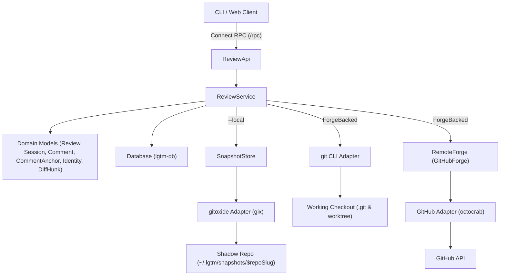

- `ReviewApi` decodes Connect RPC requests, establishes tracing spans, and maps domain results to Protobuf responses.
- `ReviewService` orchestrates review, session, and comment workflows across `Database`, `SnapshotStore` (`--local`), `git` (`ForgeBacked`), and `RemoteForge` (`ForgeBacked`).
- `Review`, `Session`, `Comment`, and `Identity` are pure in-memory domain models that validate state, format agent disclosures, and convert to and from persistence records.
- `CommentAnchor` validates diff line anchors (`validate_line`) and computes line-anchor shifts across commits (`recompute_shifts`) in memory.
- `DiffHunk` builds inline $\pm 3$-line unified diff hunks (`from_blobs`) in memory for `ShowReview`.
- `SnapshotStore` manages `~/.lgtm/snapshots/$repoSlug` and `refs/lgtm/snapshots/<branch>` for `--local` reviews via `gitoxide` (`gix`).
- `git` wraps standard `git` CLI commands (`add`, `commit`, `push`, `diff`, `show`) on the working checkout for `ForgeBacked` workflows.
- `RemoteForge` (`GitHubForge`) synchronizes pull requests, review sessions, comments, and viewed files with the remote forge.
- `Database` (`lgtm-db`) persists identities, reviews, sessions, and comments transactionally.

### Data and Control Flow

#### Local staging and shadow commit (`Add --local`, `Commit --local`)

When `local = true`, `lgtm-forge` delegates to `SnapshotStore`, which stages the requested worktree paths into a shadow Git index (`~/.lgtm/snapshots/$repoSlug/index.<branch>`) with `GIT_WORK_TREE` pointing at the working checkout and commits the shadow tree onto `refs/lgtm/snapshots/<branch>`, leaving the working checkout's `.git/index` and `HEAD` untouched.

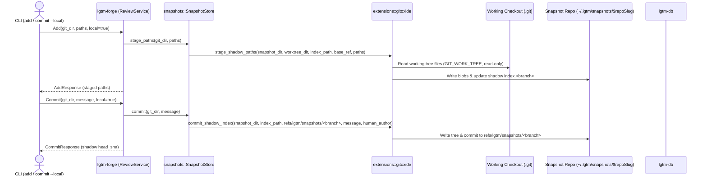

#### Remote-tracked staging, commit, and push (`Add`, `Commit`, `Push`)

When `local = false`, `ReviewService` wraps standard `git` on the working checkout using the human user's native Git identity without touching `SnapshotStore`. Because it uses the checkout's native `.git/index` and `refs/heads/<branch>`, users and agents can freely interleave external `git`/`jj` commands with `lgtm` commands.

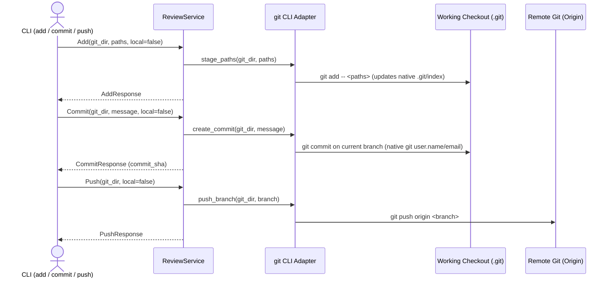

#### Creating and refreshing a local review (`CreateReview --local`, `RefreshReview --local`)

For a `Local` review, `ReviewService` uses `SnapshotStore` (`gitoxide`) to snapshot any pending worktree changes into `~/.lgtm/snapshots/$repoSlug` and records `base_sha` and `head_sha` in `Database`. On `RefreshReview`, `ReviewService` reads the commit blobs from `SnapshotStore` and passes them to `CommentAnchor::recompute_shifts` to shift surviving lines and mark overwritten lines `outdated = true`.

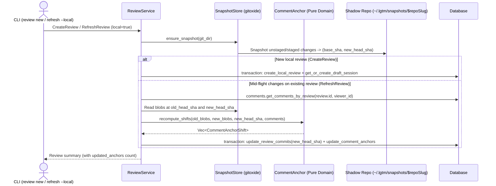

#### Creating and refreshing a forge-backed review (`CreateReview`, `RefreshReview`)

For a `ForgeBacked` review, `ReviewService` never touches `SnapshotStore`. It flushes any unsynced local draft comments (`forge_id IS NULL`) through `RemoteForge`, pulls the latest PR bundle into `Database`, and when `head_sha` advances mid-flight, reads commit blobs from `.git` via the `git` CLI adapter and passes them to `CommentAnchor::recompute_shifts` to remap open draft comments.

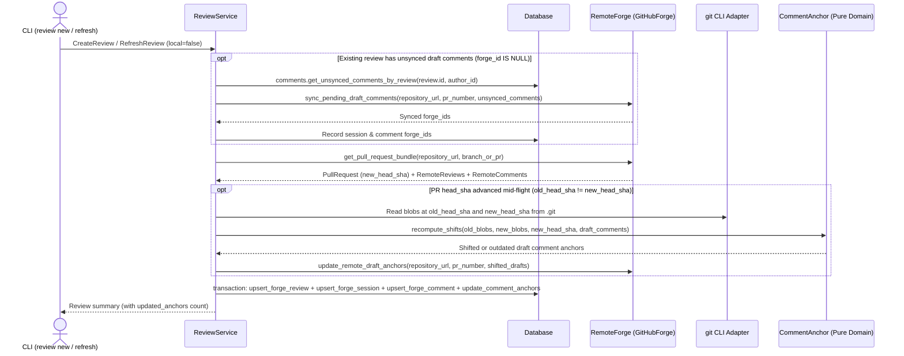

#### Showing a review with inline diff hunks (`ShowReview`)

`ShowReview` loads the review, sessions, and comments from `Database`, reads the base and head blobs via `SnapshotStore` (`Local`, using `gitoxide`) or the `git` CLI adapter (`ForgeBacked`), and builds inline unified diff hunks in memory via `DiffHunk::from_blobs`.

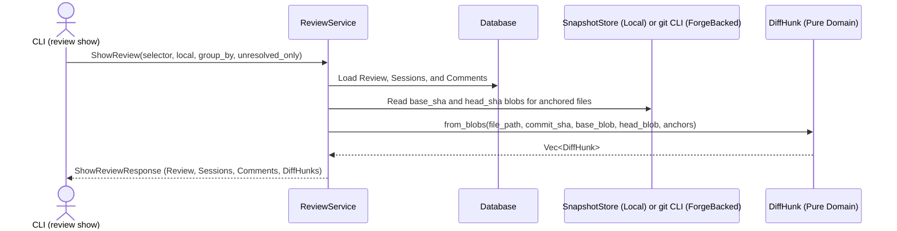

#### Marking and unmarking files as viewed (`SetFileReviewed`)

`SetFileReviewed` records or removes `file_path -> head_sha` in `review.reviewed_files` in `Database`, and when the review is `ForgeBacked`, syncs the viewed state in near real-time to the remote forge via `RemoteForge::set_remote_file_viewed`. During `RefreshReview`, any file modified between its recorded `commit_sha` and `new_head_sha` is automatically pruned from `review.reviewed_files`.

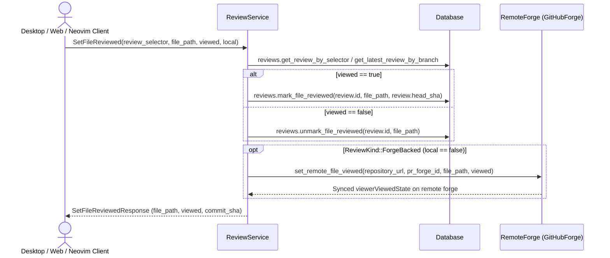

#### Drafting, updating, and deleting local comments (`CreateComment --local`, `UpdateComment --local`, `DeleteComment --local`)

In local mode (`--local`), creating, updating, or deleting a comment resolves the caller's `Human` or `Agent` identity (`--as`), reads the target blob from `SnapshotStore`, validates the line anchor in memory via `CommentAnchor::validate_line`, and mutates the open `Draft` session in `Database` without contacting any remote forge.

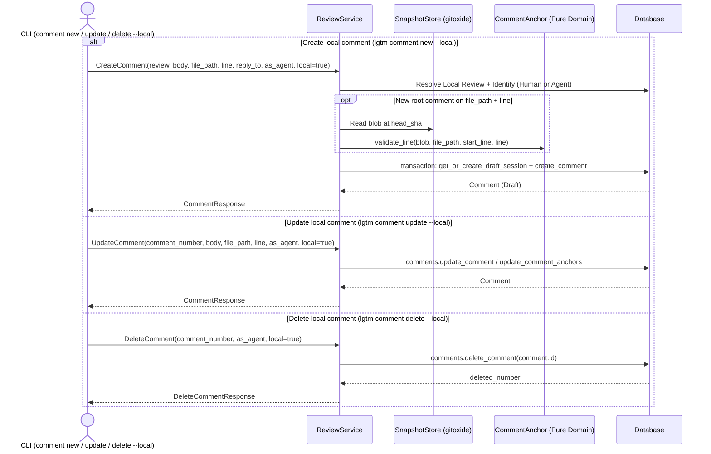

#### Drafting, updating, and deleting remote comments (`CreateComment`, `UpdateComment`, `DeleteComment`)

For a `ForgeBacked` review, `ReviewService` reads the target blob from `.git` via the `git` CLI adapter, validates the diff line anchor in memory via `CommentAnchor::validate_line`, saves the draft comment in `Database` first, and syncs the change to `RemoteForge`.

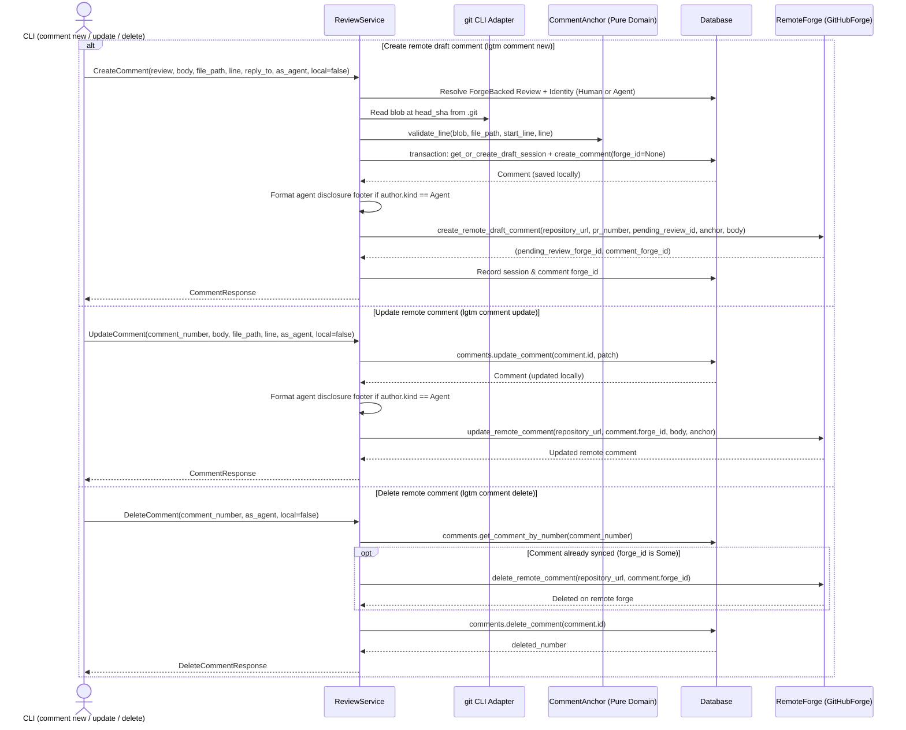

#### Closing a local review session (`CloseReview --local`)

When `CloseReview` is called on a `Local` review, `lgtm-forge` transitions the caller's open `Draft` session to `Published` directly in `lgtm-db` without contacting any remote forge.

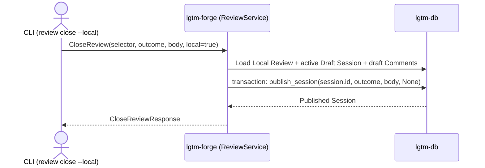

#### Closing a forge-backed review session (`CloseReview`)

When `CloseReview` is called on a `ForgeBacked` review, `lgtm-forge` first flushes any unsynced draft comments (`forge_id IS NULL`) to the pending review on the remote forge via `RemoteForge` so no comment gets stuck locally, formats any agent disclosure footer on the top-level session `body`, submits the pending review (`Comment`, `Approve`, or `RequestChanges`) via `RemoteForge::submit_pending_review`, and marks the session `Published` in `lgtm-db`.

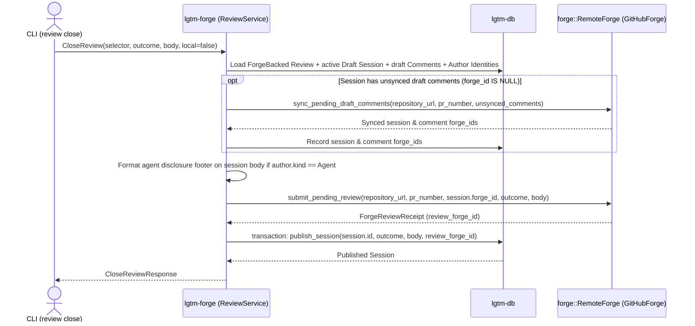

### Interfaces and Contracts

#### Core domain types

| Type | Description |
| --- | --- |
| `Identity` | Actor with `id: Uuid`, `name: String`, and `kind: IdentityKind`. |
| `IdentityKind` | `Human { email: String, forge_login: Option<String> }` or `Agent { provider: String, model: String }`. |
| `Review` | Review entity with `id`, `number`, `name`, `context: ReviewContext`, `status: ReviewStatus`, `base_sha`, `head_sha`, and `reviewed_files`. |
| `ReviewContext` | `Local { git_dir, branch }` or `ForgeBacked { git_dir, branch, repository_url, pr_number, forge_id }`. Rejects remote operations when `Local`. |
| `ReviewStatus` | `Open`, `Closed`, or `Merged`. |
| `ReviewOutcome` | Session verdict: `Comment`, `Reject`, `Approve`, or `Request`. |
| `ReviewGroupBy` | Presentation grouping for `ShowReview`: `File` (default) or `Session`. |
| `Session` | Comment batch with `id`, `review_id`, `number`, `author: Identity`, `state: SessionState`, `outcome`, `body`, and `published_at`. |
| `SessionState` | `Draft` or `Published`. |
| `Comment` | Inline diff comment or reply with `id`, `number`, `review_id`, `session_id`, `author: Identity`, `reply_to_number`, `anchor: Option<CommentAnchor>`, `body`, `resolved`, and `outdated`. |
| `CommentAnchor` | Diff anchor with `file_path`, `start_line`, `line`, `commit_sha`, `original_start_line`, `original_line`, and `original_commit_sha`, plus pure `validate_line` and `recompute_shifts`. |
| `DiffHunk` | Inline unified diff block (`file_path`, `commit_sha`, `start_line`, `lines: Vec<DiffLine>`) built by `from_blobs` for `ShowReview`. |
| `DiffLine` | Single unified diff line with `kind: DiffLineKind` (`Context`, `Added`, `Removed`), `line_number`, and `content`. |

#### Connect / Protobuf RPC methods (`lgtm.forge.v1.ReviewService`)

| RPC Method | Request Fields | Response Fields | CLI Command |
| --- | --- | --- | --- |
| `Add` | `git_dir`, `paths`, `local` | `staged_paths`, `local` | `lgtm add <paths>... [--local]` |
| `Commit` | `git_dir`, `message`, `local` | `commit_sha`, `branch`, `author`, `local` | `lgtm commit [--local] [-m <msg>]` |
| `Push` | `git_dir`, `local` | `branch`, `head_sha`, `repository_url`, `local` | `lgtm push [--local]` |
| `ListReviews` | `git_dir`, `local`, `all` | `reviews: Vec<ReviewSummary>` | `lgtm review list [--local] [--all]` |
| `CreateReview` | `git_dir`, `local`, `as_agent` | `review: ReviewSummary`, `session: SessionSummary` | `lgtm review new [--local] [--as <agent>]` |
| `RefreshReview` | `git_dir`, `selector`, `local` | `review: ReviewSummary`, `updated_anchors: u32` | `lgtm review refresh [<review>] [--local]` |
| `ShowReview` | `git_dir`, `selector`, `local`, `group_by`, `unresolved` | `review`, `sessions`, `comments`, `diff_hunks` | `lgtm review show [<review>] [--local] [--group-by <file\|session>] [--unresolved]` |
| `CloseReview` | `git_dir`, `selector`, `local`, `with_outcome`, `body`, `as_agent` | `review: ReviewSummary`, `session: SessionSummary` | `lgtm review close [<review>] --with <outcome> [--body <text>]` |
| `CreateComment` | `git_dir`, `review_selector`, `body`, `file_path`, `start_line`, `line`, `reply_to`, `local`, `as_agent` | `comment: CommentDetail` | `lgtm comment new <body> [--review <r>] [--file <f>] [--start-line <s>] [--line <l>] [--reply-to <id>] [--local] [--as <agent>]` |
| `UpdateComment` | `git_dir`, `comment_number`, `body`, `file_path`, `start_line`, `line`, `resolved`, `local`, `as_agent` | `comment: CommentDetail` | `lgtm comment update <id> [--body <text>] [--file <f>] [--start-line <s>] [--line <l>] [--resolved <bool>] [--local] [--as <agent>]` |
| `DeleteComment` | `git_dir`, `comment_number`, `local`, `as_agent` | `deleted_number: u64` | `lgtm comment delete <id> [--local] [--as <agent>]` |
| `SetFileReviewed` | `git_dir`, `review_selector`, `file_path`, `viewed`, `local` | `file_path`, `viewed`, `commit_sha` | Desktop / Web / Neovim viewed checkbox toggle |
| `HelloReview` | `name` | `message` | Health/smoke demonstration endpoint |

#### Component contracts

- `SnapshotStore` (`--local` shadow storage backed by `gitoxide`):
  - `snapshot_dir(&self, git_dir) -> Result<PathBuf>`
  - `stage_paths(&self, git_dir, paths) -> Result<Vec<String>>`
  - `commit(&self, git_dir, message) -> Result<(String, String)>`
  - `ensure_snapshot(&self, git_dir) -> Result<(String, String)>`
  - `get_changed_files(&self, git_dir, old_sha, new_sha) -> Result<Vec<String>>`
  - `get_commit_blobs(&self, git_dir, commit_sha) -> Result<BTreeMap<String, String>>`
  - `read_file_at_commit(&self, git_dir, commit_sha, file_path) -> Result<Option<String>>`
- `CommentAnchor` and `DiffHunk` (pure in-memory domain models):
  - `CommentAnchor::validate_line(head_blob, file_path, start_line, line) -> Result<()>`
  - `CommentAnchor::recompute_shifts(old_blobs, new_blobs, new_head_sha, comments) -> Vec<CommentAnchorShift>`
  - `DiffHunk::from_blobs(file_path, commit_sha, base_blob, head_blob, anchors) -> Vec<DiffHunk>`
- `RemoteForge` (remote pull request provider trait, implemented by `GitHubForge` and `DummyForge`):
  - `get_pull_request_bundle(&self, repository_url, branch_or_pr) -> Result<ForgePullRequestBundle>`
  - `create_pending_review(&self, repository_url, pr_number, head_sha) -> Result<String>`
  - `create_remote_draft_comment(&self, repository_url, pr_number, pending_review_id, comment) -> Result<ForgeDraftCommentReceipt>`
  - `update_remote_comment(&self, repository_url, forge_id, update) -> Result<()>`
  - `delete_remote_comment(&self, repository_url, forge_id) -> Result<()>`
  - `set_remote_file_viewed(&self, repository_url, pr_forge_id, pr_number, file_path, viewed) -> Result<()>`
  - `submit_pending_review(&self, repository_url, pr_number, pending_review_id, outcome, body) -> Result<ForgeReviewReceipt>`

## Implementation

### Package layout

```text
apps/lgtm-forge/
├── Cargo.toml
├── build.rs                       Protobuf and Connect RPC code generation
├── proto/
│   └── lgtm/forge/v1/
│       └── review.proto           Shared RPC schema for CLI and web clients
├── src/
│   ├── lib.rs
│   ├── main.rs                    Standalone server entry point
│   ├── error.rs                   Application error types and Connect status mapping
│   ├── snapshots.rs               SnapshotStore managing ~/.lgtm/snapshots/$repoSlug via extensions::gitoxide
│   ├── utils.rs                   Repository slug and path helpers
│   ├── extensions/
│   │   ├── mod.rs
│   │   ├── gitoxide.rs            General stateless gix local Git and unified diff adapter
│   │   └── octocrab.rs            Stateless GitHub REST and GraphQL adapter
│   ├── forge/
│   │   ├── mod.rs                 RemoteForge trait for remote PR/MR providers
│   │   ├── github.rs              GitHubForge implementation backed by extensions::octocrab
│   │   └── models.rs              Remote forge import/export contracts
│   ├── models/
│   │   ├── mod.rs
│   │   ├── identity.rs            Identity and IdentityKind
│   │   ├── review.rs              Review, ReviewContext, ReviewStatus, ReviewOutcome
│   │   ├── session.rs             Session and SessionState
│   │   ├── comment.rs             Comment and CommentAnchor
│   │   └── diff.rs                DiffHunk and DiffLine
│   ├── services/
│   │   ├── mod.rs
│   │   └── review.rs              ReviewService orchestration
│   └── rpc/
│       ├── mod.rs
│       └── review.rs              Connect RPC transport handlers
└── tests/
    ├── common/
    │   └── mod.rs                 Test fixtures for SQLite/PostgreSQL, SnapshotStore, and DummyForge
    └── review_service.rs          Integration tests for local and forge-backed lifecycles
```

### Snapshot repository isolation

Each local checkout maps deterministically to `~/.lgtm/snapshots/$repoSlug` (derived from the canonicalized `git_dir`). `SnapshotStore` initializes a bare Git repository at that path and delegates to `extensions::gitoxide` to fetch or mirror objects from `git_dir` without modifying `.git/index`, `HEAD`, or remote refs in the user's working tree during `--local` operations.

## References

- [Snapshot store architecture](snapshot-store.md).
- [Authorship and agent identity architecture](authorship.md).
- [ADR 0002: Core Concepts and CLI Design](../../../adr/0002-cli-design/ADR.md).
- [Database architecture](../db/index.md).
- [CLI architecture](../cli/index.md).
- [Application architecture](../index.md).
