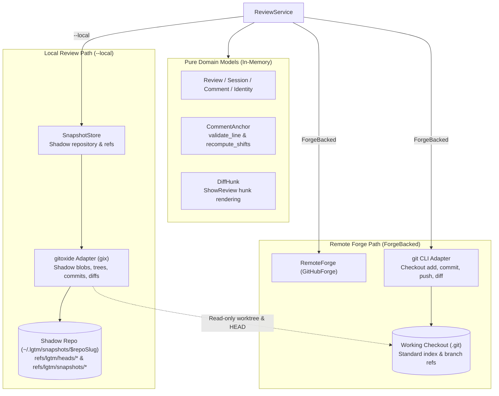
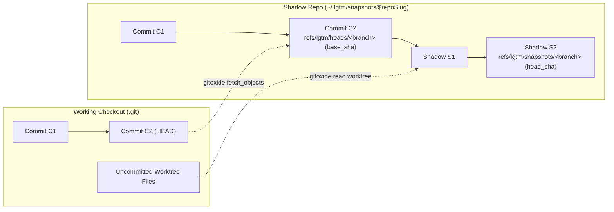
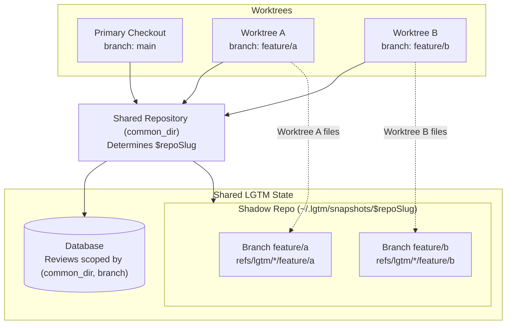
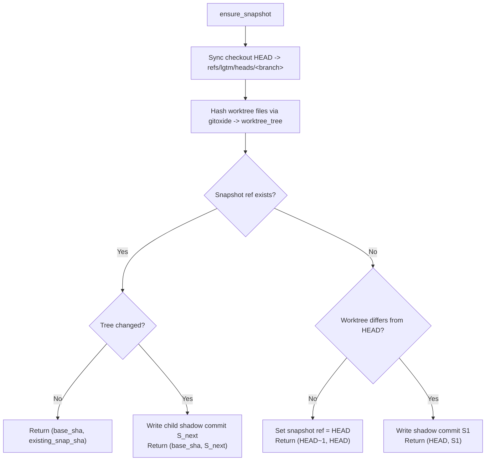
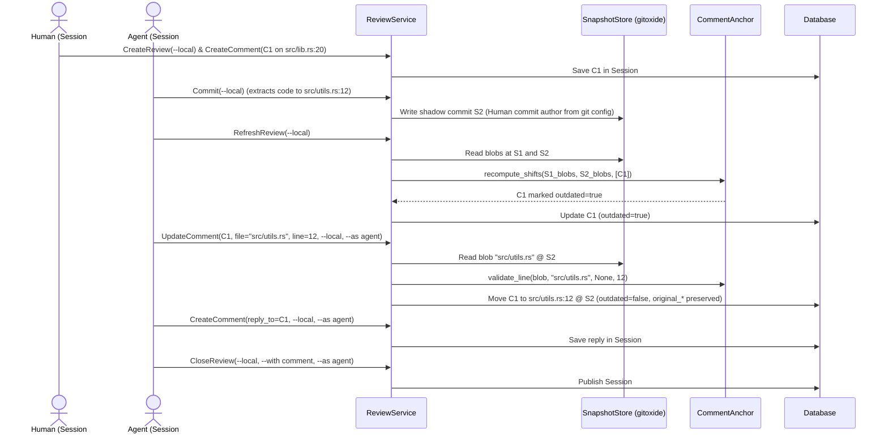

# Snapshot store — software architecture

## Overview

`SnapshotStore` owns local shadow repositories under `~/.lgtm/snapshots/$repoSlug` for `--local` reviews, using `gitoxide` (`gix`) to stage, snapshot, and diff uncommitted work without touching the user's checkout. LGTM is a review forge rather than a `git` or `jj` replacement: remote (`ForgeBacked`) workflows delegate directly to standard `git` on the working checkout, while `--local` workflows use `SnapshotStore` and `gitoxide`.

## Requirement

### Functional

- **Local-only shadow storage**: Restrict `SnapshotStore` and `gitoxide` to `--local` workflows; never mirror commits into `~/.lgtm/snapshots/$repoSlug` for remote pull request reviews.
- **External VCS compatibility**: Interoperate with native `git` and `jj` commands, branches, and linked worktrees by delegating non-local checkout operations and diffs to standard `git`.
- **Worktree and branch isolation**: Share one snapshot repository per canonical repository (`common_dir`) across linked worktrees while isolating shadow state and refs per branch.
- **Non-destructive shadow staging and commits**: Stage worktree files and commit onto `refs/lgtm/snapshots/<branch>` via `gitoxide` without mutating the checkout's `.git/index`, `HEAD`, or branch refs.
- **Idempotent worktree snapshots**: Reuse the existing shadow commit when starting or refreshing a `--local` review if worktree files have not changed.
- **Agent-assisted comment anchor relocation**: Allow agents and users to move comment anchors across lines and files after automated diff and anchor tracking while preserving original coordinates.
- **Concurrent overlapping sessions**: Support simultaneous active `Draft` sessions for human and agent participants on the same review.

### Non-Functional

- **Working checkout invariance**: Leave working files, `.git/index`, `HEAD`, and remote refs unchanged during `--local` operations.
- **Clear adapter separation**: Use `gitoxide` (`gix`) exclusively inside `SnapshotStore` for `--local` shadow repositories, and wrap standard `git` (`extensions::git`) for working-checkout operations and `ForgeBacked` diffs.
- **Pure domain models**: Keep `DiffHunk` (`ShowReview` hunk rendering) and `CommentAnchor` (`validate_line`, `recompute_shifts`) as pure in-memory models with no VCS adapter dependencies.

## Design

### Usage

```rust
let snapshots = SnapshotStore::default();

// 1. Stage and commit into the shadow repository via gitoxide (--local only)
let staged = snapshots.stage_paths("/repo/.git", &["src/lib.rs".into()])?;
let (snap_sha, branch) = snapshots.commit(
    "/repo/.git",
    Some("Snapshot local refactor"),
)?;

// 2. Capture an idempotent worktree snapshot for a local review
let (base_sha, head_sha) = snapshots.ensure_snapshot("/repo/.git")?;

// 3. Validate and shift anchors via CommentAnchor, and build ShowReview hunks via DiffHunk
let head_blob = snapshots.get_file_at_commit("/repo/.git", &head_sha, "src/lib.rs")?;
CommentAnchor::validate_line(head_blob.as_deref(), "src/lib.rs", Some(5), 7)?;
let shifts = CommentAnchor::recompute_shifts(&old_blobs, &new_blobs, &new_head_sha, &comments);
let hunks = DiffHunk::from_blobs("src/lib.rs", &head_sha, base_blob.as_deref(), head_blob.as_deref(), &anchors);
```

### Components and Responsibilities



- `ReviewService` routes `--local` workflows to `SnapshotStore` and `ForgeBacked` workflows to `RemoteForge` and the `git` CLI adapter.
- `SnapshotStore` owns `~/.lgtm/snapshots/$repoSlug`, `refs/lgtm/heads/<branch>`, and `refs/lgtm/snapshots/<branch>`, delegating shadow Git object operations to `gitoxide`.
- `CommentAnchor` validates target diff lines (`validate_line`) and computes line-anchor shifts across commits (`recompute_shifts`) in memory.
- `DiffHunk` builds $\pm 3$-line unified diff hunks in memory for `ShowReview`.
- `gitoxide` provides stateless `gix` operations for `SnapshotStore` without mutating the working checkout.
- `git` wraps standard `git` CLI commands (`add`, `commit`, `push`, `diff`, `show`) on the working checkout for `ForgeBacked` workflows.

#### Shadow commit topology

`SnapshotStore` records the branch's starting `HEAD` at `refs/lgtm/heads/<branch>` (`base_sha`) and chains shadow commits (`S1 -> S2`) on `refs/lgtm/snapshots/<branch>` (`head_sha`) via `gitoxide` while the checkout's `HEAD` remains untouched:



#### Branches and linked worktrees

Linked worktrees (`git worktree` or `jj workspace`) resolve to the same repository `common_dir`, sharing one `$repoSlug` and database key while scoping shadow refs by `<branch>` and reading files from the active `worktree_dir`:



### Data and Control Flow

#### Shadow staging and snapshots (`--local`)

`stage_paths` reads the requested paths from `worktree_dir` and writes blobs into `~/.lgtm/snapshots/$repoSlug` via `gitoxide`. `commit` writes the resulting tree and commit onto `refs/lgtm/snapshots/<branch>`.

`ensure_snapshot` compares the current worktree tree against `refs/lgtm/snapshots/<branch>` (or `HEAD` on first run). It returns the existing shadow commit when unchanged, or writes a new shadow commit when files differ:



#### Automated anchor tracking, agent relocation, and overlapping sessions

On `refresh_review --local`, `ReviewService` reads the commit blobs for `old_head_sha` and `new_head_sha` from `SnapshotStore` and passes them to `CommentAnchor::recompute_shifts`. Surviving lines shift to their new line numbers, while modified or deleted lines become `outdated = true` while keeping their last valid coordinates.

While a human reviewer's `Draft` session is open, an agent can open a concurrent `Draft` session, relocate outdated or refactored comments to new files and lines (`update_comment`), reply to threads, and publish its session independently:



### Interfaces and Contracts

```rust
impl SnapshotStore {
    pub fn new(root_dir: impl Into<PathBuf>) -> Self;
    pub fn snapshot_dir(&self, git_dir: &str) -> Result<PathBuf>;
    pub fn stage_paths(&self, git_dir: &str, paths: &[String]) -> Result<Vec<String>>;
    pub fn commit(&self, git_dir: &str, message: Option<&str>) -> Result<(String, String)>;
    pub fn ensure_snapshot(&self, git_dir: &str) -> Result<(String, String)>;
    pub fn get_changed_files(&self, git_dir: &str, old_sha: &str, new_sha: &str) -> Result<Vec<String>>;
    pub fn get_commit_blobs(&self, git_dir: &str, commit_sha: &str) -> Result<BTreeMap<String, String>>;
    pub fn get_file_at_commit(&self, git_dir: &str, commit_sha: &str, file_path: &str) -> Result<Option<String>>;
}

impl CommentAnchor {
    pub fn validate_line(head_blob: Option<&str>, file_path: &str, start_line: Option<u32>, line: u32) -> Result<()>;
    pub fn recompute_shifts(old_blobs: &BTreeMap<String, String>, new_blobs: &BTreeMap<String, String>, new_head_sha: &str, comments: &[Comment]) -> Vec<CommentAnchorShift>;
}

impl DiffHunk {
    pub fn from_blobs(file_path: &str, commit_sha: &str, base_blob: Option<&str>, head_blob: Option<&str>, anchors: &[CommentAnchor]) -> Vec<DiffHunk>;
}
```

<!-- prettier-ignore -->
| API | Contract |
| --- | --- |
| `SnapshotStore::stage_paths` | Stage worktree paths into `~/.lgtm/snapshots/$repoSlug` via `gitoxide` |
| `SnapshotStore::commit` | Commit staged shadow changes onto `refs/lgtm/snapshots/<branch>` |
| `SnapshotStore::ensure_snapshot` | Snapshot the worktree idempotently via `gitoxide` and return `(base_sha, head_sha)` |
| `SnapshotStore::get_changed_files` | Return sorted relative paths modified between two shadow commits |
| `CommentAnchor::validate_line` | Verify `file_path` content exists and `1 <= start_line <= line <= total_lines` |
| `CommentAnchor::recompute_shifts` | Remap surviving anchors and mark overwritten anchors `outdated = true` in memory |
| `DiffHunk::from_blobs` | Build unified diff hunks ($\pm 3$ context lines) around each `CommentAnchor` for `ShowReview` |

## Implementation

### Adapter separation

- **`--local` (`SnapshotStore` + `extensions::gitoxide`)**: Uses `gitoxide` (`gix`) to inspect worktree files, copy base objects from `common_dir`, write shadow trees and commits under `~/.lgtm/snapshots/$repoSlug`, and read blobs for `CommentAnchor` and `DiffHunk`.
- **`ForgeBacked` (`extensions::git`)**: Invokes standard `git` on the working checkout (`git add`, `git commit`, `git push`, `git diff`, `git show`) so external `git` and `jj` commands interoperate directly with `.git/index` and branch refs.

### Verification scenarios

BDD integration tests in `tests/snapshot_store.rs` emit human-inspectable transcripts under `target/test-outputs/snapshot_store/`:
1. **Checkout invariance**: `--local` stage, commit, and snapshot operations leave `.git/index` and `HEAD` unchanged.
2. **External Git interoperability**: Native `git add` and non-local `lgtm commit` share `.git/index` without touching `~/.lgtm/snapshots`.
3. **Linked worktrees and branches**: Multiple worktrees share one `$repoSlug` while isolating per-branch shadow refs.
4. **Idempotent snapshots**: Repeated `ensure_snapshot` calls on an unchanged worktree return the same commit SHA.
5. **Anchor tracking, cross-file relocation, and overlapping sessions**: Automated `recompute_shifts`, agent cross-file `update_comment`, and concurrent human/agent `Draft` sessions operate without collision.

## References

- [Forge architecture](index.md).
- [Authorship architecture](authorship.md).
- [ADR 0002: Core Concepts and CLI Design](../../../adr/0002-cli-design/ADR.md).
- [CLI store module](../cli/store.md).
