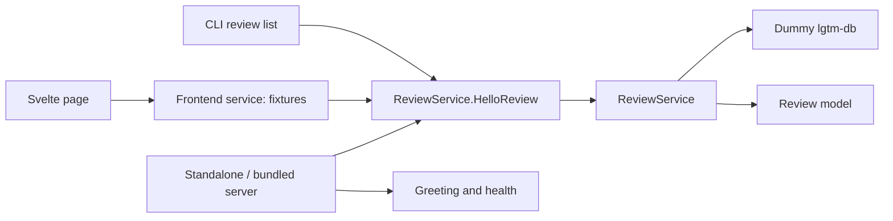
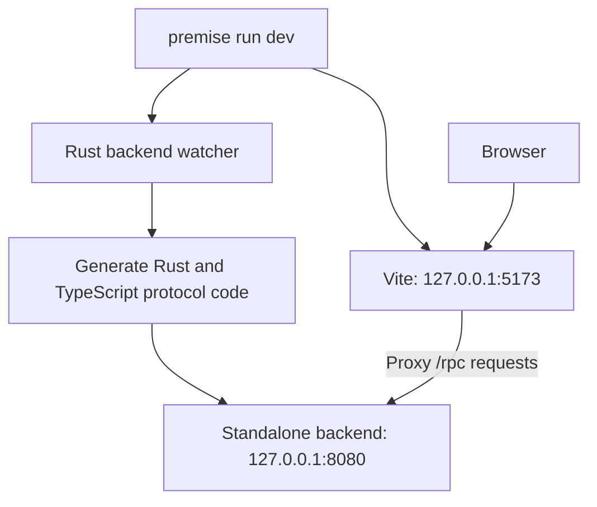
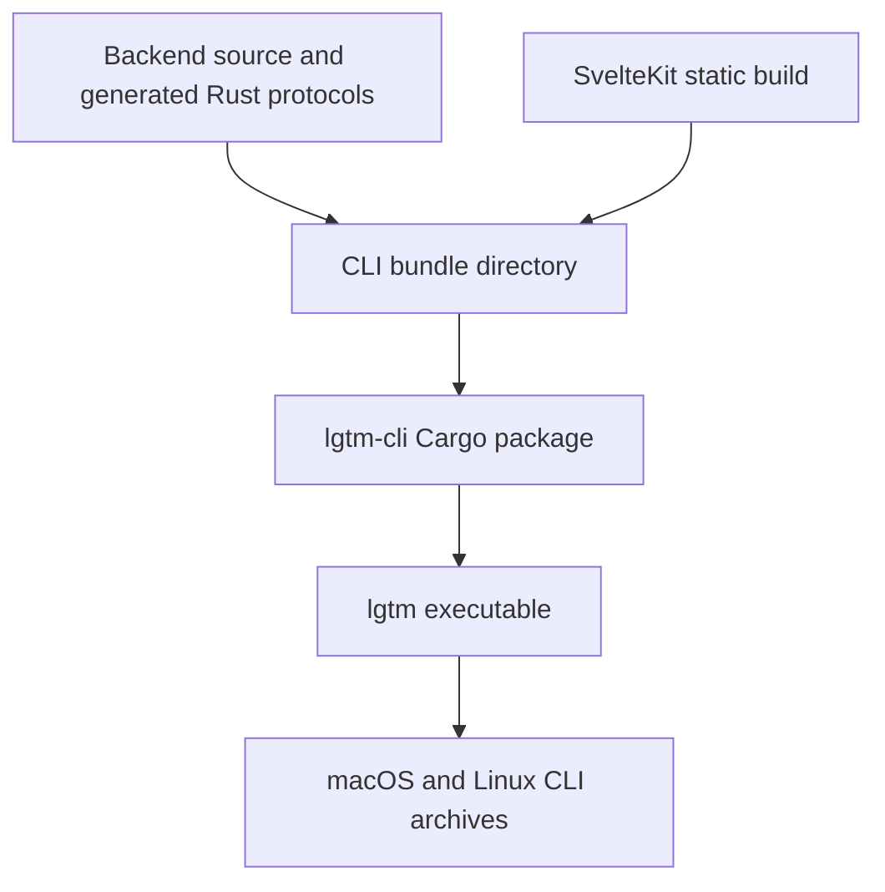

# LGTM — software architecture

## Overview

LGTM currently exposes a hello-review demonstration through a shared backend, CLI and Svelte page; the Neovim package is a dependency-loading shell. Review persistence and LGTM-managed Git storage are NA/WIP.

## Requirement

NA/WIP.

### Functional

- FR1: Call the same hello-review RPC from CLI and browser.
- FR2: Preserve daemon startup, discovery, browser opening and shutdown.
- FR3: Keep recording/replay and Neovim installation infrastructure for later work.

### Non-Functional

- NFR1: Generate Rust and TypeScript clients from shared Protobuf contracts.
- NFR2: Keep the source checkout, upstream forge and existing database files untouched by domain stubs.

## Design

NA/WIP.

### Usage

```sh
lgtm up --no-open
lgtm review list --json
lgtm ui
lgtm down
```

### Components and Responsibilities



The backend owns service orchestration and the review model; the frontend service owns display fixtures. The CLI bundles the backend and static web assets into one installed executable.

#### Key concepts

`Review` contains demonstration response data; `ReviewService` obtains fixed hello data from the dummy `Database` facade. Persistent contexts, revisions, conversations and publication are NA/WIP.

#### Review data and diff data

NA/WIP. The skeleton has no persisted review or diff API.

### Interfaces and Contracts

`ReviewService.HelloReview` accepts a name and returns `Hello, {name}!`, trimming whitespace and defaulting an empty name to `World`. The CLI labels list output as demo data; unsupported domain commands fail explicitly. See [review contract](backend/reviews.md) and [CLI contracts](cli/index.md#interfaces-and-contracts).

## Implementation

NA/WIP.

### Runtime data flow

The CLI daemon serves static assets and `/rpc` on one loopback listener. Browser and native clients call the same backend. The review service reads dummy hello data and constructs the model response without SQL, Git or forge operations.

### Review creation and resumption

NA/WIP.

### Review contexts and comparisons

NA/WIP.

### Changes to local content

NA/WIP.

### Changes to a GitHub PR

NA/WIP.

### Drafts, completion, and reviewed files

NA/WIP.

### Local comment lifecycle

NA/WIP.

### GitHub comment lifecycle

NA/WIP.

### Thread resolution

NA/WIP.

### Anchor mapping after content changes

NA/WIP.

### Reviewed-file marks

NA/WIP.

### Development flow



`premise run dev` starts Vite and the Rust backend watcher. Vite updates the browser when frontend files change. Backend and schema changes regenerate client code and restart the server.

### Packaging flow



The CLI bundle contains backend source, generated Rust protocol code, and static web assets. Cargo includes the bundle in `lgtm-cli`. The installed executable runs without Bun, Buf, or a source checkout.

Only the CLI publishes. GoReleaser defines macOS and Linux archives for arm64 and x86_64. Premise publishes the Cargo package, while archive publication uses a separate task.

### Project structure

```text
lgtm/
├── apps/
│   ├── lgtm-cli/       CLI and bundled application
│   ├── lgtm-forge/     Rust services and shared Protobuf schema
│   └── lgtm-web/       SvelteKit interface and generated client
└── libs/
    └── lgtm-db/        Private Rust library
```

### Runtime and delivery

The installed CLI serves backend RPCs and embedded frontend assets in one process. The Svelte page exercises HelloReview; Neovim remains a loading shell. Mise tasks invoked through Premise validate packages and the reduced E2E suites; offline tests preserve the snapshot/replay mechanism. Existing user DB files are unused and untouched.

## References

- [Neovim user guide](../user-guide.md).
- [Forge architecture](forge/index.md).
- [Backend architecture](backend/index.md).
- [Review RPC architecture](backend/reviews.md).
- [Database architecture](db/index.md).
- [CLI architecture](cli/index.md).
- [Editor setup and usage](../../apps/lgtm.nvim/README.md).
- [Development guide](../development.md).
- [Architecture decision](../../adr/0001-initial-architecture/ADR.md).
- [ADR 0002: Core Concepts and CLI Design](../../adr/0002-cli-design/ADR.md).
- [Product requirements](../../prd/0001-core-concepts/README.md).
- [Design prototype](../../designs/prototypes/lgtm-v0/README.md).
