# LGTM — software architecture

## Overview

LGTM provides notes, local reviews, and GitHub reviews through a shared backend managed by the CLI. CLI commands, Neovim, and other API consumers use the same persistence and review workflows. The bundled browser interface currently provides a dummy UI rather than the review frontend.

This page owns the key concepts, component design, and context-specific flow and lifecycle behavior. The [backend review architecture](backend/reviews.md) owns RPC contracts and backend implementation details. The [user guide](../user-guide.md) explains using the Neovim plugin and the availability of the web interface.

General PR dashboards, merge commands, CI browsing, and other forge implementations remain outside the review scope. Execution evidence and remaining implementation gaps belong in the reconciliation plan.

## Requirement

### Functional

- FR1: Support notes without requiring a visible review session.
- FR2: Support explicit directories, working files, the Git index, branch comparisons, and GitHub PR reviews.
- FR3: Preserve conversations and attribution across application restarts and successor review sessions.
- FR4: Keep comments accessible when content changes, even when a current line cannot be established.
- FR5: Keep local completion, private GitHub draft synchronization, and explicit remote submission separate.
- FR6: Support multiple clients and contexts through one backend without making one view replace another.
- FR7: Export notes and reviews without changing their lifecycle state.
- FR8: Provide review interfaces through Neovim, CLI, and a future web frontend.

### Non-Functional

- NFR1: Display the first selected file without waiting for every remote file or comment.
- NFR2: Keep review actions accessible through keyboard-driven interfaces.
- NFR3: Keep shared persistence rules consistent across SQLite and PostgreSQL.
- NFR4: Preserve durable operation identity and receipts instead of replaying uncertain external writes.
- NFR5: Keep forge credentials in the backend and distinguish them from logical review authorship.

## Design

### Usage

Start LGTM, then open a review through Neovim:

```sh
lgtm up --no-open
```

```vim
:Lgtm review
```

The [product guide](../user-guide.md) covers notes, local reviews, PR reviews, and exports. API clients use the [review service](backend/reviews.md#usage) for review data. The future web UI uses [DiffService](backend/diffs.md#usage) for content access.


### Components and Responsibilities

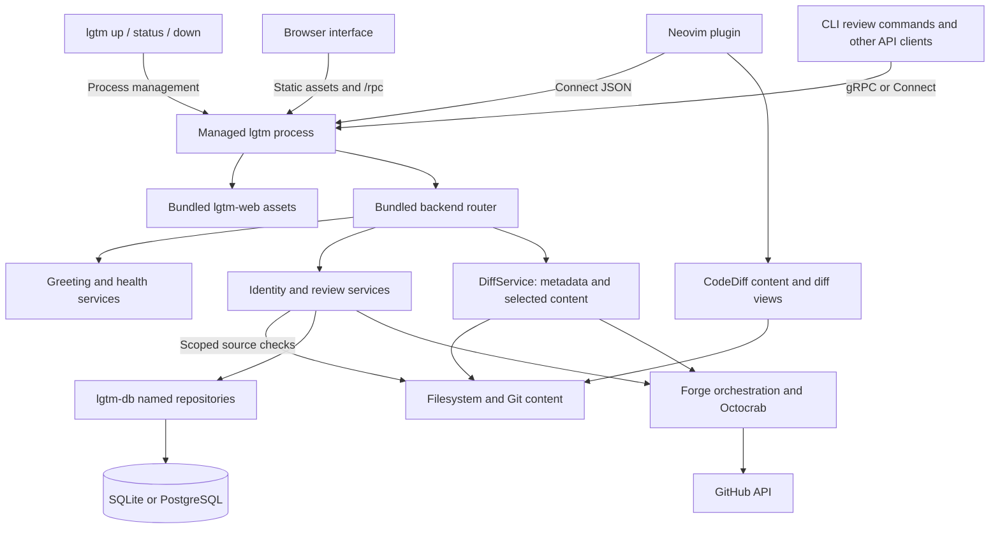

- `lgtm-cli` starts and manages one local application process that serves the bundled interface and backend. Review commands call the backend through RPC.
- `lgtm-backend` provides identity, review, and diff RPCs alongside greeting and health services through ConnectRPC. It also runs as a standalone server.
- `lgtm-web` contains the bundled browser interface and generated protocol client. Browser RPCs use `/rpc`. The current UI is a dummy interface, and its review frontend remains pending.
- `lgtm.nvim` calls the backend directly through Connect JSON and renders reviews through CodeDiff. It does not connect through the web frontend.
- `lgtm-db` provides named repositories with private SeaORM entities and shared constraints for SQLite and PostgreSQL. Backend services own application models and persistence orchestration.
- Filesystem and Git operations provide selected local content without changing checkouts. Forge orchestration uses Octocrab and backend-local credentials for GitHub reads and writes.

The installed application serves web assets and backend methods in the same process. The [database architecture](db/index.md) describes persistence boundaries, while the [backend architecture](backend/index.md) describes service ownership.

#### Key concepts

| Concept | Meaning and ownership |
| --- | --- |
| Target | What the caller wants to annotate or review, such as a directory, local branch, or PR. |
| Comparison | The selected content pair, such as baseline versus working files, index, or a branch head. |
| Context | Durable ownership of a conversation. Context resolution is an internal service responsibility in the public API. |
| Session | One review attempt. Active PR comparisons follow pushes; local and completed comparisons stay pinned. Completion metadata is explicit. |
| Thread | A root comment, ordered replies, an anchor, and an independent open or resolved state. |
| Comment | Saved text and attribution with stable identity, origin session, local visibility, and remote posting evidence. |
| Anchor | Immutable evidence of the content discussed, including original path, side, range, source identity, and selected text. |
| Placement | A derived location for one displayed comparison, with a confirmed, outdated, orphaned, or unverified status. |
| Actor | A human or agent author. The GitHub posting account is a separate identity. |
| Receipt | Evidence that an external write was accepted, used to recover without duplicates. |
| Reviewed-file mark | Consumer-local progress for a reviewed comparison, independent of discussion resolution. |

#### Review data and diff data

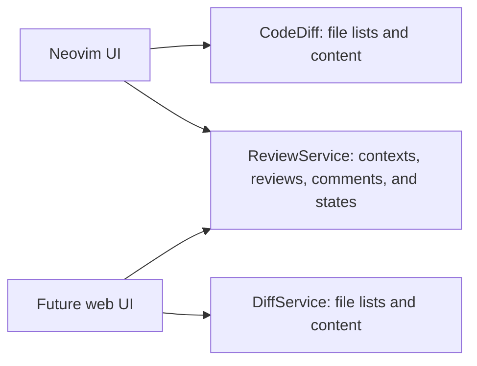

- UI: Select comparisons and files. Render content, discussions, notifications, and viewed-file marks.
- CodeDiff: Supply file content and diff hunks. The LGTM Neovim adapter captures source evidence and resolves comment placements.
- DiffService: Supply file metadata, comparison content, source identities, and mapping results for supplied anchors.
- ReviewService: Store review data, preserve original anchors and forge observations separately, enforce lifecycle rules, and synchronize forge reviews.

Review operations accept comparison and anchor data from either content source. They do not require a file-list or file-body request through ReviewService. The [diff architecture](backend/diffs.md) describes the content-service boundary.

### Interfaces and Contracts

The [review schema](../../apps/lgtm-backend/proto/lgtm/v1/review.proto) defines the current identity and review RPCs. The [backend review architecture](backend/reviews.md#rpc-method-design-and-contracts) defines the intended client contract and its effects. API consumers use the [backend usage](backend/reviews.md#usage) for request sequencing and recovery. Plugin users follow the [LGTM user guide](../user-guide.md).

Context identity remains local notes, a local Git-directory and branch pair, or a forge-backed repository and PR number. Working, staged, and branch comparisons remain selections within those identities rather than new persisted context kinds. The public review ID identifies the existing session-backed review attempt, without another review table.

Native gRPC and Connect clients use the same backend services. Standalone method paths have no prefix, while the CLI daemon also mounts them under `/rpc`. Greeting and health remain available alongside the stateful review APIs.

## Implementation

### Runtime data flow

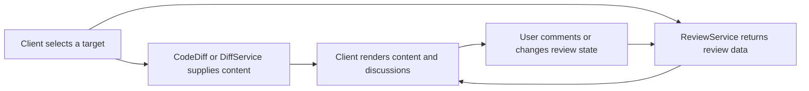

Content reads and review-data reads run independently.

### Review creation and resumption

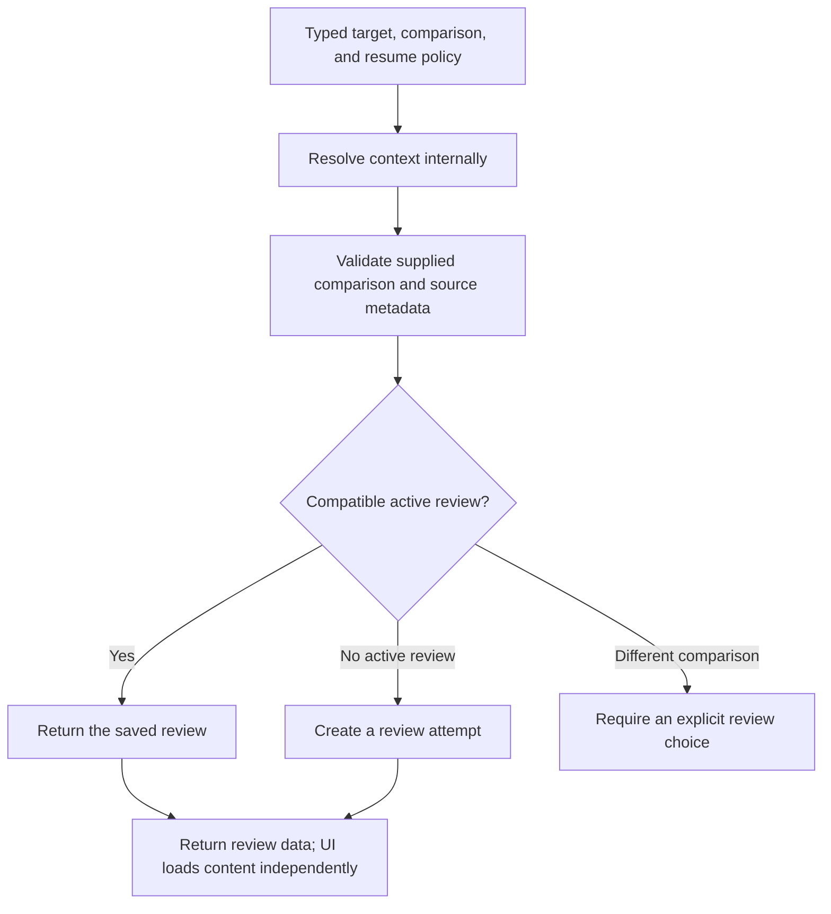

The service resolves storage internally. Consumers do not create contexts as a setup action.

The public entry accepts a typed target, comparison, and explicit resume policy. The backend resolves the context, validates comparison metadata, and selects a compatible review attempt internally. It returns a review identity without requiring consumers to create a context first.

The [backend contract](backend/reviews.md#public-review-boundary) defines the intended boundary and internal service responsibilities.

Opening or closing a consumer view does not complete a review. A changed comparison must not silently replace the content of an existing review attempt. Clients load file content through CodeDiff or the DiffService, independently of review data reads.

### Review contexts and comparisons

The context owns the conversation while its sessions record individual review attempts. Content selection changes the comparison without introducing another context kind.

| User context | Existing context identity | Reviewed content | Expected lifecycle |
| --- | --- | --- | --- |
| Notes while browsing | `notes` with a canonical absolute file or directory path | Current local text, including non-Git files | Save immediately. Keep notes without requiring a visible review session. |
| Explicit directory review | The existing `notes` context for the selected root | Files under that root, including ignored files | Start or resume a visible local session. Complete locally and retain its conversation. |
| Working-tree review | `branch` with an absolute `gitDir` and full branch ref | Selected baseline versus saved working files | Keep comments local. Unstaged anchors can become orphaned when the source changes. |
| Staged review | The same branch context | Selected baseline versus the Git index | Preserve the actual index blob and its comments when it becomes a commit. Filter the view by files in this diff. |
| Branch review | The same branch context | A resolved merge base versus a resolved branch head | Pin the reviewed commits. A later head does not replace them silently. |
| GitHub PR review | `forge_backed` with a repository URL and PR number | The observed PR base, head, files, and conversation | Save eligible comments into a private pending review. Publish only through explicit submission. |

Working, staged, and branch comparisons select content in the same local branch context. Staged and branch comments share that conversation and are filtered by files in the selected diff. A file outside the selected diff remains in the context and is not orphaned by filtering. PR comments belong to a separate PR context. Notes and explicit directory reviews also share an existing context kind. The consumer determines whether that notes context needs a visible review workflow.

The following invariants apply:

- Keep one active session per context, shared by local clients and identities.
- Keep threads and comments in their context across successor sessions.
- Keep the original author, original anchor, and origin session when content changes.
- Keep local comparisons pinned. Let active, unfrozen PR comparisons follow complete provider observations; keep frozen submissions and completed comparisons immutable.
- Persist each comment mutation before reporting a local save.
- Keep local completion separate from confirmed GitHub submission.
- Keep remote review state separate from session state and comment posting state.
- Keep reads and exports free of submission, promotion, and completion side effects.

A review records its comparison kind and commits. Changing a local comparison requires an explicit choice. A PR context is the repository and PR number, independent of any commit. Refresh, reopen, and draft posting follow current provider commits within the same active review. Mutations check saved versions and source evidence before changing data.

### Changes to local content

Preserving a comment means retaining its body, replies, attribution, resolution, and original location, even if its current location becomes uncertain.

| Event | Expected handling |
| --- | --- |
| Edit a noted file or directory file | Find a unique match for the selected text. Otherwise show an outdated file thread with its original location. |
| Edit working content after commenting | Allow unstaged anchors to become orphaned. Keep the discussion, without attaching it to unrelated text. |
| Stage or unstage changes | Keep the shared conversation and preserve staged blob identity. Earlier unstaged anchors can become orphaned. |
| Commit staged changes | Keep staged comments in the branch conversation and match their index blob to the committed file. Previously unstaged anchors can remain orphaned. |
| Continue after a commit | Keep the open session pinned. Offer explicit resume or completion followed by a new comparison. |
| Amend, rebase, or reset a branch | Treat rewritten commits as new content identities. Preserve history and map only uniquely supported locations. |
| Rename a file or directory | Automatically follow confirmed moves for all associated comments and threads. Keep original anchors and stable discussion IDs. |
| Delete a selected line or repeat its text ambiguously | Retain the original anchor and float its discussion to the file header with the lost or ambiguous selection indicated. |
| Delete a file | Keep its discussions as orphaned items with their original path, range, excerpt, replies, and resolution. |
| Switch branches or worktrees | Keep the original context. Require explicit selection of the new branch or worktree context before mutations. |
| Rename or delete a branch | Retain its saved context and conversation. Do not infer another branch from the current checkout. |
| Create a PR from a locally reviewed branch | Keep the local and forge contexts distinct. Do not upload local comments automatically. |
| Lose access to the checkout or selected root | Retain comments and export access. Report unavailable content without deleting the conversation. |

Committing is not submission, completion, resolution, or deletion. A comment on staged content follows matching content into a commit. An earlier unstaged comment can become orphaned, but its discussion remains available. If preserved selected lines are lost, float the discussion to the file header.

`PromoteNotes` copies selected root notes into a target review with explicit anchors. It does not transfer an entire local branch review into a PR. General transfer between local and forge contexts requires a separate design decision and remains pending.

### Changes to a GitHub PR

These lifecycle rules prevent a stale review from approving different content. They preserve local drafts even when GitHub can no longer accept the intended review. Refreshing a PR must never discard a draft or manufacture a successful submission.

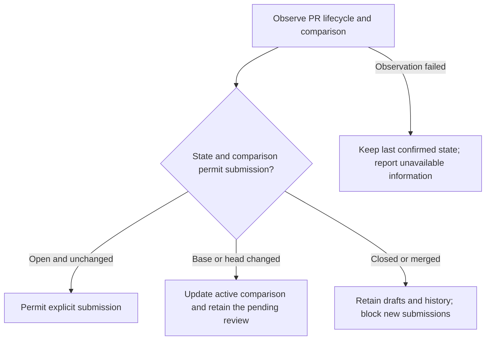

| Event | Expected handling |
| --- | --- |
| Another user comments, replies, resolves, or reopens a thread | Reconcile a complete observation with stable local IDs. Update the conversation after confirmation. |
| A remote comment disappears | Remove the cached comment after a complete observation confirms absence. Keep surviving replies and unsent local drafts. A failed fetch cannot prove deletion. |
| Add commits or force-push the PR head | Update the active comparison on refresh, reopen, or draft posting. Keep the review ID, pending review, and original anchors. Map unsent selections uniquely; retain lost selections as file-level feedback. |
| Change the PR base or target branch | Follow the new complete comparison within the active review, even when the head stays equal. Invalidate old placements and reviewed marks. Final submission verifies both current sides. |
| Merge the PR | Retain conversations, receipts, and unsent drafts. Block new pending-review creation and new review submissions. |
| Close the PR without merging | Retain drafts and history. Block new review submission while closed. |
| Reopen the PR | Refresh lifecycle and comparison data. Require an explicit review of current content before permitting submission. |
| Edit or delete an existing remote comment after closure | Apply the provider's permissions and current object state. Do not infer permission from the PR being open or closed. |
| Submit or discard the pending review outside LGTM | Reconcile its actual state and receipts. Do not silently create a replacement or duplicate comments. |
| Lose credentials, permissions, or network access | Retain the local draft and last successful observation. Report failure or uncertainty without claiming remote success. |
| Merge while a submission request is in flight | Reconcile whether GitHub accepted the review. A merge alone does not prove that the review succeeded. |

A merged PR is not an LGTM review outcome. It must not become an invented approval, rejection, or confirmed submission. An active local session and its drafts remain available until the user explicitly handles them.

### Drafts, completion, and reviewed files

| Operation | Required meaning |
| --- | --- |
| Save a note or local comment | Persist locally without contacting GitHub. |
| Save a PR line or file comment | Persist locally, then synchronize into the session's private pending review. |
| Reply in a PR review | Keep a local draft, then use the supported remote thread or pending-review contract. Report actual visibility. |
| Save a general PR comment | Keep it local until explicit submission. There is no private standalone general-comment draft path in this adapter. |
| Close an editor view | Leave the session active. Do not complete, submit, or delete drafts. |
| Complete a local session | Freeze completion metadata and retain the context conversation. Open threads remain open. |
| Submit a PR review | Submit the same pending review with the selected outcome and optional final body. |
| Export | Read notes or a review without changing any lifecycle state. |
| Mark a file reviewed or seen | Track the reviewed comparison locally in the open consumer. Do not resolve comments or set GitHub Viewed state. |

Reviewed-file marks apply to working, staged, branch, PR, and explicit directory reviews, not ordinary notes. They do not persist across editor restarts and have no backend RPC. Marks bind to both compared source identities. A change to either side clears the mark, including a hidden working or index file change.

### Local comment lifecycle

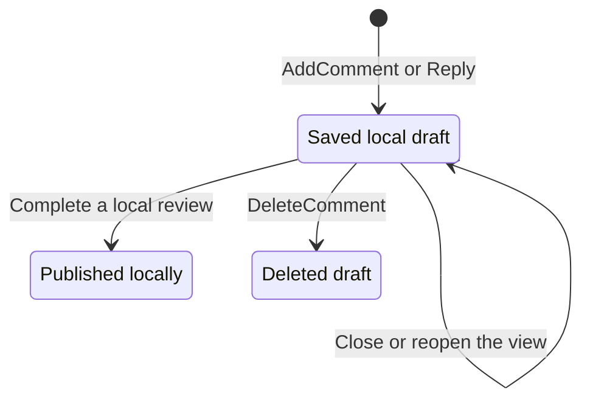

Each successful mutation saves immediately. There is no separate save RPC. Ordinary notes use an internal active session without a visible review-selection step. Explicit directory, working, staged, and branch reviews expose the session to the user.

Local publication records completion inside LGTM. It does not post anything to GitHub. Completion keeps open threads and their replies rather than resolving them. A completed session stays immutable, while successor sessions can continue the shared conversation under the mutation contracts.

Only owned unposted local drafts can be edited or deleted through the current local mutation path. Delete replies before deleting their root. Committing or changing files does not delete a saved comment.

### GitHub comment lifecycle

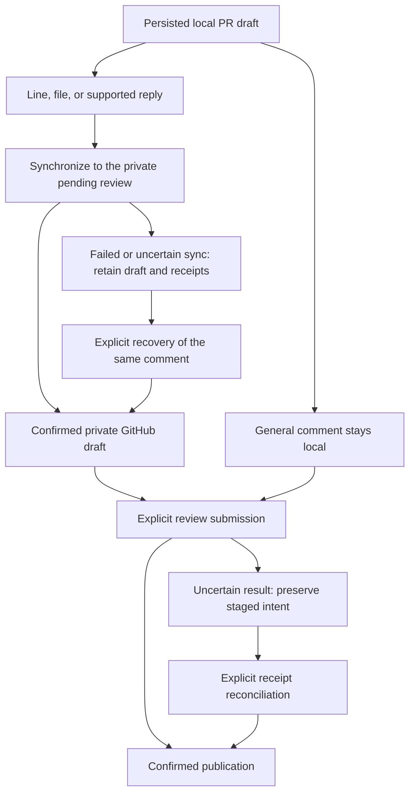

Saving an eligible anchored comment synchronizes it to a private pending review rather than publishing the review. General PR comments stay local until the explicit submission path sends them. Final submission uses the same pending review, selected outcome, and optional final comment.

A failed remote save retains the local comment. Uncertain results retain operation identity and require evidence before recovery. The diagram shows confirmed recovery paths, not a guarantee that every uncertain operation can be completed automatically. Refresh must not upload unrelated old local drafts.

### Thread resolution

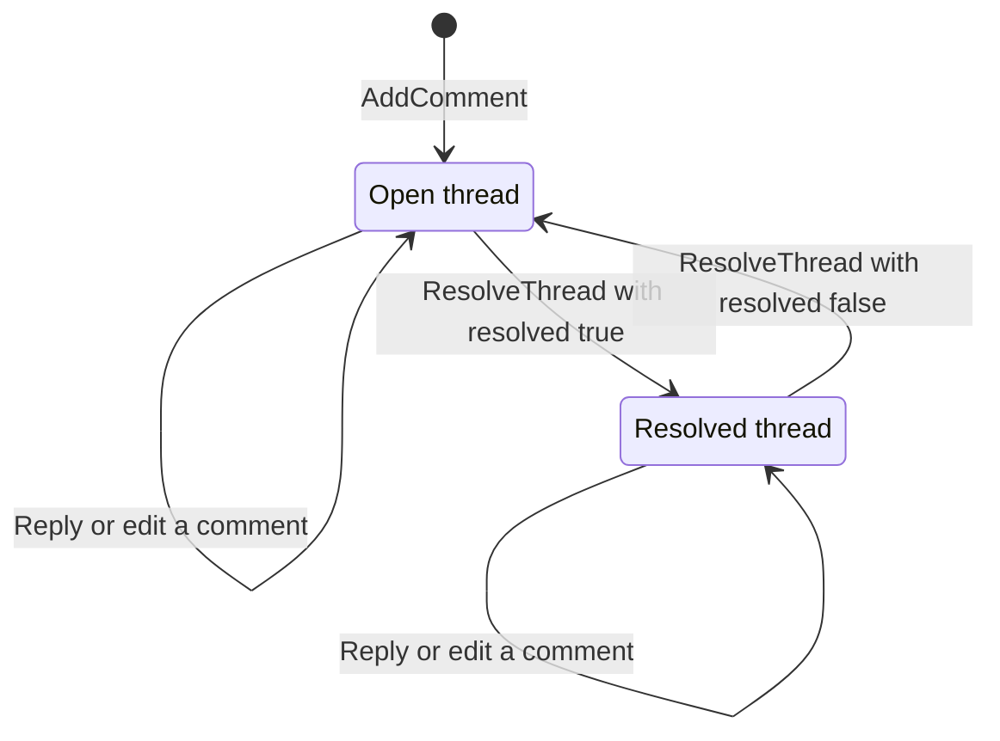

Resolution belongs to the whole thread, not an individual reply. Replies and edits do not implicitly resolve or reopen it. The API applies local rules or provider permissions before reporting the changed resolution.

Resolution and location validity are independent. An outdated thread can remain open or resolved. A commit or PR merge does not prove that its discussion is resolved.

### Anchor mapping after content changes

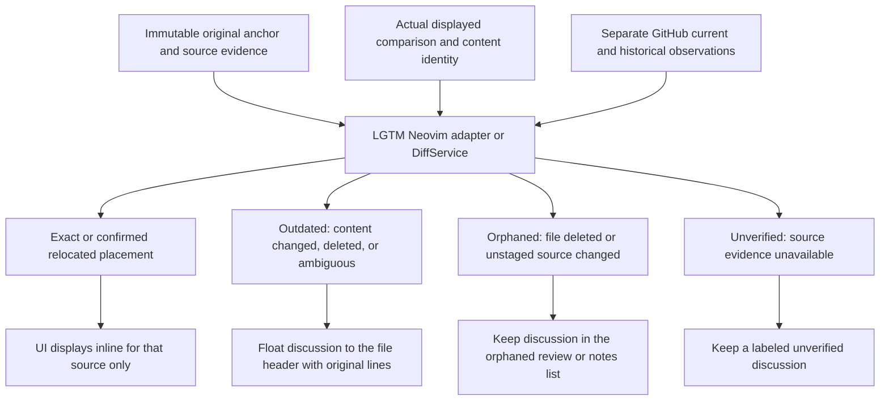

Original anchors never move. A placement can change when the displayed content changes. CodeDiff supplies content and diff hunks, while LGTM owns anchor capture, hash handling, mapping, and stale-result rejection. DiffService provides equivalent mapping for future web clients. ReviewService preserves original evidence and forge observations without owning the diff view.

Working, index, and non-Git anchors identify their actual saved bytes. A session commit cannot identify uncommitted text. For staged, committed, and note sources, confirmed line shifts and file moves update derived locations automatically. Unstaged Git anchors can become orphaned when their source changes. A lost selection floats to the file header with its original location and excerpt. Confirmed file deletion leaves an orphaned discussion. Matching restored content can reconnect it automatically. Original anchors and discussion identity remain intact throughout.

GitHub current locations and outdated state remain separate from historical coordinates. Never substitute an original line and label it as current. A location confirmed for historical content does not change its GitHub outdated state. The [backend anchor contract](backend/reviews.md#anchor-ownership) defines the intended rules, source identities, client calling pattern, and acceptance flows.

### Reviewed-file marks

Marking a file reviewed or seen is separate from commenting, resolution, and submission. The editor shows a checkmark for PR, branch, working, staged, and explicit directory reviews, but not ordinary notes. These marks last only for the open review and do not synchronize GitHub's Viewed state.

The editor invalidates a mark when either compared source changes. Hidden working and index files use metadata checks rather than body downloads. Use the [editor guide](../../apps/lgtm.nvim/README.md) for the mark and navigation keys.

### Development flow

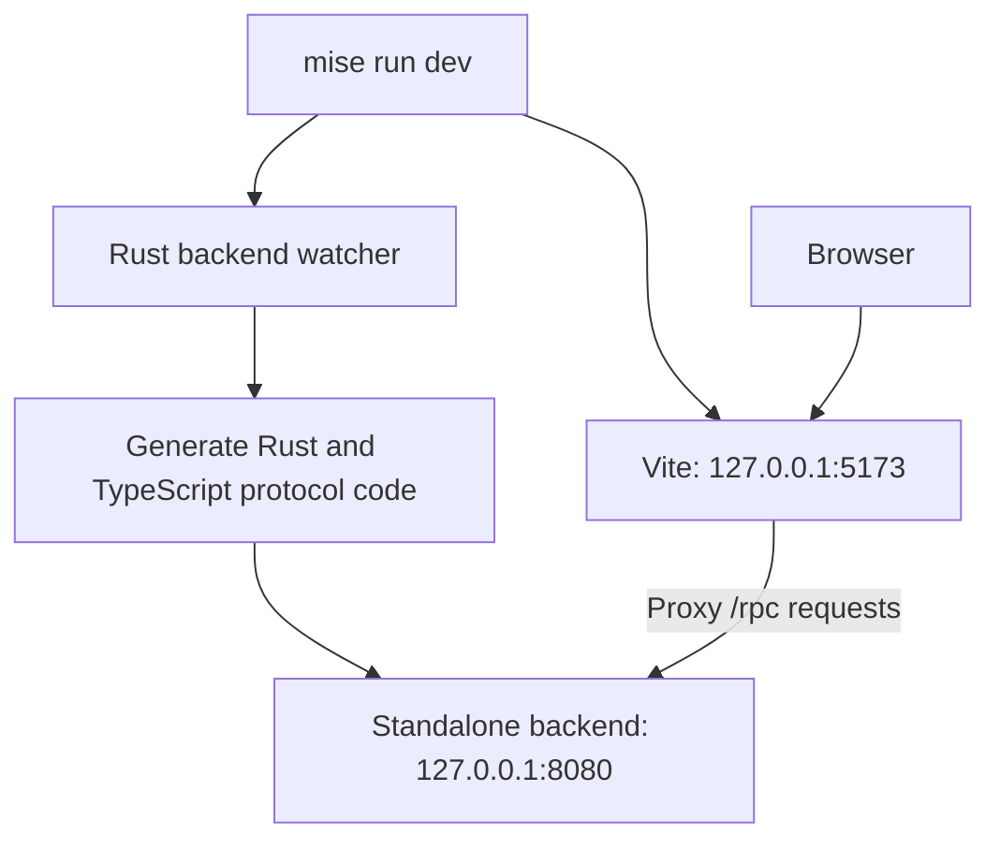

`mise run dev` starts Vite and the Rust backend watcher. Vite updates the browser when frontend files change. Backend and schema changes regenerate client code and restart the server.

### Packaging flow

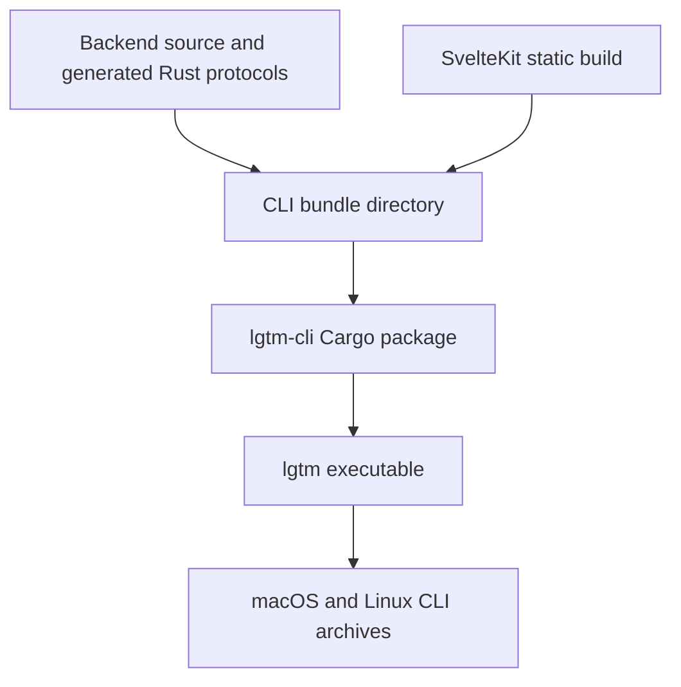

The CLI bundle contains backend source, generated Rust protocol code, and static web assets. Cargo includes the bundle in `lgtm-cli`. The installed executable runs without Bun, Buf, or a source checkout.

Only the CLI publishes. GoReleaser defines macOS and Linux archives for arm64 and x86_64. Premise publishes the Cargo package, while archive publication uses a separate task.

### Project structure

```text
lgtm/
├── apps/
│   ├── lgtm-cli/       CLI and bundled application
│   ├── lgtm-backend/   Rust services and shared Protobuf schema
│   └── lgtm-web/       SvelteKit interface and generated client
└── libs/
    └── lgtm-db/        Private Rust library
```

### Runtime and delivery

The CLI bundles backend source, generated protocol types, and static web assets into its installed executable. Review commands use RPCs rather than opening the review database directly. The daemon serves the backend and bundled browser assets through a loopback listener.

The current web UI displays the requested path and exercises the greeting service. A full web review interface remains pending. The editor and CLI review workflows operate independently of that frontend.

Mise and Premise provide project checks. Cargo and Bun manage dependencies. Service contracts and the separate backend, CLI, and editor E2E suites provide implementation evidence. The [backend acceptance flows](backend/reviews.md#acceptance-flows) define the evidence required for the intended API contract.

## References

- [Neovim user guide](../user-guide.md).
- [Backend architecture](backend/index.md).
- [Review RPC architecture](backend/reviews.md).
- [Database architecture](db/index.md).
- [CLI architecture](cli/index.md).
- [Editor setup and usage](../../apps/lgtm.nvim/README.md).
- [Development guide](../development.md).
- [Architecture decision](../../adr/0001-initial-architecture.md).
- [Product requirements](../../prd/0001-core-concepts/README.md).
- [Design prototype](../../designs/prototypes/lgtm-v0/README.md).
