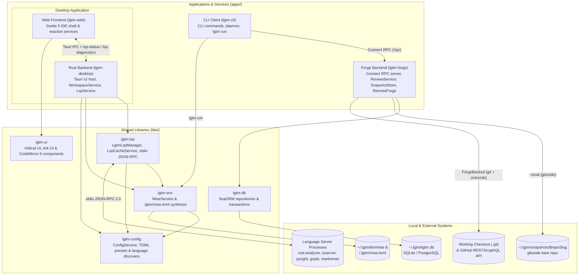
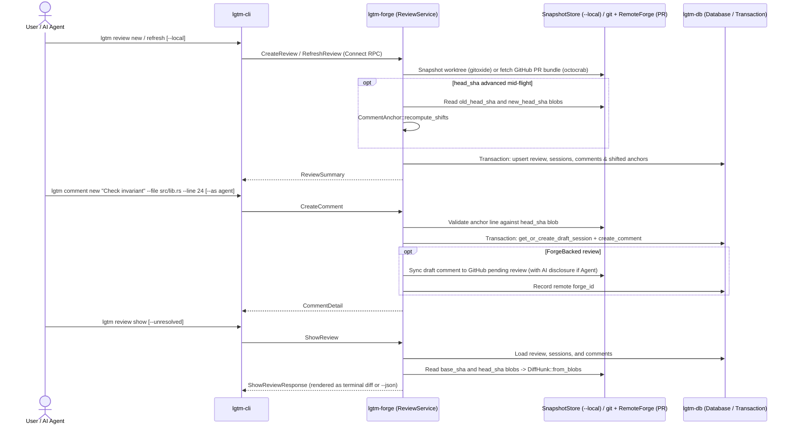
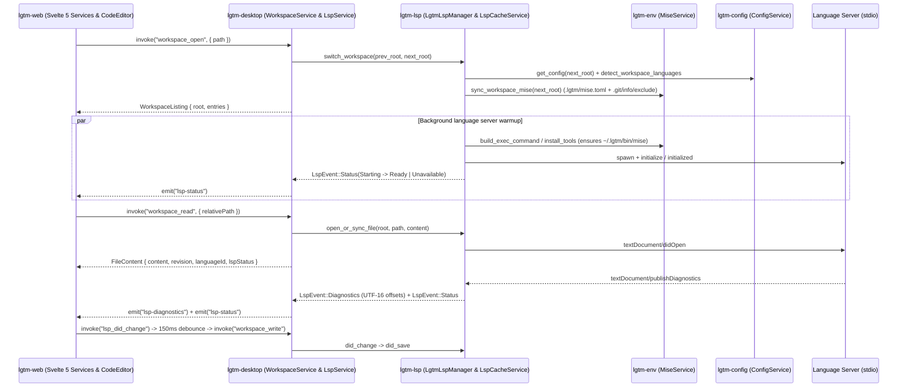
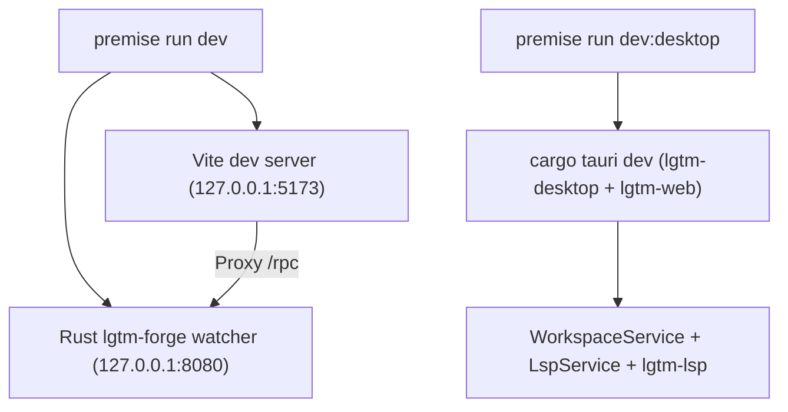
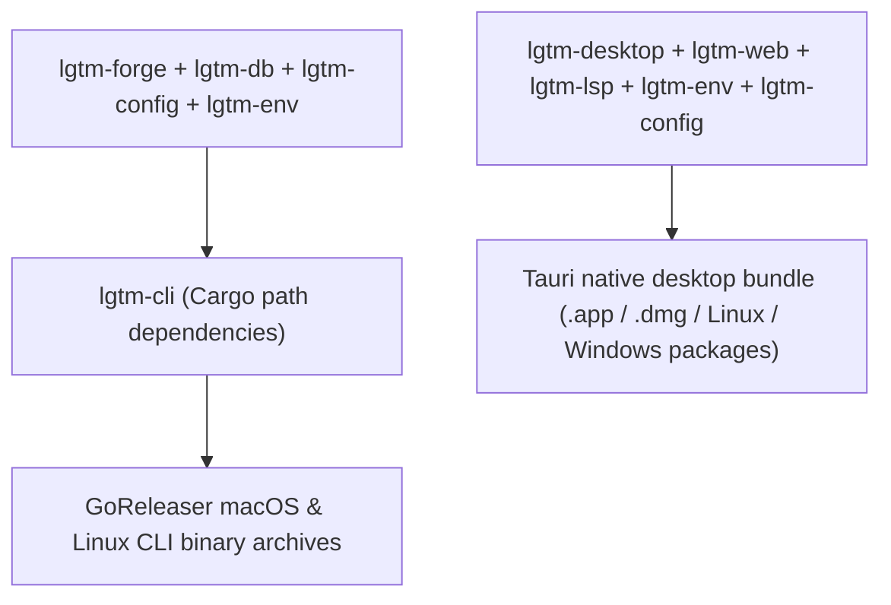

# LGTM — software architecture

## Overview

LGTM is a local-first and forge-backed code review, workspace editing, and developer environment platform for humans and AI agents. It combines a command-line interface and daemon (`lgtm-cli`), a Connect RPC review and snapshot server (`lgtm-forge`), a native Tauri v2 desktop IDE (`lgtm-desktop` + `lgtm-web`), and five focused workspace libraries (`lgtm-db`, `lgtm-config`, `lgtm-env`, `lgtm-lsp`, and `lgtm-ui`) so developers and agents can review uncommitted worktrees or remote GitHub pull requests, edit workspaces with live Language Server Protocol intelligence, and run project tasks without polluting user repositories or global toolchains.

## Requirement

### Functional

- Unified local and remote code reviews (`lgtm-cli`, `lgtm-forge`, `lgtm-db`): Stage, commit, push, create/refresh/show/close reviews, and draft/reply/resolve/delete comments across both non-destructive local shadow snapshots (`--local`) and remote GitHub pull requests (`ForgeBacked`).
- First-class human and AI agent attribution (`lgtm-forge`, `lgtm-db`): Track `Human` (email + optional forge login) and `Agent` (`--as <agent>`, provider + model) identities, support concurrent overlapping draft sessions on the same review, and attach AI disclosure footers when agents publish to remote pull requests.
- Native desktop workspace and file management (`lgtm-desktop`, `lgtm-web`, `lgtm-ui`): Open, browse, create, edit with 150ms debounced auto-save, rename, and move workspace files/folders to the OS Trash inside a reactive Svelte 5 + CodeMirror 6 + Helical UI shell.
- Zero-config language server and task orchestration (`lgtm-config`, `lgtm-env`, `lgtm-lsp`): Merge `~/.lgtm/config.toml` and `<workspace>/.lgtm/config.toml` over built-in language presets, automatically bootstrap `mise` into `~/.lgtm/bin/mise` when missing, synthesize `<workspace>/.lgtm/mise.toml`, execute project tasks via `lgtm run`, and pool stdio JSON-RPC 2.0 language servers for real-time diagnostics, hover tooltips, go-to-definition, and read-only diagnostics buffers.
- End-to-end binary verification (`e2e/`): Verify compiled `lgtm-forge`, `lgtm`, and `lgtm-desktop` (`--ipc-bridge` with `tauri::test::MockRuntime`) binaries across Vitest and Playwright (Chromium and WebKit) with deterministic GitHub cassette replay.

### Non-Functional

- Non-destructive repository and host isolation: Store local review snapshots under `~/.lgtm/snapshots/$repoSlug`, install managed `mise` under `~/.lgtm/bin/mise`, keep workspace metadata inside `<workspace>/.lgtm/` registered in `<git-dir>/info/exclude`, and never mutate the user's working tree index/HEAD during `--local` reviews or overwrite root `mise.toml` and `.gitignore` files.
- Strict layered boundaries: Expose database access exclusively through named repositories on `lgtm-db::Database` and `Transaction`, keep pure domain validation and diff/anchor math in models, and isolate subprocess/network/filesystem orchestration inside services.
- Offline capability and remote resilience: Execute all local review, workspace editing, and cached toolchain workflows offline, and persist remote pull request draft sessions and comments locally in `lgtm-db` before syncing to GitHub so work is never lost on network failures.

## Design

### Usage

```sh
# 1. Start the background RPC daemon and run local or remote PR review workflows
lgtm up
lgtm add src/ --local
lgtm commit --local -m "Snapshot worktree"
lgtm review new --local
lgtm comment new "Extract helper" --file src/lib.rs --line 24 --local --as claude-sonnet-4-5
lgtm review show --local --group-by file --unresolved
lgtm review close --local --with approve --body "Ready"

# 2. List and execute workspace tasks synthesized in <workspace>/.lgtm/mise.toml
lgtm run --list
lgtm run check

# 3. Launch the native Tauri desktop IDE at a workspace directory
lgtm open .
premise run dev:desktop
```

### Components and Responsibilities



- [`lgtm-cli`](cli/index.md) (`apps/lgtm-cli`): Parses CLI commands, manages the background `lgtm-forge` RPC daemon (`up`, `down`, `status`, `serve`), launches the `lgtm-desktop` IDE (`open [<path>]`), proxies review/VCS commands (`add`, `commit`, `push`, `review`, `comment`) to `lgtm-forge` over Connect RPC, and delegates `lgtm run` to `lgtm-env`.
- [`lgtm-forge`](forge/index.md) (`apps/lgtm-forge`): Serves `lgtm.forge.v1.ReviewService` over Connect RPC, orchestrating `ReviewService` across `lgtm-db`, `SnapshotStore` (`extensions::gitoxide` for `--local` reviews), native `git` CLI checkout commands, and `RemoteForge` (`GitHubForge` via `extensions::octocrab`).
- [Desktop Application](desktop/index.md) (`apps/lgtm-web` + `apps/lgtm-desktop`):
  - **Web Frontend (`lgtm-web`)**: Reactive Svelte 5 IDE shell (`Shell.svelte`, `WorkspaceExplorer.svelte`, `ContentPane.svelte`, `LspStatusMenu.svelte`) and `$state` services (`WorkspaceService`, `LspService`) communicating with the Rust host via `TauriWorkspaceClient`.
  - **Rust Backend (`lgtm-desktop`)**: Native Tauri v2 host owning `WorkspaceService` (sandboxed filesystem CRUD) and desktop `LspService` (bridging `lgtm-lsp` events to `lsp-status` and `lsp-diagnostics` Tauri events and coordinating the quit handshake).
- `lgtm-ui` (`libs/lgtm-ui`): Provides reusable, app-agnostic Svelte 5 + `@ark-ui/svelte` + CodeMirror 6 components (`CodeEditor`, `TreeView`, `TabBar`, `MenuBar`, `ContextMenu`, `MarkdownPreview`, `Sidebar`) styled with semantic Tailwind tokens and `cva` variants.
- [`lgtm-db`](db/index.md) (`libs/lgtm-db`): Encapsulates SeaORM migrations, private entity tables (`identities`, `reviews`, `sessions`, `comments`), and typed repositories (`IdentitiesRepository`, `ReviewsRepository`, `SessionsRepository`, `CommentsRepository`) over SQLite or PostgreSQL.
- [`lgtm-config`](config/index.md) (`libs/lgtm-config`): Merges built-in language presets with `~/.lgtm/config.toml` and `<workspace>/.lgtm/config.toml`, detects workspace languages and ancestor project roots, and initializes `<workspace>/.lgtm/` and `<git-dir>/info/exclude`.
- [`lgtm-env`](env/index.md) (`libs/lgtm-env`): Detects or installs `mise` into `<lgtm_home>/bin/mise`, synthesizes `<workspace>/.lgtm/mise.toml` (`GeneratedMiseFile`), and executes isolated `mise run`, `mise install`, and `mise exec` commands (`MiseService`).
- [`lgtm-lsp`](lsp/index.md) (`libs/lgtm-lsp`): Pools per-`(workspace_root, language_id, project_root)` stdio JSON-RPC 2.0 language server sessions (`LgtmLspManager`, `LspClientHandle`), caches open UTF-8 documents and diagnostics (`LspCacheService`), and translates CodeMirror UTF-16 offsets to and from LSP `(line, character)` coordinates.

### Data and Control Flow

#### 1. CLI and Forge Review Lifecycle (`lgtm-cli` -> `lgtm-forge` -> `lgtm-db`)



#### 2. Desktop Workspace, Environment, and LSP Lifecycle (`lgtm-web` <-> `lgtm-desktop` -> `lgtm-lsp` -> `lgtm-env` -> `lgtm-config`)



## Implementation

### Project structure

```text
lgtm/
├── apps/
│   ├── lgtm-cli/       CLI binary, daemon manager, Connect RPC client, and `lgtm run` proxy
│   ├── lgtm-desktop/   Tauri v2 desktop host, WorkspaceService, LspService, and E2E stdio IPC bridge
│   ├── lgtm-forge/     Connect RPC review server, SnapshotStore, RemoteForge, and Protobuf schemas
│   └── lgtm-web/       Svelte 5 desktop/web IDE shell, reactive services, and Tauri/RPC clients
├── libs/
│   ├── lgtm-config/    Global/workspace `.lgtm/config.toml` resolution and language discovery SDK
│   ├── lgtm-db/        SeaORM SQLite/PostgreSQL persistence layer and named repositories
│   ├── lgtm-env/       Managed `mise` binary lifecycle and `<workspace>/.lgtm/mise.toml` synthesis SDK
│   ├── lgtm-lsp/       Stdio JSON-RPC 2.0 language server pool, document cache, and UTF-16 offset math
│   └── lgtm-ui/        Portable Helical UI + Ark UI + CodeMirror 6 Svelte 5 component library
└── e2e/
    ├── common/         Shared test harness and offline GitHub REST/GraphQL cassette replay
    ├── forge/          Vitest Connect RPC and ReviewService E2E suite
    ├── cli/            Vitest CLI local/PR review, daemon, and `lgtm run` E2E suite
    └── desktop/        Playwright Chromium and WebKit desktop workspace and LSP E2E suite
```

### Workspace and runtime storage

| Path | Owner | Purpose |
| --- | --- | --- |
| `~/.lgtm/config.toml` | `lgtm-config` | Optional user-wide `[lsp]`, `[mise]`, and `[languages.<id>]` overrides (`$LGTM_HOME/config.toml`). |
| `~/.lgtm/bin/mise` | `lgtm-env` | Managed `mise` binary installed automatically when no system `mise` is available on `PATH`. |
| `~/.lgtm/lgtm.db` | `lgtm-db` / `lgtm-forge` | Default local SQLite database storing identities, reviews, sessions, and comments. |
| `~/.lgtm/snapshots/$repoSlug` | `lgtm-forge` (`SnapshotStore`) | Bare Git repository and per-branch shadow indices (`index.<branch>`, `refs/lgtm/snapshots/<branch>`) for `--local` reviews. |
| `~/.lgtm/workspace` | `lgtm-desktop` (`WorkspaceService`) | Default desktop workspace directory created on first launch when no folder is specified. |
| `<workspace>/.lgtm/config.toml` | `lgtm-config` | Optional workspace-specific configuration overlay. |
| `<workspace>/.lgtm/mise.toml` | `lgtm-env` (`MiseService`) | Synthesized Mise tools and tasks file (`dir = "{{cwd}}"`) scoped away from any user-owned root `mise.toml`. |
| `<workspace>/.lgtm/cache/discovery.json` | `lgtm-lsp` (`LspCacheService`) | Cached workspace language and project-root discovery snapshot. |
| `<git-dir>/info/exclude` | `lgtm-config` (`ConfigService`) | Local Git exclude file updated idempotently with `.lgtm/` so LGTM metadata remains untracked without touching `.gitignore`. |

### Development flow



`premise run dev` runs the standalone `lgtm-forge` watcher alongside the Vite development server, while `premise run dev:desktop` launches the native Tauri v2 desktop window backed by `apps/lgtm-desktop` and `apps/lgtm-web`. All formatting, linting, unit/integration testing, and E2E verification run through root Mise tasks invoked via Premise (`premise run format`, `premise run lint`, `premise run test`, `premise run e2e:smoke`).

### Packaging and delivery



All workspace Cargo crates set `publish = false` and link directly via Cargo `path` dependencies. Precompiled `lgtm` CLI binary archives (built via GoReleaser from the workspace root) and native `lgtm-desktop` installers (built via `cargo tauri build` with `apps/lgtm-web/build` embedded) are distributed via GitHub Releases. See [CI, Release, and Publishing Architecture](../ci.md).

## References

- [Forge architecture (`lgtm-forge`)](forge/index.md).
- [Review RPC contracts](forge/reviews.md).
- [Snapshot store architecture](forge/snapshot-store.md).
- [Authorship and agent identity architecture](forge/authorship.md).
- [Database library architecture (`lgtm-db`)](db/index.md).
- [CLI architecture (`lgtm-cli`)](cli/index.md).
- [Desktop application architecture (`lgtm-desktop` & `lgtm-web`)](desktop/index.md).
- [Configuration library architecture (`lgtm-config`)](config/index.md).
- [Environment library architecture (`lgtm-env`)](env/index.md).
- [LSP library architecture (`lgtm-lsp`)](lsp/index.md).
- [End-to-end testing architecture (`e2e/`)](e2e/index.md).
- [Environment variables reference](../environment.md).
- [Development guide](../development.md).
- [ADR 0001: Initial Architecture](../../adr/0001-initial-architecture/ADR.md).
- [ADR 0002: Core Concepts and CLI Design](../../adr/0002-cli-design/ADR.md).
- [Product requirements](../../prd/0001-core-concepts/README.md).
