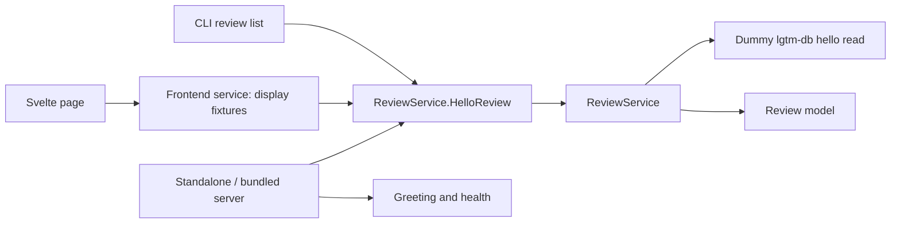

# LGTM architecture

The current application is a hello-review skeleton with generated clients and a separate backend boundary; LGTM-managed Git storage, persisted collaboration and explicit upstream publication are future work.

`lgtm-backend` owns the review model, service and RPC handlers. `lgtm-db` supplies fixed hello data without a connection or schema. The CLI and frontend use generated protocol clients; frontend services own display fixtures. RPC errors remain visible and are not replaced with fixture success.

The installed CLI serves static web assets and RPC methods in one daemon process. `up`, `down`, `status` and `ui` manage that application. `review list` demonstrates the real RPC; the other new domain commands return unimplemented errors without Git or forge mutations.

The Neovim package remains a dependency-loading shell with retained installation and test infrastructure. E2E preserves strict HTTP recording/replay and old cassettes for later use, while active journeys cover only supported skeleton behavior.

## Package details

- [Backend](backend/index.md) and [hello-review contract](backend/reviews.md).
- [Dummy DB package](db/index.md).
- [CLI hosting and distribution](cli/index.md), [server](cli/server.md), [daemon](cli/daemon.md) and [runtime store](cli/store.md).
- [Development and checks](../development.md) and [E2E](../../e2e/README.md).

## Future direction

LGTM will own reviews and their Git content before explicitly publishing selected work to an upstream forge. In that model, local means unpublished to the upstream forge; accessing an LGTM instance remotely is a separate hosting concern. This reset does not implement repositories, changes, revisions, review persistence, agent workspaces or publication mappings.
